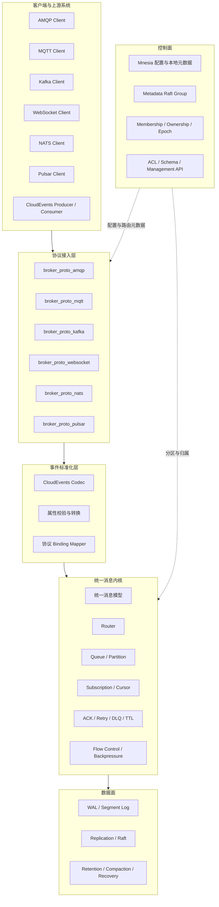

# UnifiedMQ 统一消息 Broker 架构设计
## Erlang/OTP + Raft + 多协议接入 + Pulsar + CloudEvents

- **文档版本**：v1.2
- **状态**：架构方案基线。**实现状态见 [`docs/roadmap.md`](docs/roadmap.md) 与 [`progress.md`](progress.md)**：S0–S9 已实现并验证（S9 收尾时 `rebar3 ct` **1063/1063、68 套件**；六协议真实客户端套件 + MQTT-SN / MQTT over QUIC / MQTT over WebSocket / **A2A / MCP / ACP 三协议官方 SDK** 六套真实客户端证据），S9 收口后仍未实现的方向（含三协议的 18 条明确未实现项）列在 [`docs/security.md`](docs/security.md) §12.1。**S10（WebRTC 信令面 + ICE 面，媒体面不做）进行中**：S10-0（收敛报告 + ADR-028/029）与 **S10-A（信令前端底座 `broker_proto_webrtc`，WSS 连接层，出厂 `listeners => []` 零端口）已交付**，当前全量 `rebar3 ct` **1108/1108、71 套件**；S10-B（房间成员与 `to` 转发）、S10-C（STUN/TURN）、S10-D（安全与一致性收口）未开工，见 [`docs/design/s10-execution-plan.md`](docs/design/s10-execution-plan.md)。本文 §7.3 的监督树示意、§8 的目录结构与 §12 的分阶段表是**设计建议**（S0 阶段写下的规划，模块名与分阶段粒度都不是现状），实际应用清单见 [`docs/architecture.md`](docs/architecture.md) §2.1，实际监督树见其 §3.1，实际阶段与证据见 [`docs/roadmap.md`](docs/roadmap.md) §10。
- **目标**：构建一个以 Erlang/OTP 为核心、支持多消息协议、分布式一致性、持久化消息和标准化事件的统一消息 Broker。
- **核心原则**：协议适配与消息内核解耦；控制面与数据面分离；共识层不替代消息语义；CloudEvents 是事件表达标准，不是传输协议。

---

## 1. 项目目标与范围

### 1.1 目标

构建面向物联网、工业互联网和事件驱动应用的消息中间件，具备：

1. 多协议接入：AMQP、MQTT、Kafka 协议、WebSocket、NATS、Pulsar。
2. 统一消息内核：路由、订阅、队列、ACK、重投递、死信、过期、流控和背压。
3. 分布式能力：节点成员管理、分区归属、Leader 选举、复制日志和故障恢复。
4. 控制面：用户、租户、ACL、Topic/Queue、Binding、订阅、集群和配置版本管理。**已接线的是用户/租户/ACL（`broker_security` 消费）、订阅元数据、集群节点与分区归属、配置版本与 outbox；`topic_meta` / `queue_meta` / `binding_meta` 三张表已建表并有泛型 CRUD，但还没有运行时读取方**（见 `docs/architecture.md` §2.1 的表）。
5. 事件互操作：支持 CloudEvents 1.0 核心属性、JSON 事件格式、Structured Mode、Binary Mode，以及按需实现的协议绑定。**当前实现的是统一 `ce-*` 头通道的 Binary Mode 映射**（六个协议共享，见 `docs/protocol-compatibility.md` §4.10）；各协议**官方** Binding 的逐字结论已给出，结论是「统一 `ce-*` 是本 Broker 的项目定义，逐字实现不立项」——逐协议差异见 `docs/roadmap.md` §9.1。
6. 可观测与运维：指标、日志、追踪、健康检查、管理 API 和配置审计。

### 1.2 非目标与边界

- 第一阶段不承诺所有协议的全部高级特性均与原生产品完全兼容。
- 支持 Pulsar Wire Protocol 不等于实现 Pulsar 原生完整架构，也不要求首期集成 Apache BookKeeper。
- 支持 CloudEvents 不代表所有消息都必须符合 CloudEvents；普通二进制消息和原生协议消息仍应可用。
- Raft 解决复制状态机的一致性，不自动提供业务 ACK、重试、DLQ、消息保留和消费者游标语义。
- 不在每条消息、每次 ACK 或每次游标读取时都同步写入 Mnesia 或提交 Metadata Raft Group。

### 1.3 目标协议与能力边界

| 协议/标准 | 定位 | 首期建议范围 |
|---|---|---|
| AMQP | 消息传输协议 | 基础连接、Exchange、Queue、Binding、Publish、Consume、ACK；逐步扩展兼容性 |
| MQTT | 轻量 IoT 协议 | MQTT 3.1.1 / 5.0 的连接、发布订阅、QoS、Session、Retain、Will 按阶段实现 |
| Kafka Protocol | 兼容 Kafka 客户端生态 | 选定客户端和 API 版本，优先 Produce、Fetch、Metadata、Consumer Group 基础流程 |
| WebSocket | 双向长连接承载 | 定义 Broker 自有应用层消息 API，不将 WebSocket 本身误认为消息语义标准 |
| NATS | Subject 消息模型 | Publish、Subscribe、Queue Group、Request/Reply 按阶段实现 |
| Pulsar | Pulsar 客户端协议 | 二进制协议、Producer、Consumer、Lookup、ACK、Cursor、Flow 和重投递分阶段实现 |
| CloudEvents | 事件格式与上下文标准 | JSON 编码、核心属性校验、Structured/Binary Mode；协议映射按需实现 |

---

## 2. 总体架构



### 2.1 分层职责

- **协议接入层**：连接、认证握手、帧解析、协议状态机、协议特定流控与客户端兼容性。
- **事件标准化层**：可选地解析/编码 CloudEvents，校验属性，并根据标准协议绑定在事件属性与协议元数据之间转换。
- **统一消息内核**：路由、订阅、队列、投递、ACK、重试、死信、TTL、保留和背压。
- **数据面**：追加日志、消息持久化、复制、恢复、日志段清理与保留。
- **控制面**：租户、权限、Topic/Queue、Binding、分区归属、节点成员、配置版本和 Schema 元数据。

协议 Adapter 不应直接操作底层磁盘格式；事件标准化层不应负责 ACK 或复制；Raft 不应被用来替代每条消息的业务处理流程。

---

## 3. 统一消息模型与 CloudEvents 模型

### 3.1 两种模型分离

建议分别定义 `broker_message` 与 `cloud_event`：

- `broker_message` 表示 Broker 内部的一条消息及其运行时状态。
- `cloud_event` 表示业务事件的标准化上下文和数据。
- 普通消息可以没有 `cloud_event`；CloudEvents 消息则可在 Broker 消息中携带解析后的事件视图或原始事件字节。

示意结构（仅为内部设计示例，并非规范规定的 Erlang 类型）：

```erlang
-record(broker_message, {
    message_id,
    tenant_id,
    destination,
    partition_id,
    payload,
    payload_encoding = raw,
    headers = #{},
    persistence = durable,
    created_at,
    expires_at = undefined
}).

-record(cloud_event, {
    specversion = <<"1.0">>,
    id,
    source,
    type,
    subject = undefined,
    time = undefined,
    datacontenttype = undefined,
    dataschema = undefined,
    extensions = #{},
    data = undefined,
    data_base64 = undefined
}).
```

实现时应依据选定的 CloudEvents 规范版本检查字段类型、必需属性、互斥规则和 JSON 表达方式。`data` 与 `data_base64` 的具体处理必须符合规范，而非任意混用。

### 3.2 CloudEvents 核心属性

| 属性 | 含义 | 设计要求 |
|---|---|---|
| `specversion` | CloudEvents 规范版本 | 核心必需属性 |
| `id` | 事件标识 | 核心必需属性；用于事件识别，不等同于 Broker 内部消息 ID |
| `source` | 事件来源上下文 | 核心必需属性 |
| `type` | 事件类型 | 核心必需属性；适合用于事件路由与过滤 |
| `subject` | 来源中的事件主题/对象 | 可选 |
| `time` | 事件发生时间 | 可选；与 Broker 接收时间分开保存 |
| `datacontenttype` | 事件数据内容类型 | 可选 |
| `dataschema` | 数据模式标识 | 可选 |
| 扩展属性 | 应用自定义上下文 | 保留规范允许的扩展属性，校验命名与类型 |

### 3.3 CloudEvents 编码模式

1. **Structured Mode**：事件上下文与数据一同放入消息体；JSON 事件通常使用 `application/cloudevents+json`。
2. **Binary Mode**：事件上下文映射到传输协议的消息属性、Header 或等价元数据，消息体只承载事件数据。
3. **批量模式**：可作为后续能力；需明确批次中各事件的验证、错误处理和投递语义。

建议首期支持 JSON Structured Mode 与 Binary Mode。对其他事件格式（例如 Avro、Protobuf）按实际需求扩展，不应把它们当作首期硬依赖。

### 3.4 CloudEvents 的可选策略

按租户、目的地或路由规则设置事件策略：

- `disabled`：不解析 CloudEvents，按普通消息处理。
- `pass_through`：保留原始消息，不强制校验。
- `validate_if_present`：检测到 CloudEvents 时校验，否则按普通消息处理。
- `required`：要求输入消息符合所配置版本与编码模式。
- `normalize`：解析事件并在内部提供统一事件视图；保留原始 payload 或可重建的编码信息。

转换失败时应提供明确的拒绝、隔离或死信策略，不能静默丢弃数据。

---

## 4. CloudEvents 与各协议的映射

| 协议 | Structured Mode | Binary Mode / 属性映射 | 注意事项 |
|---|---|---|---|
| AMQP | 事件放在消息体 | 事件上下文映射到 AMQP 消息属性/应用属性 | 按选定 AMQP 版本与 CloudEvents Binding 实现 |
| MQTT | 事件 JSON 放在 Payload | 在支持的 MQTT 版本中映射到相应元数据；MQTT 5 可评估 User Properties | MQTT 3.1.1 的元数据能力较有限，必须定义兼容策略 |
| Kafka | 完整事件放入 Record Value | 上下文映射到 Record Headers，事件数据放入 Value | 约定 key、headers、value 的映射与反向转换 |
| WebSocket | 事件 JSON 作为应用消息 | 定义 Broker 自有 JSON/二进制帧封装 | WebSocket 不提供统一的消息属性标准，必须写明应用层协议 |
| NATS | 结构化事件放在消息体 | 可映射到 Headers | 确认目标 NATS 版本与对应 Binding 的细节 |
| Pulsar | 完整事件放入消息体 | 将上下文映射到 Pulsar 消息属性 | 保留 Pulsar message ID、sequence、partition、subscription 等原生语义 |

**规范要求**：最终实现应以 CloudEvents 对应版本的正式规范和各协议 Binding 文档为准。上表是架构映射建议，不应被视为每种协议都已实现完整标准绑定的声明。

### 4.1 跨协议转换规则

跨协议转发时，应明确：

- 保留 `specversion`、`id`、`source`、`type` 及所有合法扩展属性。
- 保留事件数据的字节或可验证的等价表示，避免无意的 JSON 反序列化/重序列化造成数据变化。
- 分别记录 CloudEvents `time` 与 Broker 接收时间、入队时间和投递时间。
- 协议自身的消息 ID、分区、Offset、Pulsar Message ID、MQTT Packet Identifier 等不应直接覆盖 CloudEvents `id`。
- 如果目标协议无法表达某个元数据，应按策略拒绝、保存到受控扩展封装中，或在转换报告中标记损失；不要静默丢弃。
- 防止把未经信任的 CloudEvents 属性直接用于 ACL 决策。授权应使用可信的认证主体与 Broker 配置。

---

## 5. Pulsar 协议支持设计

### 5.1 协议实现范围

Pulsar 二进制协议基于 Protobuf 命令帧，客户端与 Broker 之间还涉及连接状态、请求关联、认证、心跳、Producer/Consumer 命令、流控和负载解析。仅实现 Protobuf 解码不足以满足客户端兼容性。

建议按阶段实现：

- **P1 基础连通**：TCP、帧长度处理、Protobuf 命令、认证/连接、Lookup、Producer、Consumer 的最小闭环。
- **P2 消费语义**：Subscription 类型、ACK、Flow Permit、重投递、消息 ID 与游标。
- **P3 可靠性**：WAL/Segment、恢复、批量消息、持久化与复制策略、backlog 和 retention。
- **P4 兼容性扩展**：Partitioned Topic、Schema、管理 API、事务及其他高级特性。

必须以官方 Pulsar Java Client 等真实客户端进行兼容性测试，不能只依赖自编客户端互测。

### 5.2 Subscription 与 Cursor 抽象

Pulsar 订阅模式至少需要考虑：

- `Exclusive`
- `Shared`
- `Failover`
- `Key_Shared`

建议在内核中提供统一抽象：

- `broker_subscription`：订阅类型、消费者集合、权限与订阅配置。
- `broker_cursor`：消费者组/订阅的消费位置、累计 ACK 位置、单条 ACK 状态和积压边界。
- `broker_delivery`：投递状态、消费者归属、投递次数和确认状态。
- `broker_redelivery`：重投递计划与原因。
- `broker_dispatcher`：按订阅语义、流控和顺序约束进行分发。

Pulsar 的游标与 ACK 语义不能简单套用为 Kafka Offset；不同协议的语义应保留在 Adapter 或显式的内核能力模型中。

### 5.3 存储策略

**方案 A：Erlang 原生 WAL / Segment + Raft 复制（推荐先验证）**

- 由 Erlang 实现分段追加日志、批量写入、Group Commit、恢复、保留与清理。
- 使用 Raft 或与 Raft 严格协调的复制日志层提供选定的一致性保证。
- 独立维护订阅 Cursor 与 backlog 状态。
- 优点是架构统一、减少 Java 运行时和外部存储依赖；代价是需要自行承担持久化、清理、恢复与性能工程。

**方案 B：集成 Apache BookKeeper**

- 可以借助成熟的分布式日志存储能力，但会引入 Java 服务、部署、监控和跨运行时运维复杂度。
- 需要明确 Erlang Broker 与 BookKeeper 之间的客户端、错误恢复、超时和资源隔离机制。

Raft 不等于 BookKeeper 的全部能力。不能因为消息复制使用了 Raft，就省略日志段管理、快照/恢复、保留策略、游标保留与 backlog 回收。也不要默认每个 Topic 都创建独立 Raft Group；需要通过分区数量、复制开销和吞吐测试决定分组策略。

---

## 6. Raft、Mnesia 与控制面设计

### 6.1 Mnesia 的职责

Mnesia 适合存储控制面元数据与配置，不应承担每条消息正文、每次 ACK 或高频 Cursor 更新的默认存储职责。

建议的元数据包括：

- `tenant`
- `broker_user`
- `acl_rule`
- `topic_meta`
- `queue_meta`
- `binding_meta`
- `subscription_meta`
- `cluster_node`
- `partition_meta`
- `config_version`
- `config_outbox`

配置更新采用版本号、事件通知和周期性对账。若配置提交后还需要向外部发布变更事件，应考虑 Outbox 模式，避免数据库提交与事件发送之间的双写不一致。

### 6.2 Raft 的职责

建议优先评估 RabbitMQ 团队维护的 Erlang Raft 库 `ra`：<https://github.com/rabbitmq/ra>

可以将一致性状态拆分为：

1. **Metadata Raft Group**：分区 Owner、Epoch、复制成员、分区迁移状态等需要一致性的元数据。
2. **消息复制层**：根据性能和故障模型决定是否按分区建立 Raft Group，或采用与共识日志严格集成的复制方案。
3. **本地数据面**：处理批量追加、读取、投递与流控，避免将每个业务操作都变成全局共识命令。

3 个投票成员通常需要至少 2 个成员形成多数派；失去多数派时，必须按照一致性配置停止或限制可靠写入。利用 Epoch/Fencing Token 防止旧 Owner 在分区迁移后继续写入。

### 6.3 ACK 与持久化承诺

Producer ACK 的返回时机必须与配置的可靠性等级一致，例如：

- 仅写入本地操作系统缓存；
- 本地日志已按策略刷盘；
- 已达到规定的复制/共识提交条件。

需要清晰定义这些等级及其故障保证。Raft 提交只代表复制状态机中的操作已达到相应提交条件，不代表消费者已经收到消息或业务处理已经完成。

---

## 7. Erlang/OTP 并发与监督树

### 7.1 Actor / Process 划分

适合由独立 Erlang Process 承载的工作单元包括：

- Connection / Session
- 协议状态机
- Router Worker
- Queue / Partition Worker
- Storage Worker
- Subscription / Consumer Coordinator
- Cluster Membership Worker

避免为每条消息创建一个长期存活的 Actor，也避免让单个全局进程串行处理所有消息。

### 7.2 背压与资源保护

- 为关键 mailbox 设置可观测性与容量策略。
- 采用有界批次、流控、生产者限速和消费者 Flow Permit。
- 对慢磁盘、慢消费者、热点分区、消息积压和连接爆发设置资源隔离。
- ETS 可用于本地热点索引与缓存，但不能在没有复制/恢复策略时将其视为权威持久化状态。
- 避免单一 GenServer 成为所有路由和存储请求的全局瓶颈。

### 7.3 监督树示意

```text
broker_sup
├── broker_config_sup
├── broker_cluster_sup
│   ├── membership_worker
│   ├── metadata_raft_sup
│   └── partition_ownership_sup
├── broker_listener_sup
│   ├── amqp_listener_sup
│   ├── mqtt_listener_sup
│   ├── kafka_listener_sup
│   ├── websocket_listener_sup
│   ├── nats_listener_sup
│   └── pulsar_listener_sup
├── broker_core_sup
│   ├── router_sup
│   ├── queue_partition_sup
│   ├── subscription_sup
│   └── dispatcher_sup
├── broker_storage_sup
│   ├── wal_sup
│   ├── segment_manager_sup
│   └── replication_sup
└── broker_observability_sup
```

实际监督策略应根据子进程的状态是否可恢复、是否持有连接、是否持有分区所有权来决定，不应所有子进程统一使用同一种重启策略。

---

## 8. 建议的 Monorepo 目录结构

```text
unified-broker/
├── rebar.config
├── apps/
│   ├── broker_core/
│   ├── broker_protocol/
│   ├── broker_proto_amqp/
│   ├── broker_proto_mqtt/
│   ├── broker_proto_kafka/
│   ├── broker_proto_websocket/
│   ├── broker_proto_nats/
│   ├── broker_proto_pulsar/
│   ├── broker_event/
│   ├── broker_router/
│   ├── broker_queue/
│   ├── broker_subscription/
│   ├── broker_storage/
│   ├── broker_cluster/
│   ├── broker_consensus/
│   ├── broker_config/
│   ├── broker_security/
│   ├── broker_management/
│   └── broker_observability/
├── config/
├── docs/
│   ├── architecture.md
│   ├── protocol-compatibility.md
│   ├── cloudevents-mapping.md
│   ├── storage-and-recovery.md
│   └── adr/
├── test/
│   ├── integration/
│   ├── protocol-compatibility/
│   ├── chaos/
│   └── performance/
└── tools/
```

应用边界可按实际依赖进一步合并或拆分。重点是避免协议模块直接依赖彼此的内部实现，并通过行为接口、公共记录或稳定消息结构连接到统一内核。

---

## 9. 消息生命周期

### 9.1 发布

1. Adapter 接收并解析协议帧。
2. 完成连接认证、权限检查和协议级参数验证。
3. 根据目的地策略决定是否解析 CloudEvents。
4. 若启用校验，校验事件属性、编码模式和数据格式。
5. 转换为统一 `broker_message`，保留必要的原始字节与协议元数据。
6. Router 解析目标队列、Topic、分区或订阅关系。
7. Storage 根据可靠性配置写入日志并执行复制/提交。
8. 在满足配置的 ACK 条件后向 Producer 返回确认。

### 9.2 消费

1. Subscription/Dispatcher 根据订阅类型和流控选择消息。
2. Adapter 将统一消息映射为目标协议格式；若目标订阅要求 CloudEvents，则按绑定输出 Structured 或 Binary Mode。
3. 消费者确认后，内核更新相应投递状态或游标。
4. 未确认、超时或消费者断连时，根据协议与策略重投递。
5. 达到重试上限或满足死信规则时进入 DLQ/隔离流程。
6. 根据 retention、消费游标和复制状态清理日志段。

### 9.3 幂等性边界

CloudEvents `source + id` 可作为业务事件去重的候选键，但 Broker 不应默认对所有消息进行永久去重。需要按租户/目的地配置去重窗口、持久化策略和冲突行为；协议级生产者序号、Broker Message ID 与业务事件 ID 应分别建模。

---

## 10. 安全、治理与可观测性

### 10.1 安全

- 租户隔离、认证、ACL、TLS 和密钥轮换。
- CloudEvents 属性不得绕过 Broker ACL；事件 `source` 是事件上下文，不是已认证身份的证明。
- 限制消息体大小、事件属性数量、扩展属性长度和嵌套 JSON 深度。
- 防范高基数属性导致的指标爆炸；不要默认将任意 `source`、`subject` 或 `id` 作为 Prometheus 标签。
- 定义非法事件、未知扩展属性、Schema 不匹配和编码失败的错误策略。

### 10.2 可观测性

建议提供：

- 连接数、认证失败、协议错误和帧解析失败。
- 发布/消费吞吐、端到端延迟、ACK 延迟和重投递次数。
- 队列深度、订阅积压、Cursor 延迟、DLQ 规模。
- WAL 写入/刷盘延迟、日志段大小、恢复时间、复制延迟与 Raft 状态。
- CloudEvents 校验成功/失败计数、格式转换失败、未知版本与属性映射损失。
- 按需在可信上下文中传播 trace context（**已实现**）：`broker_event_trace` 按 W3C 校验并规范化 `traceparent`/`tracestate`，合法值随消息存 WAL、投递时回填；`broker_event.trace_context` 默认 `off`（剥离客户端提供的 trace 头），可设 `on` 或 `{trusted_tenants, [...]}`，且 trace 属性不参与身份/租户/ACL 判定（`docs/security.md` §5.1）。OTel 等导出层仍未实现（`docs/architecture.md` §9）。

---

## 11. 测试与验收标准

### 11.1 协议兼容性

- 使用真实第三方客户端做集成测试。
- Pulsar 优先覆盖官方 Java Client；其他协议也要明确客户端与版本矩阵。
- 验证连接中多个命令交错、断连恢复、认证失败、超时、流控和异常帧处理。
- 为每个协议建立能力矩阵，区分“已支持”“部分支持”“计划支持”。

**当前实现状态**（截至 2026-11-11，详见 [`docs/protocol-compatibility.md`](docs/protocol-compatibility.md) §2 能力矩阵与 §4 逐协议证据）：

| 协议 | 传输 | 默认端口 | 真实客户端证据 |
|---|---|---|---|
| MQTT 3.1.1 / 5.0 | TCP（`tls.enabled` 打开时同一端口即 TLS） | 1883 | paho-mqtt 2.x + mosquitto 2.1.2，10/10 |
| MQTT over WebSocket | TCP（同上，即 wss） | 8083 | paho-mqtt 2.1.0（`transport="websockets"`），8/8 |
| MQTT-SN 1.2 | **UDP**（无 DTLS） | 1884 | `mqtt-sn-tools` 0.0.7，10/10 |
| MQTT over QUIC | **UDP**，强制 TLS 1.3 | 14567（默认关闭） | EMQX `emqtt` 1.16.1，8/8 |
| WebSocket（Broker 自有 API） | TCP（同上） | 8080 | `websocket-client` 1.7.0，10/10 |
| NATS / AMQP / Kafka / Pulsar | TCP（同上） | 4223 / 5673 / 9093 / 6650 | 官方客户端各 8~13 例 |

端口不随 TLS 变化：`broker_security.tls.enabled` 是**整个 listener 的开关**（`broker_security_tls:transport/0` 决定走 `ranch_tcp` 还是 `ranch_ssl`），打开后原端口直接说 TLS，没有「明文 1883 + TLS 8883」这样的双端口。MQTT over QUIC 只在 `rebar3 as quic` 构建里带 NIF，默认 release 不含该端口；启用前必须先配证书（`docs/operations.md` §1.2）。

### 11.2 CloudEvents 一致性

- 核心必需属性缺失、错误类型和无效格式应得到可预测的结果。
- Structured 与 Binary Mode 的编码/解码测试。
- 扩展属性保留、未知扩展属性、时间格式和数据内容类型测试。
- 各协议 Binding 的正反向映射测试。
- 跨协议转换的往返测试，明确允许的非无损字段。
- 事件与 Broker 消息 ID 的映射、重复事件和重投递行为测试。

### 11.3 分布式可靠性

- 节点崩溃、网络分区、失去多数派、Leader 切换和分区迁移。
- 旧 Owner 的 Fencing 验证。
- WAL 部分写入、刷盘失败、磁盘满、恢复中断和日志段清理。
- Producer ACK 与实际持久化/复制等级一致性。
- 慢消费者、热点分区、积压暴涨和背压恢复。

### 11.4 性能测试

分阶段测量：

- 单机内存消息与持久化消息吞吐。
- 单连接与多连接的吞吐和延迟分布。
- 消息大小、批量大小、分区数量、订阅数量的影响。
- CloudEvents 校验开关、Structured/Binary 编码带来的 CPU 与内存开销。
- Raft 复制、刷盘、故障切换和恢复对尾延迟的影响。

不要在未完成基准测试前给出未经验证的吞吐承诺。

---

## 12. 分阶段路线图

> 本节的 Phase 0–6 是 S0 阶段的设计粒度划分，与仓库实际的 S0–S8 阶段不是一一对应关系（例如 Phase 5「协议扩展」在本仓库拆成 S1–S8，Phase 6「生产化」的安全与观测部分落在 S6/S7）。实际阶段、完成状态与用例证据见 [`docs/roadmap.md`](docs/roadmap.md) §10。

### Phase 0：架构验证

- 建立统一消息结构、协议行为接口和错误模型。
- 评估 `ra` 的 API、持久化、快照、成员变更和故障恢复能力。
- 定义可靠性等级、分区模型和 ACK 契约。
- 用小规模 PoC 验证 WAL + Raft 的写入路径。

### Phase 1：单机消息内核

- 完成最小发布/订阅、路由、队列、ACK、重投递、TTL 和 DLQ。
- 建立监督树、指标、日志、配置加载和集成测试。
- 实现可插拔存储行为接口。

### Phase 2：CloudEvents 基础能力

- 实现 CloudEvents JSON 编码/解码与核心属性校验。
- 支持 Structured Mode 和 Binary Mode 的内部模型。
- 实现 `broker_event` 与 `broker_message` 的分离。
- 为首批目标协议编写 Binding Mapper 和转换测试。
- 提供按租户/目的地启用、校验或透传的策略。

### Phase 3：控制面与 Metadata Raft

- 使用 Mnesia 管理配置和元数据。
- 引入配置版本、Outbox/通知与周期性对账。
- 建立 Metadata Raft Group，管理分区 Owner、Epoch 和成员状态。

### Phase 4：持久化与复制

- 完成 WAL/Segment、Group Commit、恢复、保留与清理。
- 验证副本复制与 Producer ACK 的可靠性契约。
- 增加故障注入和性能基线。

### Phase 5：协议扩展

- 逐个实现 AMQP、MQTT、Kafka、WebSocket、NATS 和 Pulsar。
- 按客户端兼容性矩阵推进高级功能。
- 将 CloudEvents Binding 作为各协议适配器的独立测试套件。

### Phase 6：生产化

- 安全审计、权限模型、TLS、限流和租户隔离。
- 管理 API、监控告警、备份恢复、滚动升级与数据迁移。
- 完成容量规划、压测报告、故障演练和运维手册。

---

## 13. 关键架构决策（ADR 摘要）

### ADR-001：协议 Adapter 与消息内核分离

每种协议独立处理协议握手、状态机和语义映射，不直接依赖其他 Adapter 的内部代码。

### ADR-002：Mnesia 只承担控制面元数据

消息正文与高频投递状态进入数据面存储，不将 Mnesia 当作高吞吐消息日志。

### ADR-003：采用现成 Raft 实现进行评估

优先评估 `rabbitmq/ra`，先通过 PoC 验证再决定生产采用方式，不自行从零实现 Raft。

### ADR-004：CloudEvents 是可选事件标准化层

普通消息继续可用；CloudEvents 的校验、透传和规范化可按租户或目的地配置。

### ADR-005：事件 ID 与 Broker Message ID 分离

CloudEvents `source + id` 用于事件身份；Broker Message ID、Offset、Pulsar Message ID 和投递状态服务于 Broker 生命周期。

### ADR-006：Pulsar 协议兼容与原生存储解耦

先验证 Pulsar Wire Protocol 和客户端语义；是否集成 BookKeeper 是独立的存储决策。

### ADR-007：可靠性承诺必须显式化

定义本地刷盘、复制提交、ACK 返回和消费者确认之间的边界，不使用含糊的“可靠投递”表述。

---

## 14. 主要风险与缓解措施

| 风险 | 影响 | 缓解措施 |
|---|---|---|
| 一次性实现过多协议 | 研发周期和兼容性风险高 | 先完成统一内核与协议能力矩阵，按客户端优先级分阶段交付 |
| 把 CloudEvents 当作所有消息的强制格式 | 破坏原生协议兼容性 | 默认可选，按租户/目的地设置校验策略 |
| 各协议语义被过度统一 | ACK、顺序、游标和会话语义丢失 | 内核提供通用能力，Adapter 保留协议特定状态 |
| Raft Group 数量过多 | 资源与运维开销增长 | 按分区批量规划，先压测并明确故障域 |
| WAL 与复制状态不一致 | 数据丢失或重复 | 定义写入顺序、提交点、恢复协议与故障注入测试 |
| CloudEvents 转换丢失元数据 | 跨协议事件语义变化 | 定义 Binding、转换报告和不可表达字段策略 |
| Pulsar 高级特性范围失控 | 兼容性目标无法验收 | 明确客户端/版本/功能矩阵，先完成基础闭环 |

---

## 15. 参考资料

以下为设计和实现阶段应持续核对的上游资料；具体实现以所选版本的官方文档为准。

- CloudEvents 规范仓库：<https://github.com/cloudevents/spec>
- CloudEvents 官方文档：<https://cloudevents.io/>
- Apache Pulsar 二进制协议：<https://pulsar.apache.org/docs/4.2.x/developing-binary-protocol/>
- Apache Pulsar 架构概览：<https://pulsar.apache.org/docs/next/concepts-architecture-overview/>
- RabbitMQ `ra` Erlang Raft 库：<https://github.com/rabbitmq/ra>
- Erlang/OTP 文档：<https://www.erlang.org/doc/>

---

## 附录 A：建议优先实现的最小垂直切片

在全面铺开所有协议前，先选定一个协议和一条持久化路径完成端到端闭环：

1. Producer 发布消息。
2. 可选 CloudEvents 校验与规范化。
3. 路由到一个持久化分区。
4. WAL 追加并满足所配置的 ACK 条件。
5. Consumer 拉取消息并 ACK。
6. 节点崩溃后恢复日志、订阅位置与未确认消息。
7. 用测试证明重复、丢失、重投递和跨协议转换的行为符合设计契约。

该闭环通过后，再扩展协议和分布式分区规模，可以显著降低多协议、多存储与一致性问题同时出现的排障成本。
