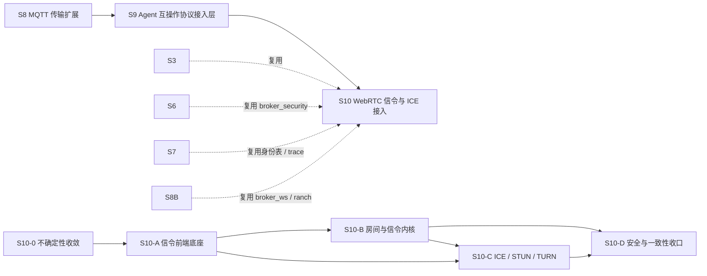

# S10 方案设计 — WebRTC 信令与 ICE 接入（下一阶段需求）

- **文档版本**：v0.1（立项规划稿，2026-11-11）
- **对应 Roadmap**：[`docs/roadmap.md`](../roadmap.md) §12（S10 章，含阶段总览与 Gate S10）
- **前置**：S0–S8 已实现并验证（`rebar3 ct` 823/823、52 套件）；S9 为立项规划、代码未开工
- **调研来源**：[`lambdaclass/webrtc-server`](https://github.com/lambdaclass/webrtc-server)（`master`，Erlang/OTP WebRTC 信令 + ICE 服务器）
- **状态**：**立项规划，未开工，无「已实测」数字**。本文是「协议整理（§2）→ 需求提炼（§3）→ 开发计划（§4）」三段式立项输入；需求优先级与子阶段归属是**建议**，Gate 通过后以 ADR 冻结。
- **本文三部分的读法**：§2 是对 `lambdaclass/webrtc-server` 仓库 README 与源码的逐字整理（事实），§3 是把这些事实映射成 UnifiedMQ 接入层需求的候选清单（推导），§4 是把需求排成阶段与 Gate（计划）。三者之间的推导链要可回溯，**不要把 §3 的候选需求读成 §2 的仓库事实**。

---

## 0. 来源与证据口径

| 来源 | 版本 / 位置 | 本文取用范围 |
|---|---|---|
| [lambdaclass/webrtc-server](https://github.com/lambdaclass/webrtc-server) README | `master` | Usage / Configuration / Signaling API reference / Server API / Troubleshooting |
| `src/webrtc_ws_handler.erl` | `master` | 认证、`peer_id`、房间加入/离开、信令转发、`ping`/`pong`、错误信息 |
| `src/webrtc_server.erl` | `master` | `peers/1`、`publish/2,3`、`send/2,3` |
| `src/webrtc_server_app.erl` | `master` | `syn:init()`、`stun_listener:add_listener/3`、TURN `auth_fun`、`turn_ip` 解析 |
| `src/webrtc_server_sup.erl` / `src/webrtc_utils.erl` / `src/webrtc_server.app.src` | `master` | 监督树、`text_event/1,2` 的 JSON 形状、应用名 |
| `rebar.config` / `conf/test.config` | `master` | 依赖版本、配置键 |
| `examples/simple/src/example_app.erl` | `master` | Cowboy TLS listener 与 `/websocket/:room` 路由 |
| `examples/simple/priv/js/main.js` | `master` | 浏览器端完整握手时序、`iceServers`、事件名 |

**证据口径（重要，先声明）**：

1. §2 只写上述文件中**逐字出现**的内容；`main.js` 里的 `offer` / `answer` / `candidate` 是**浏览器客户端之间的应用层事件名**，服务器对其不透明（§2.3），不是 `webrtc-server` 定义的协议报文。
2. 仓库 README 与源码存在若干不一致（回调参数形状、转发报文是否保留 `to`、`ws_auth_delay` 未记载），§2.8 逐条列出，**以源码为准**，并标明 README 的表述。
3. 仓库没有发布版本号与正式规范文档，本文以 `master` 分支源码为唯一权威；**不把仓库的实现选择写成 WebRTC 标准条文**（标准层引用 RFC 5389 / 5766 / 7350 / 5245 / 5764 / 8826 / 8827 时另行标注）。
4. 本文不含任何性能、兼容性、吞吐数字；所有这类数字按项目惯例（README §11.4 / roadmap §0 第 4 条）必须来自 S10 起落盘的实测报告。
5. 本文**不新增 app、端口、代码路径**；README / `progress.md` / `architecture.md` 的「S0–S8 已实现」状态行与 `docs/security.md` §12 清单本阶段仍不改动，待 S10-A 有首个代码交付时统一同步，避免把计划读成现状。

---

## 1. 定位、分层与对位

### 1.1 「WebRTC 通信协议」的准确分层

WebRTC **不是一个消息协议**，与 MQTT / AMQP / Kafka 不同层。先澄清，否则需求会串层：

| 面 | 解决的问题 | `lambdaclass/webrtc-server` 是否实现 | 媒体/数据是否经过服务器 |
|---|---|---|---|
| **信令面（Signaling）** | 在对端建立 P2P 连接前交换 SDP offer/answer 与 ICE candidate；WebRTC 标准**不规定**信令协议 | ✅ 实现：Cowboy WebSocket + 房间 + JSON 事件转发 | 否（只转信令 JSON） |
| **ICE / NAT 穿越面** | 收集候选地址、连通性检查；对称 NAT 下经 TURN 中继 | ✅ 实现：STUN + TURN（`stun` 库，UDP 3478） | 仅 TURN 中继时媒体流经服务器 |
| **媒体面（Media / DataChannel）** | 音视频 RTP/RTCP（DTLS-SRTP）、SCTP DataChannel、编解码 | ❌ **不实现**：浏览器之间 P2P（或经 TURN 中继） | 否（除 TURN 中继） |
| **消息语义面** | pub/sub、队列、ACK、持久化、重投、DLQ | ❌ 不实现：信令是瞬时转发，落盘即错 | — |

**结论**：作为 UnifiedMQ 的下一阶段，立项对象是「**为实时媒体会话提供可信的信令中继与 ICE 辅助服务**」，不是「把 WebRTC 做成第七种消息协议」。仓库正好覆盖了前两面，媒体面按 README §1.2 非目标**明确不做**（无 SFU/MCU、无编解码、无录制、无转码）。

### 1.2 与 UnifiedMQ 现有抽象的对位（为什么是「新增协议接入层」）

按 roadmap §0「协议层横向解耦」与 [ADR-001](../adr/001-protocol-adapter-separation.md)，S10 与 S5/S8/S9 同构：**一个 `broker_proto_*` adapter，只依赖内核门面，不写第二套消息内核**。

| WebRTC 概念 | 落点（既有能力 / 待补） | 依据 |
|---|---|---|
| WebSocket 信令帧（RFC 6455） | `broker_ws`（S8-A 抽出的纯 RFC 6455 库）+ `broker_proto_ws` 的 ranch listener 装配经验 | `docs/architecture.md` §2.1、ADR-023 |
| 房间 `room` | 复用 `broker_router` 的 destination → partition / 订阅索引语义；房间是**瞬时广播域**，不是持久化队列 | ADR-010 |
| `peer_id` / 用户名 / 认证 | **六协议共用 `broker_security` 身份表**（S7 已完成）+ ACL；`peer_id` 由服务端铸造，不得由客户端指定 | `docs/security.md` §2.1/§4 |
| 信令事件（JSON `event`/`data`） | `broker_message`（ADR-009）+ CloudEvents `ce-*` 通道（S3）**可选**映射；沿用 S7「逐字 Binding 不立项」结论 | ADR-009/020、`docs/roadmap.md` §9.1 |
| `joined`/`left`、房间成员快照 | 新增房间成员注册表（ETS / 进程注册表）；**归属待 S10-0 冻结**，不复活 `topic_meta` 等三张无读取方的表 | `docs/architecture.md` §2.1、ADR-002 |
| `join_callback`/`leave_callback` | 管理 API / 事件钩子；与 S9 的会话元数据经验对齐 | `docs/roadmap.md` §11 |
| 可观测 | `broker_metrics:snapshot/0` + ADR-016 最小集 + W3C Trace Context 门控（S7 `broker_event_trace`） | ADR-016、`docs/security.md` §5.1 |
| **STUN / TURN（新增面）** | 新组件 `broker_ice`（或等价命名）：UDP 3478 / TLS 5349、长期凭据、`turn_ip`、relay 端口范围；**不属于消息内核** | §2.2、§2.5 |
| `auth_fun` 返回明文口令 | **必须改为**接 `broker_security`，不得沿用「按用户名返回期望口令」的明文比较 | §2.5、§2.8 |

> **关键差异（相对 S5/S8/S9）**：上述协议都是「客户端↔Broker」的消息流，而 WebRTC 信令是「客户端↔客户端」、Broker 只做转发；且 STUN/TURN 是**独立的 UDP 有状态服务**，与 ranch TCP listener、Raft、WAL 完全不同路径。这是 S10 必须单独收敛的第一号架构问题（§4.4 OQ-1/OQ-2）。

### 1.3 定位结论与非目标边界

**结论**：S10 = 在既有统一消息内核之上，新增 **WebRTC 信令接入前端**（`broker_proto_webrtc`）+ **ICE 辅助服务**（STUN/TURN），把 Broker 扩展为实时媒体会话的信令中继与 NAT 穿越辅助；**复用** `broker_ws` / `broker_security` / 可观测最小集 / 消息模型，**不实现媒体面**。

**非目标（明确不做，避免被读成「已完成」）**：

| 项 | 说明 |
|---|---|
| 音视频媒体处理（SFU / MCU / 转码 / 录制 / 混流） | 媒体 P2P 或经 TURN 中继，Broker 不碰 RTP/RTCP |
| SCTP DataChannel 的 Broker 内终结 | DataChannel 是 P2P；仅 SDP 里的 `m=application` 段被透传 |
| 把 SDP / ICE candidate 当业务消息持久化、进队列、建 SubRef cursor | 信令瞬时、低延迟、过期即无意义；持久化契约待 S10-0 以 ADR 冻结（OQ-2） |
| 完整实现 W3C WebRTC 规范 / 浏览器兼容性承诺 | Broker 只提供信令与 ICE，浏览器行为由真实客户端证据验证 |
| TURN over TCP / DTLS 完整矩阵、TURN-over-TLS 5349 的全套认证模式、ICE-lite / Trickle ICE 全套优化 | 首期只取 §3.4 明确列出的范围 |
| 多路房间 / 大型会议（>2 人）的规模化选路 | 首期对齐仓库的 1:1 假设（§2.7），多人房间为 P2 |
| 各协议**官方** CloudEvents Binding 逐字实现 | S7 已结案「不立项」（`docs/roadmap.md` §9.1），S10 沿用统一 `ce-*` 项目定义 |
| 引入 Cowboy 作为全站 HTTP 框架、替换 ranch | 是否引入 Cowboy / `syn` / `stun` 是 OQ-3，须先收敛，不得直接照搬仓库依赖 |
| OTel 导出层、审计日志签名、外部 KMS | 沿用 `docs/security.md` §12 既有待办，S10 不扩面 |

---

## 2. 协议整理（调研事实）

### 2.1 仓库组成与依赖

`lambdaclass/webrtc-server` 是一个 **Erlang/OTP application**（`webrtc_server`），用 rebar3 构建，定位是「provides all the server side components to make video calls using WebRTC」——即**信令服务器 + ICE 服务器**，不含媒体面。

`rebar.config` 依赖（逐字）：

| 依赖 | 版本 | 用途 |
|---|---|---|
| `cowboy` | `2.0.0` | WSS/HTTPS listener + WebSocket handler |
| `lager` | `3.5.1` | 日志（含 `lager_transform` parse_transform） |
| `syn` | `1.6.1` | 全局进程注册（`peer_id` → pid）与房间进程组 |
| `jsx` | `2.8.2` | JSON 编解码（`return_maps`, `{labels, attempt_atom}`） |
| `stun` | `1.0.20` | `processone/stun`，STUN/TURN listener |
| `websocket_client`（仅 test profile） | git `9a6f65d` | 测试用 WS 客户端 |

源码文件（`src/`）：`webrtc_server.app.src`、`webrtc_server.erl`、`webrtc_server_app.erl`、`webrtc_server_sup.erl`、`webrtc_utils.erl`、`webrtc_ws_handler.erl`。`examples/simple/` 是一份完整 Cowboy 应用 + 浏览器客户端示例。`webrtc_server_sup:init/1` 返回 `{ok, {{one_for_all, 0, 1}, []}}`——**监督树没有任何子进程**；`syn:init()` 与 STUN listener 在 `webrtc_server_app:start/2` 里直接启动，不在监督之下。

### 2.2 两个服务端组件与端口

| 组件 | 启动方式 | 端口 / 传输 | 说明 |
|---|---|---|---|
| 信令服务器 | 宿主应用 `cowboy:start_tls/3`，路由 `{"/websocket/:room", webrtc_ws_handler, []}` | 示例 `8443` / TLS（`wss://`） | `:room` 是路径绑定，用于把客户端分组；handler 由库提供，宿主应用负责 TLS 与路由 |
| STUN/TURN 服务器 | `stun_listener:add_listener(3478, udp, Opts)` | `3478` / UDP | `Opts = [{use_turn, true}, {turn_ip, ...}, {certfile, ...}, {auth_type, user}, {auth_realm, ...}, {auth_fun, ...}]` |

浏览器侧 `iceServers`（`main.js` 逐字）：

```javascript
const stunUrl = 'stun:' + window.location.hostname + ':3478';
const turnUrl = 'turn:' + window.location.hostname + ':3478';
var pcConfig = { iceServers: [{ urls: turnUrl, username: username, credential: password },
                             { urls: stunUrl }] };
```

README 的防火墙清单另列 `5349`（tcp/udp，TURN over TLS）与 `49152:65535`（udp，TURN relay 端口范围）；**源码只显式 `add_listener(3478, udp, ...)`**，5349 与 relay 端口段由 `stun` 库/部署层提供，本文按 README 记载，不推断源码行为。

### 2.3 信令报文（精确 JSON）

`webrtc_utils.erl` 的两个构造器（逐字）：

```erlang
text_event(Event)     -> {text, json_encode(#{event => Event})}.
text_event(Event, Data) -> {text, json_encode(#{event => Event, data => Data})}.
```

即服务器事件一律是 **WebSocket text 帧**，形状为 `{"event": <atom>, "data": <map>}`（`text_event/1` 时**没有** `data` 字段）。`json_decode` 用 `jsx:decode(Data, [return_maps, {labels, attempt_atom}])`，因此字段名被转成 atom。

**客户端 → 服务器**

| 帧 | 内容 | 服务器处理 |
|---|---|---|
| 认证 | text 帧 `{"event":"authenticate","data":{"username":"john","password":"s3cr3t!"}}` | 未认证状态下唯一被接受的消息；校验 `event` + `data.username` + `data.password` |
| 保活 | **纯文本**帧 `ping`（不是 JSON） | 回复纯文本帧 `pong`（不是 JSON）——**不经过 `text_event`** |
| 信令 | text 帧 `{"event":"<任意>","to":"<peer_id>","data":{...}}` | 认证后所有消息**必须**带 `to`；`event` 与 `data` 对服务器**不透明**（可以是 ICE candidate、SDP 或任意内容） |
| 其他帧 | binary 帧等 | `websocket_handle/2` 兜底只打 warning 并忽略，**不关闭连接** |

**服务器 → 客户端**

| event | 触发 | 载荷 | 目标 |
|---|---|---|---|
| `authenticated` | 认证成功 | `{"event":"authenticated","data":{"peer_id":"bxCBrwyL3Ar7Nw=="}}` | 仅请求者（reply） |
| `unauthorized` | 认证失败 / JSON 非法 / 口令不匹配 | `{"event":"unauthorized"}`（无 `data`） | 仅请求者（reply） |
| `invalid_message` | 已认证消息缺 `to` | `{"event":"invalid_message"}`（无 `data`） | 仅请求者（reply） |
| `joined` | 有新客户端加入房间 | `{"event":"joined","data":{"username":"john","peer_id":"..."}}` | 房间内**已有**的其他成员（不含新加入者） |
| `left` | 客户端断开 | `{"event":"left","data":{"username":"john","peer_id":"..."}}` | `syn:publish(Room, ...)`，房间**全体**成员（含正在断开者自身，无害） |
| 转发信令 | 收到带 `to` 的信令消息 | 原报文 + `from` 字段 | `to` 指向的单个 peer |

转发逻辑（`webrtc_ws_handler.erl` 逐字）：

```erlang
#{to := OtherPeer} = Message ->
    {Pid, {_Username, _PeerId, Room}} = syn:find_by_key(OtherPeer, with_meta),
    Message2 = Message#{from => ThisPeer},
    Pid ! {text, webrtc_utils:json_encode(Message2)},
```

两点与 README 示例不一致，以源码为准：

- **转发的报文保留 `to` 字段**，只追加 `from`；README 的接收示例只列了 `event`/`from`/`data`。
- `syn:find_by_key/2` 返回值被**硬模式匹配**为 `{Pid, {_Username, _PeerId, Room}}`，其中 `Room` 是接收方 handler 的房间变量——因此 `to` 指向不存在的 `peer_id`、或指向**别的房间**的 `peer_id` 时，模式匹配失败会导致该 WebSocket handler 进程崩溃（源码注释自述 `%% crash if room doesn't match`）。这是真实的可用性缺陷（§2.8）。

`peer_id` 的铸造方式（逐字）：`base64:encode(crypto:strong_rand_bytes(10))`——10 字节强随机数，base64 后形如 `bxCBrwyL3Ar7Nw==`。

### 2.4 房间与 peer 生命周期

- 连接建立：`init/2` 读 `cowboy_req:binding(room, Req)`，state 为 `#{room => Room, authenticated => false}`；`websocket_init/1` 起一个 `timer:send_after(ws_auth_delay, check_auth)`。
- 未认证窗口：`ws_auth_delay` 默认 `300`（毫秒，源码内 app env，README 未记载）；`check_auth` 到达时若仍未认证则 `{stop, State}` 断开。
- 认证成功：`join_room/3` → `syn:register(PeerId, self(), {Username, PeerId, Room})`（全局注册表，3 元组 meta）+ `syn:join(Room, self(), {Username, PeerId})`（房间组，2 元组 meta）；取加入前的成员快照 `OtherMembers` 逐个 `Pid ! joined`；调 `join_callback`。
- 断开：`terminate/3` 计算 `OtherUsers`、`syn:publish(Room, left)`、调 `leave_callback`。
- 回调签名（源码）：`Module:Function(Room, Username, OtherUsers)`，`OtherUsers` 是**用户名的扁平列表**（`[Name || {_, {Name, _Peer}} <- OtherMembers]`）。README 写的是 `[{Username, PeerId}]`，**与源码不一致**（§2.8）。回调异常被 `try/catch` 捕获后仅 `lager:error` 记录，不影响连接。
- `idle_timeout` 默认 `60000`（ms，Cowboy WebSocket 选项），README 明确要求客户端周期性发 `ping`；设 `infinity` 可关闭。

**成员可见性事实**：`joined` 只发给**已有**成员，新加入者收不到自己的 `joined`，也**收不到房间内现有 peer 列表**；它只有通过收到对方 `offer` 时的 `from` 字段才知道对端是谁（`main.js` 的 `offer(data, fromPeer)`）。仓库 README 自述示例为 1:1 会话。

### 2.5 认证、回调与配置

配置项（`webrtc_server` app env，`conf/test.config` 与 README）：

| 键 | 含义 / 源码用法 |
|---|---|
| `auth_fun` | `{Module, Function}`；调用 `Module:Function(Username)`，返回**期望口令**（binary）。信令侧 `safe_auth/1` 捕获异常并把结果直接与 JSON 里的 `password` 比较；非 binary 或抛错即失败 |
| `hostname` | 用作 TURN `auth_realm`；未给 `turn_ip` 时以 `inet_res:lookup(Hostname, in, a)` 取第一个 A 记录作为 `turn_ip` |
| `turn_ip` | TURN 宣告的服务器 IP；未配置时按上条解析 |
| `certfile` / `keyfile` | STUN/TLS 与 Cowboy TLS listener 的证书与私钥 |
| `port` | 宿主示例应用的 WSS 端口（示例 8443） |
| `idle_timeout` | WS 空闲超时，默认 `60000` |
| `join_callback` / `leave_callback` | `{Module, Function}`，见 §2.4 |
| `ws_auth_delay` | 认证窗口，默认 `300` ms（源码内部项，README 未记载） |

TURN 认证包装（`webrtc_server_app.erl` 逐字）：

```erlang
fun (User, _Realm) ->
    case AuthMod:AuthFun(User) of
        Password when is_binary(Password) -> Password;
        _ -> <<"">>
    end
end
```

`stun` 应用把 `<<"">>` 视为认证失败；`auth_type, user` + `auth_realm, hostname` 构成 TURN 长期凭据机制。**即信令 WSS 口令与 TURN 口令来自同一个 `auth_fun`，且都是按用户名返回明文期望口令**。

### 2.6 服务端 API（`webrtc_server.erl`）

| 函数 | 返回 / 行为 |
|---|---|
| `peers(Room)` | `[{PeerId, Name}]`，来自 `syn:get_members(Room, with_meta)` |
| `publish(Room, Event)` / `publish(Room, Event, Data)` | 构造 `text_event` 后 `syn:publish(Room, Message)`，房间广播 |
| `send(Peer, Event)` / `send(Peer, Event, Data)` | `syn:find_by_key(Peer)` 取 pid 后 `Pid ! Message`（**不校验房间、不校验 pid 存在**） |

用途：宿主应用可从服务端向房间/单个 peer 推送自定义事件，无需客户端先发消息。

### 2.7 浏览器客户端完整握手时序（`main.js` 逐字）

```text
1. getUserMedia(audio+video) → 本地流
2. new WebSocket('wss://' + host + '/websocket/' + room)   // room = URL 第一段路径
3. onopen → sendMessage('authenticate', {username, password})
   sendMessage(event, message) 统一发 {event, data: message, to: remotePeerId}
   // 此刻 remotePeerId 为 undefined，JSON.stringify 会丢掉 to
4. server → {event:'authenticated', data:{peer_id}}  → 客户端仅记录
5. 第二个客户端加入 → server 向【第一个】客户端发 joined
   第一个客户端 joined(data) → remotePeerId = data.peer_id，作为 initiator：
     startRTC(true) → createOffer() → sendMessage('offer', sessionDescription)
6. 第二个客户端收到 offer(data, fromPeer)：
     remotePeerId = fromPeer → startRTC(false)
     setRemoteDescription → createAnswer → sendMessage('answer', sessionDescription)
7. 第一个客户端 answer(data) → setRemoteDescription
8. 双方 onicecandidate → sendMessage('candidate', {label, id, candidate})
   对端 candidate(data) → new RTCIceCandidate(...) → pc.addIceCandidate(...)
9. 任一方断开 → server 广播 left → 客户端 pc.close()
```

客户端事件名共 6 个：`authenticated` / `joined` / `left` / `candidate` / `offer` / `answer`。其中 **`offer` / `answer` / `candidate` 是应用自定义事件名，服务器完全不解释**（§2.3）；`username`/`password` 在示例里硬编码为 `'username'`/`'password'`，与 TURN `iceServers` 的 `username`/`credential` 用同一组值。

### 2.8 实现特征与缺陷（事实 → 需求输入）

以下均为 `master` 源码/README 呈现的事实，是 §3 需求的主要来源；**不是**对仓库的负面评价，而是「接入 UnifiedMQ 时必须显式处置」的清单：

| 编号 | 事实 | 对 S10 的含义 |
|---|---|---|
| F-1 | 认证后带 `to` 的消息对目标做硬模式匹配；目标不存在或跨房间 → handler 进程崩溃 | 必须改为显式错误事件 + 房间归属校验（R-S5/R-X4） |
| F-2 | `send/2,3` 不校验目标 pid 是否存在（可能 `badarg`） | 服务端 API 必须定义未知 peer 的返回（R-S6） |
| F-3 | 仅处理 text 帧；binary/其他帧只 warning 忽略，不关闭 | 必须明确帧类型策略（R-T3） |
| F-4 | 口令以明文出现在 WSS JSON 与 TURN 凭据；`auth_fun` 返回期望口令做明文比较 | 必须接统一身份表，禁止明文口令比较（R-X1/R-X2） |
| F-5 | `peer_id` 是 10 字节强随机 base64，但**客户端可任意指定 `to`**，且全局注册表跨房间可见 | 必须做房间隔离 + 越权防护（R-X4） |
| F-6 | 新加入者收不到房间现有成员列表；1:1 假设写死在客户端 | 首期明确 1:1 边界，成员快照能力列为 P2（R-S4） |
| F-7 | 无消息大小上限、无速率限制、无房间人数上限、无 per-room ACL | 必须接入既有资源上限 / 慢消费者守卫（R-X5/R-M5） |
| F-8 | `ws_auth_delay` 默认 300 ms 且 README 未记载；`idle_timeout` 默认 60 s 需客户端 `ping` | 配置口径必须显式化、可门控（R-T4/R-S3） |
| F-9 | `ping`/`pong` 是纯文本帧，不是 JSON 事件；不兼容浏览器原生 WS ping 帧 | 保活协议必须写清（R-T4） |
| F-10 | 监督树为空；`syn:init()` 与 STUN listener 不在监督下 | 新增组件必须进监督树并给崩溃恢复口径（R-C2/R-I4） |
| F-11 | 回调参数为用户名扁平列表，README 写成 `[{Username, PeerId}]`；回调异常仅记日志 | 需求以源码为准，并明确回调失败语义（R-C3） |
| F-12 | 转发报文保留 `to` 字段，README 接收示例未列 | 协议文档必须写实际线格式（R-S2） |
| F-13 | `syn:publish(Room, left)` 含自身；`joined` 用加入前快照只发其他人 | 广播集合必须以测试钉死（R-S3） |
| F-14 | 仓库无版本发布、无正式协议规范、无固定端口注册表（3478/8443/5349 分散在源码与 README） | 端口/版本/能力矩阵需 S10-0 冻结并落 ADR（OQ-3/OQ-6） |

---

## 3. 需求提炼

**读法**：编号 `R-<组><序号>`；「来源」指向 §2 的仓库事实或 §1 的既有能力；优先级 `P0` = 首期闭环必须、`P1` = 首期应做、`P2` = 后续或明确裁剪；「子阶段」对应 §4.2。约束用词按 RFC 2119 中文口径（必须 / 应 / 不得 / 可）。**这是候选需求清单，不是已批准的规格**；验证方式统一见 §4.3 Gate S10。

### 3.1 传输与接入（R-T）

| 编号 | 需求 | 来源 | 优先级 | 子阶段 |
|---|---|---|---|---|
| R-T1 | 必须提供 WSS 信令前端，路径形如 `/websocket/:room`，`room` 为服务端绑定的房间标识；生产必须 TLS | §2.2、§2.7 | P0 | S10-A |
| R-T2 | 必须复用 `broker_ws`（RFC 6455 帧编解码）与 ranch listener 装配经验；**不得**为信令再写一份 WebSocket 编解码 | §1.2、ADR-023 | P0 | S10-A |
| R-T3 | 必须明确帧类型策略：仅 text 帧承载 JSON；binary 帧必须按配置拒绝（建议 close 1003）而非静默忽略 | F-3 | P0 | S10-A |
| R-T4 | 必须实现保活：客户端发纯文本 `ping`、服务端回纯文本 `pong`（非 JSON 事件）；`idle_timeout` 与认证窗口 `ws_auth_delay` 必须可配置、有默认值并在文档写明 | §2.3、§2.4、F-8/F-9 | P0 | S10-A |
| R-T5 | 新增前端必须可配置门控（默认关闭 / profile 门控可选依赖），参照 S8-D `quicer` 与 S9-A 做法 | 项目惯例 | P1 | S10-A |
| R-T6 | 应声明 WebSocket 子协议或版本协商字段，使能力/版本可演进；不支持的能力必须显式拒绝而非静默降级 | §1.2、S9 R-T6 类比 | P1 | S10-A |

### 3.2 信令报文与房间语义（R-S）

| 编号 | 需求 | 来源 | 优先级 | 子阶段 |
|---|---|---|---|---|
| R-S1 | 必须实现服务器事件集：`authenticated` / `unauthorized` / `invalid_message` / `joined` / `left`，形状严格按 §2.3（`text_event/1` 无 `data`） | §2.3 | P0 | S10-B |
| R-S2 | 必须实现带 `to` 的信令转发，转发报文为**原报文 + `from`**（保留 `to`）；`event` 与 `data` 对服务器不透明，不得解析、不得改写 SDP/candidate | §2.3、F-12 | P0 | S10-B |
| R-S3 | 必须钉死广播集合：`joined` 只发加入前已有成员；`left` 发房间全体；`authenticated`/`unauthorized`/`invalid_message` 只回请求者 | §2.3、§2.4、F-13 | P0 | S10-B |
| R-S4 | 首期必须明确 **1:1 房间**边界；应提供房间成员查询能力（`peers(Room)` 等价），多人房间（>2）与成员快照推送列为 P2 并在能力矩阵留痕 | §2.4、§2.6、F-6 | P1 | S10-B |
| R-S5 | 认证后消息缺 `to` 必须回 `invalid_message`；`to` 指向不存在或**跨房间**的 `peer_id` 必须回明确错误事件并**不得**使 handler 崩溃 | F-1 | P0 | S10-B |
| R-S6 | 必须实现服务端 API 等价物：`peers/1`、`publish/2,3`、`send/2,3`；未知 peer 必须有明确返回值，不得抛 `badarg` | §2.6、F-2 | P1 | S10-B |
| R-S7 | `peer_id` 必须由服务端用强随机数铸造、与连接绑定；**不得**由客户端指定或令客户端可伪造 | §2.3、§2.4、F-5 | P0 | S10-B |

### 3.3 与统一消息内核的映射（R-M，核心架构项）

| 编号 | 需求 | 来源 | 优先级 | 子阶段 |
|---|---|---|---|---|
| R-M1 | 信令事件到 `broker_message` / `broker_router` 的映射必须先在 S10-0 以 **ADR 冻结**，再写实现；**不得写第二套消息内核** | ADR-001/009/010、§1.2 | P0 | S10-0 |
| R-M2 | 必须给出「信令是瞬时转发、默认不持久化」的显式口径；如需短暂留存必须绑定 TTL / retention 契约，**不得**建 SubRef cursor、不得写 `.cursors`、不得参与 `min(live cursor)`（参照 S9-0 的事件溯源结论） | §1.1、ADR-025、ADR-013/014/015 | P0 | S10-0 |
| R-M3 | `room` 到 destination / 订阅索引的映射必须复用 `broker_router`，房间是瞬时广播域而非持久化队列 | §1.2、ADR-010 | P0 | S10-B |
| R-M4 | 应给出信令事件到统一 `ce-*` 通道的**可选**映射与开关；沿用 S7「逐字 Binding 不立项」结论，不得声称实现官方 WebRTC/CloudEvents Binding | ADR-020、`docs/roadmap.md` §9.1 | P2 | S10-D |
| R-M5 | 必须定义信令 JSON 大小上限、房间人数上限并接入既有资源上限 / 慢消费者守卫（ADR-016） | §1.2、F-7 | P0 | S10-C |

### 3.4 ICE / STUN / TURN（R-I，新增面）

| 编号 | 需求 | 来源 | 优先级 | 子阶段 |
|---|---|---|---|---|
| R-I1 | 必须提供 STUN + TURN 服务，UDP `3478`，TURN 开启；`turn_ip` 可配置，未配置时按 `hostname` 的 A 记录解析并给出失败口径 | §2.2、§2.5 | P0 | S10-C |
| R-I2 | 必须实现 TURN 长期凭据认证：`auth_type, user` + `auth_realm`；**认证必须接 `broker_security` 统一身份表**，不得沿用按用户名返回明文期望口令 | §2.5、F-4、R-X1 | P0 | S10-C |
| R-I3 | 必须给出 TURN 凭据与信令凭据的**同账号 / 隔离账号**口径，并支持凭据轮换；口令不得进日志、不得进审计明文 | §2.5、§2.7 | P1 | S10-C |
| R-I4 | ICE 组件必须纳入 OTP 监督树，给出重启与崩溃恢复口径；`turn_ip` / 证书缺失必须启动期显式失败而非静默降级 | §2.1、F-10、ADR-021 | P0 | S10-C |
| R-I5 | 必须给出端口矩阵：`3478` udp（+tcp）、`5349` tcp/udp（TURN over TLS）、`49152:65535` udp（relay）与防火墙/部署要求；证书复用 `broker_security_tls` 口径 | §2.2、`docs/security.md` | P1 | S10-C |
| R-I6 | `5349` TURN-over-TLS、TURN over TCP、ICE-lite、Trickle ICE 全套优化、IPv6 候选**首期不立项**，逐行写入能力矩阵与限制清单 | §1.3、§2.2 | P2 | S10-D |

### 3.5 认证、授权与安全（R-X）

| 编号 | 需求 | 来源 | 优先级 | 子阶段 |
|---|---|---|---|---|
| R-X1 | 信令 WSS 认证与 TURN 认证都必须接**六协议共用 `broker_security` 身份表**（S7）；身份在传输层，禁止明文口令比较 | §1.2、F-4、`docs/security.md` §2.1 | P0 | S10-A/S10-C |
| R-X2 | 必须实现 `401`/`403` 等价的拒绝语义（`unauthorized` / ACL 拒绝），并逐消息校验；认证失败不得泄露账号是否存在 | §2.3、`docs/security.md` §4 | P0 | S10-A |
| R-X3 | 必须支持 per-room ACL：加入房间、向 `to` 发信令、调用服务端 API 均要过 ACL，ACL 不得被 `event`/`data` 属性绕过 | §1.2、`docs/security.md` §4/§5 | P0 | S10-B |
| R-X4 | 必须做**房间隔离**：`to` 只能指向同房间 peer；跨房间探测、伪造 `peer_id`、未知 peer 都必须被拒绝且不崩溃 | F-1/F-5 | P0 | S10-B |
| R-X5 | 必须实现连接级 / 房间级限流与消息大小上限；ICE 分配数、relay 带宽上限须给出口径 | F-7、`docs/security.md` | P1 | S10-C |
| R-X6 | 必须给出凭据/令牌在日志、指标、审计中的脱敏规则；SDP/candidate 内含内网地址，须明确日志最小化 | §2.7、`docs/security.md` §9 | P1 | S10-D |
| R-X7 | 应实现审计：加入/离开房间、认证失败、跨房间拒绝、TURN 分配与释放 | S9 R-X8 类比 | P1 | S10-D |

### 3.6 生命周期与回调（R-C）

| 编号 | 需求 | 来源 | 优先级 | 子阶段 |
|---|---|---|---|---|
| R-C1 | 必须实现认证窗口：超时未认证断开；`ws_auth_delay` / `idle_timeout` 配置化，默认值写入文档 | §2.4、F-8 | P0 | S10-A |
| R-C2 | 断线/崩溃必须清理房间成员并广播 `left`；成员注册表归属（ETS / 进程注册表 / 复用 `syn`）在 S10-0 冻结 | §2.4、F-10、OQ-4 | P0 | S10-0/S10-B |
| R-C3 | 应提供 `join_callback` / `leave_callback` 等价钩子，签名按源码口径（房间、用户名、其他用户名列表）并明确失败处理语义 | §2.4、F-11 | P1 | S10-B |
| R-C4 | 必须给出多节点部署下房间成员与 `peer_id` 注册表的口径（本地 / 集群一致），与 S4 集群能力对齐 | ADR-021、`docs/architecture.md` §3.1 | P1 | S10-0 |

### 3.7 可观测与治理（R-O）

| 编号 | 需求 | 来源 | 优先级 | 子阶段 |
|---|---|---|---|---|
| R-O1 | 应接入 ADR-016 最小集：连接数、房间数、信令消息率、认证失败率、ICE 分配数、relay 字节数；避免高基数标签 | ADR-016、`docs/security.md` §7 | P1 | S10-D |
| R-O2 | 日志应含 `room` / `peer_id` / `username` / correlation id / W3C Trace Context（接 S7 `broker_event_trace` 门控）；凭据与 SDP 脱敏 | §1.2、R-X6 | P1 | S10-A |
| R-O3 | 应提供健康检查与容量/背压口径，长连接放大慢消费者风险须有专项用例 | `docs/operations.md`、S9 OQ-5 类比 | P1 | S10-D |

### 3.8 工程约束（R-E）

| 编号 | 需求 | 来源 | 优先级 | 子阶段 |
|---|---|---|---|---|
| R-E1 | 各 adapter 只依赖内核门面、彼此不引用；ICE 组件与消息内核解耦，**不得写第二套消息内核** | ADR-001 / roadmap §0 | P0 | 全程 |
| R-E2 | S10 的关键不确定性必须在 S10-0 收敛并以 **ADR 落盘**，冻结后再写实现 | roadmap §0 第 2 条 | P0 | S10-0 |
| R-E3 | 需一份**真实第三方客户端**证据落盘 `test/protocol-compatibility/`（浏览器 `RTCPeerConnection` + STUN/TURN 客户端），并有能力矩阵与限制清单 | roadmap §10.2 / S8 惯例 | P0 | S10-A~S10-D |
| R-E4 | 既有 `rebar3 ct` 零回归（基线 823/823、52 套件）；dialyzer / xref 干净；`rebar3 release` 装配成功 | 项目惯例 | P0 | 全程 |
| R-E5 | 所有性能 / 容量数字必须来自落盘的实测基准，不得预先承诺 | README §11.4 / roadmap §0 第 4 条 | P0 | S10-D |
| R-E6 | 文档同步：roadmap、architecture、operations、security、README、progress、protocol-compatibility | roadmap §10.2 | P1 | S10-D |

### 3.9 需求到「非目标」的收口

§3.1–§3.8 中标注 `P2` 的项与 §1.3 非目标表一起构成裁剪边界；**每裁剪一项都要在能力矩阵里留一行**，与 S8 对 MQTT-SN / QUIC / WS 的处理一致（`docs/protocol-compatibility.md` §4.11–§4.13）。§2.8 的 F-1~F-14 每条都必须在 §3 找到对应需求或在能力矩阵中标注「保留仓库行为并说明风险」。

---

## 4. 下一阶段开发计划（S10）

### 4.1 阶段定位与依赖



S10 承接 S9（S9 代码未开工，S10 为**更后一阶段的立项建议**，不前置阻塞 S9）。它**不引入新的内核抽象**，而是复用 S3（`ce-*` 通道）、S6/S7（`broker_security` 身份表、ACL、可观测最小集、trace 门控）、S8-B（`broker_ws` + ranch 装配）、ADR-007/013/014/015（可靠性、游标、retention、重投递/DLQ/TTL——用于**明确「信令不落盘」的边界**）。S10-C 的 ICE 面与 S10-B 的信令面可在 S10-A 底座完成后并行（协议层横向解耦）。

### 4.2 子阶段划分（Gate 驱动）

| 子阶段 | 目标 | 主要产出 | 证据（真实客户端 / 测试） | 依赖 |
|---|---|---|---|---|
| **S10-0** 不确定性收敛 | 回答 §4.4 全部 OQ，冻结关键抽象 | 收敛报告 + 新增 ADR（信令→内核映射与持久化边界、前端选型、ICE 组件归属、注册表与集群口径） | spike 代码 + 评审签认 | S8 结案；S9 不妨碍 |
| **S10-A** 信令前端底座 | WSS 前端 + RFC 6455 复用 + `ping`/`pong` + 认证窗口 + `broker_security` 接线 + 配置门控 | `broker_proto_webrtc` 骨架；默认关闭的 listener | 单连接认证 / 拒绝 / 保活用例；既有 823/823 零回归 | S10-0 |
| **S10-B** 房间与信令内核 | 事件集、`peer_id`、房间成员、`to`/`from` 转发、`joined`/`left`、ACL 与房间隔离、服务端 API | 房间与信令子系统 | 两浏览器客户端 1:1 信令贯通；跨房间 / 未知 peer 拒绝专项用例 | S10-A |
| **S10-C** ICE / STUN / TURN | UDP 3478、TURN 长期凭据接身份表、`turn_ip`、端口矩阵、监督树、限流与上限 | `broker_ice`（或等价命名）组件 | STUN/TURN 真实客户端 + 浏览器 `RTCPeerConnection` 经 NAT 场景证据 | S10-A/S10-B |
| **S10-D** 安全与一致性收口 | 凭据脱敏、审计、可观测、能力矩阵与限制清单、压测与容量、文档同步、ADR 定稿 | 文档与报告 | 全量 CT + dialyzer/xref + 容量报告 + 安全专项用例 | S10-B/S10-C |

> 子阶段命名与粒度是**建议**（同 s8 / s9 设计稿的落地偏差处理方式）；实际以 S10-0 评审后冻结的 ADR 为准。

### 4.3 Gate S10（结案条件，与 roadmap §12.2 同一份清单）

- [ ] 一份**真实第三方客户端**证据落盘 `test/protocol-compatibility/`：浏览器 `RTCPeerConnection` 完成 offer/answer/candidate 全时序，且 STUN/TURN 各有连通性证据；并有一行能力矩阵 + 逐项限制清单
- [ ] 信令为瞬时转发、不落盘的口径由 ADR 冻结并有测试证明（无 SubRef cursor、不写 `.cursors`）
- [ ] `joined` / `left` / `authenticated` / `unauthorized` / `invalid_message` 的广播集合与线格式有自动化测试钉死
- [ ] 认证接六协议统一身份表；`unauthorized` / ACL 越权 / 跨房间 `to` / 未知 `peer_id` 专项用例通过，**handler 不崩溃**
- [ ] STUN/TURN 认证接身份表、凭据轮换、日志脱敏有专项用例；端口矩阵与防火墙要求写入运维文档
- [ ] 既有 `rebar3 ct` 零回归（基线 823/823、52 套件）；dialyzer / xref 干净；`rebar3 release` 装配成功
- [ ] 压测 / 容量报告落盘，数字全部来自实测
- [ ] S10 ADR 定稿；roadmap / architecture / operations / security / README / progress / protocol-compatibility 同步
- [ ] §1.3 非目标与 §3.9 裁剪项在能力矩阵中逐行留痕

### 4.4 未决问题（必须在 S10-0 收敛，符合 roadmap §0「不确定性前置」）

| 编号 | 问题 | 为什么阻塞 | 收敛方式 |
|---|---|---|---|
| OQ-1 | 信令事件是否走统一消息内核（`broker_message` + `broker_router`），还是保持纯转发只复用身份/可观测？ | 决定 R-M1/R-M2，是 S10 最核心的架构决策；选错会把瞬时信令写成持久化队列 | spike + ADR（参照 S9-0 的事件溯源论证方式） |
| OQ-2 | 信令是否落盘 / 持久化等级 / TTL；若落盘，与 ADR-007 三档可靠性如何绑定 | 决定 R-M2；WebRTC 信令过期即无意义，持久化可能是负收益 | spike + ADR，明确「默认不落盘」 |
| OQ-3 | 前端选型：复用 ranch + `broker_ws`、还是引入 Cowboy（仓库做法）；`cowboy 2.0.0` / `syn 1.6.1` / `jsx 2.8.2` / `stun 1.0.20` 是否新增依赖及版本 | 当前 `rebar.config` 只有 `ranch 2.3.0` 与 `ra 3.2.0`；直接照搬会引入 4 个新依赖并可能与 OTP 28.3.1 冲突 | spike，给出与既有 listener 监督树的装配关系 + 依赖审计 |
| OQ-4 | 房间成员与 `peer_id` 注册表归属：ETS / `syn` / `broker_meta` 新表；单节点还是集群一致 | 决定 R-C2/R-C4；`syn` 是全局进程注册表，与 S4 集群 / Raft 口径需对齐 | spike + ADR，沿用 ADR-002（Mnesia 只做控制面） |
| OQ-5 | ICE 组件是否独立成 app（`broker_ice`）、与 `broker_proto_webrtc` 的启动/监督顺序 | UDP 有状态服务与 ranch TCP listener 完全不同路径，boot 顺序错误会破坏既有 823 用例 | 参照 `docs/architecture.md` §3.1 boot step 给出顺序 |
| OQ-6 | 端口矩阵与 5349 / relay 端口段的默认门控；TURN over TLS 是否首期 | 端口与证书是部署面，须在冻结前定死，避免与既有端口冲突 | 与 `docs/operations.md` / `docs/security.md` 对齐 |
| OQ-7 | 浏览器真实客户端证据的取证方式（`RTCPeerConnection` 无头浏览器 / Pion / 官方 sample） | 决定 R-E3 能否验收；WebRTC 没有「官方服务器兼容套件」 | 选型 spike，落一份可复现脚本 |
| OQ-8 | 多人房间（>2）与成员快照、SFU 边界 | 仓库写死 1:1；是否扩面直接影响规模与选路复杂度 | 明确 P2 裁剪，能力矩阵留痕 |
| OQ-9 | SDP / ICE candidate 内含内网地址与指纹，日志/指标/审计的最小化口径 | 关系 R-X6，属隐私与数据外泄边界 | 与 `docs/security.md` §9 对齐 |
| OQ-10 | S10 与 S9 的先后关系：S9 未开工时 S10 是否可先行 | 两者都复用身份表与前端经验，端口/依赖可能互相影响 | roadmap 层面冻结依赖顺序（本文 §4.1 暂定 S9 → S10） |

### 4.5 口径说明

1. **本文件是规划稿**：§3 是候选需求、§4.2 是建议子阶段、§4.3 全是未勾选项。任何「已完成 / 已实测」的表述都不适用于 S10；Gate 通过后以 ADR 与 `progress.md` 的实测记录为准。
2. **事实与推导分开**：§2 只写仓库源码/README 逐字出现的内容；§3 的映射、优先级、子阶段归属是 UnifiedMQ 的**推导**，不属于仓库或 WebRTC 标准条文。§2.8 的 README/源码不一致已逐条标注。
3. **现有状态行暂不同步**：README / `progress.md` / `architecture.md` 的「S0–S8 已实现」与 `security.md` §12 清单刻意保留；规划稿不等于立项实现，待 S10-A 有首个代码交付时再统一同步。
4. **沿用既有结论**：CloudEvents 逐字 Binding「不立项」（S7）、六协议统一身份表（S7）、OTel 导出层与审计签名等 §12 待办，S10 均不重复立项、不推翻。

---

## 5. 参考资料

**调研仓库**：

- [`lambdaclass/webrtc-server`](https://github.com/lambdaclass/webrtc-server)（README；`src/webrtc_ws_handler.erl`、`webrtc_server.erl`、`webrtc_server_app.erl`、`webrtc_server_sup.erl`、`webrtc_utils.erl`；`rebar.config`；`conf/test.config`；`examples/simple/`）

**依赖与规范（仅在需要复核标准层时引用，本文未据此立项）**：

- `processone/stun`：仓库 `rebar.config` 的 `{stun, "1.0.20"}`；`cowboy 2.0.0` / `syn 1.6.1` / `jsx 2.8.2` / `lager 3.5.1`
- STUN：RFC 5389；TURN：RFC 5766；STUN/TURN over TLS 端口 5349 与 relay 端口段见仓库 README Troubleshooting
- ICE：RFC 5245 / RFC 8445；DTLS-SRTP：RFC 5764；WebRTC 安全：RFC 8826 / RFC 8827
- W3C WebRTC（`RTCPeerConnection` / `RTCIceCandidate` / `RTCSessionDescription`）：浏览器 API，非 Broker 实现范围
