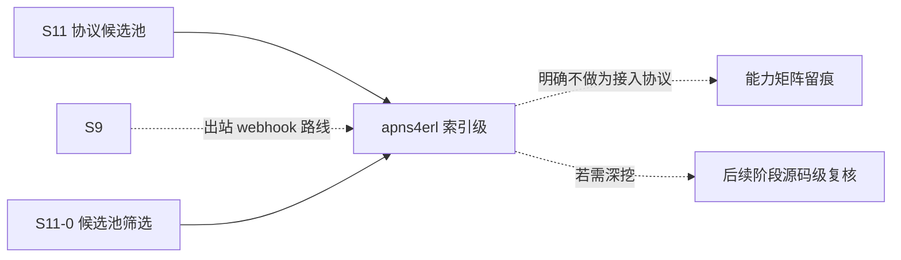

# S11 索引级立项稿 — APNs（inaka/apns4erl）

- **文档版本**：v0.1（索引级立项稿，2026-11-11）
- **对应 Roadmap**：[`docs/roadmap.md`](../roadmap.md) §13（S11 协议候选池）
- **调研来源**：[`inaka/apns4erl`](https://github.com/inaka/apns4erl)（`master`）
- **状态**：**立项规划，未开工，无「已实测」数字**。**本文为索引级稿**：按 S11-0 的「先深挖 IoT/UDP 子集」口径，本仓只做一行索引级事实登记，§2 未做源码级调研。
- **三段式读法**：§2 协议整理（索引级事实）→ §3 需求提炼（候选 / 待深挖）→ §4 开发计划（深挖入口）。

---

## 0. 来源与证据口径

| 来源 | 位置 | 取用范围 |
|---|---|---|
| [`apns4erl` README](https://github.com/inaka/apns4erl) | `master` | 定位、Requirements、config 示例、connect / push / token / feedback / reconnection 用法 |

**证据口径**：本轮**只取 README 层事实**，未读 `src/`、未核对 `rebar.config`、未做依赖版本审计；精确 API 形状、HTTP/2 流语义、错误码映射均以「待深挖」标注。本文不含任何性能 / 容量数字。本阶段只新增文档，不改「S0–S8 已实现」状态行与 `docs/security.md` §12 清单。

---

## 1. 定位、分层与对位

### 1.1 一行索引

**Erlang 的 Apple APNs 推送「出站客户端库」（HTTP/2），不是接入协议、不是服务端。**

| 面 | 内容 | 与 Broker 关系 |
|---|---|---|
| 出站连接 | 到 `api.push.apple.com:443` 的 HTTP/2 + TLS 1.2+ | 出站投递 |
| 认证 | Provider Certificate（pem）或 Provider Authentication Token（`.p8` + ES256 JWT） | 凭据管理 |
| 消息语义 | 单条推送通知 + APNs 头 | ❌ 不是 Broker 的接入协议 |

### 1.2 对位与结论（推导）

UnifiedMQ 的接入层是「客户端 ↔ Broker」；`apns4erl` 是「Broker/应用 → Apple」的**出站方向**。若 UnifiedMQ 未来要做推送出口，形态最接近的是 **S9 的 Push Notification / 出站 webhook**（[`s9-agent-protocols.md`](s9-agent-protocols.md) §3.5，含 SSRF / 签名 / 防重放 / 重试-DLQ-TTL），而不是新增一个「协议接入前端」。

**结论**：候选池标 **P2 / 明确不做为接入协议**；保留为「出站推送客户端」的参考条目。

**非目标**：APNs 服务端实现、Provider Certificate / Token 托管、feedback binary API、官方 CloudEvents Binding 逐字实现（S7 已结案「不立项」）。

---

## 2. 协议整理（仅索引级）

| 项 | 索引级事实（README 逐字 / 片段） |
|---|---|
| 定位 | 「allow you to write an APNs provider for Apple Push Notification services (APNs) over HTTP2 in Erlang」；**Apns4erl v2 仍 under development**，支持证书与 token 两种推送 |
| 环境要求 | OpenSSL 需支持 TLS 1.2+；**Erlang/OTP 27+**（README 自述因使用 stdlib 的 `json` 模块） |
| 连接配置 | `apple_host` / `apple_port 443` / `certfile` / `keyfile` / `token_keyfile`(.p8) / `timeout 10000`；APNs 头：`apns_id`、`apns_expiration`、`apns_priority`、`apns_topic`、`apns_collapse_id`、`apns_push_type`；feedback：`feedback_host` / `feedback_port 2195` |
| API | `apns:connect/1,2`（`type = cert \| token`，name 可为 `undefined` 走 pid）；`apns:push_notification/3,4`；`apns:push_notification_token/4,5`；`apns:generate_token(TeamId, KeyID)`（JWT，1 小时有效）；`apns:get_feedback/0,1`；`apns:close_connection/1` |
| 传输语义 | 用 `gun` 的 HTTP/2 连接；「Each request gets its own HTTP2 stream and is replied to individually」 |
| 重连 | 断线给创建连接进程发 `{reconnecting, ServerPid}` / `{connection_up, ServerPid}`；指数退避，`backoff_ceiling` 默认 10 秒 |

**实现特征与风险（索引级）**：F-1 出站客户端、非接入协议；F-2 v2 自述 under development，API 可能变；F-3 OTP 27+ 下限（项目 OTP 28.3.1 满足，但需复核 `json` 模块用法）；F-4 凭据（pem / `.p8`）与 JWT 密钥管理口径未核；F-5 依赖版本（`gun` 等）未核；F-6 出站目标固定为 Apple，与 S9 的通用 webhook egress 策略不同。

---

## 3. 需求提炼（候选，待深挖后定稿）

| 编号 | 结论 / 候选 | 优先级 |
|---|---|---|
| R-C1 | 必须把本仓标为「出站客户端 / 非接入协议」，**不得**列入消息协议接入实现范围 | P0 |
| R-C2 | 若 UnifiedMQ 要做推送出口，必须归到 S9 的 Push Notification / 出站 webhook 路线，**不得**另立 APNs 前端 | P0 |
| R-C3 | 必须在候选池总览与能力矩阵留一行，写明「明确不做为接入协议」 | P0 |
| R-C4 | 若引用其经验，只取「HTTP/2 每请求一流 + 指数退避重连 + 凭据/JWT 管理」作为参考 | P2 |
| R-C5 | 若未来真要评估，须先补齐 F-2~F-6 的源码级复核 | P2 |
| R-E1 | 本候选不单独设 Gate / 子阶段；结论并入 S11-0 候选池筛选 | P0 |

---

## 4. 下一阶段开发计划

### 4.1 深挖入口与依赖

无独立实现阶段；唯一动作是 S11-0 确认「不做为接入协议」并留痕。

### 4.2 Gate（并入 S11-0，不另开）

- [ ] 候选池总览标注「出站客户端 / 非接入协议 / 明确不做」
- [ ] 能力矩阵留出裁剪行，写明「若做推送出口归 S9 webhook 路线」
- [ ] 未引入 APNs 代码 / 依赖 / 端口，未新增 app

### 4.3 未决问题（并入 S11-0）

| 编号 | 问题 |
|---|---|
| OQ-1 | 是否需要「出站推送」能力；若需要，是 S9 webhook 路线扩面还是新阶段 |
| OQ-2 | 凭据 / JWT 托管是否已有项目口径可复用 |
| OQ-3 | 是否连参考条目都不保留，直接从候选池移除 |

### 4.4 口径说明

1. 本文是**索引级规划稿**，§2 未做源码级调研；任何「已完成 / 已实测」表述都不适用。
2. 事实与推导分开：§2 是 README 层索引，§1/§3 的「是否立项」是 UnifiedMQ 的推导。
3. 不新增 app / 端口 / 代码路径；现有状态行本阶段不同步。
4. 沿用 S9、S7、CloudEvents 逐字 Binding「不立项」等既有结论。

---

## 5. 参考资料

- [`inaka/apns4erl`](https://github.com/inaka/apns4erl)（README、`test/test.config` 示例；`src/` / `rebar.config` **待深挖**）
- 本仓 [`docs/design/s9-agent-protocols.md`](s9-agent-protocols.md) §3.5、[`docs/design/s11-protocol-candidates.md`](s11-protocol-candidates.md)
