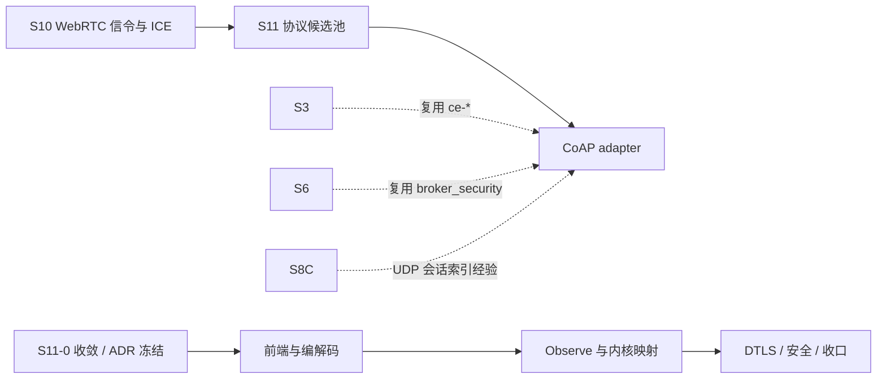

# S11 立项稿 — CoAP（gotthardp/gen_coap）

- **文档版本**：v0.1（立项规划稿，2026-11-11）
- **对应 Roadmap**：[`docs/roadmap.md`](../roadmap.md) §13（S11 协议候选池）
- **调研来源**：[`gotthardp/gen_coap`](https://github.com/gotthardp/gen_coap)（`master`）
- **状态**：**立项规划，未开工，无「已实测」数字**。本文是「协议整理（§2）→ 需求提炼（§3）→ 开发计划（§4）」三段式立项输入；优先级与子阶段归属是**建议**，Gate 通过后以 ADR 冻结。
- **读法**：§2 只写仓库 README / 源码逐字出现的内容（事实），§3 是映射到 UnifiedMQ 的推导（候选需求），§4 是排期建议。三者推导链要可回溯。

---

## 0. 来源与证据口径

| 来源 | 位置 | 取用范围 |
|---|---|---|
| [`gotthardp/gen_coap` README](https://github.com/gotthardp/gen_coap) | `master` | 定位、RFC 清单、未实现项、Usage（client/server）、构建与 OTP 要求 |
| `src/coap_resource.erl` | `master` | `coap_resource` behaviour 的逐字回调签名 |
| `rebar.config` | `master` | 依赖清单、`src_dirs`、dialyzer 选项 |
| `src/` 目录清单 | `master` | 模块组成 |

**证据口径**：

1. 仓库没有发布版本号与正式协议规范；本文以 `master` 源码与 README 为唯一权威，**不把库的实现选择写成 RFC 条文**。RFC 号按 README 逐字引用。
2. README 明列「尚未实现」项与「API 可能变化」的自述，本文原样保留并转成 §2.4 的风险事实。
3. 本文不含任何性能、兼容性、吞吐数字；这类数字按项目惯例（README §11.4 / roadmap §0 第 4 条）必须来自 S11 起落盘的实测报告。
4. 本阶段只新增文档，**不改** README / `progress.md` / `architecture.md` 的「S0–S8 已实现」状态行与 `docs/security.md` §12 清单。

---

## 1. 定位、分层与对位

### 1.1 CoAP 在 UnifiedMQ 里的分层

CoAP（Constrained Application Protocol）是面向受限设备/低功耗网络的 **UDP 请求-响应协议**，不是消息队列协议。它与 Broker 的关系有三层：

| 层 | 内容 | 是否 Broker 职责 |
|---|---|---|
| 传输与报文层 | UDP 数据报、4 字节固定头、Token、Options、CON/NON/ACK/RST、重传与去重 | 需新增 adapter |
| 资源层 | `coap://host/path` 资源、`.well-known/core` 发现、CoRE Link Format | 可映射到 destination/topic |
| 观察层 | RFC 7641 Observe：一次订阅、多次通知 | **与 Broker pub/sub 直接同构**，是立项的主要价值 |
| 媒体/业务层 | 载荷语义（CBOR / Link Format / 自定义） | 不解释，交给上层 |

**关键判断**：CoAP 的 Observe 天然是「订阅 → 持续推送」，比 MQTT 更轻、面向无 IP 网络边界的受限设备；README 自述该库已被用于 [`rabbitmq-coap-pubsub`](https://github.com/gotthardp/rabbitmq-coap-pubsub)（CoAP 发布订阅接口到 RabbitMQ），说明「CoAP ↔ 消息 Broker」的桥接是已被验证过的形态。

### 1.2 与 UnifiedMQ 现有抽象的对位

按 roadmap §0「协议层横向解耦」与 [ADR-001](../adr/001-protocol-adapter-separation.md)，S11 与 S5/S8/S9/S10 同构：一个 `broker_proto_*` adapter，只依赖内核门面，**不写第二套消息内核**。

| CoAP 概念 | 落点（既有能力 / 待补） | 依据 |
|---|---|---|
| `coap://host/path` 资源路径 | `broker_router` 的 destination → partition / 订阅索引 | ADR-010 |
| Observe 订阅与通知 | 订阅 / 游标（ADR-013）+ 流式投递；订阅生命周期需新增 adapter 状态 | ADR-013/019 |
| CON/NON/ACK/RST 与重传 | **不复用** MQTT QoS 状态机；CoAP 是 datagram 级确认，与 TCP 流上的 PUBACK 不同层 | S8-C MQTT-SN 的「UDP 不复用 `mqtt_conn_fsm`」结论可类比 |
| 载荷 / `content-format` | `broker_message`（ADR-009）+ CloudEvents `ce-*` 通道（S3）可选映射；沿用 S7「逐字 Binding 不立项」 | ADR-009/020、`docs/roadmap.md` §9.1 |
| DTLS（`coaps://`） | `broker_security_tls` 口径 + 统一 `broker_security` 身份表（S7） | `docs/security.md` §2.1、ADR-021 |
| Block-wise 分块 | 消息大小上限 / 分片重组（ADR-016 资源上限） | ADR-016 |
| 可观测 | `broker_metrics:snapshot/0` + ADR-016 最小集 + W3C Trace Context 门控 | ADR-016 |

### 1.3 定位结论与非目标边界

**结论**：S11 候选中，CoAP 是**与 UnifiedMQ「物联网 / 事件驱动」定位契合度最高**的一个（受限设备接入 + Observe 天然发布订阅）。建议列为候选池 P0，作为「若 S11 只立一个协议」的首选。

**非目标（明确不做）**：

| 项 | 说明 |
|---|---|
| CoAP 代理 / 虚拟主机（Uri-Host / Uri-Port / Proxy-Uri / Proxy-Scheme） | 仓库自述未实现；首期不补 |
| 完整 RFC 7959 Block-wise | 仓库实现的是 `draft-ietf-core-block-18`，与最终 RFC 有偏差，须在能力矩阵留痕 |
| CoAP over TCP / WebSocket（RFC 8323）、OSCORE（RFC 8613）、CoAP 组播 | 首期只取 UDP + DTLS |
| 6LoWPAN / LPWAN 物理层、LwM2M 对象语义 | 载荷语义由上层应用给出，Broker 不解释 |
| 把 CON 确认等价成 MQTT QoS 1 的持久化 ACK | 两者可靠性层级不同，须按 ADR-007 显式分档，不得含糊表述 |
| 官方 CloudEvents Binding 逐字实现 | S7 已结案「不立项」 |

---

## 2. 协议整理（调研事实）

### 2.1 仓库组成与依赖

`gen_coap` 是**纯 Erlang** 实现的 CoAP 客户端 / 服务器。`rebar.config` 逐字内容只有三项：`{src_dirs, ["src", "examples"]}`，`dialyzer` 选项（`unmatched_returns` / `error_handling` / `race_conditions`，PLT 附加 `erts, kernel, stdlib, crypto`）——**没有 `{deps, ...}`，即零外部依赖**。

`src/` 模块清单（逐字）：`coap_channel.erl`、`coap_channel_sup.erl`、`coap_channel_sup_sup.erl`、`coap_client.erl`、`coap_dtls_listen.erl`、`coap_dtls_socket.erl`、`coap_message.erl`、`coap_message_parser.erl`、`coap_observer.erl`、`coap_resource.erl`、`coap_responder.erl`、`coap_responder_sup.erl`、`coap_server.erl`、`coap_server_content.erl`、`coap_server_registry.erl`、`coap_test.erl`、`coap_transport.erl`、`coap_udp_socket.erl`、`core_iana.erl`、`core_link.erl`、`core_link_parser.yrl`、`core_link_scanner.xrl`、`gen_coap.app.src`。

从命名可见三层：`coap_message*`（编解码）/ `coap_*_socket` + `coap_transport`（UDP、DTLS 传输）/ `coap_channel*` + `coap_responder*`（会话与资源）；`core_link*` 是 CoRE Link Format 的 parser/scanner（`.yrl` / `.xrl`）。

### 2.2 协议覆盖与端口

README 逐字列出的对齐规范：

| 规范 | 内容 |
|---|---|
| RFC 7252 | CoAP 核心协议（含「since Erlang/OTP 19.2」的 DTLS-Secured CoAP，即 `coaps://`） |
| RFC 7641 | CoAP Observe option |
| `draft-ietf-core-block-18` | Block-wise transfers（**草案版本，非最终 RFC**） |
| RFC 6690 | CoRE link format（`.well-known/core`） |

**未实现（README 逐字）**：Proxying and virtual servers（Uri-Host、Uri-Port、Proxy-Uri、Proxy-Scheme options）。

README 自述的互操作验证对象：C `libcoap`（develop 分支）与 `coap.me`。示例 URI 为 `coap://coap.me:5683`、`coaps://127.0.0.1/.well-known/core?rt=core.ps`、`coap://127.0.0.1/resource`。（5683 / 5684 是 RFC 7252 的标准端口，仓库示例显式带 5683；本文不把端口默认值写成仓库事实。）

### 2.3 客户端 / 服务器 API 与资源模型

**客户端**（README 逐字）：

```erlang
{ok, content, Data} = coap_client:request(get, "coap://coap.me:5683").
```

「No application need to be started to use the client.」示例 CLI `sample_client.erl` 支持 `-m get|put|post|delete`、`-e <Text>` 载荷、`-s <Duration>` 订阅秒数，URI 支持 `coap://` 与 `coaps://`。

**服务器**（README 逐字）：

```erlang
1> application:ensure_all_started(gen_coap).
{ok,[crypto,asn1,public_key,ssl,gen_coap]}
2> coap_server:start_udp(coap_udp_socket).
{ok,<0.78.0>}
```

「the server out of a box does not offer any resources」——必须实现 `coap_resource` behaviour 才暴露资源。DTLS 传输需自签证书（`openssl req` / `rsa` / `x509`）。

**`coap_resource` behaviour 回调（`src/coap_resource.erl` 逐字）**：

| 回调 | 签名 | 触发 |
|---|---|---|
| `coap_discover/2` | `[binary()], any() -> [coap_uri()]` | 客户端请求 `.well-known/core` 资源列表 |
| `coap_get/4` | `coap_channel_id(), [binary()], [binary()], [binary()] -> coap_content() \| {error, atom()}` | GET |
| `coap_post/4` | `coap_channel_id(), [binary()], [binary()], coap_content() -> {ok, atom(), coap_content()} \| {error, atom()}` | POST |
| `coap_put/4` | `... coap_content() -> ok \| {error, atom()}` | PUT |
| `coap_delete/3` | `coap_channel_id(), [binary()], [binary()] -> ok \| {error, atom()}` | DELETE |
| `coap_observe/4` | `coap_channel_id(), [binary()], [binary()], boolean() -> {ok, any()} \| {error, atom()}` | GET 带 `Observe=0` |
| `coap_unobserve/1` | `any() -> ok` | GET 带 `Observe=1` |
| `handle_info/2` | `any(), any() -> {notify, any(), coap_content(), any()} \| {noreply, any()} \| {stop, any()}` | 发给 responder 进程的消息，用于生成通知 |
| `coap_ack/2` | `any(), any() -> {ok, any()}` | 通知的确认 |

类型：`coap_channel_id() :: {inet:port_number(), inet:ip_address()}`；`coap_uri() :: {absolute, [binary()], coap_uri_param()}`。**channel id 是 `{端口, IP}` 二元组**——UDP 无连接，会话身份由对端地址构成，这与 S8-C MQTT-SN 的 `{IP,Port}` 会话索引是同构问题。

### 2.4 实现特征与风险（事实 → 需求输入）

| 编号 | 事实 | 对 S11 的含义 |
|---|---|---|
| F-1 | 零外部依赖、纯 Erlang，但 `rebar.config` 用旧式 rebar（非 rebar3 profile），`src_dirs` 含 `examples` | 依赖审计成本低；但需评估与 OTP 28.3.1 / rebar3 3.27 的构建兼容（OQ-3） |
| F-2 | Block-wise 对齐的是 `draft-ietf-core-block-18` 草案而非 RFC 7959 | 能力矩阵必须标注草案版本，不得声称「完整 RFC 7959」 |
| F-3 | 代理与虚拟主机选项未实现 | 明确列为非目标，逐行留痕 |
| F-4 | 库本身不提供认证 / ACL；资源是否可访问完全由 `coap_resource` 回调决定 | 认证与授权必须由 adapter 接 `broker_security`，不能「裸接」 |
| F-5 | DTLS 自 OTP 19.2 起支持，示例用自签证书、无凭据校验说明 | 生产必须接 `broker_security_tls` 口径，禁止自签默认 |
| F-6 | UDP datagram 的 CON/ACK/RST 与去重由库实现，ACK 语义不是业务 ACK | 必须按 ADR-007 显式分档，不得与 MQTT QoS 混用 |
| F-7 | README 自述「The API may change and some functions may not be implemented」 | 冻结 API 前必须做一次源码级复核，不能直接锁版本 |
| F-8 | Observe 订阅状态与通知生成靠 `handle_info/2` + responder 进程 | adapter 需定义订阅状态归属、断线/重启后的清理口径 |

---

## 3. 需求提炼

**读法**：编号 `R-<组><序号>`；优先级 `P0` = 首期闭环必须、`P1` = 首期应做、`P2` = 后续或明确裁剪。约束用词按 RFC 2119 中文口径。**这是候选需求清单，不是已批准的规格**；验证见 §4.3 Gate。

### 3.1 传输与编解码（R-T）

| 编号 | 需求 | 来源 | 优先级 |
|---|---|---|---|
| R-T1 | 必须实现 CoAP over UDP 的报文编解码（固定头 / Token / Options / CON-NON-ACK-RST / 重传与去重），并给出与 TCP 流协议不同的可靠性分档 | §2.2、F-6、ADR-007 | P0 |
| R-T2 | 必须实现 `coaps://`（DTLS），证书与凭据接 `broker_security_tls` / 统一身份表；**不得**默认自签证书 | §2.2、F-5、`docs/security.md` | P0 |
| R-T3 | 必须实现资源路径到 `broker_router` destination 的映射；`.well-known/core` 返回 CoRE Link Format | §2.3、ADR-010 | P0 |
| R-T4 | 应实现 Block-wise 分块重组并接入消息大小上限；**必须**标注对齐的是 `draft-ietf-core-block-18` 而非 RFC 7959 | §2.2、F-2、ADR-016 | P1 |
| R-T5 | 新增 adapter 必须可配置门控（默认关闭 / profile 门控），参照 S8-D `quicer` 做法 | 项目惯例 | P1 |

### 3.2 观察 / 发布订阅语义（R-O，核心）

| 编号 | 需求 | 来源 | 优先级 |
|---|---|---|---|
| R-O1 | 必须实现 RFC 7641 Observe：`Observe=0` 建立订阅、`Observe=1` 取消；服务端事件经 `handle_info/2` 生成通知 | §2.3、F-8 | P0 |
| R-O2 | Observe 订阅到 `broker_message` / 订阅 / 游标的映射必须先在 S11-0 以 ADR 冻结，**不得写第二套消息内核** | ADR-001/009/013 | P0 |
| R-O3 | 必须定义订阅状态归属（进程 / ETS / 控制面）与 UDP 无连接下的会话清理口径；**不得**把 `{Port, IP}` 当持久会话键 | §2.3、F-8、S8-C 类比 | P0 |
| R-O4 | 通知必须支持 CON / NON 两种确认等级，等级与可靠性承诺显式绑定（ADR-007），不得含糊表述「可靠推送」 | ADR-007 | P0 |

### 3.3 认证、授权与安全（R-X）

| 编号 | 需求 | 来源 | 优先级 |
|---|---|---|---|
| R-X1 | 认证必须接**六协议共用 `broker_security` 身份表**（S7）；库本身不提供认证，adapter 不得裸接 | F-4、`docs/security.md` §2.1 | P0 |
| R-X2 | 必须实现逐资源 ACL；GET/POST/PUT/DELETE 与 Observe 订阅分别鉴权，ACL 不得被 `content-format` / URI 参数绕过 | §2.3、`docs/security.md` §4 | P0 |
| R-X3 | 必须实现 datagram 级限流 / 放大攻击防护（UDP 无连接、源地址可伪造）与消息大小上限 | §2.3、`docs/security.md` | P0 |
| R-X4 | 日志 / 指标 / 审计中的设备标识与载荷必须脱敏 | `docs/security.md` §9 | P1 |

### 3.4 工程约束（R-E）

| 编号 | 需求 | 来源 | 优先级 |
|---|---|---|---|
| R-E1 | 关键不确定性在 S11-0 收敛并以 ADR 落盘，冻结后再写实现 | roadmap §0 第 2 条 | P0 |
| R-E2 | 需一份**真实第三方客户端**证据落盘 `test/protocol-compatibility/`（libcoap / coap.me 等价物）+ 能力矩阵与限制清单 | roadmap §10.2 / S8 惯例 | P0 |
| R-E3 | 既有 `rebar3 ct` 零回归（基线 823/823、52 套件）；dialyzer / xref 干净；`rebar3 release` 装配成功 | 项目惯例 | P0 |
| R-E4 | 所有性能 / 容量数字必须来自落盘实测，不得预先承诺 | README §11.4 | P0 |
| R-E5 | 文档同步：roadmap / architecture / operations / security / README / progress / protocol-compatibility | roadmap §10.2 | P1 |

**收口**：§1.3 非目标与 `P2` 项逐行写入能力矩阵，与 S8 对 MQTT-SN / QUIC / WS 的处理一致（`docs/protocol-compatibility.md` §4.11–§4.13）。

---

## 4. 下一阶段开发计划

### 4.1 阶段定位与依赖



CoAP 候选**不引入新的内核抽象**：复用 S3（`ce-*` 通道）、S6/S7（`broker_security` 身份表 / ACL / TLS）、S8-C（UDP 无连接会话索引经验）、ADR-007/013/014/015（可靠性 / 游标 / retention / 重投递）。它是候选池中的独立分支，与其他候选**不互相引用**。

### 4.2 子阶段与 Gate

| 子阶段 | 目标 | 证据 |
|---|---|---|
| S11-0 收敛 | 冻结 Observe→内核映射、UDP 会话状态归属、依赖与 OTP 兼容性结论 | spike + ADR |
| A 前端与编解码 | UDP/DTLS 前端 + 报文编解码 + 资源路由 + `.well-known/core` | libcoap 真实客户端 GET/PUT 用例 |
| B Observe 与内核映射 | Observe 订阅 / 通知 / 取消 + `broker_message` 映射 + 可靠性分档 | Observe 订阅全流程 + 崩溃恢复用例 |
| C 安全与收口 | 身份表接线、逐资源 ACL、限流、能力矩阵、压测、文档同步 | 全量 CT + dialyzer/xref + 容量报告 |

**Gate（结案条件）**：真实第三方客户端证据落盘；Observe 映射由 ADR 冻结且无第二套内核；`401`/`403` 与 ACL 越权专项用例通过；UDP 放大攻击防护用例通过；既有 `rebar3 ct` 零回归（823/823、52 套件）；数字全部来自实测；非目标逐行留痕。

### 4.3 未决问题（S11-0 必须收敛）

| 编号 | 问题 | 收敛方式 |
|---|---|---|
| OQ-1 | Observe 订阅状态落到哪里：进程 / ETS / 控制面？与 ADR-013 cursor 归属如何共存 | spike + ADR（参照 ADR-013 论证） |
| OQ-2 | CON/ACK 与 Broker 业务 ACK 如何分档，是否落盘、绑定哪档可靠性 | ADR-007 显式分档，禁止含糊表述 |
| OQ-3 | `gen_coap` 旧式 rebar / OTP 19.2 DTLS 代码与当前 OTP 28.3.1 / rebar3 3.27 的兼容性；是否 vendor | 构建 spike + 依赖审计 |
| OQ-4 | `draft-ietf-core-block-18` 与 RFC 7959 的偏差是否影响互操作 | libcoap 真实客户端分块用例 |
| OQ-5 | 资源路径与六协议 destination 命名空间的冲突（`/` 层级 vs topic 过滤器） | 与 `docs/architecture.md` §2.1 对齐 |
| OQ-6 | DTLS 凭据（PSK / 证书）与统一身份表的绑定方式 | 与 `docs/security.md` §2.1 对齐 |

### 4.4 口径说明

1. 本文是**规划稿**：§3 是候选需求、§4.2 是建议子阶段、Gate 全未勾选；任何「已完成 / 已实测」表述都不适用。
2. 事实与推导分开：§2 只写仓库逐字内容；§3 的映射与优先级是 UnifiedMQ 的推导。
3. 不新增 app / 端口 / 代码路径；现有状态行本阶段不同步。
4. 沿用既有结论：CloudEvents 逐字 Binding「不立项」、六协议统一身份表、OTel 导出层等 §12 待办，均不重复立项。

---

## 5. 参考资料

- [`gotthardp/gen_coap`](https://github.com/gotthardp/gen_coap)（README、`src/coap_resource.erl`、`rebar.config`、`src/`）
- [`gotthardp/rabbitmq-coap-pubsub`](https://github.com/gotthardp/rabbitmq-coap-pubsub)（README 提及的下游应用）
- RFC 7252（CoAP）、RFC 7641（Observe）、RFC 6690（CoRE Link Format）、RFC 7959（Block-wise 最终版，**仓库未对齐**）、RFC 8323（CoAP over TCP/WebSocket，**非目标**）
