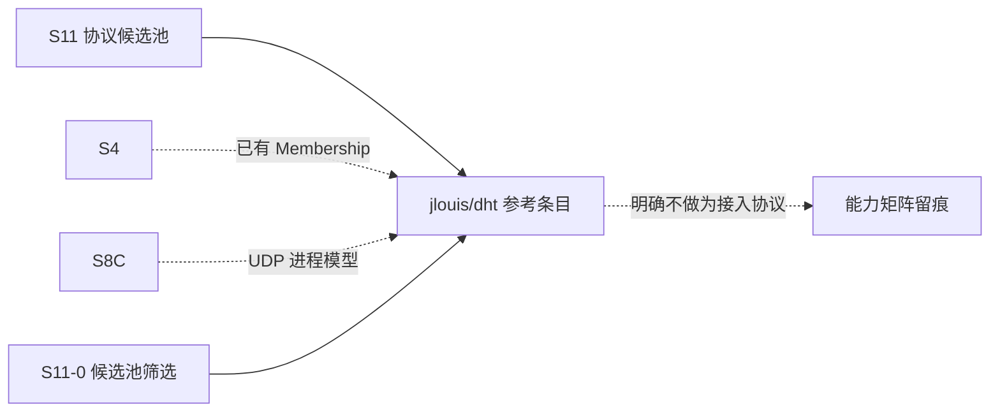

# S11 立项稿 — Kademlia DHT（jlouis/dht）

- **文档版本**：v0.1（立项规划稿，2026-11-11）
- **对应 Roadmap**：[`docs/roadmap.md`](../roadmap.md) §13（S11 协议候选池）
- **调研来源**：[`jlouis/dht`](https://github.com/jlouis/dht)（`master`）
- **状态**：**立项规划，未开工，无「已实测」数字**。三段式：§2 协议整理（事实）→ §3 需求提炼（推导）→ §4 开发计划（建议）。
- **结论速览**：这是候选池里**工程品质最高、协议语义最清晰**的 DHT 实现（零外部依赖、QuickCheck 模型、Kademlia 完整），但 README 明确「**The protocol makes no security guarantees**」且存储是**概率性的**（8 副本全失效会丢最长 45 分钟）——与 ADR-007 的显式可靠性承诺直接冲突。候选池标 **P2 / 参考，不作为接入协议立项**。

---

## 0. 来源与证据口径

| 来源 | 位置 | 取用范围 |
|---|---|---|
| [`jlouis/dht` README](https://github.com/jlouis/dht) | `master` | DHT 定义、属性、高层/低层 API、Kademlia 进程模型、模块清单、安全声明 |
| `rebar.config` | `master` | 依赖与 OTP 要求 |

**证据口径**：

1. README 内容详实且含**自述的安全与可靠性限制**，本文逐字保留（§2.4），不因「适合做发现层」而淡化。
2. README 自述协议「built loosely on the BitTorrent protocol ... changed completely ... no resemblance to the original protocol whatsoever」——**不得**把它写成 BEP-5 兼容实现。
3. 本文不含任何性能 / 规模数字；README 的「millions of nodes」是作者对算法可扩展性的陈述，本文不引用为可承诺指标。
4. 本阶段只新增文档，不改「S0–S8 已实现」状态行与 `docs/security.md` §12 清单。

---

## 1. 定位、分层与对位

### 1.1 分层

README 逐字定义：DHT 是「a mapping from *identities* which are 256 bit numbers to a list of pairs, `[{IP, Port}]`」，分布式存储、每个节点持有部分路由表；「much like DNS doesn't interpret what the identity is. It just maps that identity onto the IP/Port endpoints. That is, you have to write your own protocol once you know where an identity is registered.」

| 面 | 内容 | 是否 Broker 职责 |
|---|---|---|
| 身份空间 / XOR 度量 / 路由表 | 256-bit ID、Kademlia spine + buckets | 纯算法库 |
| UDP 二进制协议 | PING / FIND_NODE / FIND_VALUE / STORE + token | 独立线协议，非消息协议 |
| 存储 / 刷新 | `dht_store`（1h GC）、`dht_track`（45min 刷新）、`dht_refresh` | 概率性存储 |
| 消息语义 | pub/sub / 队列 / ACK / 持久化 | ❌ 完全无关 |

**关键判断**：DHT 解决的是「**在哪**」（服务定位），Broker 解决的是「**消息怎么可靠送达**」。它与 S4 的 Membership / Ownership（ADR-021）看似相近，但 S4 用 Raft 提供**强一致**，而 DHT 明确**无安全保证 + 概率性存储**。引入它会形成「第二套、且更弱的成员真相」，这是立项的根本障碍（OQ-1）。

### 1.2 与 UnifiedMQ 现有抽象的对位

| 概念 | 落点 | 依据 |
|---|---|---|
| 节点 / 分区归属 | **S4 Metadata Raft + Membership + Fencing（ADR-021）已存在** | ADR-021 |
| 端到端验证（README 建议 `crypto:sha(256, Val)` 或公钥挑战） | 与 `broker_security` 身份表（S7）可类比，但 DHT 自身不提供 | `docs/security.md` §2.1 |
| UDP 单 gen_server 多路复用 | S8-C MQTT-SN 单 socket 多会话经验 | ADR-022 |
| 可靠性 /  retention | ADR-007 / ADR-014；DHT 的 1h GC + 45min 刷新与之冲突 | ADR-007/014 |
| 可观测 | ADR-016 最小集 | ADR-016 |

### 1.3 定位结论与非目标边界

**结论**：候选池 **P2 / 参考，不作为接入协议立项**。保留价值在两点：(a) 「协议无关、身份不解释」的分层思想与 ADR-001 的「协议适配与消息内核解耦」同构，可作架构参考；(b) `dht_net` 的 UDP 多路复用进程模型可作 S8-C / 未来 UDP 前端的参考。**不进入消息接入实现范围**。

**非目标**：

| 项 | 说明 |
|---|---|
| 把 DHT 做成 Broker 的第七种接入协议 / 成员管理机制 | 与 ADR-021 重复且更弱 |
| 声称 BEP-5 / BitTorrent DHT 兼容 | README 明确「no resemblance to the original protocol whatsoever」 |
| 用 DHT 承载业务消息 / 分区数据 | 概率性存储，最长丢 45 分钟，违反 ADR-007 |
| 官方 CloudEvents Binding 逐字实现 | S7 已结案「不立项」 |
| 与 [`s11-dhtcrawler.md`](s11-dhtcrawler.md) 合并为「一个 DHT 候选」 | 两者是「协议栈 vs 应用」，对照关系要在候选池里保留 |

---

## 2. 协议整理（调研事实）

### 2.1 仓库组成与依赖

`rebar.config` 逐字：`{deps, []}. {erl_opts, [debug_info, warn_export_vars, warn_shadow_vars, warn_obsolete_guard]}.` —— **零外部依赖**。README 自述「relies on no additional modules but the standard Erlang/OTP implementation in order to ease its portability」，但「does require at least Erlang/OTP release 18 as it makes heavy use of the new time API」（旧版需改 `dht_time` 做 backport）。构建支持 `make`（erlang.mk）、`rebar compile`、`rebar3 compile`。

背景（README 逐字）：从 `etorrent` 应用中「excised」，后经大幅重写以支持「a full QuickCheck model」，「There are few traces left of the original code base」。

### 2.2 协议属性（README 逐字）

| 属性 | 内容 |
|---|---|
| 身份空间 | 256 bit 整数；`X xor Y` 为距离度量（Kademlia） |
| 值 | `[{IP, Port}]`，多个 peer 可存同一 identity |
| 协议无关 | 「you have to write your own protocol once you know where an identity is registered」 |
| **安全** | 「the protocol makes no security guarantees. Anyone can claim to store a given ID」；建议 `ID = crypto:sha(256, Val)` 校验，或以公钥为 identity 并用 CurveCP 类协议挑战 |
| 插入 / 删除 | 插入快；删除基于超时，**最长 1 小时**；节点消失后其条目也最长 1 小时才移除 |
| 规模 | 「Scalability is in millions of nodes」（作者陈述） |
| **存储** | 「**probabilistic**. An entry is stored at 8 nodes, and if all 8 nodes disappear, that entry will be lost for up to 45 minutes, before it is reinserted in a refresh」 |
| 路由表 | 二叉树 spine + 每条未走分支的 bucket，**每 bucket 最多 8 个节点** |

### 2.3 API 与线协议（README 逐字）

高层：

```erlang
application:ensure_all_started(dht).
[dht:ping({IP, Port}) || {IP, Port} <- Peers].      % 插入路由表
Self = dht:node_id(), dht_search:run(find_node, Self). % 快速填充路由表
dht:enter(456, 3000).        % 声明 ID 456 在本节点 3000 端口
dht:delete(456).
[{IP, 3000}] = dht:lookup(456).
```

README 特别说明：「How to obtain the nodes [to bootstrap] is outside of the scope of the DHT application currently」。

四个低层命令：

| 命令 | 语义 |
|---|---|
| `PING({IP, Port})` | 探活 |
| `FIND_NODE({IP, Port}, NodeID)` | 问对端路由表里关于 `NodeID` 的信息 |
| `FIND_VALUE({IP, Port}, ID)` | 问某 ID 的值；可能返回值，或「更可能知道」的节点集合，并返回供后续 `STORE` 用的临时 token |
| `STORE({IP, Port}, Token, ID, Port)` | 把 `ID => {NodeIP, Port}` 关联到对端；`Token` 证明近期执行过 `FIND_VALUE` |

**token 机制**（逐字）：随机 token 与对端 IP 哈希后生成该 peer 的唯一 token，`STORE` 必须出示；「provides some security against forged stores of data at random peers」；token **每分钟轮换一次**。

模块与进程模型（README 逐字）：

- `dht_metric.erl` —— 纯库，实现 256-bit XOR 度量空间。
- `dht_proto.erl` / `dht_net.erl` —— 二进制 UDP 协议编解码；`dht_net` 是 gen_server，**同时处理入站与出站**：入站为每个请求 spawn 一个 handler 进程，出站用 `noreply` 阻塞调用方直到响应或超时，「multiplexes the network」。协议「loosely based on the BitTorrent protocol」但「changed completely ... no resemblance」。
- `dht_state.erl` / `dht_routing_meta.erl` / `dht_routing_table.erl` —— 路由表状态；meta 记录「last successfully contacted / 失败次数 / 是否可达」，因「many nodes are firewalled」不可达节点不进路由表。
- `dht_store.erl` —— ID → IP/Port 表，**超过 1 小时的条目被周期回收**，客户端须在 1 小时内刷新。
- `dht_track.erl` —— 每 **45 分钟**周期刷新本节点在 DHT 中的映射。
- `dht_refresh.erl` —— 节点 / 区间刷新，spawn helper 以避免 `state` 与 `net` 两进程死锁。
- `dht.erl` / `dht_search.erl` —— 非进程的库，基于低层命令做递归搜索。

### 2.4 实现特征与风险（事实 → 需求输入）

| 编号 | 事实 | 对 S11 的含义 |
|---|---|---|
| F-1 | README 明确「no security guarantees」，任何人可声称持有某 ID | 不得作为身份 / 成员真相源；与 `broker_security` 冲突 |
| F-2 | 存储概率性：8 副本全失效会丢最长 45 分钟；`dht_store` 1h GC、`dht_track` 45min 刷新 | 与 ADR-007 显式可靠性、ADR-014 retention 直接冲突，不能承载消息 |
| F-3 | 零外部依赖、OTP 18+、QuickCheck 模型 | 工程品质高，适合作为**参考实现**而非直接依赖 |
| F-4 | 协议不兼容 BitTorrent / BEP-5 | 能力矩阵不得写「BEP-5 兼容」 |
| F-5 | bootstrap 节点来源不在库范围内 | 若引入需另建发现机制（与 mDNS / DNS-SD 候选相关） |
| F-6 | 「no blacklisting of talkative peers, no storage limit per node, no security handshake」 | 无限流 / 无配额，生产必须补 |
| F-7 | `dht_net` 单 gen_server 多路复用 + 每请求 spawn handler | 可作 UDP 前端进程模型参考（S8-C 类比） |
| F-8 | `dht_refresh` 明确为「避免 state 与 net 两进程死锁」而 spawn helper | 有参考价值的并发设计事实 |
| F-9 | 老 OTP 需改 `dht_time` 做 backport；OTP 18 下限 | 与 OTP 28.3.1 的兼容复核项（新 time API 应已满足） |

---

## 3. 需求提炼

**读法**：本候选不产生实现需求；以下为**参考条目与裁剪要求**。`P0` = 必须留痕 / 必须不做，`P1` = 应做。

| 编号 | 需求 / 结论 | 来源 | 优先级 |
|---|---|---|---|
| R-C1 | 必须把 DHT 标为「服务定位 / 参考」，**不得**列入消息协议接入实现范围 | §1.1、ADR-001 | P0 |
| R-C2 | **不得**用 DHT 替代 S4 Metadata Raft / Membership（ADR-021），不得形成第二套成员真相 | §1.1、F-1/F-2、ADR-021 | P0 |
| R-C3 | 必须在候选池总览与能力矩阵逐行写明：无安全保证、概率性存储（8 副本 / 最长丢 45 分钟）、不兼容 BEP-5 | F-1/F-2/F-4 | P0 |
| R-C4 | 应把 `dht_net` 的 UDP 多路复用 + 每请求 spawn handler、`dht_refresh` 的防死锁 spawn 记录为 UDP 前端设计参考 | F-7/F-8、ADR-022 | P1 |
| R-C5 | 应把「身份不解释、协议无关」的分层思想记录为 ADR-001 的类比参考 | §1.1、README | P2 |
| R-C6 | 若未来真要引入，必须先补齐安全（身份校验 / 挑战）、限流 / 配额 / 握手、bootstrap 发现，并以 ADR 冻结可靠性档 | F-1/F-5/F-6、ADR-007 | P2 |
| R-E1 | 本候选不单独设 Gate / 子阶段；结论并入 S11-0 候选池筛选 | roadmap §0 第 2 条 | P0 |

**收口**：§1.3 非目标与 R-C* 逐行写入能力矩阵（S8 惯例）。

---

## 4. 下一阶段开发计划

### 4.1 阶段定位与依赖



**无实现阶段**：唯一动作是 S11-0 筛选时确认「不做为接入协议、保留为参考」，并把 F-1~F-9 的裁剪理由写入能力矩阵。与 [`s11-dhtcrawler.md`](s11-dhtcrawler.md) 的「协议栈 vs 应用」对照结论一并写入候选池评审。

### 4.2 Gate（并入 S11-0，不另开）

- [ ] 候选池总览标注「参考 / 服务定位，非消息协议」
- [ ] 能力矩阵逐行留痕：无安全保证、概率性存储、不兼容 BEP-5、不替代 S4
- [ ] UDP 进程模型参考点有索引，未引入任何 DHT 代码 / 依赖 / 端口

### 4.3 未决问题（并入 S11-0）

| 编号 | 问题 |
|---|---|
| OQ-1 | 是否连「参考」价值都不保留，直接从候选池移除 |
| OQ-2 | 与 `dhtcrawler` / `kdht` 的对照是否值得单列一份「DHT 类候选」小结 |
| OQ-3 | 若未来做服务发现，DHT 与 mDNS / DNS-SD / erldns 如何划界 |

### 4.4 口径说明

1. 本文是**规划稿 / 裁剪结论**，不是新协议立项；§3 无实现需求。
2. 事实与推导分开：§2 逐字取自 README / `rebar.config`；§1/§3 的「是否立项」是 UnifiedMQ 的推导。
3. 不新增 app / 端口 / 代码路径；现有状态行本阶段不同步。
4. 沿用 ADR-001/007/014/021/022 与 S7 既有结论，不重复立项、不推翻。

---

## 5. 参考资料

- [`jlouis/dht`](https://github.com/jlouis/dht)（README、`rebar.config`）
- Kademlia（README 自述「we follow the Kademlia hash table implementation」）；CurveCP（README 建议的挑战协议）
- 本仓 [ADR-001](../adr/001-protocol-adapter-separation.md)、[ADR-007](../adr/007-explicit-reliability.md)、[ADR-014](../adr/014-retention-and-segment-gc.md)、[ADR-021](../adr/021-cluster-control-plane-raft-and-fencing.md)、[ADR-022](../adr/022-mqtt-sn-gateway.md)
