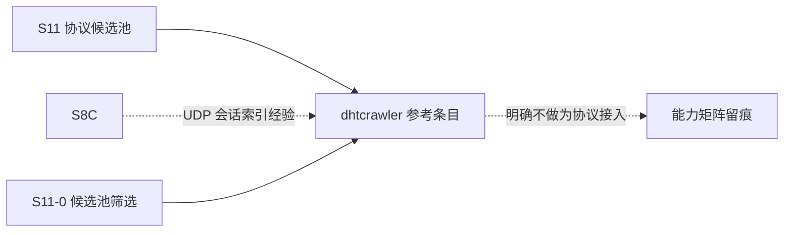

# S11 立项稿 — BitTorrent DHT 爬虫（kevinlynx/dhtcrawler）

- **文档版本**：v0.1（立项规划稿，2026-11-11）
- **对应 Roadmap**：[`docs/roadmap.md`](../roadmap.md) §13（S11 协议候选池）
- **调研来源**：[`kevinlynx/dhtcrawler`](https://github.com/kevinlynx/dhtcrawler)（`master`）
- **状态**：**立项规划，未开工，无「已实测」数字**。三段式：§2 协议整理（事实）→ §3 需求提炼（推导）→ §4 开发计划（建议）。
- **结论速览**：本仓是**应用（爬虫 + 索引 + HTTP 检索）**，不是 DHT 协议栈；DHT 实现来自外部依赖 `kdht`。候选池标 **P2 / 明确不做为接入协议**，仅保留为「UDP 无连接会话索引」的参考。

---

## 0. 来源与证据口径

| 来源 | 位置 | 取用范围 |
|---|---|---|
| [`dhtcrawler` README](https://github.com/kevinlynx/dhtcrawler) | `master` | 定位、Usage、Config、启动方式 |
| `rebar.config` | `master` | 依赖与来源方式 |
| `src/` 目录清单 | `master` | 模块组成 |

**证据口径**：

1. 仓库无发布版本、无正式协议文档；README 只有约一页，本文严格按逐字内容写，**不推断 DHT 报文细节**——DHT 协议由外部依赖 `kdht` 提供，不在本仓。
2. 仓库页面显示 **26 Commits / 127 stars / 42 forks**，属小型历史项目；本文只陈述页面可见事实，不推断维护状态结论。
3. 本文不含任何性能、吞吐数字；按项目惯例必须来自落盘实测报告。
4. 本阶段只新增文档，不改「S0–S8 已实现」状态行与 `docs/security.md` §12 清单。

---

## 1. 定位、分层与对位

### 1.1 分层

| 层 | 内容 | 是否 Broker 职责 |
|---|---|---|
| DHT 网络协议（Kademlia / BEP-5 类） | UDP 节点发现、`get_peers`/`announce_peer` 等 | 由外部 `kdht` 提供，**本仓不含** |
| 爬虫逻辑 | 加入 DHT 网络、抓取 torrent 元数据 | 应用逻辑 |
| 存储 / 检索 | MongoDB 存 torrent 信息、HTTP 按关键字检索 | 应用逻辑 |
| 消息语义 | pub/sub / 队列 / ACK | ❌ 无关 |

**关键判断**：这个仓库**不是「Erlang 的 DHT 协议实现」**，而是「用 Erlang 写的 DHT 应用」。它进入候选池的价值只有两点：(a) 与 [`s11-dht.md`](s11-dht.md)（`jlouis/dht`）形成「协议栈 vs 应用」的对照；(b) 它的「UDP 单 socket + 多节点会话 + 状态落盘（`dhtstate` 目录）」与 S8-C MQTT-SN 网关的会话索引问题同构，可作参考。**不作为协议接入立项**。

### 1.2 与 UnifiedMQ 现有抽象的对位

| 概念 | 落点 | 依据 |
|---|---|---|
| UDP 无连接会话索引 | S8-C MQTT-SN 的 `{IP,Port}` + `client_id` 双索引经验 | `docs/roadmap.md` §10.1、ADR-022 |
| 状态持久化（`dhtstate` 目录 / `node_count` 变更需清目录） | 与 ADR-011 storage / ADR-013 会话文件布局可类比 | ADR-011/013 |
| MongoDB 存储 / HTTP 检索 | 与 UnifiedMQ 内核无关，不复用 | README §1.2 非目标 |
| 身份 / ACL | 六协议共用 `broker_security`（S7）；本仓无认证 | `docs/security.md` §2.1 |

### 1.3 定位结论与非目标边界

**结论**：候选池 **P2 / 明确不做为协议接入**；保留为参考条目，在总览候选表与能力矩阵留一行。

**非目标**：

| 项 | 说明 |
|---|---|
| 把 DHT 做成 Broker 的第七种接入协议 | 本仓不含协议栈，且 DHT 是 P2P 索引网络，不是消息协议 |
| 抓取 / 索引 torrent、MongoDB、HTTP 检索前端 | 应用逻辑，与消息 Broker 无关 |
| 引入 `kdht`（git HEAD、SSH 地址）作为依赖 | 见 F-3，依赖不可复现 |
| 用 DHT 替代 S4 Metadata Raft / Membership | ADR-021 已有结论 |
| 官方 CloudEvents Binding 逐字实现 | S7 已结案「不立项」 |

---

## 2. 协议整理（调研事实）

### 2.1 仓库组成与依赖

README 逐字定位：「dhtcrawler is a DHT crawler written in erlang. It can join a DHT network and crawl many P2P torrents. The program save all torrent info into database and provide an http interface to search a torrent by a keyword.」

`rebar.config` 逐字：

```erlang
{erl_opts, [debug_info, fail_on_warning]}.
{deps, [ {bson, ".*", {git, "git@github.com:mongodb/bson-erlang.git", "HEAD"}},
         {mongodb, ".*", {git, "git@github.com:mongodb/mongodb-erlang.git", "HEAD"}},
         {kdht, ".*", {git, "git@github.com:kevinlynx/kdht.git", "HEAD"}} ]}.
```

三个依赖全部是 **git `HEAD`（无 tag / ref）+ `git@github.com:` SSH 地址**——这是最重要的工程事实（F-3）：不可复现、且需要 SSH 凭据。

`src/` 模块清单（逐字）：`crawler_app.erl`、`crawler_stats.erl` / `.hrl`、`crawler_sup.erl`、`db_conn_pool.erl`、`db_store.erl`、`db_store_mongo.erl`、`dht_monitor.erl`、`dhtcrawler.app.src`、`http_front/`（目录）、`string_split.erl`、`time_util.erl`、`torrent/`（目录）、`torrent_index.erl`、`vlog.erl`。**没有任何 `dht_*` 协议编解码模块**——DHT 报文处理在外部 `kdht` 里，进一步印证 §1.1 判断。

### 2.2 运行与配置（README 逐字）

启动顺序：

```text
mongod --dbpath db --setParameter textSearchEnabled=true
rebar get-deps && rebar compile
erl -pa ebin
crawler_app:start().        % 启动爬虫
crawler_http:start().       % 启动 HTTP 前端
浏览器打开 localhost:8000/index.html
```

配置见 `priv/dhtcrawler.config`；README 特别注明：「when you change `node_count` value in dhtcrawler.config, you'd better delete all files saved in dhtstate directory」——即**节点数变更会让已落盘的 DHT 状态失效**，是状态布局与配置耦合的事实（F-4）。

### 2.3 实现特征与风险（事实 → 需求输入）

| 编号 | 事实 | 对 S11 的含义 |
|---|---|---|
| F-1 | 本仓不含 DHT 协议编解码，DHT 由外部 `kdht` 提供 | 不得把本仓当作「协议实现」立项或做兼容矩阵 |
| F-2 | 26 commits、README 极简、无版本发布 / 无协议文档 | 证据基线薄弱，任何结论须以源码复核为准 |
| F-3 | 三个依赖均为 git `HEAD` + SSH 地址，不可复现 | **若引入即违反可复现构建**；须先固定 ref 或 vendor（ADR-003 做法） |
| F-4 | `node_count` 变更需清空 `dhtstate` 目录 | 状态布局与配置强耦合，与 ADR-013 会话文件布局经验形成对照 |
| F-5 | 无认证 / 无 ACL / 无限流描述；UDP 抓取对外暴露 | 不得裸接入生产 |
| F-6 | 依赖 MongoDB（外部组件）与 HTTP 前端 | 与消息内核无关，Broker 不复制 |
| F-7 | 存储的是 torrent 索引，不是业务消息 | 与 `broker_message` 无映射关系 |

---

## 3. 需求提炼

**读法**：本候选不产生实现需求；以下为**参考条目与裁剪要求**。

| 编号 | 需求 / 结论 | 来源 | 优先级 |
|---|---|---|---|
| R-C1 | 必须把本仓标为「应用 / 参考」，**不得**列入协议接入候选的实现范围 | F-1、§1.1 | P0 |
| R-C2 | 必须在候选池总览与能力矩阵留一行，写明「不含协议栈、依赖 `kdht`」 | F-1 | P0 |
| R-C3 | 若未来要复用其 UDP 会话索引经验，必须先把三个 git `HEAD` SSH 依赖固定为可复现 ref 或 vendor | F-3、ADR-003 | P1 |
| R-C4 | 必须记录「`node_count` 变更导致 `dhtstate` 失效」作为状态布局反例，供 ADR-013 会话布局讨论引用 | F-4 | P2 |
| R-C5 | 不得引入 MongoDB / HTTP 检索 / 爬虫逻辑到 Broker | F-6/F-7 | P0 |
| R-E1 | 本候选不单独设 Gate、不单独设子阶段；其结论并入 S11-0 候选池筛选 | roadmap §0 第 2 条 | P0 |

**收口**：§1.3 非目标与 R-C* 逐行写入能力矩阵（S8 惯例：`docs/protocol-compatibility.md` §4.11–§4.13）。

---

## 4. 下一阶段开发计划

### 4.1 阶段定位与依赖



**无实现阶段**：本候选的唯一动作是 S11-0 筛选时确认「不做」，并在总览 / 能力矩阵留痕。与 [`s11-dht.md`](s11-dht.md) 的对照结论（协议栈 vs 应用）一并写入候选池评审。

### 4.2 Gate（并入 S11-0，不另开）

- [ ] 候选池总览明确标注「应用 / 参考，不含协议栈」
- [ ] 能力矩阵留出裁剪行，写明依赖 `kdht` 与 git `HEAD` 不可复现问题
- [ ] 未引入 MongoDB / HTTP 检索 / 爬虫代码，未新增 app / 端口 / 依赖

### 4.3 未决问题（并入 S11-0）

| 编号 | 问题 |
|---|---|
| OQ-1 | 是否连「参考」价值都不保留，直接从候选池移除 |
| OQ-2 | `kdht` 是否值得单独调研（它是真正的 DHT 实现），还是与 `jlouis/dht` 合并评估 |
| OQ-3 | git `HEAD` SSH 依赖若必须引用，如何固定为可复现 ref |

### 4.4 口径说明

1. 本文是**规划稿 / 裁剪结论**，不是新协议立项；§3 无实现需求。
2. 事实与推导分开：§2 逐字取自 README / `rebar.config` / `src/` 清单；§1/§3 的「是否立项」是 UnifiedMQ 的推导。
3. 不新增 app / 端口 / 代码路径；现有状态行本阶段不同步。
4. 沿用 ADR-021、ADR-003、S7 等既有结论，不重复立项、不推翻。

---

## 5. 参考资料

- [`kevinlynx/dhtcrawler`](https://github.com/kevinlynx/dhtcrawler)（README、`rebar.config`、`src/` 清单、`priv/dhtcrawler.config` 指引）
- 外部依赖：`kevinlynx/kdht`、`mongodb/bson-erlang`、`mongodb/mongodb-erlang`（均为 git `HEAD`）
- 本仓 [ADR-022](../adr/022-mqtt-sn-gateway.md)（UDP 单 socket 多会话）、[ADR-013](../adr/013-subscription-kinds-and-cursor-ownership.md)（会话文件布局）、[`docs/design/s11-dht.md`](s11-dht.md)
