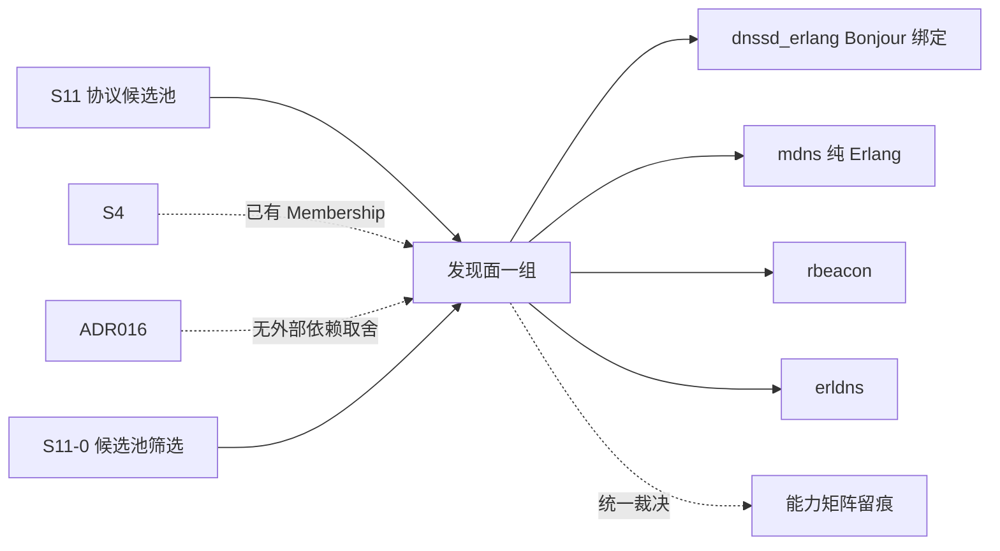

# S11 立项稿 — DNS-SD / Bonjour（benoitc/dnssd_erlang）

- **文档版本**：v0.1（立项规划稿，2026-11-11）
- **对应 Roadmap**：[`docs/roadmap.md`](../roadmap.md) §13（S11 协议候选池）
- **调研来源**：[`benoitc/dnssd_erlang`](https://github.com/benoitc/dnssd_erlang)（`master`）
- **状态**：**立项规划，未开工，无「已实测」数字**。三段式：§2 协议整理（事实）→ §3 需求提炼（推导）→ §4 开发计划（建议）。
- **结论速览**：`dnssd_erlang` 是 **Erlang 到系统 Bonjour/Avahi 守护进程的 NIF/port 绑定**，不是纯 Erlang 协议实现——部署强依赖 `avahi-daemon` / `libavahi-compat-libdnssd-dev` / Bonjour SDK。候选池标 **P2（发现面备选 / 外部守护进程依赖需先裁决）**。

---

## 0. 来源与证据口径

| 来源 | 位置 | 取用范围 |
|---|---|---|
| [`dnssd_erlang` README](https://github.com/benoitc/dnssd_erlang) | `master` | 定位、Prerequisites、完整 browse/resolve/register/enumerate 示例、结果消息格式 |
| `rebar.config` | `master` | `port_specs` / `port_env` / 平台宏 / `pre_hooks` |
| 仓库根目录清单 | `master` | `c_src/`（C 源码）、`winbuild.escript`、`overview.edoc` |

**证据口径**：

1. 仓库逐字表述是「interface to Apple's Bonjour DNS Service Discovery implementation」——**绑定系统库，不是协议栈**。本文不把它写成「纯 Erlang DNS-SD 实现」。
2. README 的 `Prerequisites` 明确列出 OS X / Windows / BSD-Linux 各需什么系统组件；本文原样保留为部署事实。
3. 本文不含任何性能 / 规模数字；按项目惯例必须来自落盘实测报告。
4. 本阶段只新增文档，不改「S0–S8 已实现」状态行与 `docs/security.md` §12 清单。

---

## 1. 定位、分层与对位

### 1.1 分层

| 面 | 内容 | 是否 Broker 职责 |
|---|---|---|
| 系统守护进程 | `avahi-daemon` / `mDNSResponder` / Bonjour SDK，**Erlang 进程外** | ❌ 外部依赖 |
| C 绑定层 | `c_src/*.c` → `priv/dnssd_drv.so`（port driver / NIF） | 部署 / 构建链 |
| DNS-SD 操作 | browse / resolve / register / enumerate | 发现面 API |
| 消息语义 | pub/sub / 队列 / ACK | ❌ 无关 |

README 逐字：「Bonjour allows applications to browse, resolve and register network services via link-local multicast DNS on the local network and via unicast DNS over the internet. In the later case if the service is running behind a NAT gateway Bonjour will only advertise it if a port forward can be negotiated via NAT-PMP or uPNP (which is attempted automatically).」——**广域 unicast DNS-SD 会自动尝试 NAT-PMP/uPnP 端口映射**，这是重要的部署面风险（F-5）。

### 1.2 与 UnifiedMQ 现有抽象的对位

| 概念 | 落点 | 依据 |
|---|---|---|
| 服务发现 / 成员 | **S4 Metadata Raft + Membership（ADR-021）已存在**；DNS-SD 只能作对外发现面 | ADR-021 |
| 异步操作结果 | 仓库用 Erlang 消息 `{dnssd, Ref, {...}}`；项目用 `broker_subscription` / 门面回调 | ADR-013 |
| 身份 | 六协议共用 `broker_security`（S7）；DNS-SD 本身无认证 | `docs/security.md` §2.1 |
| 外部守护进程 | 与项目「无外部依赖」取舍（ADR-016）冲突 | ADR-016 |

### 1.3 定位结论与非目标边界

**结论**：候选池 **P2**。与 [`s11-mdns.md`](s11-mdns.md) 同为 DNS-SD 发现面，但实现形态不同：mdns 是纯 Erlang（erlang.mk），dnssd_erlang 是**系统库绑定**。项目 ADR-016 明确取「无外部依赖」最小集，引入 `avahi-daemon` 会破坏这一取舍。**建议只作参考，不单独立项**；发现面一组在 S11-0 统一裁决。

**非目标**：

| 项 | 说明 |
|---|---|
| 引入 `avahi-daemon` / Bonjour SDK / `libavahi-compat-libdnssd-dev` 作为运行时依赖 | 与 ADR-016「无外部依赖」冲突 |
| 广域 unicast DNS-SD 与 NAT-PMP / uPnP 自动端口映射 | 部署面风险，生产默认关闭 |
| 用 DNS-SD 替代 S4 Metadata Raft / Membership | ADR-021 已有结论 |
| Windows Bonjour SDK + Visual Studio 构建链 | 非目标平台 |
| 把 DNS 记录当业务消息持久化 | 串层 |
| 官方 CloudEvents Binding 逐字实现 | S7 已结案「不立项」 |

---

## 2. 协议整理（调研事实）

### 2.1 仓库组成与构建（`rebar.config` 逐字）

```erlang
{cover_enabled, true}. {cover_print_enabled, true}.
{erl_opts, [debug_info,
            {platform_define, "(R14|R15)", 'warnings_as_errors'},
            {platform_define, "(linux|bsd)", 'AVAHI'}]}.
{edoc_opts, [{overview, "overview.edoc"}, {dir, "doc"}]}.
{eunit_opts, [verbose]}.
{port_specs, [{"linux",  "priv/dnssd_drv.so", ["c_src/*.c"]},
              {"darwin", "priv/dnssd_drv.so", ["c_src/*.c"]}]}.
{port_env, [{"linux", "LDFLAGS", "$LDFLAGS -ldns_sd"}]}.
{pre_hooks, [{compile, "escript winbuild.escript"}]}.
```

即：**Linux / darwin 编译 `c_src/*.c` 成 `priv/dnssd_drv.so`，Linux 链接 `-ldns_sd`**；`rebar.config` **没有 `{deps, ...}`**（无 Erlang 依赖，但有系统库依赖）。根目录另有 `c_src/`、`winbuild.escript`、`overview.edoc`。

README `Prerequisites` 逐字：

- Erlang **R16A 或更高**（兼容更老 Erlang 用 v0.8）。
- Apple Bonjour 或兼容 API（Avahi 兼容层）及开发文件：OS X 自带；Windows 需 Bonjour SDK；BSD/Linux 需 Avahi；Ubuntu 为 `apt-get install avahi-daemon libavahi-compat-libdnssd-dev`。
- 「If `{error,-65537}` is returned when starting an operation it may be that avahi-daemon is not running」。
- Windows 还需 Visual Studio + Bonjour SDK，在 VS 命令提示符下构建。

构建用 rebar（`rebar compile` / `rebar eunit` / `rebar doc`）。

### 2.2 API 与消息格式（README 逐字）

启动：`dnssd:start().`（或 `application:start(dnssd)`）。所有成功操作返回 `{ok, Reference}`，`Reference` 用于 `dnssd:stop/1`；进程退出时操作也会停止。

| 操作 | 调用 | 结果 |
|---|---|---|
| browse | `dnssd:browse("_http._tcp")` / `dnssd:browse(Type, Domain)` | 消息 `{dnssd, Ref, {browse, add\|remove, {ServiceName, ServiceType, Domain}}}`，字段为 binary |
| resolve | `dnssd:resolve(Name, Type, Domain)` | `{dnssd, Ref, {resolve, {Hostname, Port, TxtStrings}}}`——**resolve 不带 add/remove 标记**（README：「the underlying DNSSD API does not provide this information」）；`TxtStrings` 为 binary 或 `{Key, Value}` 元组 |
| resolve_sync | `dnssd:resolve_sync(Name, Type, Domain[, Timeout])` | 默认超时 5 秒，超时返回 `{error, timeout}` |
| register | `dnssd:register(Type, Port)` 及 5 种重载（Name / Txt / Host / Domain） | `{dnssd, Ref, {register, add, {ServiceName, ServiceType, Domain}}}`；**服务名冲突可能被重命名**，须读结果确认 |
| enumerate | `dnssd:enumerate(browse)` / `dnssd:enumerate(reg)` | `{dnssd, Ref, {enumerate, add, Domain}}`（binary） |
| 结果查询 | `dnssd:results(Ref)` | resolve 只返回最后一个结果，其余返回全部当前结果 |

通用消息信封：`{dnssd, Reference, {Operation, Change, Result}}`，`Operation ∈ browse | resolve | register | enumerate`，`Change ∈ add | remove`。

`Txt` 格式可为：`<<Size, String:Size/binary>>` 序列、atom/string/binary 列表、或 `{Key, Value}` 元组。`Host` 传 `localhost` 时只在本地域注册；`Domain` 空表示所有域。README 强调：「It's important to stop operations when no more results are needed to avoid generating needless network traffic.」

### 2.3 实现特征与风险（事实 → 需求输入）

| 编号 | 事实 | 对 S11 的含义 |
|---|---|---|
| F-1 | 是系统 Bonjour/Avahi 的 C 绑定（`dnssd_drv.so` + `-ldns_sd`），不是纯 Erlang | 部署强依赖外部守护进程，与 ADR-016「无外部依赖」冲突 |
| F-2 | `rebar.config` 无 Erlang 依赖，但有 `port_specs` / `port_env` / `pre_hooks` | 构建链含 C 编译与平台脚本，须纳入依赖审计 |
| F-3 | Erlang R16A 下限；`(R14|R15)` 老版本宏 | 与本仓 OTP 28.3.1 的兼容复核项；老宏可能不可达 |
| F-4 | 广域 unicast DNS-SD 会自动尝试 NAT-PMP / uPnP 端口映射 | **生产默认必须关闭**，避免意外在网关开洞 |
| F-5 | `{error,-65537}` 表示 `avahi-daemon` 未运行 | 启动期必须显式失败并给出可诊断错误，不得静默降级 |
| F-6 | 无认证 / 无 ACL；服务名冲突会被自动重命名 | 发现结果不可信，须补身份校验；注册结果须核对实际名字 |
| F-7 | 操作不 `stop` 会持续产生网络流量；`resolve` 无 add/remove 标记 | 生命周期与缓存口径必须在 adapter 内定义 |
| F-8 | `resolve_sync` 默认 5 秒超时 | 超时策略须与项目流控 / 背压口径对齐 |
| F-9 | Windows 需 Bonjour SDK + Visual Studio + `winbuild.escript` | 非目标平台，能力矩阵留痕 |

---

## 3. 需求提炼

**读法**：本候选不产生消息接入实现需求；以下为**发现面裁剪与留痕要求**。

| 编号 | 需求 / 结论 | 来源 | 优先级 |
|---|---|---|---|
| R-D1 | **不得**引入 `avahi-daemon` / Bonjour SDK 作为运行时依赖，除非 S11-0 显式推翻 ADR-016 取舍并落 ADR | F-1/F-2、ADR-016 | P0 |
| R-D2 | 广域 unicast DNS-SD 与 NAT-PMP / uPnP 自动端口映射**必须默认禁用** | F-4、`docs/security.md` | P0 |
| R-D3 | 守护进程缺失（`{error,-65537}`）必须启动期显式失败并给可诊断错误，不得静默降级 | F-5 | P0 |
| R-D4 | 若引入，发现结果必须补 `broker_security` 身份校验与 ACL；注册后必须核对实际服务名（可能被重命名） | F-6、`docs/security.md` §2.1 | P0 |
| R-D5 | 必须定义操作生命周期（`stop/1`）、结果缓存与 resolve 无 add/remove 的语义口径 | F-7 | P1 |
| R-D6 | 必须在 S11-0 复核 OTP 28.3.1 兼容性、C 构建链与 `port_specs` 平台差异（F-9 非目标平台） | F-2/F-3/F-9 | P1 |
| R-D7 | 必须在能力矩阵写明：系统库绑定、非纯 Erlang、无认证、Windows 不在范围 | F-1/F-6/F-9 | P0 |
| R-D8 | 不得用 DNS-SD 替代 S4 Metadata Raft / Membership | §1.3、ADR-021 | P0 |
| R-E1 | 本候选不单独设 Gate / 子阶段；结论并入 S11-0「发现面」一组统一裁决 | roadmap §0 第 2 条 | P0 |

**收口**：§1.3 非目标与 R-D* 逐行写入能力矩阵（S8 惯例）。

---

## 4. 下一阶段开发计划

### 4.1 阶段定位与依赖



**无独立实现阶段**：与 `mdns` / `rbeacon` / `erldns` 一起在 S11-0 作为「发现面」一组裁决。本候选的核心裁决点是 **ADR-016「无外部依赖」取舍 vs 系统守护进程依赖**（OQ-2）。

### 4.2 Gate（并入 S11-0，不另开）

- [ ] 发现面一组完成统一裁决，是否推翻 ADR-016 有明确结论并落 ADR
- [ ] 广域 DNS-SD / NAT-PMP 默认禁用、`{error,-65537}` 显式失败口径写入裁剪清单
- [ ] 能力矩阵逐行留痕：系统库绑定、非纯 Erlang、无认证、Windows 不在范围
- [ ] 未引入外部守护进程，未新增 app / 端口 / 依赖

### 4.3 未决问题（并入 S11-0「发现面」一组）

| 编号 | 问题 |
|---|---|
| OQ-1 | 是否需要发现面？S4 已有 Membership |
| OQ-2 | **ADR-016「无外部依赖」取舍是否可为 DNS-SD 破例**（本候选的决定性问题） |
| OQ-3 | 与 `mdns`（纯 Erlang）二选一还是都只作参考 |
| OQ-4 | OTP 28.3.1 下 `port_specs` / C 编译链 / 老 OTP 宏的可用性 |
| OQ-5 | 容器 / 云网络无二层组播时 DNS-SD 是否仍可用 |

### 4.4 口径说明

1. 本文是**规划稿 / 发现面裁决输入**，不是新协议立项；§3 无消息接入实现需求。
2. 事实与推导分开：§2 逐字取自 README / `rebar.config`；§1/§3 的「是否立项」是 UnifiedMQ 的推导。
3. 不新增 app / 端口 / 代码路径；现有状态行本阶段不同步。
4. 沿用 ADR-016/021、S7 统一身份表、CloudEvents 逐字 Binding「不立项」等既有结论，不重复立项、不推翻。

---

## 5. 参考资料

- [`benoitc/dnssd_erlang`](https://github.com/benoitc/dnssd_erlang)（README、`rebar.config`、`c_src/`、`winbuild.escript`、`overview.edoc`）
- Apple Bonjour DNS Service Discovery；Avahi（`avahi-daemon` / `libavahi-compat-libdnssd-dev`）；NAT-PMP / uPnP（README 提及）
- 本仓 [ADR-016](../adr/016-observability-minimal-set.md)、[ADR-021](../adr/021-cluster-control-plane-raft-and-fencing.md)、[`docs/design/s11-protocol-candidates.md`](s11-protocol-candidates.md)
