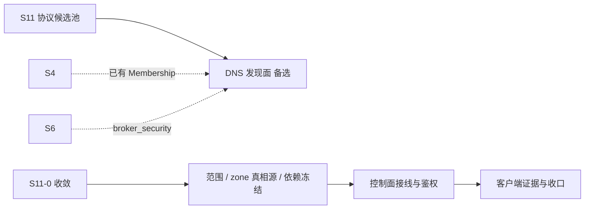

# S11 立项稿 — DNS 权威服务器（dnsimple/erldns）

- **文档版本**：v0.1（立项规划稿，2026-11-11）
- **对应 Roadmap**：[`docs/roadmap.md`](../roadmap.md) §13（S11 协议候选池）
- **调研来源**：[`dnsimple/erldns`](https://github.com/dnsimple/erldns)（`main`）
- **状态**：**立项规划，未开工，无「已实测」数字**。三段式：§2 协议整理（事实）→ §3 需求提炼（推导）→ §4 开发计划（建议）。

---

## 0. 来源与证据口径

| 来源 | 位置 | 取用范围 |
|---|---|---|
| [`erldns` README](https://github.com/dnsimple/erldns) | `main` | 三大子系统、Admin API、Zones、平台差异、AXFR、测试 |
| `rebar.config` | `main` | OTP 下限、依赖版本、插件、xref/dialyzer 配置 |
| `erldns.example.config` | `main` | listener 端口、packet pipeline 模块链、zones 路径 |

**证据口径**：

1. `erldns` 是**权威 DNS 服务器应用**，不是消息协议库；本文区分「仓库事实」与「UnifiedMQ 是否立项」。
2. README 自述 AXFR「not currently implemented. The current implementation (`m:erldns_axfr`) is a stub」——原样保留为裁剪事实。
3. 本文不含任何性能、吞吐数字；README 的 Benchmarking guide 只是指引，本文不引用为指标。
4. 本阶段只新增文档，不改「S0–S8 已实现」状态行与 `docs/security.md` §12 清单。

---

## 1. 定位、分层与对位

### 1.1 分层

DNS 是**命名 / 发现层**，不是消息传输层。`erldns` 回答「某名字有哪些记录」，不承载业务消息。对 UnifiedMQ 可能相关的只有三点：**服务发现（SRV / NAPTR / TXT）**、**控制面命名**、**与 mDNS/DNS-SD 候选的互补**（[`s11-mdns.md`](s11-mdns.md)、[`s11-dnssd.md`](s11-dnssd.md)）。

| 面 | 内容 | 是否 Broker 职责 |
|---|---|---|
| DNS 报文（UDP/TCP 53，权威应答） | 编解码、EDNS、DNSSEC、节流、包缓存 | 需新增服务，非消息协议 |
| Zone 数据 | JSON 区域文件、zone cache、Admin API | 控制面元数据（ADR-002） |
| 服务发现 | SRV / TXT 记录、集群节点发现 | 与 S4 成员管理相关 |
| 消息语义 | pub/sub / 队列 / ACK | ❌ 完全不属于 DNS |

**关键判断**：S4 已有 Metadata Raft / Membership / Ownership（ADR-021），**不缺成员管理机制**。若引入 DNS，只能定位为「对外暴露 Broker 端点的发现面」，而不是「再造一套集群成员共识」。这是本候选最大的立项风险（OQ-1）。

### 1.2 与 UnifiedMQ 现有抽象的对位

| 概念 | 落点 | 依据 |
|---|---|---|
| Zone / 记录元数据 | `broker_meta` 控制面（ADR-002：Mnesia 只做控制面）；`topic_meta`/`queue_meta`/`binding_meta` 三表已建表但无运行时读取方 | `docs/architecture.md` §2.1 |
| 集群成员 / 端点发现 | **S4 Metadata Raft + Membership（ADR-021）已存在**；DNS 只能作对外暴露面 | ADR-021 |
| 监听器 / 并行 | `ranch 2.3`（本项目已在用）+ `broker_proto_ws` 的 listener 装配经验 | `docs/architecture.md` §2.1 |
| 认证 / ACL | 六协议共用 `broker_security` 身份表（S7）；Admin API 需鉴权 | `docs/security.md` §2.1/§4 |
| 可观测 | Telemetry（仓库用法）vs 项目 ADR-016 最小集 `broker_metrics` | ADR-016 |

### 1.3 定位结论与非目标边界

**结论**：候选池 **P2（控制面 / 服务发现备选）**。DNS 不是消息协议，与 UnifiedMQ 的核心价值（多协议消息内核）距离最远；但 `minimum_otp_vsn "28"` 与项目 OTP 28.3.1 一致、且同样用 `ranch ~> 2.3`，工程兼容性最好。建议**只作依赖/实现参考，不单独立项**；若 S11 要做服务发现，优先 mDNS/DNS-SD 候选。

**非目标**：

| 项 | 说明 |
|---|---|
| AXFR / IXFR 区域传送 | 仓库自述 `erldns_axfr` 是 stub |
| 递归解析器完整实现、根提示、DNSSEC 签名/验证全套 | `use_root_hints, false` 是示例默认；非 Broker 职责 |
| 把 DNS 记录当业务消息持久化、进队列 / 游标 | 串层，明确不做 |
| 用 DNS 替代 S4 的 Metadata Raft / Membership | ADR-021 已有结论，不推翻 |
| 递归开放解析器（open resolver） | 放大攻击风险，生产默认关闭 |
| 官方 CloudEvents Binding 逐字实现 | S7 已结案「不立项」 |

---

## 2. 协议整理（调研事实）

### 2.1 仓库组成与依赖

README 逐字：三个主子系统——

- `m:erldns_zones`：加载与缓存 zone 数据；
- `m:erldns_pipeline`：处理入站 DNS 查询，含解析与扩展；
- `m:erldns_listeners`：监听入站查询，支持多端口 / 多接口、UDP 与 TCP、Unix 网络栈优化、高并行。

另有 RESTful **Admin API**（默认端口 `8083`）：`GET /` 列全部 zone、`GET /zones/example.com` 查 zone、`GET /zones/example.com/records/example.com?type=A` 查记录。Telemetry 事件命名空间为 `[erldns, pipeline | _]` 与 `[erldns, request | _]`。Zone 从 `priv/zones/` 下的 **JSON 文件**加载，路径由 `erldns.config` 的 `zones.path` 配置。

`rebar.config` 逐字要点：

- `{minimum_otp_vsn, "28"}` —— **要求 OTP 28**（项目当前为 OTP 28.3.1）。
- `{deps, [{ranch, "~> 2.3"}, {cowboy, "~> 2.20"}, {dns_erlang, "~> 5.1"}, {telemetry, "~> 1.4"}, {segmented_cache, "~> 0.6"}, {worker_pool, "~> 7.0"}, {recon, "~> 2.5"}]}`。
- `{project_plugins, [rebar3_depup ~>1.0, rebar3_hex ~>7.3, rebar3_ex_doc ~>0.3, rebar3_lint ~>6.0, erlfmt ~>1.8, covertool ~>2.0]}`；test profile 加 `proper ~>1.5`、`meck ~>1.2`、`dnstest`(git ref)。
- 严格 `erl_opts`：`warnings_as_errors`、`warn_missing_spec`、`strict_validation` 等；xref / dialyzer / elvis / erlfmt 全开；CT 覆盖率下限 85%。
- `ex_doc` 把模块分组为 **Listeners / Packet pipeline / Zones / Admin API** 四组。

### 2.2 端口与 packet pipeline（`erldns.example.config` 逐字）

```erlang
[{erldns, [
   {listeners, [#{name => inet_1, port => 8053}]},
   {packet_pipeline, [erldns_questions, erldns_query_throttle,
                      erldns_packet_cache, erldns_resolver_recursive,
                      erldns_resolver, erldns_dnssec, erldns_sorter,
                      erldns_section_counter, erldns_packet_cache,
                      erldns_empty_verification]},
   {zones, #{path => "priv/zones/"}},
   {use_root_hints, false}
 ]}, {kernel, [...]}].
```

README 的查询示例统一用 `dig -p 8053 @127.0.0.1 ...`（A / CNAME / NS / MX / TXT / SSHFP / SOA / NAPTR / PTR）。**8053 是示例端口，不是 53**；平台差异表逐字给出：Linux 双栈单 socket、`parallel_factor × schedulers` 且负载分摊；FreeBSD 每 family 一 socket、同样分摊；macOS/NetBSD 双栈单 socket、**不分摊**；OpenBSD / Windows 仅 IPv4、不分摊。

### 2.3 实现特征与风险（事实 → 需求输入）

| 编号 | 事实 | 对 S11 的含义 |
|---|---|---|
| F-1 | `minimum_otp_vsn "28"`，依赖 `ranch ~>2.3` 与项目一致 | 工程兼容性最好的候选之一；但 `cowboy ~>2.20` / `dns_erlang` 等仍是新增依赖 |
| F-2 | AXFR 是 stub，README 明确「not currently implemented」 | 能力矩阵必须逐行留痕 |
| F-3 | Zone 来自本地 JSON 文件 + zone cache，Admin API 可运行时管理 | 若接入 `broker_meta`，需定义「谁是 zone 的真相源」，避免第二份元数据（ADR-002） |
| F-4 | packet pipeline 里 `erldns_packet_cache` 出现**两次**，模块顺序是显式配置 | 直接照搬会把「顺序即语义」带进 Broker，须先冻结 pipeline 契约 |
| F-5 | 仓库用 Telemetry，项目用 ADR-016 最小集 `broker_metrics` | 可观测口径不一致，须 S11-0 收敛 |
| F-6 | Admin API 默认 8083，README 未在该页说明认证（指向 `docs/admin-api.md`） | 若引入必须补鉴权与暴露面审计 |
| F-7 | `erldns_resolver_recursive` 在 pipeline 里但 `use_root_hints, false` | 不得声称「完整递归解析器」；开放解析器有放大攻击风险 |
| F-8 | 平台差异表显示非 Linux 平台无负载分摊 | 容量结论必须与平台绑定，不得预先承诺 |

---

## 3. 需求提炼

**读法**：`R-<组><序号>`；`P0` 必须 / `P1` 应做 / `P2` 后续或裁剪。约束按 RFC 2119 中文口径。**候选清单，非已批准规格**。

| 编号 | 需求 | 来源 | 优先级 |
|---|---|---|---|
| R-D1 | 必须先冻结立项范围：DNS 只能作为「对外端点发现面」，**不得**替代 S4 的 Metadata Raft / Membership | §1.1、ADR-021 | P0 |
| R-D2 | 若引入，Zone / 记录元数据必须落在 `broker_meta` 控制面，**不得**出现第二份 zone 真相源 | F-3、ADR-002 | P0 |
| R-D3 | 必须定义 packet pipeline 的模块顺序契约，不得把显式顺序照搬进消息内核 | F-4 | P1 |
| R-D4 | 必须给出 Telemetry → ADR-016 最小集 `broker_metrics` 的映射或明确「不引入」 | F-5、ADR-016 | P1 |
| R-D5 | Admin API 必须接 `broker_security` 身份表与 ACL，默认端口不得裸暴露 | F-6、`docs/security.md` | P0 |
| R-D6 | 必须默认关闭递归 / 根提示，避免开放解析器放大攻击；`use_root_hints, false` 作为基线 | F-7、`docs/security.md` | P0 |
| R-D7 | AXFR / IXFR 明确不立项，能力矩阵逐行留痕 | F-2 | P2 |
| R-E1 | 依赖审计：`cowboy ~>2.20` / `dns_erlang ~>5.1` / `telemetry` 等 7 个依赖与本项目 `ranch 2.3.0` 的共存；OTP 28.3.1 已满足下限 | F-1 | P1 |
| R-E2 | 需真实 DNS 客户端（`dig` / `dnstest`）证据落盘 `test/protocol-compatibility/` + 能力矩阵与限制清单 | roadmap §10.2 / S8 惯例 | P1 |
| R-E3 | 既有 `rebar3 ct` 零回归（823/823、52 套件）；dialyzer / xref 干净；`rebar3 release` 装配成功 | 项目惯例 | P0 |
| R-E4 | 性能 / 容量数字全部来自落盘实测；**平台差异**（F-8）必须在报告中注明 | README §11.4 | P0 |

**收口**：§1.3 非目标与 `P2` 项逐行写入能力矩阵（S8 惯例）。

---

## 4. 下一阶段开发计划

### 4.1 阶段定位与依赖



DNS 候选**不新增消息内核抽象**；与 S4 集群能力是「可能互补 / 更可能重复」的关系，必须先由 S11-0 裁决（OQ-1）。它是候选池的独立分支，与 CoAP / LoRaWAN / mDNS 候选不互相引用。

### 4.2 子阶段与 Gate

| 子阶段 | 目标 | 证据 |
|---|---|---|
| S11-0 收敛 | 裁决「是否立项」；若立项，冻结范围、zone 真相源、pipeline 契约、依赖 | ADR + 评审签认 |
| A 控制面接线 | `broker_meta` 落 zone、Admin API 鉴权、递归默认关闭 | `401`/`403`、ACL 越权、开放解析器拒绝专项用例 |
| B 收口 | 真实 DNS 客户端证据、能力矩阵、平台差异、压测、文档同步 | `dig` 真实客户端 + 容量报告 + 全量 CT |

**Gate**：范围由 ADR 冻结且明确不替代 S4；zone 只有一份真相源；Admin API 鉴权专项用例通过；递归默认关闭有测试；AXFR 等裁剪项逐行留痕；既有 `rebar3 ct` 零回归（823/823、52 套件）；数字全部来自实测且标注平台。

### 4.3 未决问题（S11-0 必须收敛）

| 编号 | 问题 | 收敛方式 |
|---|---|---|
| OQ-1 | **是否立项**：S4 已有 Membership，DNS 服务发现是否重复建设 | ADR 边界声明，倾向「只作参考，不立项」 |
| OQ-2 | Zone 真相源：`broker_meta` 还是本地 JSON 文件 + Admin API | ADR-002 对齐 |
| OQ-3 | packet pipeline 顺序契约与 `erldns_packet_cache` 出现两次的含义 | 源码复核 |
| OQ-4 | 7 个新增依赖（含 `cowboy ~>2.20`）与既有 `ranch 2.3.0` 的共存 | 依赖审计 + 构建 spike |
| OQ-5 | Telemetry vs ADR-016 最小集的口径 | 可观测对齐 |
| OQ-6 | 与 mDNS / DNS-SD 候选的边界（广域 DNS vs 链路本地发现） | 候选池评审 |
| OQ-7 | 平台差异（非 Linux 无负载分摊）下的容量口径 | 压测报告标注 |

### 4.4 口径说明

1. 本文是**规划稿**：§3 候选需求、§4.2 建议子阶段、Gate 全未勾选；任何「已完成 / 已实测」表述都不适用。
2. 事实与推导分开：§2 逐字取自 README / `rebar.config` / `erldns.example.config`；§3 的映射与优先级是 UnifiedMQ 的推导。
3. 不新增 app / 端口 / 代码路径；现有状态行本阶段不同步。
4. 沿用既有结论：ADR-021 集群、ADR-002 控制面、S7 统一身份表、CloudEvents 逐字 Binding「不立项」，均不重复立项、不推翻。

---

## 5. 参考资料

- [`dnsimple/erldns`](https://github.com/dnsimple/erldns)（README、`rebar.config`、`erldns.example.config`、`docs/admin-api.md`、`priv/zones/ZONES.md`）
- `dns_erlang ~> 5.1`（DNS 报文编解码依赖）、`ranch ~> 2.3`、`cowboy ~> 2.20`、`telemetry ~> 1.4`
- 本仓 [`docs/architecture.md`](../architecture.md) §2.1、[ADR-002](../adr/002-mnesia-control-plane-only.md)、[ADR-021](../adr/021-cluster-control-plane-raft-and-fencing.md)
