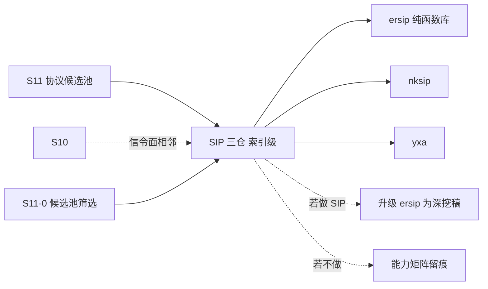

# S11 索引级立项稿 — SIP/SDP 纯函数库（poroh/ersip）

- **文档版本**：v0.1（索引级立项稿，2026-11-11）
- **对应 Roadmap**：[`docs/roadmap.md`](../roadmap.md) §13（S11 协议候选池）
- **调研来源**：[`poroh/ersip`](https://github.com/poroh/ersip)（`master`）
- **状态**：**立项规划，未开工，无「已实测」数字**。**本文为索引级稿**：SIP 三仓（nksip / yxa / ersip）本轮只做索引级登记，未做源码级调研。
- **三段式读法**：§2 协议整理（索引级事实）→ §3 需求提炼（候选 / 待深挖）→ §4 开发计划（深挖入口）。
- **在 SIP 三仓中的位置**：**若未来要做 SIP，本仓是三仓里最符合 ADR-001 的一个**——纯函数、零依赖、无 supervisor/server/ETS，可嵌入 `broker_proto_*` adapter。但 SIP 本身不在本轮深挖范围。

---

## 0. 来源与证据口径

| 来源 | 位置 | 取用范围 |
|---|---|---|
| [`ersip` README](https://github.com/poroh/ersip) | `master` | Approach to design、Provided primitives、Supported RFC 清单、Roadmap、License |

**证据口径**：只取 README 层事实，未读 `src/`、未核对依赖与 OTP 兼容性；RFC 覆盖程度按 README 的「partially / header only」原样保留。本文不含任何性能数字。本阶段只新增文档，不改「S0–S8 已实现」状态行与 `docs/security.md` §12 清单。

---

## 1. 定位、分层与对位

### 1.1 一行索引

**Erlang 的 SIP/SDP 纯函数解析与协议原语库，不含服务器、监督树、ETS、依赖。**

| 面 | 内容 | 与 Broker 关系 |
|---|---|---|
| 解析层 | `ersip_conn`（流拆包）、`ersip_msg`、`ersip_sipmsg`（惰性高层消息） | 可嵌入 adapter 的编解码层 |
| 协议层 | 事务 `ersip_trans`、UAS `ersip_uas`、Registrar、Proxy、Dialog | 协议状态机原语 |
| 运行层 | ❌ **明确没有** Supervisors / Servers / ETS / Dependencies | 由宿主提供（正是 Broker 的强项） |
| 消息语义 | pub/sub / 队列 / ACK | ❌ 无关 |

### 1.2 对位与结论（推导）

README 的「What you cannot find in ersip: Supervisors / Servers / ETS / Dependencies. You can find only pure functions that are compliant to SIP specification」与 ADR-001「协议适配与消息内核解耦」高度同构：解析 / 状态机交给库，连接 / 监督 / 身份 / 可观测由 `broker_proto_*` adapter 提供。这与 S8-A 把 RFC 6455 帧编解码抽成 `broker_ws` 是同一种拆法。

**结论**：候选池标 **P2**，但**在 SIP 三仓里排第一**（优先于 [`s11-nksip.md`](s11-nksip.md) 的完整框架与 [`s11-yxa.md`](s11-yxa.md) 的历史套件）。**本轮仍不做为消息接入协议立项**；若 S11-0 裁决「要做 SIP」，则把本仓升级为深挖稿。

**非目标**：SIP 全套 UA / INVITE dialog / Authorization（README Roadmap 里均为 TODO）、SDP 全量、把 SIP 做成第七种消息协议、官方 CloudEvents Binding 逐字实现（S7 已结案「不立项」）。

---

## 2. 协议整理（仅索引级）

| 项 | 索引级事实（README 逐字） |
|---|---|
| 定位 | 「Erlang SIP and SDP library」；「Full module documentation is available [doc/README.md]」 |
| 设计取向 | 不含 Supervisors / Servers / ETS / Dependencies；只有符合 SIP 规范的纯函数 |
| 原语 | `ersip_conn`（流拆包取低层 SIP 消息）、`ersip_msg`（低层消息）、`ersip_sipmsg`（惰性高层消息）、`ersip_trans`（事务）、`ersip_uas`、`ersip_registrar`、`ersip_proxy`（有状态）、`ersip_dialog` |
| RFC（核心） | RFC 2543（向后兼容）；**RFC 3261 部分**：§7 SIP Messages、§8.2 UAS Behavior、§9 Canceling、§10 Registration（仅 Registrar）、§12 Dialogs、§16 Proxy Behavior、§17 Transactions、§18 Transport、§19 Common Message Components |
| RFC（扩展） | RFC 3262（PRACK：§6/§7 RSeq/RAck）、RFC 6026（INVITE 2xx 事务处理）、RFC 3581（rport）、RFC 4475（torture test messages）、RFC 5118（IPv6 torture）、RFC 4566 SDP（部分）、RFC 3515（Refer-To，**仅 header/method**）、RFC 6665（Event / Subscription-State，**仅 header/method**）、RFC 3891（Replaces，**仅 header**）、RFC 3966（tel URI） |
| Roadmap 已完成 | 低层 parser、essential headers、高层消息、无状态 proxy（请求/响应传递）、事务（事务识别 / Non-INVITE / INVITE）、Registrar、parser limits、有状态 proxy、common dialog、SDP |
| Roadmap 待办 | 详细文档与教程、**Authorization / Proxy-Authorization**、**INVITE dialog**、**High-level UA** |
| 真实用例 | `poroh/ersip_proxy`（有状态 SIP proxy）、`poroh/piraha`（hunt group / B2BUA 示例） |
| License | MIT |

**实现特征与风险（索引级）**：F-1 纯函数 / 零依赖 / 无运行时，最易嵌入；F-2 RFC 3261 是「partially」，多份扩展只做 header/method，**不得声称「完整 SIP 栈」**；F-3 授权、INVITE dialog、High-level UA 仍在 TODO，认证需 adapter 自补；F-4 默认 SIP 端口 5060 / 传输矩阵未在 README 明写，待深挖；F-5 依赖 / OTP 兼容性未核；F-6 SIP 三仓重复；F-7 与 S10 WebRTC 信令面相邻但不同协议。

---

## 3. 需求提炼（候选，待深挖后定稿）

| 编号 | 结论 / 候选 | 优先级 |
|---|---|---|
| R-C1 | 必须把本仓标为「SIP 纯函数库 / 非消息协议」，**不得**列入消息协议接入实现范围（本轮） | P0 |
| R-C2 | 必须先在 S11-0 收敛「是否做 SIP」；若做，**优先升级本仓为深挖稿**，并把 nksip / yxa 定为「框架 / 历史参考」 | P0 |
| R-C3 | 若做 SIP，必须按 ADR-001 拆层：解析 / 状态机用库，连接 / 监督 / 身份 / ACL / 可观测由 adapter 提供 | P0 |
| R-C4 | 必须在能力矩阵逐行留痕：RFC 3261 仅部分、扩展仅 header/method、Authorization / INVITE dialog / High-level UA 为 TODO | P0 |
| R-C5 | 必须在候选池总览写明与 S10 信令面的相邻关系及「不重复立项」 | P0 |
| R-C6 | 若未来真要评估，须先补齐 F-4/F-5 的源码级复核（端口 / 传输矩阵、依赖、OTP 兼容） | P2 |
| R-E1 | 本候选不单独设 Gate / 子阶段；结论并入 S11-0 候选池筛选 | P0 |

---

## 4. 下一阶段开发计划

### 4.1 深挖入口与依赖

无独立实现阶段；SIP 三仓在 S11-0 作为一组统一裁决。本仓是「若做」分支的入口。

### 4.2 Gate（并入 S11-0，不另开）

- [ ] SIP 三仓完成统一裁决（不做 / 做则升级 `ersip` 为深挖稿）
- [ ] 能力矩阵逐行留痕 RFC 覆盖程度与 TODO 项
- [ ] 未引入 SIP 代码 / 依赖 / 端口，未新增 app

### 4.3 未决问题（并入 S11-0「SIP 一组」）

| 编号 | 问题 |
|---|---|
| OQ-1 | 是否做 SIP？与 S10 WebRTC 信令面是否合并评估 |
| OQ-2 | 若做，Authorization / INVITE dialog / High-level UA 由 adapter 补还是等上游 |
| OQ-3 | 传输矩阵（UDP/TCP/TLS/WS）与端口、证书的落点 |
| OQ-4 | 与 S8-A `broker_ws` 抽层经验的类比是否成立（编解码库 ↔ adapter） |

### 4.4 口径说明

1. 本文是**索引级规划稿**，§2 未做源码级调研；任何「已完成 / 已实测」表述都不适用。
2. 事实与推导分开：§2 是 README 层索引，§1/§3 的「是否立项」是 UnifiedMQ 的推导。
3. 不新增 app / 端口 / 代码路径；现有状态行本阶段不同步。
4. 沿用 ADR-001、S10、S7、CloudEvents 逐字 Binding「不立项」等既有结论。

---

## 5. 参考资料

- [`poroh/ersip`](https://github.com/poroh/ersip)（README、`doc/README.md` 指引；`src/` **待深挖**）
- [`poroh/ersip_proxy`](https://github.com/poroh/ersip_proxy)、[`poroh/piraha`](https://github.com/poroh/piraha)（README 列出的真实用例）
- 本仓 [ADR-001](../adr/001-protocol-adapter-separation.md)、[ADR-023](../adr/023-mqtt-over-websocket-two-processes.md)、[`docs/design/s11-protocol-candidates.md`](s11-protocol-candidates.md)
