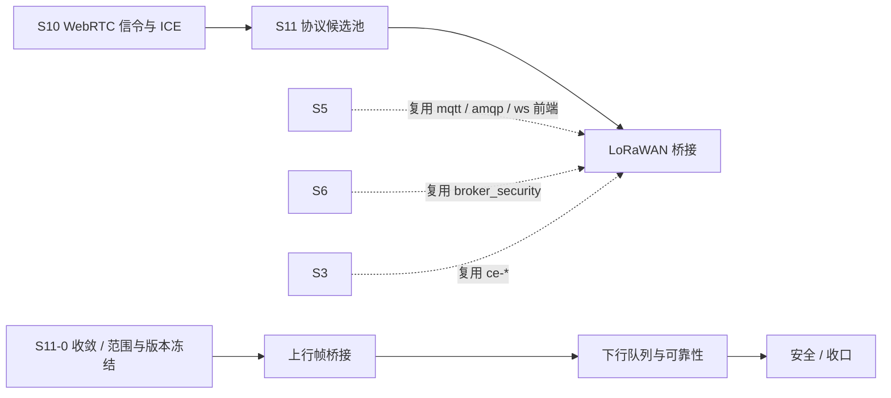

# S11 立项稿 — LoRaWAN（gotthardp/lorawan-server）

- **文档版本**：v0.1（立项规划稿，2026-11-11）
- **对应 Roadmap**：[`docs/roadmap.md`](../roadmap.md) §13（S11 协议候选池）
- **调研来源**：[`gotthardp/lorawan-server`](https://github.com/gotthardp/lorawan-server)（`master`）
- **状态**：**立项规划，未开工，无「已实测」数字**。三段式：§2 协议整理（事实）→ §3 需求提炼（推导）→ §4 开发计划（建议）。
- **读法**：§2 只写仓库 README / `doc/Introduction.md` / `rebar.config` 逐字内容；§3 是映射到 UnifiedMQ 的候选需求；§4 是排期建议。

---

## 0. 来源与证据口径

| 来源 | 位置 | 取用范围 |
|---|---|---|
| [`lorawan-server` README](https://github.com/gotthardp/lorawan-server) | `master` | 功能清单、版本警告、网关协议、区域、连接器、端口、管理界面 |
| `doc/Introduction.md` | `master` | 网关/网络/设备模型、上行去重与 FCnt 处理、下行队列、Class A/B/C |
| `rebar.config` | `master` | OTP 下限与依赖版本 |

**证据口径**：

1. 仓库 README 首行即警告「This is a development version 0.7.0. Use the stable 0.6.x instead」——本文原样保留，作为选型风险事实（F-1）。
2. `lorawan-server` 是**完整的网络服务器 + 应用服务器**，不是协议库；本文区分「仓库事实」与「UnifiedMQ 要立项的对象」，不把整套 NS 当成 adapter。
3. 本文不含任何性能、容量、吞吐数字；按项目惯例（README §11.4 / roadmap §0 第 4 条）这类数字必须来自 S11 起落盘的实测报告。README 自述「没有硬限制」，本文不引用为可承诺指标。
4. 本阶段只新增文档，不改 README / `progress.md` / `architecture.md` 的「S0–S8 已实现」状态行与 `docs/security.md` §12 清单。

---

## 1. 定位、分层与对位

### 1.1 先澄清：这不是「一种消息协议」

LoRaWAN 是**低功耗广域网的 MAC / 网络层规范**，设备不直接连 Broker，中间必须经过网关：

```text
终端(Node) --LoRa 射频--> 网关(Gateway) --UDP/IP--> 网络服务器(NS) --> 应用(AS/后端)
```

`lorawan-server` 把 NS 与 AS 合在一个 Erlang release 里。对 UnifiedMQ 而言，真正的分层是：

| 层 | 内容 | 是否 Broker 职责 |
|---|---|---|
| 射频 / LoRa PHY | 扩频、频段、占空比 | ❌ 不碰 |
| 网关接入协议 | Semtech Packet Forwarder（UDP）、Basic Station LNS Protocol | 可新增前端（或完全不碰） |
| LoRaWAN MAC | MIC/加解密、FCnt、ADR、ABP/OTAA、Class A/B/C、区域参数 | ❌ 完整 NS 语义，非消息内核 |
| 上行帧 → 应用数据 | 去重、解密、解析 Cayenne/CBOR、交给 Handler/Connector | ✅ **Broker 可承接的落点** |
| 后端连接器 | WebSocket / HTTP / MQTT 3.1.1 / AMQP 0-9-1 | ✅ **UnifiedMQ 已实现其中三种** |

**关键判断**：README 的 Connector 清单里，MQTT v3.1/v3.1.1、AMQP 0-9-1、WebSocket(RFC6455) **正是 UnifiedMQ 已实现的协议**（S5 / S8-B）。所以最自然的定位不是「把 LoRaWAN 做成第七种接入协议」，而是 **UnifiedMQ 作为 lorawan-server 的后端承载面**——上行帧成为 `broker_message`，下行指令由 Broker 的订阅/推送出口回到 NS。若立项，应只取「LoRaWAN 上行/下行到统一消息模型的桥接」，**不重写 NS**。

### 1.2 与 UnifiedMQ 现有抽象的对位

按 [ADR-001](../adr/001-protocol-adapter-separation.md) 与 roadmap §0「协议层横向解耦」：

| LoRaWAN 概念 | 落点（既有能力 / 待补） | 依据 |
|---|---|---|
| 上行应用帧 | `broker_message`（ADR-009）+ `broker_router` destination；一设备一 topic 或按 DevAddr/AppEUI 分组 | ADR-009/010 |
| 去重 / FCnt 单调性 | 与 QoS 去重 / 幂等（ADR-012/018）同构，但**不是** MQTT QoS 状态机 | ADR-012/018 |
| 下行队列（Class A 等下一次上行） | 队列 / 订阅 / 重投递 / TTL / DLQ（ADR-013/014/015） | ADR-013/014/015 |
| Connector（MQTT / AMQP / WS / HTTP） | 既有 `broker_proto_mqtt` / `broker_proto_amqp` / `broker_proto_ws` | `docs/architecture.md` §2.1 |
| 设备身份（DevEUI / DevAddr / AppKey / NwkSKey / AppSKey） | **六协议共用 `broker_security` 身份表**（S7）+ ACL；密钥不得进日志 | `docs/security.md` §2.1/§4 |
| 载荷（Cayenne LPP / CBOR） | CloudEvents `ce-*` 通道可选映射（S3）；沿用 S7「逐字 Binding 不立项」 | ADR-020、`docs/roadmap.md` §9.1 |
| 可观测 / 健康告警 | ADR-016 最小集 + 管理 API | ADR-016 |

### 1.3 定位结论与非目标边界

**结论**：候选池 **P1**。价值在于「IoT 广域设备 → 消息 Broker」的天然上游，且后端连接器与 UnifiedMQ 已实现协议重叠；但立项范围必须严格收窄为「桥接 / 接入前端」，**不重写 LoRaWAN 网络服务器**。若 S11 只立一个协议，CoAP 更直接（见 [`s11-coap.md`](s11-coap.md) §1.3）。

**非目标（明确不做）**：

| 项 | 说明 |
|---|---|
| 重写 LoRaWAN NS / AS（MIC、加解密、OTAA Join、ADR、区域参数、Class B） | 这是完整协议栈，不是消息接入层；README 且自述 0.7.0 为开发版 |
| LoRa PHY / 网关固件 / Semtech Packet Forwarder 实现 | 硬件与射频边界 |
| Class B（README 明确「Currently not supported」） | 逐行写入能力矩阵 |
| 内置 MongoDB 存储、ng-admin 管理界面、邮件/Slack 告警 | 仓库自带组件，Broker 不复制 |
| LoRaWAN 1.1 / 1.0.4、Regional Parameters 新版本 | 首期只对齐仓库的 1.0.3 |
| Basic Station LNS 全套（含 TLS / CUPS） | 首期仅作事实记录，是否立项留 OQ |
| 官方 CloudEvents Binding 逐字实现 | S7 已结案「不立项」 |

---

## 2. 协议整理（调研事实）

### 2.1 仓库组成与依赖

`lorawan-server` = 单个 Erlang/OTP release（`rebar.config` 的 `relx` 为 `{'lorawan-server', "0.7.0"}`），`require_min_otp_vsn, "21"`（README 自述需 OTP 21.0+）。

`rebar.config` 依赖逐字：

| 依赖 | 版本 | 依赖 | 版本 |
|---|---|---|---|
| `lager` | `3.7.0` | `gen_smtp` | `0.15.0` |
| `eid` | git tag `0.6.0` | `amqp_client` | `3.7.18` |
| `cowlib` | git tag `2.6.0` | `emqtt` | git tag `v1.1.1` |
| `cowboy` | git tag `2.5.0` | `erlmongo` | git ref `f0d03cd` |
| `gun` | git tag `1.3.0` | `prometheus_cowboy` | `0.1.8` |
| `jsx` | `2.10.0` | `cbor` | git ref `b5c9dbc` |
| `iso8601` | `1.3.1` | | |

`post_hooks` 里有 `npm install --save` 与十几条 `cp node_modules/...`（jQuery、ng-admin、vis、leaflet 等）用于管理界面——**构建过程引入 Node/npm 前端资产**，是依赖审计的重要事实。

### 2.2 协议覆盖与端口

| 项 | README 逐字内容 |
|---|---|
| 规范 | LoRaWAN Specification **v1.0.3**；区域参数覆盖 Europe / US / China / Australia / Asia / South Korea / India / Russia |
| 网关协议 | Semtech **Packet Forwarder**（UDP）；**Basic Station LNS Protocol**（`doc.sm.tc/station/tcproto.html`） |
| 默认网关端口 | `1680`（README：「set the server address and port (by default 1680) in the LoRaWAN gateways」） |
| 管理界面 | `http://<server>:8080`，默认 `admin`/`admin`（README 要求安装后立刻改密） |
| 载荷格式 | Cayenne Low Power Payload、CBOR（README 引 RFC 7049） |
| 后端连接器 | WebSocket(RFC 6455)、HTTP/1.1 + HTTP/2 REST、**MQTT v3.1/v3.1.1**、**AMQP 0-9-1**（RabbitMQ） |
| 存储 | 上行数据直接写 MongoDB collection |
| 设备 | Class A / Class C（**Class B 不支持**）；ABP 与 OTAA；confirmed / unconfirmed 上下行；组播 |
| 加密 | 执行全部 MIC 校验与解密；ABP 支持 relaxed frame-counter check |

### 2.3 数据流（`doc/Introduction.md` 逐字）

**模型**：网关（Gateway）→ 网络（Network）→ Profile（设备型号静态配置）→ Commissioned Device（OTAA 入网参数：DevEUI / AppEUI / AppKey）→ Activated Node（ABP/OTAA 已入网：DevAddr / NwkSKey / AppSKey / FCnt / ADR）。后端由 **Handler**（定义上下行消息格式、字段、confirmed 重传逻辑）与 **Connector**（协议、目标端点、编码）组成。

**上行**（逐字要点）：

1. 一个上行帧可能被**多个网关**收到；网关只是简单转发。
2. 服务器**过滤重复帧**（多网关收到同一帧）。
3. 校验 MIC 并解密应用数据。
4. 比较 `FCnt Up` 与上次值：
   - **增加** → 调用 Application Handler；
   - **相同** → 判定为重传，只记入 Received Frames，**不调用 handler**；
   - **减少** → 生成 error Event，除非 `FCnt Check = Reset on zero`，此时按「增加」处理。
5. README 给出的占空比约束示例：0.1% 占空比 → 1 小时总发送 < 3.6s、每帧 < 0.72s、间隔 > 0.72s；1% → 总 < 36s、每帧 < 3.6s、间隔 > 1.8s。并明确「LoRaWAN is thus not suitable for continuous transmissions」。

**下行**（逐字要点）：

- Class A：设备仅在上行后短暂开窗；若无上行则下行帧**在服务器排队**等待下一次上行。
- Class B：**Currently not supported**。
- Class C：持续监听；应用可设 `time`（时间戳或 `immediately`），服务器交给网关调度。
- 组播：专用 DevAddr（不得与任一 Node 地址冲突）+ `time` 参数，一次下行到多个 Class C 设备。
- 网关选择：下行发给「**indicated best RSSI**」的那个网关。

### 2.4 实现特征与风险（事实 → 需求输入）

| 编号 | 事实 | 对 S11 的含义 |
|---|---|---|
| F-1 | README 首行警告 0.7.0 是开发版、建议用 0.6.x；大版本升级后必须重新核对配置 | 选型须先冻结版本，不得直接跟 `master` |
| F-2 | 依赖 13 个库 + git ref 的库 + npm 前端资产；`require_min_otp_vsn "21"` | 依赖审计、OTP 28.3.1 兼容性、npm 构建链都要 S11-0 收敛 |
| F-3 | 是完整 NS+AS，不是可嵌入的协议库 | **不得**把它当 `broker_proto_*` 照搬；立项范围必须收窄为桥接 |
| F-4 | Connector 已含 MQTT 3.1.1 / AMQP 0-9-1 / WebSocket | 与 UnifiedMQ 已实现协议重叠，宜用「Broker 作后端」而非再加前端 |
| F-5 | 默认管理口令 `admin`/`admin`，README 要求安装后立即修改 | 若引入必须给默认凭据强制变更与审计用例 |
| F-6 | 上行去重 + FCnt 单调判定 + 重传只记日志不调 handler | 这是「恰好一次/去重」语义，须按 ADR-007 显式分档，不得含糊 |
| F-7 | 下行在 Class A 排队等下一次上行，可能长期不投递 | 必须绑定 TTL / DLQ / 重投递（ADR-014/015），并给出明确过期口径 |
| F-8 | 设备密钥（AppKey / NwkSKey / AppSKey）在配置里，README 未说明密钥存储 | 必须接密钥管理口径，禁止进日志 / 指标 / 审计明文 |
| F-9 | 组播 DevAddr 与单播地址不得冲突；Class B 不支持 | 能力矩阵逐行留痕 |
| F-10 | 载荷解析（Cayenne / CBOR）在 NS 内完成 | Broker 不解释载荷语义，避免串层 |

---

## 3. 需求提炼

**读法**：`R-<组><序号>`；`P0` 首期必须 / `P1` 应做 / `P2` 后续或裁剪。约束按 RFC 2119 中文口径。**候选清单，非已批准规格**；验证见 §4.3 Gate。

### 3.1 接入与桥接（R-B）

| 编号 | 需求 | 来源 | 优先级 |
|---|---|---|---|
| R-B1 | 必须先把立项范围冻结为「上行帧 → `broker_message`、下行指令 → Broker 出口」的桥接，**不得**重写 LoRaWAN NS/AS | F-3、ADR-001 | P0 |
| R-B2 | 上行帧到 `broker_router` destination 的映射（按 DevEUI / DevAddr / AppEUI 分组）必须先有 ADR 冻结 | §2.3、ADR-010 | P0 |
| R-B3 | 应优先复用既有 MQTT / AMQP / WebSocket 接入作为后端 Connector；如需新增网关 UDP 前端，必须独立成 adapter 且默认门控 | F-4、项目惯例 | P0 |
| R-B4 | 必须实现上行去重与 FCnt 单调判定，并与 ADR-007 三档可靠性显式绑定；**不得**把「重传只记日志」写成「可靠投递」 | §2.3、F-6、ADR-007/012/018 | P0 |
| R-B5 | 下行队列必须绑定 TTL / DLQ / 重投递口径，并明确 Class A 长期排队的过期行为 | §2.3、F-7、ADR-014/015 | P0 |

### 3.2 身份与安全（R-X）

| 编号 | 需求 | 来源 | 优先级 |
|---|---|---|---|
| R-X1 | 设备身份必须接**六协议共用 `broker_security` 身份表**（S7）与逐设备 ACL；不得沿用默认口令 | F-5、`docs/security.md` §2.1/§4 | P0 |
| R-X2 | AppKey / NwkSKey / AppSKey 必须走密钥管理口径，**不得**进日志 / 指标 / 审计明文，并给出轮换方案 | F-8、`docs/security.md` | P0 |
| R-X3 | 必须定义网关接入的认证与来源校验（UDP 源可伪造），并对 `1680` / `8080` 端口做暴露面审计 | §2.2、`docs/security.md` | P0 |
| R-X4 | 载荷（Cayenne / CBOR）由上层解释，Broker 不得据此绕过 ACL | F-10、`docs/security.md` §5 | P1 |

### 3.3 与内核映射 / 工程约束（R-M / R-E）

| 编号 | 需求 | 来源 | 优先级 |
|---|---|---|---|
| R-M1 | 上行 / 下行不建 SubRef cursor 之外的第二套内核抽象；持久化与 retention 契约以 ADR 冻结 | ADR-009/013/014 | P0 |
| R-M2 | 应给出到 CloudEvents `ce-*` 通道的可选映射与开关；沿用 S7「逐字 Binding 不立项」 | ADR-020、`docs/roadmap.md` §9.1 | P2 |
| R-E1 | 版本（0.6.x stable vs 0.7.x dev）、13 个依赖、npm 构建链、OTP 28.3.1 兼容性必须在 S11-0 收敛并落 ADR | F-1/F-2、roadmap §0 第 2 条 | P0 |
| R-E2 | 需真实设备 / 网关模拟器证据落盘 `test/protocol-compatibility/` + 能力矩阵与限制清单 | roadmap §10.2 / S8 惯例 | P0 |
| R-E3 | 既有 `rebar3 ct` 零回归（823/823、52 套件）；dialyzer / xref 干净；`rebar3 release` 装配成功 | 项目惯例 | P0 |
| R-E4 | 性能 / 容量数字全部来自落盘实测，不得预先承诺（README 自述「无硬限制」不作为可承诺指标） | README §11.4 / roadmap §0 第 4 条 | P0 |
| R-E5 | 文档同步：roadmap / architecture / operations / security / README / progress / protocol-compatibility | roadmap §10.2 | P1 |

**收口**：§1.3 非目标与 `P2` 项逐行写入能力矩阵（S8 惯例：`docs/protocol-compatibility.md` §4.11–§4.13）。

---

## 4. 下一阶段开发计划

### 4.1 阶段定位与依赖



LoRaWAN 候选**不新增消息内核抽象**，且**优先不新增协议前端**（复用 S5 的 MQTT / AMQP / WS）。它是候选池的独立分支，与 CoAP / 发现类候选不互相引用。

### 4.2 子阶段与 Gate

| 子阶段 | 目标 | 证据 |
|---|---|---|
| S11-0 收敛 | 冻结「桥接而非重写 NS」的范围、版本、依赖、上行/下行→内核映射 | spike + ADR |
| A 上行帧桥接 | 去重 / FCnt 单调 / `broker_message` 映射 / destination 规则 | 网关模拟器上行用例 + 去重专项 |
| B 下行队列与可靠性 | Class A 排队 / TTL / DLQ / 重投递 / 可靠性分档 | 排队过期与 DLQ 用例 + 崩溃恢复 |
| C 安全与收口 | 身份表接线、密钥管理、网关来源校验、能力矩阵、压测、文档同步 | 全量 CT + dialyzer/xref + 容量报告 |

**Gate（结案条件）**：范围由 ADR 冻结且无第二套 NS/内核；设备身份接统一身份表、默认口令被强制变更有专项用例；密钥不泄漏有审计用例；上行去重 / 下行过期分档有测试；真实网关或模拟器证据落盘；既有 `rebar3 ct` 零回归（823/823、52 套件）；数字全部来自实测；非目标逐行留痕。

### 4.3 未决问题（S11-0 必须收敛）

| 编号 | 问题 | 收敛方式 |
|---|---|---|
| OQ-1 | 立项范围：只做后端 Connector（复用既有三协议）还是新增网关 UDP 前端？ | ADR 冻结，默认选前者 |
| OQ-2 | 采用 0.6.x stable 还是 0.7.x dev；`master` 不可直接跟随 | 版本基线 + 配置迁移核对 |
| OQ-3 | 13 个依赖 / npm 前端资产 / OTP 21 下限 与 OTP 28.3.1、rebar3 3.27 的兼容性；是否 vendor | 构建 spike + 依赖审计 |
| OQ-4 | 上行去重 / FCnt 单调与 ADR-007 三档可靠性如何绑定 | ADR 显式分档 |
| OQ-5 | Class A 下行长期排队与 TTL / DLQ 的契约 | ADR-014/015 对齐 |
| OQ-6 | 设备密钥（AppKey/NwkSKey/AppSKey）的托管与轮换 | 与 `docs/security.md` 对齐 |
| OQ-7 | Basic Station LNS / CUPS 是否纳入首期 | 建议裁剪，能力矩阵留痕 |
| OQ-8 | 与 CoAP 候选的优先级：若只立一个协议取哪个 | 候选池评审（[`s11-protocol-candidates.md`](s11-protocol-candidates.md) §3） |

### 4.4 口径说明

1. 本文是**规划稿**：§3 候选需求、§4.2 建议子阶段、Gate 全未勾选；任何「已完成 / 已实测」表述都不适用。
2. 事实与推导分开：§2 逐字取自 README / `doc/Introduction.md` / `rebar.config`；§3 的映射与优先级是 UnifiedMQ 的推导。
3. 不新增 app / 端口 / 代码路径；现有状态行本阶段不同步。
4. 沿用既有结论：CloudEvents 逐字 Binding「不立项」、六协议统一身份表、`docs/security.md` §12 待办，均不重复立项。

---

## 5. 参考资料

- [`gotthardp/lorawan-server`](https://github.com/gotthardp/lorawan-server)（README、`doc/Introduction.md`、`rebar.config`）
- LoRaWAN Specification v1.0.3（README 引用）；LoRaWAN 1.0.3 Regional Parameters
- [Semtech Packet Forwarder](https://github.com/Lora-net/packet_forwarder) / [Basic Station LNS Protocol](https://doc.sm.tc/station/tcproto.html)（README 引用）
- RFC 6455（WebSocket）、RFC 7049（CBOR）、MQTT v3.1.1、AMQP 0-9-1（README 引用的连接器规范）
