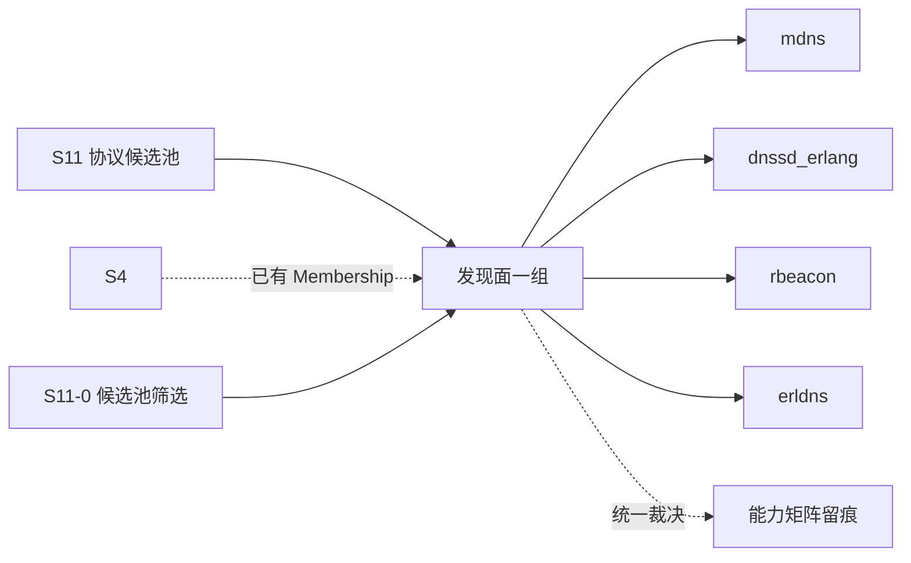

# S11 立项稿 — mDNS / DNS-SD（shortishly/mdns）

- **文档版本**：v0.1（立项规划稿，2026-11-11）
- **对应 Roadmap**：[`docs/roadmap.md`](../roadmap.md) §13（S11 协议候选池）
- **调研来源**：[`shortishly/mdns`](https://github.com/shortishly/mdns)（`master`）
- **状态**：**立项规划，未开工，无「已实测」数字**。三段式：§2 协议整理（事实）→ §3 需求提炼（推导）→ §4 开发计划（建议）。
- **结论速览**：`mdns` 用 DNS-SD（RFC 6763）做 **Erlang 节点自发现并自动组网**（`MDNS_CAN_MESH`），这与 S4 已冻结的 Metadata Raft / Membership / Fencing（ADR-021）**正面冲突**。候选池标 **P2（发现面备选 / 需先裁决冲突）**。

---

## 0. 来源与证据口径

| 来源 | 位置 | 取用范围 |
|---|---|---|
| [`mdns` README](https://github.com/shortishly/mdns) | `master` | 定位、DNS-SD 用法、环境变量表、gproc pub/sub、advertisement 结构 |
| `Makefile` | `master` | 项目版本、DEPS / SHELL_DEPS / PLT_APPS、erlang.mk 构建 |
| `dev.config` | `master` | 运行配置 |
| 仓库根目录清单 | `master` | 构建体系（无 `rebar.config`） |

**证据口径**：

1. 仓库用 **erlang.mk**（根目录只有 `Makefile` / `erlang.mk` / `dev.config`，**没有 `rebar.config`**）；本文按逐字事实记录，不推断依赖。
2. README 自述使用 `gproc` 的 pub/sub，但 `Makefile` 的 `DEPS` 只列 `envy`、`PLT_APPS` 才含 `gproc`——**两处不一致**（F-4），本文标明「README 自述 / Makefile 事实」，不替仓库下结论。
3. README 引用的是 mDNS 早期草案链接与 RFC 6763；本文按 README 逐字引用规范名，不额外声称实现了 RFC 6762 全篇。
4. 本文不含任何性能 / 规模数字；按项目惯例必须来自落盘实测报告。
5. 本阶段只新增文档，不改「S0–S8 已实现」状态行与 `docs/security.md` §12 清单。

---

## 1. 定位、分层与对位

### 1.1 分层

| 面 | 内容 | 是否 Broker 职责 |
|---|---|---|
| 链路本地组播 | IPv4 `224.0.0.251`、UDP `5353`、`.local` 域 | 需新增 UDP 前端 |
| DNS-SD 服务注册 / 发现 | `_erlang._tcp` 服务类型、TXT/PTR/SRV 记录 | 发现面 |
| **Erlang 节点自动组网** | `MDNS_CAN_MESH=true` 时自动形成 Erlang/OTP mesh | ⚠️ **与 S4 冲突** |
| 消息语义 | pub/sub / 队列 / ACK | ❌ 无关 |

**关键判断**：README 逐字写「mDNS will automatically form an Erlang/OTP mesh network of nodes if `MDNS_CAN_MESH` is true」。UnifiedMQ 的集群成员是由 **S4 Metadata Raft + Fencing**（ADR-021）严格控制的——自动组网会让「不受控节点」直接加入 Erlang distribution，绕过共识层与 ACL。因此**若立项，必须默认禁用 `MDNS_CAN_MESH`，只取「广告 / 发现」能力**（OQ-1）。这是本候选的第一号架构问题，与 [`s11-dht.md`](s11-dht.md) 的「第二套成员真相」是同一类风险，但更直接。

### 1.2 与 UnifiedMQ 现有抽象的对位

| 概念 | 落点 | 依据 |
|---|---|---|
| 节点 / 成员 | **S4 Membership + Fencing（ADR-021）已存在**；mDNS 只能作「对外发现面」 | ADR-021 |
| 服务广告 / 订阅 | `gproc` pub/sub（仓库用法）vs 项目 `broker_subscription` / `broker_metrics` | ADR-013 |
| UDP 组播前端 | S8-C MQTT-SN 单 socket 多会话经验、`broker_ws` 无关的纯 UDP 前端 | ADR-022 |
| 身份 | 六协议共用 `broker_security`（S7）；mDNS 只靠 `MDNS_ENVIRONMENT` + cookie | `docs/security.md` §2.1 |
| 可观测 | ADR-016 最小集 | ADR-016 |

### 1.3 定位结论与非目标边界

**结论**：候选池 **P2**。价值是「链路本地零配置发现」，可与 [`s11-dnssd.md`](s11-dnssd.md)、[`s11-rbeacon.md`](s11-rbeacon.md)、[`s11-erldns.md`](s11-erldns.md) 合并评估为「发现面」一组；但**不得**开启自动组网、不得替代 S4。**单独作为消息协议接入不立项**。

**非目标**：

| 项 | 说明 |
|---|---|
| `MDNS_CAN_MESH` 自动组建 Erlang distribution | 绕过 ADR-021 Fencing，明确禁用 |
| 用 mDNS 替代 S4 Metadata Raft / Membership | ADR-021 已有结论 |
| 完整 RFC 6762（含冲突处理、探测、goodbye 包、IPv6 组播） | 首期只取广告 / 发现子集，须在能力矩阵留痕 |
| 引入 `gproc` 作为 Broker 内 pub/sub | 项目已有 `broker_subscription`，不写第二套 |
| 把 DNS 记录当业务消息持久化 | 串层 |
| 官方 CloudEvents Binding 逐字实现 | S7 已结案「不立项」 |

---

## 2. 协议整理（调研事实）

### 2.1 仓库组成与构建

`Makefile` 逐字：`PROJECT = mdns`、`PROJECT_DESCRIPTION = Multicast DNS`、`PROJECT_VERSION = 0.5.0`；`LOCAL_DEPS = crypto`；`DEPS = envy`（`dep_envy = git https://github.com/shortishly/envy.git master`）；`SHELL_DEPS = recon, sync`；`PLT_APPS = any, compiler, gproc, mnesia, recon, runtime_tools, syntax_tools`；`SHELL_OPTS` 用 `-boot start_sasl -config dev.config -name mdns -s mdns -setcookie mdns`；`include erlang.mk`。

`dev.config` 只有 `kernel`（`error_logger` 写 `log/kernel.log`）与 `sasl`（`sasl_error_logger`、错误日志轮转 `10485760` 字节 × 10 文件、`errlog_type all`）两段，**没有 mDNS 协议参数**——协议参数全部走 OS 环境变量（§2.3）。

### 2.2 协议与默认行为（README 逐字）

定位：「mDNS is an implementation of the mDNS discovery protocol written in Erlang/OTP and enables two or more Erlang nodes to self discover and form a mesh network.」「uses the method described in DNS-Based Service Discovery (RFC 6763) to register and discover services.」

默认广告服务类型 **`_erlang._tcp`**，可用 `avahi-browse _erlang._tcp`（OSX：`dns-sd -B _erlang._tcp`）查看。「mDNS will automatically advertise its presence and discover other `_erlang._tcp` nodes.」

**环境变量表（README 逐字）**：

| app env | 环境变量 | 默认 |
|---|---|---|
| `can_advertise` | `MDNS_CAN_ADVERTISE` | `true` |
| `can_discover` | `MDNS_CAN_DISCOVER` | `true` |
| `can_mesh` | `MDNS_CAN_MESH` | `false` |
| `environment` | `MDNS_ENVIRONMENT` | `dev` |
| `multicast_address` | `MDNS_MULTICAST_ADDRESS` | `224.0.0.251` |
| `udp_port` | `MDNS_UDP_PORT` | `5353` |
| `domain` | `MDNS_DOMAIN` | `.local` |
| `service` | `MDNS_SERVICE` | `_erlang._tcp` |
| `ttl` | `MDNS_TTL` | `120` |

组网条件（逐字）：「providing they all share the same `MDNS_ENVIRONMENT` (default: "dev") and have the same distribution cookie」。README 给了两台机器 `MDNS_CAN_MESH=true make shell` 后 `nodes().` 互见的示例。

### 2.3 订阅 API（README 逐字）

「mDNS uses [gproc](https://github.com/uwiger/gproc)'s pub/sub pattern. Consumers can subscribe to mDNS advertisements via `mdns:subscribe(advertisement)`」；伴随 advertisement 的 map 结构：

| Key | 说明 |
|---|---|
| `host` | 广告节点的 hostname |
| `node` | 广告节点的 node name |
| `port` | 广告的 distribution 协议端口 |
| `env` | 该节点的环境 |

「Only nodes that share the same environment can be automatically meshed together.」

### 2.4 实现特征与风险（事实 → 需求输入）

| 编号 | 事实 | 对 S11 的含义 |
|---|---|---|
| F-1 | `MDNS_CAN_MESH=true` 自动组建 Erlang mesh，仅靠 `MDNS_ENVIRONMENT` + cookie 约束 | **绕过 ADR-021 Fencing / ACL**，必须默认禁用并作为专项用例 |
| F-2 | 身份隔离只有 `env` 字符串 + Erlang cookie，无认证 / 无 ACL / 无签名 | 不得作为可信成员来源 |
| F-3 | 组播 `224.0.0.251:5353`、TTL 120、`.local` | 限于链路本地；跨域 / 跨网段不适用，能力矩阵必须写明 |
| F-4 | README 说用 `gproc` pub/sub，`Makefile` 的 `DEPS` 只有 `envy`（`gproc` 只在 `PLT_APPS`） | **依赖口径不一致**，S11-0 必须源码复核，不得据 README 直接声明依赖 |
| F-5 | 用 erlang.mk 而非 rebar3；`SHELL_OPTS` 含 `-name`/`-setcookie` | 与项目 rebar3 3.27 构建体系不同，需评估是否可嵌入 |
| F-6 | 广告 map 携带 `node` / `port` / `host`，可能泄露内部拓扑 | 日志 / 指标 / 对外暴露需最小化 |
| F-7 | `PROJECT_VERSION 0.5.0`、无发布说明 | 版本基线须冻结 |
| F-8 | 未说明 goodbye 包、冲突探测、IPv6 组播 | 不得声称「完整 RFC 6762」 |

---

## 3. 需求提炼

**读法**：本候选不产生消息接入实现需求；以下为**发现面裁剪与留痕要求**。`P0` = 必须。`P1` = 应做。

| 编号 | 需求 / 结论 | 来源 | 优先级 |
|---|---|---|---|
| R-M1 | **`MDNS_CAN_MESH` 必须默认禁用并显式门控**；不得让 mDNS 自动组建 Erlang distribution 绕过 ADR-021 Fencing | F-1、ADR-021 | P0 |
| R-M2 | 必须把 mDNS 限定为「对外发现面」，**不得**替代 S4 Metadata Raft / Membership | §1.1、ADR-021 | P0 |
| R-M3 | 必须给发现的节点补 `broker_security` 身份校验与 ACL；**不得**把 `env` / cookie 当身份 | F-2、`docs/security.md` §2.1 | P0 |
| R-M4 | 必须在 S11-0 源码复核 `gproc` 依赖口径（F-4）与 erlang.mk → rebar3 可嵌入性（F-5），结论落 ADR | F-4/F-5 | P1 |
| R-M5 | 必须在能力矩阵写明：组播范围限于链路本地、TTL 120、`.local`、未实现完整 RFC 6762 | F-3/F-8 | P0 |
| R-M6 | 广告中的 `host` / `node` / `port` 必须最小化，不得进对外日志 / 指标 | F-6、`docs/security.md` §9 | P1 |
| R-M7 | 不得引入 `gproc` 作为 Broker 内 pub/sub；沿用 `broker_subscription` | §1.3、ADR-013 | P0 |
| R-E1 | 本候选不单独设 Gate / 子阶段；结论并入 S11-0「发现面」一组统一裁决 | roadmap §0 第 2 条 | P0 |

**收口**：§1.3 非目标与 R-M* 逐行写入能力矩阵（S8 惯例）。

---

## 4. 下一阶段开发计划

### 4.1 阶段定位与依赖

**无独立实现阶段**：mDNS 与 `dnssd_erlang` / `rbeacon` / `erldns` 一起，在 S11-0 作为「发现面」一组裁决：是否需要发现面、是否需要与 S4 打通、四个候选取哪个（或全部只作参考）。裁决结论写入候选池总览与能力矩阵。

### 4.2 Gate（并入 S11-0，不另开）

- [ ] 发现面一组完成统一裁决，mDNS 的 `MDNS_CAN_MESH` 禁用口径写入 ADR 或裁剪清单
- [ ] 依赖口径（F-4）与构建体系（F-5）复核结论落盘
- [ ] 能力矩阵逐行留痕：链路本地范围、身份不可信、非完整 RFC 6762
- [ ] 未引入 `gproc` 作为 Broker pub/sub，未自动组网，未新增 app / 端口 / 依赖

### 4.3 未决问题（并入 S11-0「发现面」一组）

| 编号 | 问题 |
|---|---|
| OQ-1 | 是否需要发现面？S4 已有 Membership，链路本地发现解决什么真实问题 |
| OQ-2 | 四个发现候选（mDNS / DNS-SD Bonjour / beacon / erldns）取哪个，还是全部只作参考 |
| OQ-3 | `MDNS_CAN_MESH` 与 ADR-021 Fencing 的冲突如何收口（禁用 / 隔离网络 / 审计） |
| OQ-4 | `gproc` 依赖与 erlang.mk 构建的可嵌入性 |
| OQ-5 | 组播在容器 / 云网络（无二层广播）下是否可用 |

### 4.4 口径说明

1. 本文是**规划稿 / 发现面裁决输入**，不是新协议立项；§3 无消息接入实现需求。
2. 事实与推导分开：§2 逐字取自 README / `Makefile` / `dev.config`；§1/§3 的「是否立项」是 UnifiedMQ 的推导。
3. 不新增 app / 端口 / 代码路径；现有状态行本阶段不同步。
4. 沿用 ADR-013/021、S7 统一身份表、CloudEvents 逐字 Binding「不立项」等既有结论，不重复立项、不推翻。

---

## 5. 参考资料

- [`shortishly/mdns`](https://github.com/shortishly/mdns)（README、`Makefile`、`dev.config`）
- RFC 6763（DNS-Based Service Discovery，README 引用）；mDNS 草案（README 引用）；`gproc` pub/sub（README 引用）
- 本仓 [ADR-021](../adr/021-cluster-control-plane-raft-and-fencing.md)、[ADR-013](../adr/013-subscription-kinds-and-cursor-ownership.md)、[`docs/design/s11-protocol-candidates.md`](s11-protocol-candidates.md)
