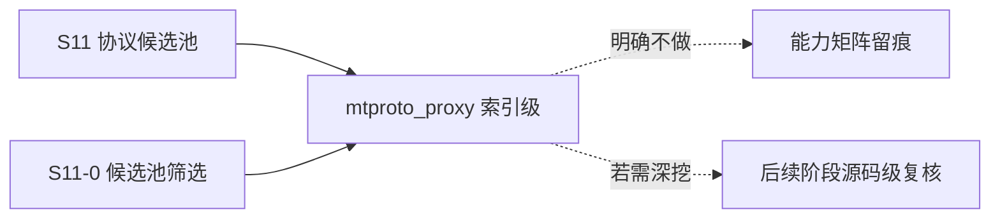

# S11 索引级立项稿 — MTProto Proxy（seriyps/mtproto_proxy）

- **文档版本**：v0.1（索引级立项稿，2026-11-11）
- **对应 Roadmap**：[`docs/roadmap.md`](../roadmap.md) §13（S11 协议候选池）
- **调研来源**：[`seriyps/mtproto_proxy`](https://github.com/seriyps/mtproto_proxy)（`master`）
- **状态**：**立项规划，未开工，无「已实测」数字**。**本文为索引级稿**：按 S11-0 的「先深挖 IoT/UDP 子集」口径，本仓只做一行索引级事实登记，§2 未做源码级调研，源码级结论留待后续阶段补齐。
- **三段式读法**：§2 协议整理（索引级事实）→ §3 需求提炼（候选 / 待深挖）→ §4 开发计划（深挖入口）。

---

## 0. 来源与证据口径

| 来源 | 位置 | 取用范围 |
|---|---|---|
| [`mtproto_proxy` README](https://github.com/seriyps/mtproto_proxy) | `master` | Features、安装、Settings 片段（页面较长，本轮只取前段与配置片段） |

**证据口径**：本轮**只取 README 层事实**，未读 `src/`、未核对 `rebar.config`、未做依赖版本审计；凡涉及精确协议细节、端口矩阵、依赖版本均以「待深挖」标注。本文不含任何性能 / 容量数字（README 自述的高连接数不作为可承诺指标）。本阶段只新增文档，不改「S0–S8 已实现」状态行与 `docs/security.md` §12 清单。

---

## 1. 定位、分层与对位

### 1.1 一行索引

**Erlang 写的高性能 MTProto 代理（TCP 层转发 / 混淆代理），不是消息协议，也不是协议接入库。**

| 面 | 内容 | 与 Broker 关系 |
|---|---|---|
| 客户端接入 | TCP 1443（默认），`dd` 随机包长协议、`ee`/base64 Fake-TLS 协议 | 代理前端 |
| 转发 / 复用 | 多客户端连接复用到少量到上游的连接、域名前置（domain fronting）、SNI 策略 | 代理逻辑 |
| 消息语义 | pub/sub / 队列 / ACK | ❌ 完全无关 |

### 1.2 对位与结论（推导）

按 [ADR-001](../adr/001-protocol-adapter-separation.md)，UnifiedMQ 的接入层是「协议 ↔ 统一消息内核」的适配器；MTProto Proxy 是**端到端流量代理**，两端都不产生 `broker_message`。它与 S9 的出站 webhook、S10 的信令中继也不同构（那两者至少交换结构化事件）。

**结论**：候选池标 **P2 / 明确不做**，仅保留为「Erlang 高并发 TCP 代理工程实践」的一行参考（连接限制策略、配置热更新、front/back 分离）。

**非目标**：代理 / 混淆协议实现、DPI 规避、domain fronting、上游连接复用、split-mode（Erlang distribution 前置/后置分离）、官方 CloudEvents Binding 逐字实现（S7 已结案「不立项」）。

---

## 2. 协议整理（仅索引级）

| 项 | 索引级事实（README 逐字 / 片段） |
|---|---|
| 协议形态 | MTProto proxy；`dd` 前缀的「secure」随机包长协议、`ee`/base64 的 Fake-TLS 协议；`allowed_protocols` 可限定 `mtp_secure` / `mtp_fake_tls` |
| 默认端口 / 密钥 | 默认端口 `1443`；默认 secret `d0d6e111bada5511fcce9584deadbeef`（README 明示例值，生产必须替换） |
| 配置 | `config/prod-sys.config` 的 `ports` 列表，每项 `#{name, listen_ip, port, secret, tag}`；支持多端口各自 secret / promo tag |
| 连接策略 | 按 IP / tls-domain / port 限连，黑白名单；per-SNI 派生 secret；配置可热更新（`make update-sysconfig` + reload） |
| 域名前置 | `domain_fronting off \| sni \| "host:port"`、`domain_fronting_timeout_sec 10`；README 明确写了 `sni` 模式的**回环风险**（SNI 解析到自身 IP 会自连耗尽 fd） |
| 其他 | 客户端 IPv6、多路复用、防重放、front/back split-mode（经 Erlang distribution）、可选指标导出；OTP 要求 README 两处分别写 25 与 20+（**待深挖复核**） |

**实现特征与风险（索引级）**：F-1 端到端代理、非消息协议；F-2 默认 secret 是示例值，生产必须替换；F-3 `domain_fronting` 的 `sni` 模式 README 自述有回环风险；F-4 配置项含上游转发目标（SSRF 类风险）需策略约束；F-5 OTP 版本要求两处不一致；F-6 依赖 / 模块清单 / 端口矩阵未核。

---

## 3. 需求提炼（候选，待深挖后定稿）

**读法**：以下为索引级候选，不是已批准规格；深挖后由 S11-0 重新裁决。

| 编号 | 结论 / 候选 | 优先级 |
|---|---|---|
| R-C1 | 必须把本仓标为「代理 / 非消息协议」，**不得**列入消息协议接入实现范围 | P0 |
| R-C2 | 必须在候选池总览与能力矩阵留一行，写明「明确不做」 | P0 |
| R-C3 | 若引用其工程实践，只取「连接限流策略 / 配置热更新 / front-back 分离」作为参考，不引入代理代码 | P2 |
| R-C4 | 若未来真要评估，须先补齐 §2 的 F-5/F-6（OTP 版本、依赖、模块、端口矩阵）源码级复核 | P2 |
| R-E1 | 本候选不单独设 Gate / 子阶段；结论并入 S11-0 候选池筛选 | P0 |

---

## 4. 下一阶段开发计划

### 4.1 深挖入口与依赖

本候选无实现阶段；唯一动作是 S11-0 确认「不做」并留痕。若后续要引用其工程实践，另开「深挖」任务补齐 §2 的待核项。

### 4.2 Gate（并入 S11-0，不另开）

- [ ] 候选池总览标注「代理 / 非消息协议 / 明确不做」
- [ ] 能力矩阵留出裁剪行
- [ ] 未引入代理代码 / 依赖 / 端口，未新增 app

### 4.3 未决问题（并入 S11-0）

| 编号 | 问题 |
|---|---|
| OQ-1 | 是否连「工程实践参考」都不保留，直接从候选池移除 |
| OQ-2 | 若要做「Broker 前置代理」，是否该由项目自有协议定义而非引入 MTProto |

### 4.4 口径说明

1. 本文是**索引级规划稿**，§2 未做源码级调研；任何「已完成 / 已实测」表述都不适用。
2. 事实与推导分开：§2 是 README 层索引，§1/§3 的「是否立项」是 UnifiedMQ 的推导。
3. 不新增 app / 端口 / 代码路径；现有状态行本阶段不同步。
4. 沿用 ADR-001、S7、CloudEvents 逐字 Binding「不立项」等既有结论。

---

## 5. 参考资料

- [`seriyps/mtproto_proxy`](https://github.com/seriyps/mtproto_proxy)（README、Settings 片段；`src/` / `rebar.config` **待深挖**）
- 本仓 [ADR-001](../adr/001-protocol-adapter-separation.md)、[`docs/design/s11-protocol-candidates.md`](s11-protocol-candidates.md)
