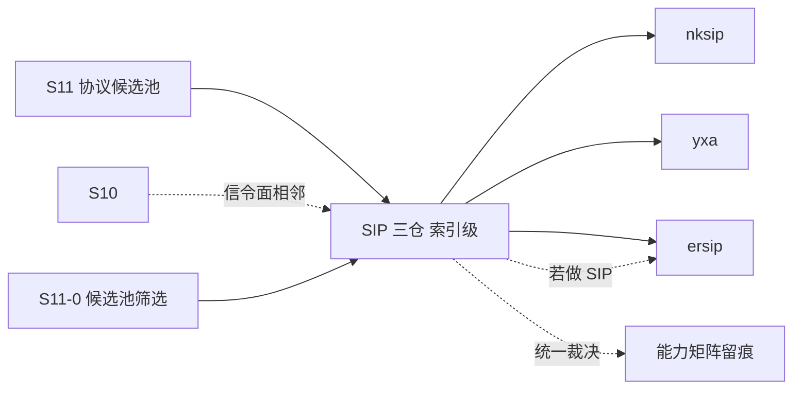

# S11 索引级立项稿 — SIP 应用服务器（erlnets/nksip）

- **文档版本**：v0.1（索引级立项稿，2026-11-11）
- **对应 Roadmap**：[`docs/roadmap.md`](../roadmap.md) §13（S11 协议候选池）
- **调研来源**：[`erlnets/nksip`](https://github.com/erlnets/nksip)（`master`）
- **状态**：**立项规划，未开工，无「已实测」数字**。**本文为索引级稿**：按 S11-0 的「先深挖 IoT/UDP 子集」口径，SIP 三仓（nksip / yxa / ersip）本轮只做索引级登记，未做源码级调研。
- **三段式读法**：§2 协议整理（索引级事实）→ §3 需求提炼（候选 / 待深挖）→ §4 开发计划（深挖入口）。

---

## 0. 来源与证据口径

| 来源 | 位置 | 取用范围 |
|---|---|---|
| [`nksip` README](https://github.com/erlnets/nksip) | `master` | Introduction、Features、Standard plugins、Quick Start |

**证据口径**：只取 README 层事实，未读 `src/`、未核对依赖版本、未做端口矩阵与 OTP 兼容复核。README 的性能数字（3.000 call cycles / 10.000 registrations per second）**不被引用为可承诺指标**。本阶段只新增文档，不改「S0–S8 已实现」状态行与 `docs/security.md` §12 清单。

---

## 1. 定位、分层与对位

### 1.1 一行索引

**Erlang SIP「应用服务器 / 框架」（proxy / registrar / B2BUA / SBC），不是消息协议接入库。**

| 面 | 内容 | 与 Broker 关系 |
|---|---|---|
| SIP 方法 | INVITE / ACK / REGISTER / OPTIONS / INFO / UPDATE / PRACK / SUBSCRIBE / NOTIFY / REFER / PUBLISH / MESSAGE，UAC/UAS/Proxy | 会话信令栈 |
| 传输 | UDP / TCP / TLS / SCTP / WS / WSS；NAPTR + SRV；IPv6 | 多传输前端 |
| 扩展 | 插件机制（Digest 认证、Registrar、Event State Compositor、可靠临时响应、Session Timers、REFER、Outbound/GRUU、Trace/Statistics） | 框架级 |
| 消息语义 | pub/sub / 队列 / ACK | ❌ 无关 |

### 1.2 对位与结论（推导）

SIP 与 S10 的 WebRTC **信令面**相邻（都服务于实时会话建立），但 SIP 是重协议栈：事务状态机、dialog、注册、认证、多传输、NAPTR/SRV、插件体系。它不能像 `broker_proto_*` 那样只挂内核门面。且候选池里已有 **3 个 SIP 仓**（nksip / yxa / ersip），必须先收敛「要不要做 SIP、三选一取哪个」。

**结论**：候选池标 **P2 / 不做为消息接入协议**。若未来要做 SIP，三仓中 [`s11-ersip.md`](s11-ersip.md)（纯函数库、零依赖、无 supervisor/ETS）最符合 ADR-001 的「可嵌入 adapter」形态；nksip 是完整应用服务器，与 `lorawan-server` 同类，照搬会写成第二套服务。

**非目标**：SIP 全套方法 / 事务 / dialog / Registrar / B2BUA / SBC、SCTP / WSS 传输、插件体系、NAPTR/SRV、官方 CloudEvents Binding 逐字实现（S7 已结案「不立项」）。

---

## 2. 协议整理（仅索引级）

| 项 | 索引级事实（README 逐字 / 片段） |
|---|---|
| 定位 | 「NkSIP is an Erlang SIP framework or *application server*」，用于 proxy / registrar / redirect / outbound / B2BUA / SBC / load generator |
| 多 Service | 单实例可起任意多 SIP Service，每个监听一组 transport（udp / tcp / tls / sctp / ws / wss）、IP 与端口；**默认 SIP 端口 5060 未在 README 明写，待深挖** |
| 回调 | Service 可提供 callback module（全部可选、有 sane defaults）；纯出站应用不需要 callback |
| 方法 | 全部当前定义的 SIP method（见 §1.1），可作 UAC / UAS / Proxy；Full SIP Event support |
| 实现 | 「written from scratch, fully typed 100% Erlang code with few external dependencies」；140+ 测试；热配置 / 热代码升级；自动多核 |
| 标准插件 | Digest Authentication、Registrar Server + Automatic Registrations、Event State Compositor、Reliable provisional responses、Session Timers、SIP REFER、Outbound + GRUU、Trace + Statistics |
| Quick Start | `nksip:start(test, #{sip_listen=>"sip:all, sips:all"})` → `{ok,b746wle}`；`nksip_uac:options(test1, "sip:sip2sip.info", [])` → `{ok,200,[]}`；Erlang 21 已测，17+ 应可用 |
| 其他 | IPv6 与 IPv4↔IPv6 桥；NAPTR / SRV（含 priority / weight）；dialog 与 SDP 工具（含媒体起停检测） |

**实现特征与风险（索引级）**：F-1 完整应用服务器 / 框架，非可嵌入库；F-2 传输面极宽（6 种），端口 / 证书矩阵未核；F-3 插件体系本身是一套扩展框架，与 ADR-001 的 adapter 边界易混淆；F-4 README 的性能数字不作为指标；F-5 依赖版本 / OTP 28.3.1 兼容性未核；F-6 SIP 三仓重复，需先收敛选型；F-7 与 S10 信令面相邻但不是同一协议。

---

## 3. 需求提炼（候选，待深挖后定稿）

| 编号 | 结论 / 候选 | 优先级 |
|---|---|---|
| R-C1 | 必须把本仓标为「SIP 应用服务器 / 非消息协议」，**不得**列入消息协议接入实现范围 | P0 |
| R-C2 | 必须先在 S11-0 收敛「是否做 SIP」与「三仓选哪个」；若做，倾向 `ersip`，nksip 只作框架参考 | P0 |
| R-C3 | 必须在候选池总览与能力矩阵留一行，写明与 S10 信令面的相邻关系及「不重复立项」 | P0 |
| R-C4 | 若引用其经验，只取「多 Service / 多 transport 装配、插件化、热配置」作为参考，不引入框架 | P2 |
| R-C5 | 若未来真要评估，须先补齐 F-2/F-5/F-6 的源码级复核（端口矩阵、依赖、OTP 兼容、三仓对比） | P2 |
| R-E1 | 本候选不单独设 Gate / 子阶段；结论并入 S11-0 候选池筛选 | P0 |

---

## 4. 下一阶段开发计划

### 4.1 深挖入口与依赖

无独立实现阶段；SIP 三仓在 S11-0 作为一组统一裁决。

### 4.2 Gate（并入 S11-0，不另开）

- [ ] SIP 三仓完成统一裁决（不做 / 做则选 `ersip`），结论落候选池总览
- [ ] 能力矩阵逐行留痕：应用服务器 / 非消息协议、不重复立项 S10
- [ ] 未引入 SIP 框架 / 依赖 / 端口，未新增 app

### 4.3 未决问题（并入 S11-0「SIP 一组」）

| 编号 | 问题 |
|---|---|
| OQ-1 | 是否做 SIP？与 S10 WebRTC 信令面是否合并评估 |
| OQ-2 | 三仓选哪个（`ersip` 纯库 / `yxa` 历史 / `nksip` 框架） |
| OQ-3 | SIP over UDP/TCP/TLS/SCTP/WS/WSS 的端口与证书矩阵 |
| OQ-4 | 依赖版本与 OTP 28.3.1 兼容性 |

### 4.4 口径说明

1. 本文是**索引级规划稿**，§2 未做源码级调研；任何「已完成 / 已实测」表述都不适用。
2. 事实与推导分开：§2 是 README 层索引，§1/§3 的「是否立项」是 UnifiedMQ 的推导。
3. 不新增 app / 端口 / 代码路径；现有状态行本阶段不同步。
4. 沿用 ADR-001、S10、S7、CloudEvents 逐字 Binding「不立项」等既有结论。

---

## 5. 参考资料

- [`erlnets/nksip`](https://github.com/erlnets/nksip)（README、`doc/README.md` 指引；`src/` / `rebar.config` **待深挖**）
- 本仓 [`docs/design/s11-ersip.md`](s11-ersip.md)、[`s11-yxa.md`](s11-yxa.md)、[`s10-webrtc-signaling.md`](s10-webrtc-signaling.md)、[`s11-protocol-candidates.md`](s11-protocol-candidates.md)
