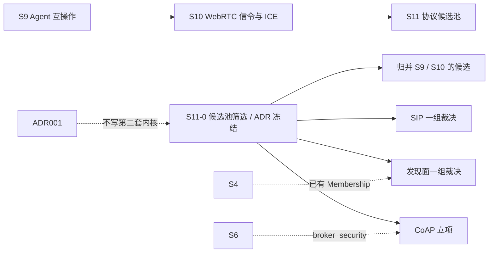

# S11 总览 — Erlang 协议候选池（下一阶段需求）

- **文档版本**：v0.1（立项规划稿，2026-11-11）
- **对应 Roadmap**：[`docs/roadmap.md`](../roadmap.md) §13（S11 协议候选池）
- **前置**：S0–S8 已实现并验证（`rebar3 ct` 823/823、52 套件）；S10 为立项规划、代码未开工；**S9 的实时状态以 [`docs/roadmap.md`](../roadmap.md) §11 为准**（本文不写死 S9 进度，避免与进行中的交付冲突）
- **状态**：**立项规划，未开工，无「已实测」数字，无新增 app / 端口 / 代码路径**。本文是 S11 的**总览与筛选结论**，14 份协议立项稿的索引与优先级都在这里收敛。
- **本轮范围**：按 S11-0 口径，**9 个 IoT/UDP 类仓库深挖**（三段式完整稿），**5 个仓库索引级**（三段式骨架稿，§2 明确标「仅索引级、待深挖」）。深挖 / 索引级的划分见 §1.3。

---

## 0. 来源与证据口径

调研对象为 14 个 GitHub 仓库（`master` / `main` 分支 README、`rebar.config` / `Makefile`、关键源码文件与文档），逐仓来源表见各立项稿 §0。

1. **事实与推导分开**：各稿 §2 只写仓库逐字出现的内容；§1 / §3 的「与 UnifiedMQ 如何对位、是否立项、优先级」是 UnifiedMQ 的**推导**，不属于仓库或规范事实。README 与源码不一致处（如 `mdns` 的 `gproc` 依赖、`stun` 的 `add_listener/3` vs `/4`、`rbeacon` 的 `broadast_if` 拼写）已在各稿 §2.4 标注，以源码 / 标注为准。
2. **不把实现选择写成规范条文**：RFC 号只在仓库 README 逐字引用时记录；`jlouis/dht` 明确「no resemblance to the original BitTorrent protocol」，`gen_coap` 对齐的是 `draft-ietf-core-block-18` 而非 RFC 7959，均不写成「兼容」。
3. **README 自述的性能 / 规模数字一律不引用为可承诺指标**（`nksip` 的 call cycles、`mtproto_proxy` 的连接数、`jlouis/dht` 的 millions of nodes、`lorawan-server` 的「无硬限制」）。按项目惯例（README §11.4 / roadmap §0 第 4 条）所有数字必须来自 S11 起落盘的实测报告。
4. **索引级稿不冒充深挖**：5 份索引级稿的 §2 只做 README 层事实登记，未读 `src/` / 依赖版本；其 OQ 明确写「待深挖」。
5. **状态口径**：S11 全部「⬜ 未开工」，Gate S11 全未勾选。README / `progress.md` / `architecture.md` 的「S0–S8 已实现」状态行与 `docs/security.md` §12 清单本阶段**仍不改动**——规划稿不等于立项实现，待有首个代码交付时统一同步。

---

## 1. 候选池全表

### 1.1 14 行对比表

| # | 仓库 | 协议 / 标准 | 传输 / 端口（仓库事实） | Erlang 形态 | 与 UnifiedMQ 契合度 | 优先级 | 深度 | 立项稿 |
|---|---|---|---|---|---|---|---|---|
| 1 | [`gotthardp/gen_coap`](https://github.com/gotthardp/gen_coap) | CoAP：RFC 7252 / 7641 Observe / 6690 CoRE Link Format / `draft-ietf-core-block-18` | UDP（示例 5683）、`coaps://` DTLS | 纯 Erlang，**零依赖**，client + server + `coap_resource` behaviour | **最高**：Observe 天然「订阅→持续推送」，IoT 定位与 README §1.1 一致；已有 RabbitMQ pubsub 桥接先例 | **P0 建议立项** | 深挖 | [`s11-coap.md`](s11-coap.md) |
| 2 | [`gotthardp/lorawan-server`](https://github.com/gotthardp/lorawan-server) | LoRaWAN **v1.0.3** + Regional Parameters | 网关 UDP **1680**、管理 **8080** | 完整 NS+AS release；13 依赖 + npm 前端资产；OTP 21+ | **高**：上行帧→消息、下行队列；Connector 已含 MQTT 3.1.1 / AMQP 0-9-1 / WS（本项目已实现） | **P1 桥接**，不重写 NS | 深挖 | [`s11-lorawan.md`](s11-lorawan.md) |
| 3 | [`processone/stun`](https://github.com/processone/stun) | STUN RFC 5389 / TURN 5766 / ICE 5245 / 6544 | UDP **3478**（下游另列 5349、relay 49152:65535） | 库；`fast_tls 1.1.26` + `p1_utils 1.0.29` | **中**：已是 S10 的 ICE 依赖候选 | **P1 复用 S10**，不重复立项 | 深挖（依赖级复核） | [`s11-stun.md`](s11-stun.md) |
| 4 | [`dnsimple/erldns`](https://github.com/dnsimple/erldns) | DNS 权威应答 | UDP/TCP 示例 **8053**、Admin **8083** | 应用；`ranch ~>2.3` / `cowboy ~>2.20` / `dns_erlang ~>5.1` 等 7 依赖；**OTP 28** | **低**：命名 / 发现层，非消息协议；与 S4 Membership 可能重复 | P2 参考 | 深挖 | [`s11-erldns.md`](s11-erldns.md) |
| 5 | [`jlouis/dht`](https://github.com/jlouis/dht) | Kademlia DHT（自述，**不兼容 BEP-5**） | UDP | **零依赖**纯 Erlang + QuickCheck 模型 | **低**：服务定位层；**无安全保证 + 概率性存储**与 ADR-007/014 冲突 | P2 参考，明确不做为接入协议 | 深挖 | [`s11-dht.md`](s11-dht.md) |
| 6 | [`kevinlynx/dhtcrawler`](https://github.com/kevinlynx/dhtcrawler) | BitTorrent DHT **应用**；协议在外部 `kdht` | UDP（未核）、HTTP **8000**、MongoDB | 应用；3 个 git `HEAD` + SSH 依赖 | **很低**：爬虫 / 索引，不含协议栈 | P2 **明确不做** | 深挖 | [`s11-dhtcrawler.md`](s11-dhtcrawler.md) |
| 7 | [`shortishly/mdns`](https://github.com/shortishly/mdns) | mDNS / DNS-SD（RFC 6763） | IPv4 组播 **224.0.0.251:5353** | 纯 Erlang（erlang.mk）；`gproc` 口径待核 | **低**：`MDNS_CAN_MESH` 自动组网与 **ADR-021 Fencing 冲突** | P2 参考 | 深挖 | [`s11-mdns.md`](s11-mdns.md) |
| 8 | [`benoitc/dnssd_erlang`](https://github.com/benoitc/dnssd_erlang) | DNS-SD / Apple Bonjour / Avahi | 系统守护进程 | **C port driver**（`dnssd_drv.so` + `-ldns_sd`），无 Erlang 依赖 | **低**：外部守护进程与 **ADR-016 无外部依赖**取舍冲突 | P2 参考 | 深挖 | [`s11-dnssd.md`](s11-dnssd.md) |
| 9 | [`refuge/rbeacon`](https://github.com/refuge/rbeacon) | LAN beacon（自定义，inspired by zbeacon） | IPv4 UDP 广播 | **零运行时依赖**纯 Erlang，API 极小 | **低**：极简发现原语，无认证 / 无完整性 | P2 参考 | 深挖 | [`s11-rbeacon.md`](s11-rbeacon.md) |
| 10 | [`poroh/ersip`](https://github.com/poroh/ersip) | SIP/SDP；RFC 3261 **部分** + 十余扩展（多为 header/method only） | 未核（SIP 默认 5060） | **纯函数库**：无 supervisor / server / ETS / 依赖 | **中**：SIP 三仓中最契合 ADR-001（可嵌入） | P2 若做 SIP 选它 | 索引级 | [`s11-ersip.md`](s11-ersip.md) |
| 11 | [`erlnets/nksip`](https://github.com/erlnets/nksip) | SIP 全方法 | UDP/TCP/TLS/SCTP/WS/WSS | 完整**应用服务器框架** + 插件体系 | **低**：重框架，照搬会写成第二套服务 | P2 参考 | 索引级 | [`s11-nksip.md`](s11-nksip.md) |
| 12 | [`fredrikt/yxa`](https://github.com/fredrikt/yxa) | SIP（RFC 3261 等） | UDP/TCP/TLS **5060** | 历史套件；Mnesia + 分布式 Erlang；**OTP R13B-1~R1501** | **很低**：老基线、重控制面，与 ADR-002/021 冲突 | P2 **明确不做**（历史参考） | 索引级 | [`s11-yxa.md`](s11-yxa.md) |
| 13 | [`seriyps/mtproto_proxy`](https://github.com/seriyps/mtproto_proxy) | MTProto proxy（`dd` / Fake-TLS） | TCP **1443** | 高并发 Erlang 代理 | **无**：端到端流量代理，非消息协议 | **明确不做** | 索引级 | [`s11-mtproto-proxy.md`](s11-mtproto-proxy.md) |
| 14 | [`inaka/apns4erl`](https://github.com/inaka/apns4erl) | APNs over HTTP/2 + JWT | **出站** 443（feedback 2195） | 出站**客户端库**；OTP 27+ | **无**：非接入协议；若做出站应归 S9 webhook 路线 | P2 归并 S9 | 索引级 | [`s11-apns4erl.md`](s11-apns4erl.md) |

### 1.2 分层归类

| 组 | 仓库 | 与 Broker 的关系 |
|---|---|---|
| **A. IoT / 受限设备接入** | gen_coap、lorawan-server | 唯一真正可能成为「新协议接入前端」的一组 |
| **B. NAT 穿越辅助** | processone/stun | 归并 S10 ICE 组件，作依赖复核 |
| **C. 发现 / 命名 / 定位** | erldns、mdns、dnssd_erlang、rbeacon、jlouis/dht、dhtcrawler | 与 S4 Membership 相邻但**更弱 / 重复**；统一在 S11-0 裁决 |
| **D. 实时会话信令** | nksip、yxa、ersip | 与 S10 信令面相邻，但是重协议栈；三仓需先收敛选型 |
| **E. 代理 / 出站推送** | mtproto_proxy、apns4erl | 无消息语义；明确不做或归并 S9 |

### 1.3 深挖 / 索引级划分（本轮口径）

- **深挖 9 个**（三段式完整稿，含源码级 §2、R-* 需求、Gate、OQ）：`gen_coap`、`lorawan-server`、`processone/stun`、`erldns`、`jlouis/dht`、`dhtcrawler`、`mdns`、`dnssd_erlang`、`rbeacon`。
- **索引级 5 个**（三段式骨架稿，§2 标「仅索引级、待深挖」）：`ersip`、`nksip`、`yxa`、`mtproto_proxy`、`apns4erl`。按 S11-0「先深挖 IoT/UDP 子集」口径，SIP 三仓与代理 / 出站类只登记一行索引事实，源码级调研留待后续阶段。

---

## 2. 与 UnifiedMQ 既有架构的对位（跨候选结论）

### 2.1 统一结论：都不写第二套消息内核

按 [ADR-001](../adr/001-protocol-adapter-separation.md) 与 roadmap §0「协议层横向解耦」，14 个候选**没有一个**需要新的消息内核抽象。可复用的既有能力：

| 既有能力 | 被哪些候选复用 |
|---|---|
| `broker_message` / `broker_router`（ADR-009/010） | CoAP 资源路径、LoRaWAN 上行帧 |
| 订阅 / 游标 / retention / 重投递-DLQ-TTL（ADR-013/014/015） | CoAP Observe、LoRaWAN 下行队列 |
| `broker_security` 六协议统一身份表 + ACL（S7） | 全部「若引入」的候选（14 个仓库自身均未提供生产级认证） |
| `broker_ws` / ranch 装配（S8-A/B、ADR-023） | CoAP/LoRaWAN 的 UDP 前端装配经验 |
| CloudEvents `ce-*` 通道（S3） | 可选映射；沿用 S7「逐字 Binding 不立项」 |
| 可观测最小集 / W3C Trace Context（ADR-016、S7） | 全部 |
| **S4 Metadata Raft + Membership + Fencing（ADR-021）** | ⚠️ 发现类 / DHT / mDNS 候选**不得替代** |

### 2.2 三类「看起来像、其实不是」的陷阱

1. **「服务发现」≠「集群成员管理」**：`jlouis/dht`（无安全保证 + 概率性存储）、`mdns`（`MDNS_CAN_MESH` 自动组网）、`erldns` / `dnssd_erlang` / `rbeacon` 都提供某种「找到节点」的能力，但 S4 已有 Raft 强一致成员与 Fencing。引入会形成**第二套、且更弱的成员真相**。→ 发现面一组必须先裁决「是否需要发现面」。
2. **「完整服务器」≠「协议 adapter」**：`lorawan-server`（NS+AS）、`nksip`（SIP 应用服务器）、`yxa`（SIP 套件）、`erldns`（DNS 服务器）、`dhtcrawler`（爬虫应用）都是**应用 / 服务**，不是可嵌入库；照搬会写成第二套服务。唯一符合 ADR-001 嵌入形态的是 `gen_coap`（client/server + behaviour）、`poroh/ersip`（纯函数库）、`processone/stun`（库）。
3. **「UDP」≠「同一层」**：CoAP 的 CON/ACK 是 datagram 级确认，LoRaWAN 的 FCnt 单调是链路帧去重，MQTT-SN 的 QoS 是会话级——三者都跑 UDP 但**可靠性层级不同**，必须按 ADR-007 显式分档，不得含糊表述「可靠」。

### 2.3 与 S9 / S10 的边界

| 相邻阶段 | 关系 |
|---|---|
| **S9 Agent 互操作层** | `apns4erl` 若要做「出站推送」，归并 S9 的 Push Notification / 出站 webhook（含 SSRF / 签名 / 防重放 / 重试-DLQ-TTL），不另立前端 |
| **S10 WebRTC 信令与 ICE** | `processone/stun` 归并 S10 ICE 组件（依赖级复核回灌 S10-0 OQ-3/5/6）；SIP 三仓与 S10 信令面相邻但**不重复立项** |
| **S5 / S8 既有协议** | `lorawan-server` 的 Connector 已含 MQTT 3.1.1 / AMQP 0-9-1 / WebSocket——优先让 Broker 作后端，不新增前端 |

---

## 3. 优先级结论与建议

### 3.1 结论

| 档 | 仓库 | 建议 |
|---|---|---|
| **A. 建议立项** | `gen_coap` | **若 S11 只立一个协议，取 CoAP**：Observe 天然发布订阅、IoT 定位契合、零外部依赖、纯 Erlang 可嵌入、已有 RabbitMQ 桥接先例 |
| **B. 归并既有阶段，不新开** | `lorawan-server`（桥接，不重写 NS）、`processone/stun`（复用 S10 ICE）、`apns4erl`（归并 S9 出站 webhook） | 按各稿 §3 的范围收窄执行，不产生独立 S11 子阶段 |
| **C. S11-0 统一裁决，倾向只作参考** | 发现面 4 仓（`mdns` / `dnssd_erlang` / `rbeacon` / `erldns`）、DHT 2 仓（`jlouis/dht` / `dhtcrawler`）、SIP 2 仓（`nksip` / `yxa`） | 分「发现面一组」「DHT 一组」「SIP 一组」在 S11-0 收敛；`ersip` 是「若做 SIP」的入口，可升级为深挖稿 |
| **D. 明确不做** | `mtproto_proxy`（端到端代理）、`dhtcrawler`（应用非协议栈）、`yxa`（历史基线） | 候选池与能力矩阵逐行留痕 |

### 3.2 明确不做清单（统一口径）

- 为任何一个候选**写第二套消息内核**（ADR-001）；
- 用 DHT / mDNS / DNS-SD / DNS **替代 S4 的 Metadata Raft / Membership / Fencing**（ADR-021）；
- 把 `lorawan-server` / `nksip` / `yxa` / `erldns` / `dhtcrawler` 这类**完整服务**照搬成 `broker_proto_*`；
- 把 CoAP CON/ACK、LoRaWAN FCnt、MQTT-SN QoS 混为同一可靠性等级（ADR-007）；
- 引入 `avahi-daemon` 等**外部守护进程**作为运行时依赖（ADR-016 取舍，除非 S11-0 显式推翻并落 ADR）；
- 引入 `gproc` 作为 Broker 内 pub/sub（项目已有 `broker_subscription`）；
- 开启 `MDNS_CAN_MESH` 自动组建 Erlang distribution；
- 把 beacon 自定义 binary 载荷当业务消息通道；
- 各协议**官方** CloudEvents Binding 逐字实现（S7 已结案「不立项」）；
- 预先承诺任何性能 / 容量 / 规模数字。

### 3.3 五个索引级稿的「一行索引」

| 仓库 | 一行索引 |
|---|---|
| `poroh/ersip` | SIP/SDP 纯函数库，零依赖无 server，RFC 3261 部分覆盖；SIP 三仓中最契合 ADR-001，若做 SIP 选它 |
| `erlnets/nksip` | Erlang SIP 应用服务器框架（全方法 + 6 传输 + 插件），重框架，只作参考 |
| `fredrikt/yxa` | 早期 SIP 服务器套件（6 应用 + Mnesia + OTP R13B 基线），历史参考，明确不选 |
| `seriyps/mtproto_proxy` | 高并发 TCP MTProto 代理（dd / Fake-TLS / 1443），端到端代理非消息协议，明确不做 |
| `inaka/apns4erl` | APNs over HTTP/2 出站客户端库（证书 / JWT），非接入协议，若做出站归 S9 webhook |

---

## 4. S11 开发计划（Gate 驱动）

### 4.1 阶段定位

S11 是**候选池 / 筛选阶段**，不是「14 个协议一起实现」。它承接 S10（S10 代码未开工，S11 不阻塞 S10），核心产出是**筛选结论 + ADR**，真正进入实现的只有经 Gate 通过的候选（当前建议仅 CoAP）。

### 4.2 子阶段

| 子阶段 | 状态 | 目标 | 证据 |
|---|---|---|---|
| **S11-0 候选池筛选** | ⬜ 未开工 | 回答 §4.4 全部 OQ；冻结「立项 / 归并 / 参考 / 不做」四类结论；产出 ADR | 本总览 + 14 份立项稿 + 评审签认；**不新增 app / 端口 / 代码路径** |
| **S11-A CoAP 前端与编解码** | ⬜ 未开工 | 仅当 S11-0 通过；UDP/DTLS 前端 + 报文编解码 + 资源路由 + `.well-known/core` | libcoap 真实客户端 GET/PUT 用例；既有 823/823 零回归 |
| **S11-B CoAP Observe 与内核映射** | ⬜ 未开工 | Observe 订阅 / 通知 / 取消 + `broker_message` 映射 + 可靠性分档 | Observe 全流程 + 崩溃恢复用例；映射 ADR |
| **S11-C CoAP 安全与一致性收口** | ⬜ 未开工 | 身份表 / ACL / 限流 / 能力矩阵 / 压测 / 文档同步 / ADR 定稿 | 全量 CT + dialyzer/xref + 容量报告 + 安全专项用例 |

> 子阶段命名与粒度是**建议**；实际以 S11-0 评审后冻结的 ADR 为准（同 S8 / S9 / S10 设计稿的落地偏差处理方式）。归并到 S9 / S10 的候选不产生 S11 子阶段。

### 4.3 Gate S11（与 roadmap §13.2 同一份清单）

- [ ] 14 个候选全部有「立项 / 归并 / 参考 / 不做」四选一的明确结论，并由 ADR 冻结
- [ ] 「发现面一组」「DHT 一组」「SIP 一组」完成统一裁决；§3.2「明确不做清单」逐行留痕
- [ ] 5 份索引级稿的「待深挖」项有明确去向（升级 / 移除 / 保留）
- [ ] 经 Gate 通过的候选有真实第三方客户端证据落盘 `test/protocol-compatibility/` + 能力矩阵与限制清单
- [ ] 无第二套消息内核、无替代 S4 Membership、无外部守护进程依赖（除非 ADR 显式推翻）
- [ ] 既有 `rebar3 ct` 零回归（基线 823/823、52 套件）；dialyzer / xref 干净；`rebar3 release` 装配成功
- [ ] 压测 / 容量报告落盘，数字全部来自实测
- [ ] S11 ADR 定稿；roadmap / architecture / operations / security / README / progress / protocol-compatibility 同步
- [ ] 非目标与裁剪项在能力矩阵中逐行留痕

### 4.4 未决问题（S11-0 必须收敛，符合 roadmap §0「不确定性前置」）

| 编号 | 问题 | 为什么阻塞 | 收敛方式 |
|---|---|---|---|
| OQ-1 | **S11 是否只立 CoAP 一个协议**，还是同时推进 LoRaWAN 桥接 | 决定子阶段与资源；两者都与 IoT 契合但形态不同 | 候选池评审 + ADR |
| OQ-2 | **是否需要「发现面」**：S4 已有 Membership，链路本地 / DNS 发现解决什么真实问题 | 决定发现面 4 仓（mdns / dnssd / rbeacon / erldns）是否全部只作参考 | ADR 边界声明 |
| OQ-3 | **是否做 SIP**：与 S10 信令面是否合并评估；若做，三仓选 `ersip` 并升级为深挖稿 | 决定 SIP 一组去向 | 规范跟踪 + ADR |
| OQ-4 | 若做 LoRaWAN：范围是「仅后端 Connector（复用既有三协议）」还是新增网关 UDP 前端 | 决定 R-B3 与端口 / 依赖面 | ADR 冻结 |
| OQ-5 | `processone/stun` 的锁定版本、`add_listener/3` vs `/4` 签名、依赖审计如何回灌 S10-0 | 与 S10 ICE 组件共用，避免两套结论 | 与 S10-0 OQ-3/5/6 合并收敛 |
| OQ-6 | 依赖审计：14 仓的依赖 / OTP 下限 / 构建体系（rebar3 / erlang.mk / autoconf / C 编译 / npm / git HEAD）与 OTP 28.3.1 的兼容性 | 多仓含老基线或不可复现依赖 | 构建 spike + 依赖审计表 |
| OQ-7 | 各组候选与六协议统一身份表 / ACL / 端口的装配顺序 | 避免破坏既有 823 用例与 boot 顺序 | 参照 `docs/architecture.md` §3.1 boot step |
| OQ-8 | 5 份索引级稿的深挖排期（若 S11-0 要求升级） | 索引级稿 §2 不足以支撑实现 | 升级为三段式完整稿后再评 |
| OQ-9 | S11 与 S9 / S10 的先后：在 S9 / S10 仍在交付过程中时 S11 是否可先行 | 三者都复用身份表与前端经验，端口 / 依赖可能互相影响 | roadmap 层面冻结依赖顺序（本文 §4.1 暂定 S9 → S10 → S11） |

### 4.5 口径说明

1. **本文件是规划稿**：§3 是筛选建议、§4.2 是建议子阶段、§4.3 全是未勾选项。任何「已完成 / 已实测」表述都不适用于 S11；Gate 通过后以 ADR 与 `progress.md` 的实测记录为准。
2. **事实与推导分开**：14 份立项稿的 §2 是仓库逐字内容，本文 §1 的「契合度 / 优先级」、§2 的「对位」、§3 的「建议」是 UnifiedMQ 的推导。
3. **现有状态行暂不同步**：README / `progress.md` / `architecture.md` 的「S0–S8 已实现」与 `security.md` §12 清单刻意保留；规划稿不等于立项实现，待有首个代码交付时统一同步。
4. **沿用既有结论**：CloudEvents 逐字 Binding「不立项」（S7）、六协议统一身份表（S7）、S4 Metadata Raft / Fencing（ADR-021）、OTel 导出层与审计签名等 §12 待办，S11 均不重复立项、不推翻。

---

## 5. 文档产出物索引

| 文档 | 仓库 | 深度 |
|---|---|---|
| [`s11-coap.md`](s11-coap.md) | `gotthardp/gen_coap` | 深挖 |
| [`s11-lorawan.md`](s11-lorawan.md) | `gotthardp/lorawan-server` | 深挖 |
| [`s11-stun.md`](s11-stun.md) | `processone/stun` | 深挖（依赖级复核，归并 S10） |
| [`s11-erldns.md`](s11-erldns.md) | `dnsimple/erldns` | 深挖 |
| [`s11-dht.md`](s11-dht.md) | `jlouis/dht` | 深挖 |
| [`s11-dhtcrawler.md`](s11-dhtcrawler.md) | `kevinlynx/dhtcrawler` | 深挖（裁剪结论） |
| [`s11-mdns.md`](s11-mdns.md) | `shortishly/mdns` | 深挖 |
| [`s11-dnssd.md`](s11-dnssd.md) | `benoitc/dnssd_erlang` | 深挖 |
| [`s11-rbeacon.md`](s11-rbeacon.md) | `refuge/rbeacon` | 深挖 |
| [`s11-ersip.md`](s11-ersip.md) | `poroh/ersip` | 索引级 |
| [`s11-nksip.md`](s11-nksip.md) | `erlnets/nksip` | 索引级 |
| [`s11-yxa.md`](s11-yxa.md) | `fredrikt/yxa` | 索引级 |
| [`s11-mtproto-proxy.md`](s11-mtproto-proxy.md) | `seriyps/mtproto_proxy` | 索引级 |
| [`s11-apns4erl.md`](s11-apns4erl.md) | `inaka/apns4erl` | 索引级 |

全部登记在 [`docs/roadmap.md`](../roadmap.md) §15.2「文档产出物」。
