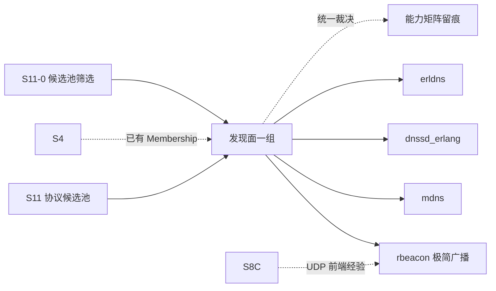

# S11 立项稿 — LAN Beacon 发现（refuge/rbeacon）

- **文档版本**：v0.1（立项规划稿，2026-11-11）
- **对应 Roadmap**：[`docs/roadmap.md`](../roadmap.md) §13（S11 协议候选池）
- **调研来源**：[`refuge/rbeacon`](https://github.com/refuge/rbeacon)（`master`）
- **状态**：**立项规划，未开工，无「已实测」数字**。三段式：§2 协议整理（事实）→ §3 需求提炼（推导）→ §4 开发计划（建议）。
- **结论速览**：`rbeacon` 是**最简单的纯 Erlang LAN 发现原语**——IPv4 UDP 广播、自定义载荷、前缀过滤、`noecho`、active 消息模式。零运行时依赖、API 极小，但**没有认证、没有完整性、广播域内任意主机可伪造**，且只有 IPv4 广播（无组播 / 无跨网段）。候选池标 **P2（发现面备选 / 参考）**。

---

## 0. 来源与证据口径

| 来源 | 位置 | 取用范围 |
|---|---|---|
| [`rbeacon` README](https://github.com/refuge/rbeacon) | `master` | 定位、Version、Usage 示例、环境变量、Modules、License |
| `doc/rbeacon.md` | `master` | 完整函数索引与函数细节（类型 / 返回值 / 选项 / 消息格式） |
| `rebar_dev.config` | `master` | 构建与依赖 |
| 仓库根目录清单 | `master` | 构建体系（无 `rebar.config`） |

**证据口径**：

1. README 逐字写明「heavily inspired on zbeacon from zeromq」——本文按仓库自述记录，不把 zbeacon / ZRE 规范写成已实现标准。
2. README 写的是 app env `broadast_if`（**原文拼写**）与 OS 变量 `RBEACON_INTERFACE`；本文原样保留拼写，不擅自纠正为 `broadcast_if`（F-5）。
3. 根目录只有 `Makefile` / `rebar_dev.config`，**没有 `rebar.config`**；本文按逐字事实记录。
4. 本文不含任何性能 / 规模数字；按项目惯例必须来自落盘实测报告。
5. 本阶段只新增文档，不改「S0–S8 已实现」状态行与 `docs/security.md` §12 清单。

---

## 1. 定位、分层与对位

### 1.1 分层

| 面 | 内容 | 是否 Broker 职责 |
|---|---|---|
| IPv4 UDP 广播 | 局域网广播地址、可配端口、`set_interval` 周期 | 需新增 UDP 前端 |
| 载荷与过滤 | 自定义 binary 载荷、订阅时前缀过滤、`noecho` | 发现面原语 |
| 消息投递 | `recv/1,2` 拉取 / `active` 模式推消息给 owner 进程 | 与 `broker_subscription` 可类比 |
| 消息语义 | pub/sub / 队列 / ACK / 持久化 | ❌ 无关 |

`rbeacon` 与 mDNS / DNS-SD 的区别：**不做服务类型 / 记录 / 解析**，只是「周期性广播一段自定义 binary + 按前缀过滤接收」。它是发现面里最底层、最轻的一层，也因此最容易与 Broker 的「自定义事件通道」混淆——必须明确它**不是**消息协议（§1.3）。

### 1.2 与 UnifiedMQ 现有抽象的对位

| 概念 | 落点 | 依据 |
|---|---|---|
| 节点 / 成员 | **S4 Metadata Raft + Membership（ADR-021）已存在**；beacon 只能作对外发现提示 | ADR-021 |
| 订阅 / 过滤 / active 消息 | `broker_subscription` / 门面回调；`{rbeacon, Beacon, Msg, Addr}` 与项目的消息信封可类比 | ADR-013 |
| UDP 无连接前端 | S8-C MQTT-SN 单 socket 多会话经验 | ADR-022 |
| 身份 | 六协议共用 `broker_security`（S7）；beacon 只有 `SenderIp` | `docs/security.md` §2.1 |
| 可观测 | ADR-016 最小集 | ADR-016 |

### 1.3 定位结论与非目标边界

**结论**：候选池 **P2**。作为「发现面」一组的**最轻参考实现**保留；零运行时依赖、API 极小，适合用作「如果需要一个极简 LAN 提示通道」的原型参考。但**不作为消息协议接入立项**，也**不得**把自定义 binary 载荷当成业务消息通道（会绕过 `broker_message` / ACL / CloudEvents）。

**非目标**：

| 项 | 说明 |
|---|---|
| 把 beacon 载荷当业务消息 / 事件通道 | 绕过统一消息内核与 ACL，明确不做 |
| 用 beacon 替代 S4 Metadata Raft / Membership | ADR-021 已有结论 |
| 声称实现 zbeacon / ZRE / ZeroMQ 规范 | README 只是「inspired on」 |
| 组播、IPv6、跨网段 / 广域发现 | 仓库只做 IPv4 UDP 广播 |
| 认证 / 完整性 / 防重放（若未补齐） | 见 R-B3，未补齐前不得进生产 |
| 官方 CloudEvents Binding 逐字实现 | S7 已结案「不立项」 |

---

## 2. 协议整理（调研事实）

### 2.1 仓库组成与构建

README 逐字：`Version: 0.3.0`，Copyright (c) 2014 Benoît Chesneau，License **MPL v2**，贡献流程用 **C4.1 (Collective Code Construction Contract)**。Modules 只列 `rbeacon` 一个。

`rebar_dev.config` 逐字：`{lib_dirs, ["deps"]}`、`{erl_opts, [{i, "deps"}, {src_dirs, ["src"]}, debug_info]}`、`{deps, [{edown, ".*", {git, "git://github.com/esl/edown.git", {tag, "0.4"}}}]}`、`{edoc_opts, ...}`。`edown` 只用于**文档生成**，即**零运行时依赖**。测试用 `rebar eunit`。

### 2.2 协议与 API（README + `doc/rbeacon.md` 逐字）

定位：「The rbeacon module implements a peer-to-peer discovery service for local networks. A beacon can broadcast and/or capture service announcements using UDP messages on the local area network. This implementation uses **IPv4 UDP broadcasts**. You can define the format of your outgoing beacons, and set a filter that validates incoming beacons. Beacons are sent and received asynchronously in the background.」

类型：`beacon() = pid()`；`beacon_opts() = [active | {active, true|false|once|integer()} | {interval, integer()} | noecho | {noecho, true|false}]`。

| 函数 | 签名 / 语义 |
|---|---|
| `new/1`, `new/2` | `new(Port) -> {ok, beacon()} \| {error, term()}`；`new(Port, Options)` |
| `publish/2` | `publish(Beacon, Msg::binary()) -> ok \| {error, term()}`，按 interval 周期广播 |
| `subscribe/2` | `subscribe(Beacon, Filter::binary() \| string())`；**零长度 filter 表示接收全部** |
| `recv/1`, `recv/2` | `recv(Beacon) -> {ok, Addr::string(), Msg::binary()} \| {error, term()}`；`recv/2` 超时为毫秒或 `infinity` |
| `set_interval/2` | 广播间隔（毫秒），**默认 1000 msec** |
| `setopts/2` | `active` / `{active, ...}`（类比 `inet:setopts/1`）/ `{interval, N}` / `noecho` |
| `noecho/1` | 过滤掉与自己完全相同的 beacon |
| `silence/1` | 停止广播 |
| `unsubscribe/1` | 停止监听 |
| `close/1` | 关闭 beacon |
| `control/2` | `control(Beacon, Pid) -> ok \| {error, not_owner}`，仅当前 owner 可换控制进程 |
| `hostname/1`, `broadcast_ip/1` | 返回本机 IP / 广播 IP 的可打印字符串 |

**消息格式**（`subscribe` 后发给 owner 进程）：

- `{rbeacon, Beacon, Message, SenderIp}` —— 收到订阅的 beacon；
- `{rbeacon, Beacon, closed}` —— beacon 关闭；
- `{'EXIT', rbeacon, Beacon, Reason}` —— beacon 异常退出。

README 示例逐字要点：`rbeacon:new(9999)` + `set_interval(100)` + `publish(<<"announcement">>)`，另一个 `new(9999)` + `subscribe(<<>>)` + `recv` 收到；`noecho(Node1)` 后 `Node1` 只收到 `<<"Node/2">>` 而过滤掉自己的 `<<"Node/1">>` 与不匹配的 `<<"GARBAGE">>`；`[active, noecho]` 选项下用 `receive {rbeacon, Client, <<"announcement">>, _Addr} -> ...`。

接口选择（README 逐字）：app env **`broadast_if`** 或 OS 环境变量 `RBEACON_INTERFACE`。

### 2.3 实现特征与风险（事实 → 需求输入）

| 编号 | 事实 | 对 S11 的含义 |
|---|---|---|
| F-1 | 纯 IPv4 UDP 广播，无组播 / 无 IPv6 / 无跨网段 | 能力矩阵必须写明广播域限制；容器 / 云网络常不可用 |
| F-2 | 载荷是任意 binary，filter 只是前缀匹配；`SenderIp` 是唯一来源信息 | **无认证 / 无完整性 / 无防重放**，广播域内任意主机可伪造 |
| F-3 | `noecho` 只过滤「与自己完全一样」的 beacon，不是安全机制 | 不得当作防伪造 |
| F-4 | `publish` 周期广播（默认 1000ms），`silence` 可停 | 需限流 / 配额，避免广播风暴 |
| F-5 | README 写 `broadast_if`（原文拼写），`rebar_dev.config` 无运行时依赖 | 配置键拼写须按源码复核，不能照抄 README；构建体系（无 `rebar.config`）需评估 |
| F-6 | `recv/1` 无超时可能永久阻塞；`recv/2` 支持 `infinity` | 与项目流控 / 背压口径对齐 |
| F-7 | 零运行时依赖（`edown` 仅文档），API 极小 | 作为**原型参考**成本最低 |
| F-8 | `control/2` 有 `not_owner` 语义，owner 进程模型明确 | 可作「每连接一进程」前端的参考（ADR-023 类比） |
| F-9 | 版本 0.3.0、2014 年、C4.1 流程、无发布说明 | 版本基线须冻结；不得据 README 推断维护状态 |

---

## 3. 需求提炼

**读法**：本候选不产生消息接入实现需求；以下为**发现面裁剪与留痕要求**。

| 编号 | 需求 / 结论 | 来源 | 优先级 |
|---|---|---|---|
| R-B1 | **不得**把 beacon 的自定义 binary 载荷当业务消息 / 事件通道，绕过 `broker_message` / ACL / `ce-*` | §1.3、ADR-001/009 | P0 |
| R-B2 | 不得用 beacon 替代 S4 Metadata Raft / Membership | §1.3、ADR-021 | P0 |
| R-B3 | 若未来进生产，必须先补齐认证 / 完整性 / 防重放并以 ADR 冻结；`noecho` 与 `SenderIp` 不得当安全机制 | F-2/F-3、`docs/security.md` | P0 |
| R-B4 | 必须实现广播限流 / 配额与「无二层广播网络」下的显式降级口径 | F-1/F-4 | P1 |
| R-B5 | 必须在 S11-0 按源码复核 `broadast_if` 配置键拼写（F-5）与 `recv/1` 阻塞语义（F-6） | F-5/F-6 | P1 |
| R-B6 | 应把 `control/2` 的 owner 进程模型、零依赖极小 API 记录为 UDP 前端原型参考 | F-7/F-8、ADR-023 | P2 |
| R-B7 | 必须在能力矩阵写明：IPv4 广播、无认证、不实现 zbeacon/ZRE、非消息协议 | F-1/F-2、README | P0 |
| R-E1 | 本候选不单独设 Gate / 子阶段；结论并入 S11-0「发现面」一组统一裁决 | roadmap §0 第 2 条 | P0 |

**收口**：§1.3 非目标与 R-B* 逐行写入能力矩阵（S8 惯例）。

---

## 4. 下一阶段开发计划

### 4.1 阶段定位与依赖

**无独立实现阶段**：与 `mdns` / `dnssd_erlang` / `erldns` 一起在 S11-0 作为「发现面」一组裁决。本候选的定位是「最轻的原型参考」，不是实现候选。

### 4.2 Gate（并入 S11-0，不另开）

- [ ] 发现面一组完成统一裁决，明确「beacon 不作为消息通道 / 不替代 S4」
- [ ] 能力矩阵逐行留痕：IPv4 广播、无认证、非 zbeacon/ZRE、非消息协议
- [ ] 未引入任何 beacon 运行时依赖，未新增 app / 端口 / 代码路径
- [ ] 若保留为参考，`control/2` owner 模型与配置键拼写复核结论有索引

### 4.3 未决问题（并入 S11-0「发现面」一组）

| 编号 | 问题 |
|---|---|
| OQ-1 | 是否需要发现面？S4 已有 Membership |
| OQ-2 | 四个发现候选取哪个，还是全部只作参考 |
| OQ-3 | 无二层广播的容器 / 云网络下，beacon 与 mDNS 是否都不可用 |
| OQ-4 | 若需要极简 LAN 提示通道，是否该由 Broker 自有协议定义而非引入外部库 |
| OQ-5 | `broadast_if` 配置键与 `recv/1` 阻塞语义的源码复核 |

### 4.4 口径说明

1. 本文是**规划稿 / 发现面裁决输入**，不是新协议立项；§3 无消息接入实现需求。
2. 事实与推导分开：§2 逐字取自 README / `doc/rbeacon.md` / `rebar_dev.config`；§1/§3 的「是否立项」是 UnifiedMQ 的推导。
3. 不新增 app / 端口 / 代码路径；现有状态行本阶段不同步。
4. 沿用 ADR-001/009/013/021/022/023、S7 统一身份表、CloudEvents 逐字 Binding「不立项」等既有结论，不重复立项、不推翻。

---

## 5. 参考资料

- [`refuge/rbeacon`](https://github.com/refuge/rbeacon)（README、`doc/rbeacon.md`、`rebar_dev.config`、`src/`）
- zbeacon（`czmq`/ZeroMQ，README 自述「heavily inspired on」）；C4.1（Collective Code Construction Contract）
- 本仓 [ADR-001](../adr/001-protocol-adapter-separation.md)、[ADR-021](../adr/021-cluster-control-plane-raft-and-fencing.md)、[ADR-022](../adr/022-mqtt-sn-gateway.md)、[ADR-023](../adr/023-mqtt-over-websocket-two-processes.md)
