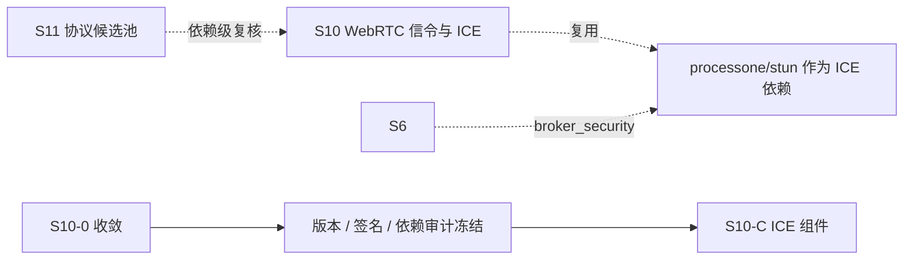

# S11 立项稿 — STUN / TURN（processone/stun）

- **文档版本**：v0.1（立项规划稿，2026-11-11）
- **对应 Roadmap**：[`docs/roadmap.md`](../roadmap.md) §13（S11 协议候选池）
- **调研来源**：[`processone/stun`](https://github.com/processone/stun)（`master`）
- **状态**：**立项规划，未开工，无「已实测」数字**。三段式：§2 协议整理（事实）→ §3 需求提炼（推导）→ §4 开发计划（建议）。
- **重要前置**：本文不是新协议立项。`processone/stun` 已在 [`s10-webrtc-signaling.md`](s10-webrtc-signaling.md) §2.1/§2.2 作为 `lambdaclass/webrtc-server` 的 ICE 依赖出现，并已在 S10 的 R-I* 需求中立项。**本文的定位是「依赖级复核 + 复用结论」，优先级为 P1（复用而非重复立项）**。

---

## 0. 来源与证据口径

| 来源 | 位置 | 取用范围 |
|---|---|---|
| [`processone/stun` README](https://github.com/processone/stun) | `master` | STUN/TURN/ICE 定位、Build、完整 BindRequest 交互示例、References |
| `rebar.config`（`rebar.config.script`） | `master` | 依赖版本、`erl_opts` 的 OTP 兼容宏 |
| [`s10-webrtc-signaling.md`](s10-webrtc-signaling.md) §2.1/§2.2/§2.5/§3.4 | 本仓 S10 立项稿 | `webrtc-server` 调用 `stun_listener:add_listener/3` 的逐字配置 |

**证据口径**：

1. `stun` 是**库**（library），不是独立服务；README 自述「pure Erlang implementation」但**依赖 `fast_tls`（需 OpenSSL 1.0.0+）**——这两句要一起读，不能只引「纯 Erlang」。
2. TURN 的 `use_turn` / `auth_type` / `auth_realm` / `auth_fun` / `turn_ip` 选项**不是**本仓 README 的内容，而是下游 `webrtc-server` 调用时的实参，已在 S10 §2.2/§2.5 逐字记录；本文按「下游事实」标注，不写成 `stun` 库的 API 文档。
3. 本文不含任何性能、吞吐、容量数字；按项目惯例必须来自落盘实测报告。
4. 本阶段只新增文档，不改「S0–S8 已实现」状态行与 `docs/security.md` §12 清单。

---

## 1. 定位、分层与对位

### 1.1 分层

| 面 | 内容 | 与 Broker 的关系 |
|---|---|---|
| STUN（RFC 5389） | Binding Request/Response，返回 `XOR-MAPPED-ADDRESS`，**不中继媒体** | 无状态 UDP 查询 |
| TURN（RFC 5766） | 在 P2P 失败时分配 relay 地址并中继流量 | **有状态、占带宽与端口** |
| ICE（RFC 5245 / RFC 6544） | 候选收集与连通性检查 | 客户端侧，服务器只提供 STUN/TURN 端点 |

README 逐字定位：「A STUN server is used to get an external network address. It does not serve as a relay for the media traffic.」「TURN servers are used to relay traffic if direct (peer to peer) connection fails.」「part of a more general negotiation technique known as ICE」，并明确服务于 VoIP（SIP / Jingle）与 WebRTC。

### 1.2 与 UnifiedMQ 现有抽象的对位

| 概念 | 落点 | 依据 |
|---|---|---|
| STUN/TURN listener | **S10 的 ICE 组件**（`broker_ice` 或等价命名），与消息内核解耦 | [`s10-webrtc-signaling.md`](s10-webrtc-signaling.md) §1.2/§3.4 |
| 长期凭据认证 | 六协议共用 `broker_security` 身份表（S7）+ ACL；**不得**沿用明文 `auth_fun` | `docs/security.md` §2.1、S10 R-I2 |
| 端口矩阵 / 证书 | `broker_security_tls` 口径 + 运维文档 | `docs/security.md`、S10 R-I5 |
| 可观测 | ADR-016 最小集（连接/分配/relay 字节数） | ADR-016 |

### 1.3 定位结论与非目标边界

**结论**：**不重复立项**。`processone/stun` 是 S10 已规划 ICE 组件最直接的依赖候选（`lambdaclass/webrtc-server` 正是用它），候选池标 **P1「复用」**。S11 对其唯一交付是「依赖级复核结论」，交给 S10-0 的 OQ-3/OQ-5/OQ-6 统一收敛。

**非目标**：

| 项 | 说明 |
|---|---|
| 把 STUN/TURN 做成第七种「消息协议接入」 | 它是 NAT 穿越辅助，不是消息语义 |
| 独立新开 ICE 阶段、与 S10 的 `broker_ice` 并存 | 明确复用，禁止两套 |
| TURN over TLS 5349 全套、TURN over TCP、ICE-lite、Trickle ICE 优化 | S10 §1.3 已列为非目标，本文沿用 |
| 官方 CloudEvents Binding 逐字实现 | S7 已结案「不立项」 |
| 直接采用下游 `webrtc-server` 的明文 `auth_fun` 比较 | S10 R-I2 已否决 |

---

## 2. 协议整理（调研事实）

### 2.1 仓库组成与依赖

`rebar.config`（文件名 `rebar.config.script`）逐字要点：

- `{deps, [{fast_tls, ".*", {git, ".../fast_tls", {tag, "1.1.26"}}}, {p1_utils, ".*", {git, ".../p1_utils", {tag, "1.0.29"}}}]}` —— **两个 ProcessOne 依赖，均为 git tag 固定版本**。
- `erl_opts` 含多个 `platform_define`：老 OTP(`R|1|20|21|22`) 走 `USE_OLD_INET_BACKEND` / `USE_OLD_CRYPTO_HMAC`，`R|1|20|21` 走 `USE_OLD_LOGGER`；`{i, "include"}`、`debug_info`。
- 另有 `cover_enabled`、`xref_checks`（undefined functions / deprecated）、`edoc_opts`（preprocess）、`dialyzer`（PLT 加 `eunit`）。

README 自述：「This is a pure Erlang implementation, so you do not need to have specific C libraries installed for the STUN, TURN, ICE code. However, this code depends on ProcessOne Fast TLS, which depends on OpenSSL 1.0.0+ library.」

### 2.2 报文与 API（README 示例逐字）

启动与监听：

```erlang
1> application:start(stun).
ok
2> stun_listener:add_listener({127, 0, 0, 1}, 3478, udp, []).
ok
```

注意 README 示例用的是 **4 参数** `add_listener(IP, Port, udp, Opts)`；[`s10-webrtc-signaling.md`](s10-webrtc-signaling.md) §2.2 记录的 `webrtc-server` 调用是 **3 参数** `add_listener(3478, udp, Opts)`——两处签名不同，属**下游版本/封装差异事实**（F-4），S10-0 须按实际锁定的 `stun` 版本复核。

`#stun{}` 记录（README `rr(stun)` 输出逐字）字段：`class`、`method`、`magic`、`trid`、`raw`、`unsupported`，以及属性：`ALTERNATE-SERVER`、`CHANNEL-NUMBER`、`DATA`、`DONT-FRAGMENT`、`ERROR-CODE`、`LIFETIME`、`MAPPED-ADDRESS`、`MESSAGE-INTEGRITY`、`NONCE`、`REALM`、`REQUESTED-TRANSPORT`、`SOFTWARE`、`UNKNOWN-ATTRIBUTES`、`USERNAME`、`XOR-MAPPED-ADDRESS`、`XOR-PEER-ADDRESS`、`XOR-RELAYED-ADDRESS`。

一次 Binding 交互（逐字）：

```erlang
TrID = random:uniform(1 bsl 96).                 % 事务 id 必须 96 bit
Msg = #stun{method = 16#001, class = request, trid = TrID}.   % 16#001 = STUN_METHOD_BINDING
PktOut = stun_codec:encode(Msg).                 % 20 字节：<<0,1,0,0,33,18,164,66,...>>
gen_udp:send(Socket, {127,0,0,1}, 3478, PktOut).
{ok, Response} = stun_codec:decode(PktIn, datagram).
```

响应里 `magic = 554869826`（即 0x2112A442）、`SOFTWARE = <<"P1 STUN library">>`、`XOR-MAPPED-ADDRESS = {{127,0,0,1},41906}`，README 以 `Addr == Response#stun.'XOR-MAPPED-ADDRESS'` 断言正确性。核心 API 为 `stun_codec:encode/1`、`stun_codec:decode/2`、`stun_listener:add_listener/4`（README 形态）。

**References（README 逐字）**：RFC 5389（STUN）、RFC 5766（TURN）、RFC 5245（ICE）、RFC 6544（TCP Candidates with ICE）。

### 2.3 下游调用形态（来自 S10 §2.2/§2.5，非本仓 README）

```erlang
stun_listener:add_listener(3478, udp,
    [{use_turn, true}, {turn_ip, resolve_ip()}, {certfile, ...},
     {auth_type, user}, {auth_realm, config(hostname)},
     {auth_fun, fun(User, _Realm) -> ... end}]).
```

`auth_fun` 返回 binary 口令；`stun` 把 `<<"">>` 视为认证失败。README 的防火墙清单另列 `3478` tcp/udp、`5349` tcp/udp、`49152:65535` udp（TURN relay 端口范围）；**源码只显式 `add_listener(3478, udp, ...)`**，5349 与 relay 端口段由库/部署层提供。

### 2.4 实现特征与风险（事实 → 需求输入）

| 编号 | 事实 | 对 S10/S11 的含义 |
|---|---|---|
| F-1 | 纯 Erlang 的 STUN/TURN/ICE 代码，但依赖 `fast_tls`（OpenSSL 1.0.0+）与 `p1_utils` | 依赖审计要含 C 库链，不能只按「纯 Erlang」评估 |
| F-2 | 依赖用 git tag `1.1.26` / `1.0.29` 固定，非 hex 版本 | 与本项目 `vendor/` + `_checkouts/` 的离线构建口径需对齐（ADR-003 做法） |
| F-3 | `erl_opts` 有大量老 OTP 兼容宏（R/20/21/22） | 需复核在 OTP 28.3.1 下这些宏是否全部失效、是否引入死代码 |
| F-4 | README 是 `add_listener/4`，下游 `webrtc-server` 用 `add_listener/3` | **签名不一致事实**，S10-0 必须按锁定版本复核（S10 OQ-3） |
| F-5 | README 示例无认证（`Opts = []`），认证选项来自下游调用 | 生产必须显式配置 `auth_type` / `auth_realm` / `auth_fun`，不得裸起 |
| F-6 | `random:uniform/1`（旧 `random` 模块）用于生成 96-bit trid | 现代 OTP 应用 `rand`，且需 CSPRNG；安全复核项 |
| F-7 | 端口 3478 / 5349 / relay 段分散在 README 与下游 README，无统一注册表 | S10 OQ-6 已列为待冻结项 |
| F-8 | 库提供编解码与 listener，不提供身份表 / ACL / 配额 | 认证、配额、审计全部由 S10 adapter 补（S10 R-I2/R-X5） |

---

## 3. 需求提炼（复用结论，非新立项）

**读法**：以下需求**归并到 S10 的 R-I* / R-X* 执行**，不在 S11 另开阶段。`P1` = 依赖级复核交付。

| 编号 | 需求 | 归并到 | 优先级 |
|---|---|---|---|
| R-S1 | 必须在 S10-0 冻结 `stun` 的锁定版本与 `add_listener` 真实签名，解决 F-4 的 3/4 参数差异 | S10 OQ-3 | P1 |
| R-S2 | 必须完成依赖审计：`fast_tls`(1.1.26) / `p1_utils`(1.0.29) 的 OpenSSL 链、git tag 与离线构建口径、OTP 28.3.1 兼容宏 | S10 OQ-3 | P1 |
| R-S3 | TURN 长期凭据认证必须接 `broker_security` 统一身份表，**不得**沿用下游的明文 `auth_fun` 比较 | S10 R-I2 / R-X1 | P0 |
| R-S4 | 生产必须显式配置 `auth_type` / `auth_realm` / `certfile`，禁止 README 示例的 `Opts = []` 裸起 | S10 R-I4 | P0 |
| R-S5 | 端口矩阵（3478 / 5349 / relay 段）与防火墙要求必须在 S10-0 冻结并写入运维文档 | S10 OQ-6 / R-I5 | P1 |
| R-S6 | trid 必须用 CSPRNG（`rand` / `crypto`）生成 96 bit；旧 `random` 模块不得沿用 | 安全复核 | P1 |
| R-S7 | 必须在能力矩阵标注：本仓只覆盖 STUN/TURN/ICE 辅助，不提供消息语义、不提供身份表 | 候选池总览 | P1 |

**收口**：本文不产生新的子阶段与 Gate；其验收并入 S10 Gate（[`s10-webrtc-signaling.md`](s10-webrtc-signaling.md) §4.3 与 roadmap §12.2）。

---

## 4. 下一阶段开发计划

### 4.1 阶段定位与依赖



**流向与候选池其他分支相反**：不是「S11 产出新阶段」，而是「S11 把复核结论回灌 S10」。S10-0 的 OQ-3（依赖选型）、OQ-5（组件归属与 boot 顺序）、OQ-6（端口矩阵）直接消费本文 §2 / §3。

### 4.2 Gate（并入 S10，不另开）

- [ ] 锁定版本与 `add_listener` 签名有源码级复核记录（F-4）
- [ ] `fast_tls` / `p1_utils` 依赖审计与离线构建口径落 ADR（F-1/F-2/F-3）
- [ ] TURN 认证接统一身份表、生产显式配置、trid 用 CSPRNG 有专项用例
- [ ] 端口矩阵写入运维文档
- [ ] 能力矩阵标注「不提供消息语义 / 不提供身份表」

### 4.3 未决问题（并入 S10-0）

| 编号 | 问题 |
|---|---|
| OQ-1 | `stun` 的锁定版本（tag / commit）与 `add_listener/3` vs `/4` 的真实签名 |
| OQ-2 | `fast_tls`(OpenSSL 链) 与本项目 `broker_security_tls` 是否冲突、能否共用证书口径 |
| OQ-3 | `rebar.config.script` 的老 OTP 兼容宏在 OTP 28.3.1 下是否引入不可达分支 |
| OQ-4 | 5349 / relay 端口段是否由库自动开启，还是需部署层显式配置 |

### 4.4 口径说明

1. 本文是**规划稿 / 复核结论**，不是新协议立项；§3 需求全部归并 S10 执行。
2. 事实与推导分开：§2.1/§2.2 是 `stun` 本仓逐字内容，§2.3 明确标注来自下游 `webrtc-server`（S10 已记录）。
3. 不新增 app / 端口 / 代码路径；现有状态行本阶段不同步。
4. 沿用 S10 与 S7 既有结论，不重复立项、不推翻。

---

## 5. 参考资料

- [`processone/stun`](https://github.com/processone/stun)（README、`rebar.config.script`）
- [`processone/fast_tls`](https://github.com/processone/fast_tls) tag `1.1.26`；[`processone/p1_utils`](https://github.com/processone/p1_utils) tag `1.0.29`
- RFC 5389（STUN）、RFC 5766（TURN）、RFC 5245（ICE）、RFC 6544（TCP Candidates with ICE）
- 本仓 [`docs/design/s10-webrtc-signaling.md`](s10-webrtc-signaling.md) §2.1/§2.2/§2.5/§3.4/§4.4
