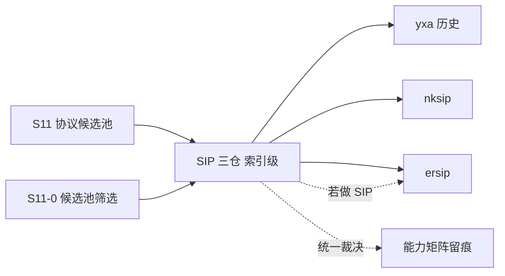

# S11 索引级立项稿 — SIP 服务器套件（fredrikt/yxa）

- **文档版本**：v0.1（索引级立项稿，2026-11-11）
- **对应 Roadmap**：[`docs/roadmap.md`](../roadmap.md) §13（S11 协议候选池）
- **调研来源**：[`fredrikt/yxa`](https://github.com/fredrikt/yxa)（`master`）
- **状态**：**立项规划，未开工，无「已实测」数字**。**本文为索引级稿**：SIP 三仓（nksip / yxa / ersip）本轮只做索引级登记，未做源码级调研。
- **三段式读法**：§2 协议整理（索引级事实）→ §3 需求提炼（候选 / 待深挖）→ §4 开发计划（深挖入口）。

---

## 0. 来源与证据口径

| 来源 | 位置 | 取用范围 |
|---|---|---|
| [`yxa` README](https://github.com/fredrikt/yxa) | `master` | Applications 清单、Installation / SSL / Distributed operation / Configuration 片段 |
| 仓库页面 | `master` | 1754 Commits / 176 stars / 53 forks（页面可见事实） |

**证据口径**：只取 README / 页面层事实，未读 `src/`、未核对依赖与 OTP 兼容性。README 是纯文本 `README`（非 Markdown），配置项较多，本轮只摘与协议 / 端口 / 边界相关的片段。本文不含任何性能数字。本阶段只新增文档，不改「S0–S8 已实现」状态行与 `docs/security.md` §12 清单。

---

## 1. 定位、分层与对位

### 1.1 一行索引

**早期 Erlang SIP 服务器套件（incomingproxy / outgoingproxy / pstnproxy / appserver / eventserver / testserver），基于 Mnesia + 分布式 Erlang，非消息协议接入库。**

| 面 | 内容 | 与 Broker 关系 |
|---|---|---|
| SIP 应用 | 6 个可独立启动的 proxy / server 应用 | 完整服务端 |
| 配置 / 状态 | `<application>.config`、Mnesia、LDAP、CPL 脚本、ENUM | 重控制面 |
| 传输 | UDP / TCP / TLS；`listenport` 默认 `5060` | 多传输 |
| 消息语义 | pub/sub / 队列 / ACK | ❌ 无关 |

### 1.2 对位与结论（推导）

`yxa` 与 [`s11-nksip.md`](s11-nksip.md) 同属「完整 SIP 服务端」，但更早期：README 逐字要求 **Erlang/OTP R13B-1 至 R1501**，配置围绕 Mnesia / LDAP / CPL，且 `eventserver` 的 SIP event 包被自述为 EXPERIMENTAL。与 UnifiedMQ 的 rebar3 / OTP 28.3.1 / `ra` 体系差异最大，且控制面（Mnesia + 分布式 Erlang）会与 ADR-002（Mnesia 只做控制面）、ADR-021（Metadata Raft + Fencing）冲突。

**结论**：候选池标 **P2 / 明确不做（历史参考）**。SIP 三仓若真要选，倾向 [`s11-ersip.md`](s11-ersip.md)；yxa 只保留为「Erlang SIP 历史实现」一行索引。

**非目标**：重写 yxa 的 6 个应用、Mnesia/LDAP/CPL 控制面、ENUM、PSTN 网关对接、SIP event 包（EXPERIMENTAL）、官方 CloudEvents Binding 逐字实现（S7 已结案「不立项」）。

---

## 2. 协议整理（仅索引级）

| 项 | 索引级事实（README 逐字 / 片段） |
|---|---|
| 定位 | 「YXA is a set of SIP servers written in Erlang」；安装要求 Erlang/OTP **R13B-1（最高允许 R1501）** |
| 应用 | `incomingproxy`（注册 + 代理、部分 ENUM/LDAP）、`outgoingproxy`（NAT 后客户端经持久 TCP 收请求）、`pstnproxy`（PSTN 网关认证前端，Remote-Party-Id）、`appserver`（forking + CPL 脚本）、`eventserver`（SIP event 框架，默认包 `presence` RFC3856 / `dialog` RFC4235，**EXPERIMENTAL**）、`testserver`（回归测试，恒回 404 等） |
| 端口 / 传输 | `listenport` 默认 **5060**；`udp_max_datagram_size` 默认 **1200**（超过则从 UDP 切 TCP）；`tcp_connection_idle_timeout` 默认 300 秒、`tcp_connect_timeout` 默认 20 秒 |
| SIP 参数 | `default_max_forwards 70`（README 注 RFC3261 规定值）、`max_max_forwards 255`、`detect_loops true`、`request_rport false`、`stateless_challenges false`、`record_route`（pstnproxy/outgoingproxy 默认 true） |
| 认证 / 用户库 | `sipauth_realm`、`sipauth_password`、`sipauth_unauth_classlist`、`sipauth_challenge_expiration 30`；`userdb_modules` 默认 `[sipuserdb_mnesia]`；`ldap_*` 一组配置 |
| 分布式 | 「setup a distributed erlang system, you must have the same `~/.erlang.cookie`」；Mnesia 表在多节点可读；SSL（`cert.comb`，口令 `foobar`）**只用于 Erlang 分布式，与 SIP TLS 无关** |
| 管理 | 每应用 `<application>.config`、`bin/<app> start` / `-d` 调试控制台、日志 `.debug/.log/.error`，`max_logfile_size` 默认 250 MB（README 注 Erlang 日志到 2GB 会崩） |
| 构建 | `configure && make && make install`（autoconf 2.59），`--with-mnesiadir`、`--with-sslcertdir`、`--with-local` 等 |

**实现特征与风险（索引级）**：F-1 OTP R13B-1~R1501 的老基线，与项目 OTP 28.3.1 差距大；F-2 autoconf + Mnesia + 分布式 Erlang 的重控制面；F-3 `eventserver` 自述 EXPERIMENTAL；F-4 SSL 只保护 Erlang dist、不管 SIP TLS（易误读）；F-5 依赖 / 模块 / 端口矩阵未核；F-6 SIP 三仓重复；F-7 1754 commits 的历史体量，照搬成本高。

---

## 3. 需求提炼（候选，待深挖后定稿）

| 编号 | 结论 / 候选 | 优先级 |
|---|---|---|
| R-C1 | 必须把本仓标为「历史 SIP 服务器套件 / 非消息协议」，**不得**列入消息协议接入实现范围 | P0 |
| R-C2 | 必须先在 S11-0 收敛「是否做 SIP」与「三仓选哪个」；yxa 明确不选 | P0 |
| R-C3 | 必须记录 F-4（SSL 只用于 dist，非 SIP TLS）作为易误读点，避免安全口径出错 | P1 |
| R-C4 | 必须在候选池总览与能力矩阵留一行，写明「明确不做 / 历史参考」 | P0 |
| R-C5 | 若引用其经验，只取「UDP 超长切 TCP（`udp_max_datagram_size 1200`）」作为协议设计参考 | P2 |
| R-C6 | 若未来真要评估，须先补齐 F-1/F-5 的源码级复核（OTP 兼容、依赖、模块） | P2 |
| R-E1 | 本候选不单独设 Gate / 子阶段；结论并入 S11-0 候选池筛选 | P0 |

---

## 4. 下一阶段开发计划

### 4.1 深挖入口与依赖

无独立实现阶段；SIP 三仓在 S11-0 作为一组统一裁决，yxa 的结论是「不选」。

### 4.2 Gate（并入 S11-0，不另开）

- [ ] SIP 三仓完成统一裁决，yxa 标注「明确不做 / 历史参考」
- [ ] 能力矩阵留出裁剪行，记录 F-4 易误读点
- [ ] 未引入 yxa 代码 / Mnesia 控制面 / 端口，未新增 app

### 4.3 未决问题（并入 S11-0「SIP 一组」）

| 编号 | 问题 |
|---|---|
| OQ-1 | 是否做 SIP？与 S10 WebRTC 信令面是否合并评估 |
| OQ-2 | 三仓选哪个（`ersip` 纯库 / `nksip` 框架 / `yxa` 历史） |
| OQ-3 | OTP 28.3.1 下老代码是否有任何可复用部分 |
| OQ-4 | `udp_max_datagram_size` 的 UDP→TCP 切换经验是否值得写入通用 UDP 前端设计 |

### 4.4 口径说明

1. 本文是**索引级规划稿**，§2 未做源码级调研；任何「已完成 / 已实测」表述都不适用。
2. 事实与推导分开：§2 是 README 层索引，§1/§3 的「是否立项」是 UnifiedMQ 的推导。
3. 不新增 app / 端口 / 代码路径；现有状态行本阶段不同步。
4. 沿用 ADR-002/021、S7、CloudEvents 逐字 Binding「不立项」等既有结论。

---

## 5. 参考资料

- [`fredrikt/yxa`](https://github.com/fredrikt/yxa)（`README`、`CHANGES`、`configure.ac`；`src/` **待深挖**）
- RFC 3856（presence）、RFC 4235（dialog）、RFC 3261（`default_max_forwards 70` 由 README 引用）
- 本仓 [ADR-002](../adr/002-mnesia-control-plane-only.md)、[ADR-021](../adr/021-cluster-control-plane-raft-and-fencing.md)、[`docs/design/s11-protocol-candidates.md`](s11-protocol-candidates.md)
