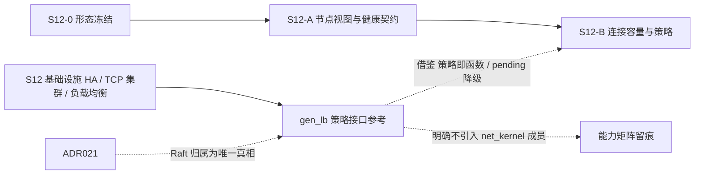

# S12 立项稿 — Erlang 节点间消息负载均衡库（boundary/gen_lb）

- **文档版本**：v0.1（底层调研立项稿，2026-11-11）
- **对应 Roadmap**：[`docs/roadmap.md`](../roadmap.md) §14（S12 基础设施高可用与 TCP 集群负载均衡）
- **调研来源**：[`boundary/gen_lb`](https://github.com/boundary/gen_lb)（`master`）
- **状态**：**立项规划，未开工，无「已实测」数字**。三段式：§2 实现整理（源码级事实）→ §3 需求提炼（推导）→ §4 开发计划（建议）。
- **本仓地位**：4 个仓库中**唯一把「选择策略」做成可插拔函数参数**的实现，对 S12 的「节点选择策略可插拔」需求最有直接参考价值；但它是「Erlang 节点间消息分发」库，**不是 TCP 连接分发**。

---

## 0. 来源与证据口径

| 来源 | 位置 | 取用范围 |
|---|---|---|
| [`gen_lb` 仓库页 / About](https://github.com/boundary/gen_lb) | `master` | 定位「A generic library to load balance communication between Erlang nodes」、License（Apache 2.0）、33 Commits / 64 stars / 5 forks |
| `src/gen_lb.erl` | `master` | 全文 339 行：`#state{}` / `#pending{}`、API、round_robin、成员发现、心跳、请求处理、pending 队列 |
| `src/gen_lb_sup.erl` / `gen_lb_app.erl` / `gen_lb.app.src` | `master` | 监督树、应用元数据、描述 |
| `rebar.config` | `master` | 依赖 |

**证据口径**：

1. 本仓 **README 极简**（只有 About + License 展示，无 API 文档），所有机制结论均来自 `gen_lb.erl` 源码逐行核对；本文按「底层调研」口径补齐源码事实。
2. `gen_lb.app.src` 的 description 写的是 **"A library for generic communication with a cluster of scylla instances."**，与仓库页 About「load balance communication between Erlang nodes」**不一致**（F-8），按源码/页面分别标注，不替仓库裁决。
3. 本文不含任何性能 / 规模数字；按项目惯例所有数字必须来自 S12 起落盘的实测报告。
4. 本阶段只新增文档，不改「S0–S8 已实现」状态行与 `docs/security.md` §12 清单。

---

## 1. 定位、分层与对位

### 1.1 它解决什么，不解决什么

| 面 | 内容 |
|---|---|
| 分发对象 | **Erlang 消息**：`{RemoteService, Node} ! {self(), Ref, Request}`，目标是对端节点上的注册进程 |
| 节点集合 | `sets` 维护的 Erlang 分布式节点列表，来自 seed + `net_kernel:monitor_nodes` + 心跳查询 |
| 策略 | `SelectNode` 是**用户传入的函数** `(Nodes, Request, Context) -> {Node, Context2}`；内置只提供 `round_robin/3` |
| 集群不可用 | `call` 请求入 `pending` 队列等待；`cast` 直接丢弃 |
| TCP 连接 | **无**：不涉及 socket / listener / acceptor |

**一句话**：这是「**把请求发给哪个 Erlang 节点**」的客户端侧路由库，不是「把 TCP 连接分给哪个后端」的接入层 LB。

### 1.2 与 UnifiedMQ 的对位

项目当前没有「请求级跨节点路由」这一层：`broker_router`（ADR-010）负责 destination → partition 的**分区解析**，归属由 `broker_cluster` 的 Metadata Raft 决定（ADR-021 D2）。已有的一致性来源是 ra 多数派，而 gen_lb 的节点集合来自 `net_kernel:monitor_nodes` + 自定义 ping/pong，**无共识、无 Fencing、无 epoch**。

| 维度 | gen_lb | UnifiedMQ |
|---|---|---|
| 节点真相 | `net_kernel:monitor_nodes` 全连接 mesh + 心跳查询 | ra Metadata Raft + `cluster_node` 表（ADR-021 D1/D2） |
| 归属决策 | 客户端 `SelectNode` 函数任意选择 | Raft 提交的 `owner` + epoch Fencing |
| 分区容忍 | 未讨论；nodedown 即从集合删除 | 失去多数派拒绝写入（D4） |
| 请求失败 | 超时 `{error, timeout}`；call 排队、cast 丢弃 | 三档显式可靠性（ADR-007） |

**结论**：**不得**用 gen_lb 的节点集合替代 `broker_cluster` 的归属——会形成第二套、且更弱的成员真相。可借鉴的只有**「策略即函数」的接口设计**与**「集群不可用时排队 + 过期丢弃」**的降级语义。

### 1.3 定位结论与非目标边界

**结论**：候选池标 **P1 / 策略接口参考，不引入实现**。它的 `SelectNode` 函数化策略与 pending 队列，对 S12「节点选择策略可插拔」和「无可用节点时的降级」有直接参考价值。

**非目标**：把 gen_lb 作为依赖引入、`net_kernel` 节点集合作为成员真相、把消息路由当 TCP 连接分发、无上限指数退避、丢弃 cast 的降级策略照搬、官方 CloudEvents Binding 逐字实现（S7 已结案「不立项」）。

---

## 2. 实现整理（源码级事实）

### 2.1 仓库组成与依赖

`src/` 4 个文件：`gen_lb.erl`（14047 字节，339 行，gen_server）、`gen_lb_app.erl`、`gen_lb_sup.erl`、`gen_lb.app.src`；另有 `test/` 目录、`LICENSE`、`rebar.config`、自带 `rebar`。

`rebar.config` 逐字：`{deps, [{meck, ".*", {git, "https://github.com/cliffmoon/meck.git", "master"}}]}`、`{erl_opts, [debug_info]}`、`{cover_enabled, true}` —— **仅测试依赖 `meck`，且为 git `"master"` 字符串、无固定 ref**（F-7）。

`gen_lb_sup:init/1` → `{ok, {{one_for_one, 5, 10}, []}}`（**空监督树**）；`gen_lb_app:start/2` 只调 `gen_lb_sup:start_link()`。`gen_lb.app.src`：`{vsn, git}`、`{registered, []}`、`{applications, [kernel, stdlib]}`、`{env, []}`、`{mod, {gen_lb_app, []}}`。

### 2.2 状态记录与 API（`gen_lb.erl` 逐字）

```erlang
-record(state, {context, select_node, remote_service, seeds, nodes, tref,
                handlers = dict:new(), pending = [], beats_up = 0,
                backoffs = dict:new()}).
-record(pending, {type, request, ref, from, time, timeout}).
-define(HEARTBEAT_INTERVAL, 30000).
```

导出 API：`start_link/3`、`start_link/4`、`start_link/5`、`call/3`、`call_future/3`、`cast/2`、`stop/1`；选择函数导出 `round_robin/3`；gen_server 回调全套。

`start_link` 的 5 个重载收敛到 `gen_server:start_link([Name], ?MODULE, {Seeds, RemoteService, SelectNode, Context}, [])`：
- `Seeds`：原子或列表（种子 Erlang 节点）；
- `RemoteService`：**目标节点上注册进程的原子名**；
- `SelectNode`：函数（guard `is_function(SelectNode)`）；
- `Context`：调用方自定义状态，原样传给 `SelectNode` 并接收其返回的新 Context（**策略可携带状态**，如 round-robin 游标）。

### 2.3 策略接口与内置 round_robin

```erlang
round_robin(Nodes, Request, Context) when not is_list(Context) ->
  round_robin(Nodes, Request, sets:to_list(Nodes));
round_robin(Nodes, Request, []) ->
  round_robin(Nodes, Request, sets:to_list(Nodes));
round_robin(Nodes, Request, [Node|Context]=C) ->
  case {sets:size(Nodes), length(C)} of
    {N,N} -> {Node, Context ++ [Node]};
    {_,_} -> round_robin(Nodes, Request, sets:to_list(Nodes))
  end.
```

逐字语义：Context 是「待选节点列表」；当 `sets:size(Nodes) == length(Context)`（成员集合未变）时取头节点、把该节点追加到队尾（轮转）；否则**重置**为 `sets:to_list(Nodes)`。请求 `Request` 参数**未被使用**——内置策略不支持按请求内容路由，但自定义 `SelectNode` 函数可以。

`cast_handler/5` 与 `call_handler/8` 都先 `SelectNode(Nodes, Request, Context)` 得 `{Node, Context2}`，再向 `{RemoteService, Node}` 发消息。`call_handler/8` 为**每个请求 `spawn_link` 一个 handler 进程**：`{RemoteService, Node} ! {self(), Ref, Request}`，`receive {RemoteEnd, Ref, Results} -> gen_server:reply(From, ...)` 或 `after Timeout -> gen_server:reply(From, {error, timeout})`。`call_future/3` 返回等待闭包。

### 2.4 成员发现、心跳与降级

- `init/1`：`process_flag(trap_exit, true)`、`net_kernel:monitor_nodes(true, [{node_type, all}])`、`query_cluster(Seeds)`、`timer:send_interval(30000, heartbeat)`。
- `query_cluster/1`（行 295–300）：对每个 Seed 发 `{admin, Seed} ! {cluster, self(), Ref}`（**依赖种子节点上存在名为 `admin` 的注册进程**，本仓未提供该进程，F-6）。
- `handle_info(heartbeat, ...)`：每 30s 向「从当前节点集合随机挑一个、否则退回第一个 Seed」再查一次集群；`beats_up` 仅在 `sets:size(Nodes) > 0` 时累加。
- `handle_info({cluster, _, Nodes}, ...)`：把未知节点 `sets:subtract` 出来后 `spawn_connect_nodes/1` → `net_kernel:connect_node/1`。
- `handle_info({nodeup, Node, _}, ...)` → `verify_membership/3`；`{nodedown, Node, _}` → 从 `nodes` 集合删除。
- **成员验证 `verify_membership_loop/5`（行 260–269，逐字）**：

```erlang
{RemoteService, Node} ! {ping, self(), Ref},
receive {pong, Ref} -> Parent ! {node_verified, Node}
after LastBackoff -> verify_membership_loop(Node, RemoteService, LastBackoff * 2, Parent, Times+1)
end.
```

初始退避 `2500`ms，**每次超时 `LastBackoff * 2` 无上限、无最大重试次数**（`Times` 参数传入但未使用）。验证通过才 `{node_verified, Node}` → 加入 `nodes` 集合并 `flush_pending/1`（F-4）。

- **集群不可用时的降级**（`handle_call({call, Request, Timeout}, ...)` 行 148–157）：`sets:size(Nodes) == 0` 时打 `error_logger:error_msg("Cluster is down. Queueing request.~n")`，把 `#pending{}` 入队 `{noreply, ...}`；`flush_pending/1` 在节点恢复后重放，**但会先用 `timeout_expired/2` 丢弃超期请求**。
- **`handle_cast({cast, Request}, ...)` 行 170–180**：无节点时排队分支被**注释掉**（`% Pend = #pending{...}` / `% {noreply, State#state{pending=[Pend|Pending]}};`），实际 `{noreply, State}` —— **cast 请求静默丢弃**（F-3）。
- `handle_info({'EXIT', Handler, Reason}, ...)`：非 `normal` 时记录日志，从 `handlers` dict 删除。
- `code_change/3` 有一个旧版 tuple 形状的兼容分支（补 `dict:new()` 到 `backoffs`），说明历史上加过字段。

### 2.5 实现特征与风险（事实 → 需求输入）

| 编号 | 事实 | 对 S12 的含义 |
|---|---|---|
| F-1 | 分发的是 Erlang 消息 `{RemoteService, Node} ! ...`，无 socket / listener / acceptor | 不得当作 TCP 连接分发方案 |
| F-2 | `SelectNode` 是用户函数 + Context 可携带状态；内置仅 `round_robin/3` 且忽略 `Request` | **策略即函数**是最有价值的借鉴点；按请求路由须自定义 |
| F-3 | 集群不可用时 `call` 排队、**`cast` 静默丢弃**（源码注释掉排队分支） | 降级语义必须显式，禁止静默丢消息（ADR-007） |
| F-4 | `verify_membership_loop` 退避 `2500 * 2^N` **无上限**，`Times` 未使用 | 禁止照搬；须有退避上限与最大重试 |
| F-5 | 用 `random:uniform/1`、`now()/0`、`dict`、`sets`、`error_logger` 等旧/已移除 API | 与 OTP 28.3.1 不兼容，禁止引入代码 |
| F-6 | `query_cluster` 依赖种子节点上存在注册名 `admin` 的进程，本仓未提供 | 机制不完整，不可直接复用 |
| F-7 | `meck` 依赖为 git `"master"` 字符串，无固定 ref | 不可复现构建（ADR-003 离线构建口径） |
| F-8 | `.app.src` 描述写 "scylla instances"，仓库页 About 写 "Erlang nodes" | 证据不一致，能力矩阵按源码行为描述 |
| F-9 | 无共识 / 无 epoch / 无 Fencing；nodedown 即从集合删除 | 与 ADR-021 冲突，不得作为成员真相 |
| F-10 | 空监督树、无测试源文件清单可见（`test/` 未逐文件核对） | 证据基线限于 `gen_lb.erl` 与元数据 |

---

## 3. 需求提炼

**读法**：`R-<组><序号>`；`P0` 必须 / `P1` 应做 / `P2` 后续或裁剪。约束按 RFC 2119 中文口径。**候选清单，非已批准规格**；验证见 §4.3 Gate。

### 3.1 节点选择策略（R-S）

| 编号 | 需求 | 来源 | 优先级 |
|---|---|---|---|
| R-S1 | 必须把「节点选择」做成**可插拔策略**，策略与调用方通过显式接口 + 可携带的 Context 交互；内置至少提供一种确定性策略（如 round-robin / 最少连接） | §2.2/§2.3、F-2 | P1 |
| R-S2 | 策略接口的输入必须包含节点视图与请求上下文，输出必须包含「选中节点 + 新 Context」；不得把策略硬编码进调用方 | §2.3 | P1 |
| R-S3 | 成员集合变化时必须定义策略的**重置语义**（本仓 `sets:size == length(Context)` 才轮转、否则重置），并以测试钉死 | §2.3 | P1 |
| R-S4 | 策略所需节点视图必须来自 `broker_cluster` 的 Raft 归属 / `cluster_node` 控制面，**不得**来自 `net_kernel:monitor_nodes` | F-9、ADR-021 | P0 |

### 3.2 无可用节点时的降级（R-D）

| 编号 | 需求 | 来源 | 优先级 |
|---|---|---|---|
| R-D1 | 必须显式定义「无可用节点」的行为：排队 / 拒绝 / 快速失败，**不得**出现静默丢弃（F-3 的反例） | F-3、ADR-007 | P0 |
| R-D2 | 若允许排队，必须有队列上限、超时与过期丢弃，并与既有背压 / 慢消费者守卫（ADR-016）对齐 | §2.4、ADR-016 | P0 |
| R-D3 | 节点恢复后的重放必须幂等且可重放；重放前必须校验请求时效 | §2.4 `flush_pending` | P1 |
| R-D4 | 成员验证 / 健康检查的退避必须有上限与最大重试，不得照搬 `2500 * 2^N` 无上限递归 | F-4 | P0 |

### 3.3 明确不做（R-N）与工程约束（R-E）

| 编号 | 需求 | 来源 | 优先级 |
|---|---|---|---|
| R-N1 | **不得**引入 gen_lb 代码 / `meck` git master 依赖 / `random` / `now()` / `dict` / `error_logger` | F-5/F-7 | P0 |
| R-N2 | **不得**把 `net_kernel` 节点集合、`admin` 种子查询作为成员发现机制 | F-6/F-9、ADR-021 | P0 |
| R-N3 | 不得把本仓列为「TCP 连接负载均衡」实现 | F-1 | P0 |
| R-N4 | 能力矩阵逐行留痕：策略仅 round-robin 且忽略请求、cast 静默丢弃、退避无上限、无共识 | F-2/F-3/F-4/F-9 | P0 |
| R-E1 | 策略接口若采纳，必须先在 S12-0 以 ADR 冻结与 `broker_router`（ADR-010）/ `broker_cluster`（ADR-021）的边界 | §1.2 | P0 |
| R-E2 | 既有 `rebar3 ct` 零回归（基线以当次 `rebar3 ct` 为准）；dialyzer / xref 干净 | 项目惯例 | P0 |
| R-E3 | 性能 / 容量数字全部来自落盘实测，不得预先承诺 | README §11.4 | P0 |

**收口**：§1.3 非目标与 `P2` 项逐行写入能力矩阵（S8 惯例）。

---

## 4. 开发计划

### 4.1 阶段定位与依赖



本仓无独立实现阶段；借鉴点落在 S12-B（节点选择策略与降级），由 S12-0 统一裁决。

### 4.2 Gate（并入 S12-0 / S12-B，不另开）

- [ ] 策略接口与节点视图来源的边界由 ADR 冻结（视图只来自 Raft 归属）
- [ ] 成员变化时的策略重置、无可用节点的显式降级、排队上限与超时、幂等重放有自动化用例
- [ ] 能力矩阵逐行留痕 F-1~F-10
- [ ] 未引入本仓代码 / `net_kernel` 成员发现 / 旧 OTP API
- [ ] 既有 `rebar3 ct` 零回归（基线以当次 `rebar3 ct` 为准）；dialyzer / xref 干净

### 4.3 未决问题（并入 S12-0）

| 编号 | 问题 | 收敛方式 |
|---|---|---|
| OQ-1 | 节点选择发生在哪一侧：Broker 内部、客户端侧、还是外部 LB | 与 `s12-infra-tcpbalance.md` OQ-1 合并收敛 |
| OQ-2 | 策略所需节点视图与 `broker_cluster:owner/1` / `cluster_node` 表如何共用一份真相 | ADR-021 D1/D2 对齐 |
| OQ-3 | 一致性哈希策略是否由 S12 引入，与 ADR-008 的 G=16 分组如何共存 | 与 `s12-infra-nkdist.md` OQ-2 合并收敛 |
| OQ-4 | 「无可用节点」降级取排队还是快速失败；是否进 `broker_metrics` 指标 | ADR-007 / ADR-016 对齐 |

### 4.4 口径说明

1. 本文是**底层调研规划稿**：§3 是候选需求、Gate 全未勾选；任何「已完成 / 已实测」表述都不适用。
2. 事实与推导分开：§2 逐字取自 `gen_lb.erl` 与元数据；README 极简，机制结论以源码为准；`.app.src` 描述与仓库页不一致已标注。
3. 不新增 app / 端口 / 代码路径；现有状态行本阶段不同步。
4. 沿用 ADR-003/007/010/016/021 与 S7 等既有结论，不重复立项、不推翻。

---

## 5. 参考资料

- [`boundary/gen_lb`](https://github.com/boundary/gen_lb)（仓库页 About、`src/gen_lb.erl`、`src/gen_lb_sup.erl`、`src/gen_lb_app.erl`、`src/gen_lb.app.src`、`rebar.config`）
- 本仓 [ADR-010](../adr/010-broker-router-behavior.md)、[ADR-016](../adr/016-observability-minimal-set.md)、[ADR-021](../adr/021-cluster-control-plane-raft-and-fencing.md)
- 总览：[`docs/design/s12-infrastructure-ha-and-lb.md`](s12-infrastructure-ha-and-lb.md)
