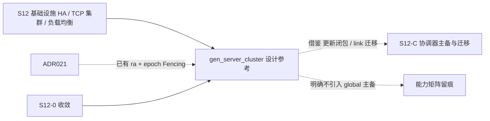

# S12 立项稿 — gen_server 主备集群框架（developerworks/tcp_gen_server_cluster）

- **文档版本**：v0.1（底层调研立项稿，2026-11-11）
- **对应 Roadmap**：[`docs/roadmap.md`](../roadmap.md) §14（S12 基础设施高可用与 TCP 集群负载均衡）
- **调研来源**：[`developerworks/tcp_gen_server_cluster`](https://github.com/developerworks/tcp_gen_server_cluster)（`master`）
- **状态**：**立项规划，未开工，无「已实测」数字**。三段式：§2 实现整理（源码级事实）→ §3 需求提炼（推导）→ §4 开发计划（建议）。
- **读法**：§2 只写仓库 README / 源码逐字出现的内容，§1 / §3 的「与 UnifiedMQ 如何对位、是否借鉴」是 UnifiedMQ 的推导。本轮按「底层调研」口径，**4 个仓库全部深挖到源码级，无索引级稿**。

---

## 0. 来源与证据口径

| 来源 | 位置 | 取用范围 |
|---|---|---|
| [`tcp_gen_server_cluster` README](https://github.com/developerworks/tcp_gen_server_cluster) | `master` | 概述、动机、工作原理、两个示例、API 说明、结语（中文整理的 developerWorks 文章） |
| `src/gen_server_cluster.erl` | `master` | 全文 523 行：状态记录、API、全部 gen_server 回调、状态广播与故障转移内部函数 |
| `src/gen_server_cluster_sup.erl` / `_app.erl` / `.app.src` | `master` | 监督树、应用元数据 |
| `rebar.config` | `master` | 依赖与编译选项 |
| `src/id_server.erl` / `chat.erl` / `shandong.conf` | `master` | 示例与随仓配置文件 |

**证据口径**：

1. 源码经 `curl` 取回本地逐行核对（非仅 README 摘要）；凡机制描述均可在 `gen_server_cluster.erl` 定位到行。
2. **仓库名带 `tcp`，但框架本身与 TCP 无关**——它是「有状态 `gen_server` 的主备集群框架」，示例是 ID 生成器与聊天室。本文按源码事实写，不按仓库名推断（F-1）。
3. README 自述的原则性限制（选举非确定、状态复制开销、不依赖位置的服务才适用）原样保留并转成 §2.5 风险事实。
4. 本文不含任何性能 / 规模数字；按项目惯例（README §11.4 / roadmap §0 第 4 条）这类数字必须来自 S12 起落盘的实测报告。
5. 本阶段只新增文档，不改 README / `progress.md` / `architecture.md` 的「S0–S8 已实现」状态行与 `docs/security.md` §12 清单。

---

## 1. 定位、分层与对位

### 1.1 它解决什么，不解决什么

| 面 | 内容 | 与本次需求的关系 |
|---|---|---|
| 有状态 `gen_server` 主备 | 一个全局服务器 + 多个本地备份，状态同步，主死后竞争接管 | ✅ 「基础设施高可用」的参考形态 |
| TCP 连接接入 / 分发 | **无** | ❌ 仓库名误导，见 F-1 |
| 负载均衡 | **无**（所有请求只发给全局服务器，备份不接客） | ❌ 不是 LB |
| 集群成员共识 / Fencing | **无**（依赖 `global` 注册 + Erlang 分布式） | ⚠️ 与 ADR-021 冲突 |

**一句话**：这是「**单活主 + N 个热备**」的 HA 框架，解决「进程挂了状态不丢、服务继续」，不解决「连接怎么分摊到多节点」。

### 1.2 与 UnifiedMQ 现有抽象的对位

项目 S4 已冻结 [ADR-021](../adr/021-cluster-control-plane-raft-and-fencing.md)：`broker_cluster` 用 `ra 3.2.0` 的 Metadata Raft Group 管分区归属，epoch Fencing、`replicated_commit` quorum ACK、Mnesia 控制面。本仓的机制与之**根本不同**：

| 维度 | 本仓 | UnifiedMQ S4（ADR-021） |
|---|---|---|
| 一致性来源 | `global:register_name` 竞争，无共识 | ra Raft 多数派提交 |
| 防双主 | 无（README 自述「选择是不确定的」） | epoch 单调递增 + `authorize_append` Fencing |
| 分区容忍 | 未讨论；网络分裂下 `global` 可各自注册 | 失去多数派拒绝写入（D4） |
| 状态复制 | `gen_server:cast` 广播更新闭包，无确认 | ra 日志复制到所有副本 + 快照 |
| 消息可靠性 | 不涉及 | 三档显式（ADR-007） |

**结论**：**不得**把本仓的主备机制直接引入——那会在已有的强一致归属层之外形成「第二套、且更弱的成员真相」，与 ADR-021 冲突。本仓的价值只在两个**可借鉴的设计点**（§3）：状态更新闭包广播、外部 link 随主备切换重建。

### 1.3 定位结论与非目标边界

**结论**：候选池标 **P2 / 设计参考，不引入实现**。它的两个机制（§2.3 更新闭包、§2.4 link 迁移）对「协调器进程主备」有参考价值，但落地必须挂在 ra + epoch 之上，且须由 ADR 冻结。

**非目标**：`global` 注册主备、无共识选举、把 `gen_server_cluster` 作为依赖引入、把本仓当 TCP 集群/负载均衡方案、任何「零停机/自动故障转移」含糊承诺（ADR-007）、官方 CloudEvents Binding 逐字实现（S7 已结案「不立项」）。

---

## 2. 实现整理（源码级事实）

### 2.1 仓库组成与依赖

`src/` 共 7 个文件：`gen_server_cluster.erl`（21281 字节，核心单模块）、`gen_server_cluster_app.erl`、`gen_server_cluster_sup.erl`、`gen_server_cluster.app.src`、`id_server.erl`、`chat.erl`、`shandong.conf`（**一段 nginx 站点配置，与本框架无关**，F-8）。根目录另有 `mod_test.erl`、`test.erl`、`rebar.config`、自带 `rebar` 可执行。

`rebar.config` 逐字：`erl_opts = [debug_info, {i,"include"}, {src_dirs,["src"]}, {parse_transform, lager_transform}]`；`deps_dir = "deps"`；`{deps, [{lager, ".*", {git, "git://github.com/basho/lager.git", {branch, "master"}}}]}` —— **git 协议 + `branch master`、无固定 ref**，不可复现构建（F-7）。

`gen_server_cluster_sup:init/1` 返回 `{ok, {{one_for_one, 5, 10}, []}}` —— **监督树无任何子进程**；`.app.src` 的 `applications` 只有 `kernel, stdlib`，`registered = []`，`{vsn, "1"}`。

### 2.2 状态记录与 API（`gen_server_cluster.erl` 逐字）

```erlang
-record(state, {name, globalServerPid, localServerPidList = [],
                targetLinkedPidList = [], targetModule, targetState}).
```

导出 API：`start/4`、`start_local_server/1`、`get_target_state/1`、`get_all_server_pids/1`、`get_all_server_nodes/1`、`is_running/1`、`stop/2`、`link/2`、`unlink/2`。

- `start(Name, TargetModule, TargetArgs, Options)`：先尝试 `gen_server:start({global, Name}, ?MODULE, {initGlobal,...}, Options)`；若返回 `{error, {already_started, _}}` 则改走 `start_local_server(Name)`（`gen_server:start({local, Name}, ...)`）。即**第一个节点是全局主，后续节点是本地备**。
- `start_local_server/1` 先 `is_running/1`（内部 `catch get_all_server_pids/1`），无全局服务器则返回原子 `noGlobalServerRunning`。
- `get_all_server_pids/1` → `{GlobalPid, [LocalPid]}`；`get_all_server_nodes/1` 对 pid 取 `node/1` 映射为 `{GlobalNode, [LocalNode]}`。
- `stop(Name, global|all|Node)`：`global` 只停主；`all` 用 `gen_server:multi_call/3` 停所有本地服务器再停主；`Node` 停指定节点上的本地服务器。
- `link/2` / `unlink/2` 用 `gen_server:cast`（源码注释：目标服务器自己可能调用，**用 call 会自锁挂起**）。

### 2.3 状态复制：广播「更新函数」而非状态（`delegate_to_target/3`）

`gen_server_cluster` 本身是 `gen_server` 回调模块，同时把目标模块（`TargetModule`）也当 `gen_server` 回调模块用：客户端请求经由 `delegate_to_target/3` 以 `apply(TargetModule, TargetCall, Args)` 转发。

关键机制（`delegate_to_target/3`，行 430–484）：

1. 按目标返回 tuple 的形状定位 state 的索引：`{reply,_,S}`→3、`{noreply,S}`→2、`{stop,_,_,S}`→4、`{stop,_,S}`→3、`{ok,S}`→2。
2. 构造 `UpdateTargetStateFun = fun(S) -> ... end`；其中 `is_function(TargetStateUpdate, 1)` 为真时**把返回值当作状态更新函数执行** `TargetStateUpdate(S#state.targetState)`，否则把返回值当作完整新状态。
3. `update_all_server_state/2` 先在本地应用 `UpdateFun`，再对 `localServerPidList` 中每个 pid 发 `gen_server:cast(Pid, {update_local_server_state, UpdateFun})`；本地服务器在 `handle_cast({update_local_server_state, UpdateFun}, State)` 里执行 `NewState = UpdateFun(State)`。
4. 用 `setelement(IndexState, TargetResult, NewState)` 把目标回复里的 state 换成集群 state 后返回。

README 逐字说明动机：「发送一个函数而非返回新的目标状态，这将减少状态传输的网络开销」；并给出 chat 示例——`handle_call({send,...})` 返回的是一个带 `io:format` 副作用的 fun，**所有副本都会执行它，于是消息显示在每个用户的 shell 上**。这是必须理解的语义：更新函数不只是纯计算，其副作用会在 N 个副本上各执行一次（F-4）。

### 2.4 故障转移与 link 迁移

- 所有服务器 `process_flag(trap_exit, true)`；本地服务器在 `init({initLocal, Name})` 里 `gen_server:call({global, Name}, init_local_server_state)` 拿到当前 state，全局服务器在该回调里 `link(FromPid)` 并把新 pid 加进 `localServerPidList`（同时广播给其它本地服务器）。
- 全局死亡：`handle_info({'EXIT', Pid, _}, State) when Pid == State#state.globalServerPid` → 每个本地服务器都调 `try_register_as_global_server(Name, Pid)`；`global:register_name(Name, self())` **只有一个能成功**，其余仍为本地。README 逐字：「由于这个注册策略,在集群中新的全局服务器的选择是不确定的」。
- `try_register_as_global_server/2`（行 506–523）用 `global:whereis_name/1` 三分支：仍是旧 pid 时 `timer:sleep(random:uniform(1000))` 后递归重试；`undefined` 时注册自己并 `timer:sleep(100)` 再查；否则返回新 pid。用旧 `random` 模块（F-6）。
- 新主上任后会 `link` 到所有剩余本地服务器，并重新 `link` 到 `targetLinkedPidList` 中的外部 pid（行 325–338）——这正是 `link/2` / `unlink/2` 的意义：README 逐字说明，若目标进程用普通 `erlang:link/1` 连到外部进程，主死后新主**不会**继承该链接，故框架把链接关系也复制进 state 并在切换时重建（**可借鉴点**）。
- 本地服务器死亡：全局服务器收到 `{'EXIT', LocalPid, _}`，从 `localServerPidList` 删除并广播更新。
- `code_change/3` 源码注释逐字：`%% Currently not supported.`，仅打日志返回 `{ok, State}`（F-5）。

### 2.5 实现特征与风险（事实 → 需求输入）

| 编号 | 事实 | 对 S12 的含义 |
|---|---|---|
| F-1 | 仓库名含 `tcp`，但源码无一处 `gen_tcp` / listener；是 `gen_server` 集群框架 | 不得当作「TCP 集群」方案引用 |
| F-2 | 所有客户端请求只发给 `{global, Name}` 主；备份不接客 | 是 HA 不是负载均衡，扛不住「分摊连接」需求 |
| F-3 | 无 epoch / 无 quorum / 无 Fencing；`global:register_name` 竞争，README 自述选举「不确定」 | 与 ADR-021 冲突，网络分裂可双主，禁止引入 |
| F-4 | 状态更新靠 `gen_server:cast` 广播闭包，**无确认**；闭包副作用在每个副本各执行一次 | 副本状态可能漂移、副作用重复；借鉴「只传 fun」前必须解决幂等与确认 |
| F-5 | `code_change/3` 明确未实现 | 热升级路径不可用，不得声称支持 |
| F-6 | `random:uniform/1`（旧模块）、`lager` parse_transform | 现代 OTP 28.3.1 需改 `rand`；旧模块已移除 |
| F-7 | 依赖 `git://...lager.git` `branch master`，无固定 ref；`git://` 协议已普遍禁用 | 不可复现构建，禁止直接引用 |
| F-8 | `src/shandong.conf` 是无关 nginx 配置；`sup` 为空 | 仓库是文章示例代码整理，非生产库 |
| F-9 | README 结语自承「不依赖与位置的服务器才适用，例如文件服务器可能不能很好使用」 | 适用范围边界须写入能力矩阵 |
| F-10 | 无持久化；README 动机段自述「把状态写数据库再恢复」的替代方案会让「服务可靠性完全依赖数据库」 | 与项目 WAL / `broker_storage` 的关系须显式说明，不得含糊 |

---

## 3. 需求提炼

**读法**：`R-<组><序号>`；`P0` 首期必须 / `P1` 应做 / `P2` 后续或裁剪。约束按 RFC 2119 中文口径。**候选清单，非已批准规格**；验证见 §4.3 Gate。

### 3.1 明确不做（R-N）

| 编号 | 需求 | 来源 | 优先级 |
|---|---|---|---|
| R-N1 | **不得**引入 `global` 注册主备 / 无共识选举作为 UnifiedMQ 的高可用机制 | F-3、ADR-021 | P0 |
| R-N2 | **不得**把本仓当作 TCP 集群 / 负载均衡方案，也不得按仓库名把它列进「TCP 接入」能力矩阵 | F-1/F-2 | P0 |
| R-N3 | **不得**把 `gen_server_cluster` 或 `git://` 无固定 ref 的 `lager` 作为依赖引入 | F-7、ADR-003 离线构建口径 | P0 |
| R-N4 | 不得声称「自动故障转移 / 零停机」；任何可用性承诺必须绑定 ADR-007 显式可靠性等级 | F-3/F-10、ADR-007 | P0 |
| R-N5 | 必须在能力矩阵逐行留痕：无 Fencing、无 quorum、选举非确定、`code_change` 未实现、适用范围限制 | F-3/F-5/F-9 | P0 |

### 3.2 可借鉴机制（R-B，须挂在既有共识层之上）

| 编号 | 需求 | 来源 | 优先级 |
|---|---|---|---|
| R-B1 | 若 S12 要新增「有状态协调进程」主备，状态复制应**优先复用 ra 日志**（ADR-021 D2），不得用 `cast` 无确认广播；本仓「只传更新函数不传全量状态」的思路可作为**减少日志体积**的候选，但必须先以 ADR 冻结「更新函数纯计算、幂等、可重放」 | §2.3、F-4、ADR-021 | P1 |
| R-B2 | 应把「外部 link 随主备切换重建」的语义纳入协调器迁移设计：主节点持有的外部监控/链接关系必须进入可迁移状态，并在新主上任时重建 | §2.4 | P1 |
| R-B3 | 若借鉴更新闭包，必须定义副作用的**恰好一次**语义，禁止把带 I/O 的 fun 复制到 N 个副本（chat 示例的反例） | §2.3、F-4 | P0 |
| R-B4 | 主备切换必须有确定性选举与 epoch 门槛，取代本仓 `timer:sleep(random:uniform(1000))` 竞争 | §2.4、F-3/F-6、ADR-021 D3 | P0 |

### 3.3 工程约束（R-E）

| 编号 | 需求 | 来源 | 优先级 |
|---|---|---|---|
| R-E1 | 本仓所有结论归并为「设计参考」，不产生独立 S12 子阶段；裁决并入 S12-0 | §1.3 | P0 |
| R-E2 | 若未来真要评估其代码，须先完成 OTP 28.3.1 兼容复核（`random`→`rand`、`lager` parse_transform、旧式 `apply`）并固定可复现 ref | F-6/F-7 | P2 |
| R-E3 | 既有 `rebar3 ct` 零回归（基线以当次 `rebar3 ct` 为准）；dialyzer / xref 干净 | 项目惯例 | P0 |
| R-E4 | 性能 / 容量数字全部来自落盘实测，不得预先承诺 | README §11.4 | P0 |

**收口**：§1.3 非目标与 `P2` 项逐行写入能力矩阵（S8 惯例：`docs/protocol-compatibility.md` §4.11–§4.13）。

---

## 4. 开发计划

### 4.1 阶段定位与依赖



本仓无独立实现阶段；唯一动作是 S12-0 评审时确认「不引入实现、保留两个可借鉴点」，并把 F-1~F-10 写入能力矩阵。可借鉴点若被采纳，落点在与 S12-C（协调器主备与迁移）共用的 ADR。

### 4.2 Gate（并入 S12-0 / S12-C，不另开）

- [ ] 候选池明确标注「设计参考 / 非 TCP 集群 / 非 LB」
- [ ] 「不引入 `global` 主备、不引入第二套共识」写入 ADR 或裁剪清单
- [ ] R-B1~R-B4 有明确去向（采纳并落 ADR / 拒绝），未采纳的理由留痕
- [ ] 能力矩阵逐行留痕 F-1~F-10
- [ ] 未引入本仓代码 / `git://` 依赖 / `global` 注册路径

### 4.3 未决问题（并入 S12-0）

| 编号 | 问题 | 收敛方式 |
|---|---|---|
| OQ-1 | S12 是否真需要「有状态协调进程主备」？若不需要，R-B* 全部裁剪 | 需求评审 + ADR |
| OQ-2 | 「只传更新函数」能否在 ra 日志里安全重放（纯计算 / 幂等 / 版本绑定） | spike + ADR（参照 ADR-021 D2 状态机） |
| OQ-3 | 外部 link / 监控关系如何进入可迁移状态，与 `broker_subscription` 游标如何划界 | 与 ADR-013 对齐 |
| OQ-4 | 若保留参考，是否值得单独做一次 OTP 28.3.1 兼容评估 | 依赖审计 |

### 4.4 口径说明

1. 本文是**底层调研规划稿**：§3 是候选结论、Gate 全未勾选；任何「已完成 / 已实测」表述都不适用。
2. 事实与推导分开：§2 逐字取自 README 与 `gen_server_cluster.erl`；§1/§3 的对位与取舍是 UnifiedMQ 的推导。
3. 不新增 app / 端口 / 代码路径；现有状态行本阶段不同步。
4. 沿用 ADR-003/007/013/021 与 S7 等既有结论，不重复立项、不推翻。

---

## 5. 参考资料

- [`developerworks/tcp_gen_server_cluster`](https://github.com/developerworks/tcp_gen_server_cluster)（README、`src/gen_server_cluster.erl`、`src/gen_server_cluster_sup.erl`、`rebar.config`、`src/id_server.erl`、`src/chat.erl`）
- 本仓 [ADR-021](../adr/021-cluster-control-plane-raft-and-fencing.md)、[ADR-007](../adr/007-explicit-reliability.md)、[ADR-013](../adr/013-subscription-kinds-and-cursor-ownership.md)
- 总览：[`docs/design/s12-infrastructure-ha-and-lb.md`](s12-infrastructure-ha-and-lb.md)
