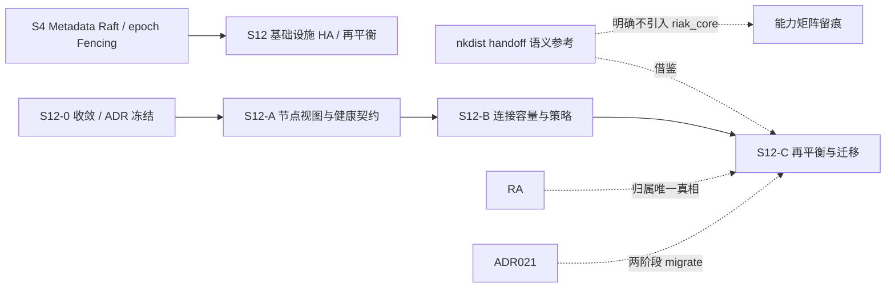

# S12 立项稿 — 一致性哈希进程分布与 handoff 再平衡（erlnets/nkdist）

- **文档版本**：v0.1（底层调研立项稿，2026-11-11）
- **对应 Roadmap**：[`docs/roadmap.md`](../roadmap.md) §14（S12 基础设施高可用与 TCP 集群负载均衡）
- **调研来源**：[`erlnets/nkdist`](https://github.com/erlnets/nkdist)（`master`）
- **状态**：**立项规划，未开工，无「已实测」数字**。三段式：§2 实现整理（源码级事实）→ §3 需求提炼（推导）→ §4 开发计划（建议）。
- **本仓地位**：4 个仓库中**架构参考价值最高**的一个——它直接实现了 [ADR-021](../adr/021-cluster-control-plane-raft-and-fencing.md) 明确留下的缺口「**S4 只实现组内归属，不做自动再平衡**」所对应的一类机制（一致性哈希 + vnode + handoff 迁移）。但它是 **riak_core 上的最终一致系统**，与项目 `ra` Raft 强一致层不同源，**不得引入第二套共识**。

---

## 0. 来源与证据口径

| 来源 | 位置 | 取用范围 |
|---|---|---|
| [`nkdist` README](https://github.com/erlnets/nkdist) | `master` | Introduction、`nkdist_proc` behaviour、示例、节点失败、Master management、`nkdist_gen_server` |
| `src/nkdist.erl` | `master` | 全文：门面 API、哈希与 vnode 定位、本地缓存 |
| `src/nkdist_proc.erl` | `master` | 全文：`start/2`、`start_and_join/2`、`join/2` 回调契约 |
| `src/nkdist_vnode.erl` | `master` | `riak_core_vnode` 状态记录、handoff 系列回调、`handle_handoff_data/2` |
| `src/nkdist_sup.erl` / `nkdist_gen_server.erl` / `nkdist.app.src` | `master` | 监督树、`handle_master/2` 行为、应用依赖 |
| `src/` 目录清单（12 文件） | `master` | 模块组成 |

**证据口径**：

1. 源码经 `curl` 取回本地逐行核对；哈希、迁移、选举机制均以 `nkdist.erl` / `nkdist_vnode.erl` / `nkdist_proc.erl` 为准。
2. README 与源码存在**消息名不一致**（README 写 `{nkcluster, Class, MasterPid}`，`nkdist.erl` 注释写 `{nkdist_master, Class, pid()}`），§2.5 标注，不替仓库裁决（F-7）。
3. README 自述 "NkDIST is an **eventually consistent system**"、节点失败「all processes started at that node will be lost. You must save any important state in an external system (like NkBASE)」——原样保留为可靠性边界事实，不淡化。
4. 本文不含任何性能 / 规模数字；按项目惯例所有数字必须来自 S12 起落盘的实测报告。
5. 本阶段只新增文档，不改「S0–S8 已实现」状态行与 `docs/security.md` §12 清单。

---

## 1. 定位、分层与对位

### 1.1 它解决什么

| 面 | 内容 |
|---|---|
| 进程分布 | 把 Erlang 进程按 `proc_id` 的**一致性哈希**均匀分布到 riak_core 集群的 vnode 上 |
| 自动再平衡 | 节点增删触发 riak_core **handoff**，vnode 迁移时进程随之移动到新节点 |
| 状态恢复 | `nkdist_proc` behaviour 的 `start_and_join/2`（迁移）/ `join/2`（网络分裂后合并）负责从旧进程取状态 |
| 本地缓存 | `find_proc/2` 先查 `nklib_proc` 本地 ETS 缓存，miss 才走 vnode |
| 主选举 | `register/1` 按 class 选 master，`nkdist_gen_server` 提供 `handle_master/2` |
| TCP 连接 | **无**：不涉及 socket / listener |

README 逐字定位：「NkDIST is an library to manage Erlang processes evenly distributed in a *riak_core* cluster. When you add or remove nodes from the cluster, NkDIST-based processes automatically *move* to another node to rebalance the cluster.」

### 1.2 与 UnifiedMQ 的对位（本次需求的核心缺口）

[ADR-021](../adr/021-cluster-control-plane-raft-and-fencing.md) 的「后果」逐字写着：「**S4 只实现组内归属，不做自动再平衡**」；D2 的状态机是 `#{partitions := #{Partition => #{owner, epoch, replicas, state}}}`，命令只有 `assign / migrate / finish_migration / remove`（**都是外部驱动**，没有「节点加入自动重算归属」）。ADR-021 D3 的两阶段 `migrate → finish_migration` 已定义了迁移的**控制面协议**，但没有触发者。

| 维度 | nkdist | UnifiedMQ S4 |
|---|---|---|
| 一致性模型 | **最终一致**（README 自述） | ra Raft 强一致多数派 |
| 哈希/分区 | `chash:key_of/1` + `riak_core_apl:get_apl/3` | ADR-008 分组模型（G=16），分区由配置 |
| 迁移触发 | riak_core ring 变化自动 handoff | 外部调 `migrate/4`，无自动触发 |
| 迁移数据面 | `handle_handoff_data/2` 调 `start_and_join` / `join` 恢复状态 | `finish_migration` 清状态；数据追平由 `broker_cluster_rep` 复制 |
| 进程状态 | 节点失败即丢，须外部持久化（README 自述） | WAL / `broker_storage` 持久化（ADR-011） |
| 防双主 | 无（`join/2` 事后合并） | epoch Fencing + `authorize_append/2` |

**结论**：nkdist 的**「handoff 时先起新进程、从旧进程取状态、旧进程停」**这套迁移语义，正好可以补 ADR-021 已定义但缺触发者的再平衡；但**不得**引入 `riak_core` / `chash` / 最终一致模型作为第二套共识。迁移的真相必须仍是 ra 提交的 epoch（ADR-021 D3）。

### 1.3 定位结论与非目标边界

**结论**：候选池标 **P0 / 重点架构参考**（4 个仓库中唯一直接命中「自动再平衡」缺口的）。可借鉴：① 一致性哈希 + 归属映射；② handoff 的 `start_and_join` / `join` 状态恢复契约；③ 本地 ETS 缓存避免每次远程查找；④ 「重要状态必须外部持久化」的诚实边界。

**非目标**：引入 `riak_core` / `nklib` / `chash`、把最终一致当强一致、把 `global`/vnode 当第二套成员真相、把本仓当 TCP 集群 / 连接 LB、声称「节点故障不丢状态」、官方 CloudEvents Binding 逐字实现（S7 已结案「不立项」）。

---

## 2. 实现整理（源码级事实）

### 2.1 仓库组成与依赖

`src/` 12 个文件（逐字）：`nkdist.erl`(5776)、`nkdist_admin.erl`(24006)、`nkdist_app.erl`、`nkdist_coverage.erl`、`nkdist_gen_server.erl`(7686)、`nkdist_proc.erl`、`nkdist_proc_sample.erl`、`nkdist_sup.erl`、`nkdist_util.erl`、`nkdist_vnode.erl`(12514)、`nkdist_vnode_worker.erl`、`nkdist.app.src`。另有 `include/`、`util/` 目录。

`nkdist.app.src` 逐字：`{vsn, "master"}`、`{description, "Nekso Distributed Library"}`、`applications = [kernel, stdlib, crypto, sasl, ssl, lager, nklib, riak_core]`、`{env, []}`、`{mod, {nkdist_app, []}}`。源码中实际引用的外部模块（逐个 `grep` 去重）：`chash`、`riak_core_apl`、`riak_core_vnode`、`riak_core_vnode_master`、`riak_core_coverage_fsm`、`riak_core_ring*`、`riak_core_node_watcher`、`riak_core_console`、`riak_core_stat`、`riak_core_status`、`riak_core_mochiglobal`、`riak_core_net_ticktime`，以及 `nklib_proc`、`nklib_config`、`nklib_gen_server`、`nklib_util`。**强依赖 riak_core + nklib 两个外部栈**（F-1）。

`nkdist_sup:start_link/0` → `{{one_for_one, 10, 60}, ChildsSpec}`，两个子进程：`nkdist_coverage_sup`（`simple_one_for_one, 3, 60`，跑 `riak_core_coverage_fsm`）与 `nkdist_vnode_master`（`riak_core_vnode_master:start_link(nkdist_vnode)`，`permanent, 5000, worker`）。源码里另有两段被注释掉的 vnode get/put fsm sup。

### 2.2 哈希与 vnode 定位（`nkdist.erl` 逐字）

```erlang
-type proc_id()  :: term().
-type vnode_id() :: {chash:index_as_int(), node()}.

get_vnode(Module, Term) ->
    DocIdx = case Module/=undefined andalso erlang:function_exported(Module, get_hash, 1) of
        true  -> Module:get_hash(Term);       % 可选自定义哈希
        false -> chash:key_of(Term)
    end,
    case riak_core_apl:get_apl(DocIdx, 1, ?APP) of
        [{Idx, Node}] -> {ok, {Idx, Node}};
        [] -> error
    end.
```

即：默认 `chash:key_of/1` 一致性哈希，回调模块可选实现 `get_hash/1` 覆盖；`riak_core_apl:get_apl(DocIdx, 1, nkdist)` 取 **1 个** preference list 项 `{Idx, Node}`。注释逐字说明：若拿到的是 secondary vnode（主节点已失败），handoff 会把进程搬回 primary。

API 门面（`-export` 逐字）：`find_proc/2`、`find_proc_in_vnode/2`、`start_proc/3`、`get_procs/0`、`get_procs/1`、`register/1`、`get_masters/0`、`get_vnode/1`、`get_vnode/2`、`get_info/0`。

`find_proc/2` 先 `nklib_proc:values({?APP, CallBack, ProcId})` 查**本地缓存**，命中直接返回 pid；miss 才 `get_vnode/2` → `nkdist_vnode:find_proc/3`，成功后 `nklib_proc:put/3` 回填缓存。`start_proc/3` 同理，vnode 返回 `{ok, Pid}` 或 `{error, {already_started, Pid}}` 时都回填缓存。`get_procs/0,1`、`get_masters/0`、`get_info/0` 走 `nkdist_coverage:launch(Cmd, 1, 10000, Fun, Acc)`（riak_core coverage 查询，超时 10s）。

### 2.3 进程行为与 handoff 迁移

**`nkdist_proc` behaviour（3 个必选回调 + 1 个可选）**：

| 回调 | 契约（源码逐字） |
|---|---|
| `start(ProcId, Args) -> {ok, pid()} \| {error, term()}` | 被请求在本节点起新进程时调用；注释：「If you link to the calling process (the vnode process), you will receive an 'EXIT' when the vnode is shutted down」 |
| `start_and_join(ProcId, OldPid) -> {ok, pid()} \| {error, term()}` | 进程须从旧节点迁到新节点时调用；收到**仍在运行的旧进程 pid**，可取信息、置旧进程为 stopping、返回新 pid、停掉旧进程 |
| `join(Current, Old) -> ok \| {error, term()}` | 网络分裂导致同一 `proc_id` 在两边都起了进程，重连后由「胜出」进程合并两者状态并停掉旧的 |
| `get_hash/1`（可选，注释掉的 `-callback`） | 自定义哈希函数 |

**README 的 `nkdist_proc` 三回调表**给出同样语义，并逐字说明「NkDIST is an *eventually consistent system*」：`join/2` 就是为网络分裂后的状态调和准备的。

**vnode 状态记录**（`nkdist_vnode.erl` 行 117–126）：

```erlang
-record(state, {idx, pos,
    procs       :: #{{module(), proc_id()} => pid()},
    proc_pids   :: #{pid() => {module(), proc_id()}},
    masters     :: #{atom() => [pid()]},     % first pid is master
    master_pids :: #{pid() => atom()},
    handoff_target :: {chash:index_as_int(), node()},
    forward    :: node() | [{integer(), node()}]}).
```

`nkdist_vnode` 是 `-behaviour(riak_core_vnode)`，导出完整回调：`init/1`、`handle_command/3`、`handle_handoff_command/3`、`handoff_starting/2`、`handoff_cancelled/1`、`handoff_finished/2`、`handle_handoff_data/2`、`encode_handoff_item/2`、`is_empty/1`、`delete/1`、`handle_coverage/4`、`handle_info/2`、`handle_exit/3`、`set_vnode_forwarding/2`。命令经 `riak_core_vnode_master:sync_spawn_command/3` 或 `sync_command/3` 下发。

**`handle_handoff_data/2`（行 257–289，逐字要点）**：

```erlang
case binary_to_term(zlib:unzip(BinObj)) of
    {{proc, CallBack, ProcId}, OldPid} ->
        case do_find_proc(CallBack, ProcId, State) of
            not_found -> CallBack:start_and_join(ProcId, OldPid) -> started_proc(...);
            {ok, NewPid} -> CallBack:join(NewPid, OldPid)
        end;
    {{master, Name}, Pids} -> lists:foldl(fun do_register/3, ...)
end.
```

`encode_handoff_item/2` 用 `zlib:zip(term_to_binary({Key, Val}))`。`handle_handoff_command(?FOLD_REQ{...}, ...)` 返回 `{async, {handoff, MastersData, ProcsData, Fun, Acc0}, Sender, State}`；注释逐字：「If we reply {error, ...}, the handoff is cancelled, and riak_core will retry it again and again」。

### 2.4 主选举与节点失败

- **Master management**（README + `nkdist.erl` 注释）：`register(Class)` 把进程注册到某 class 对应的 vnode；每个 class 选一个 master，向所有注册进程广播 master pid。README 写消息为 `{nkcluster, Class, MasterPid}`，`nkdist.erl` 的 `-spec register/1` 注释写 `{nkdist_master, Class, pid()}`（**F-7 不一致**）。源码注释逐字：「with the pid of the first successfully registered process. If this dies, the next one will be selected and sent to all.」注册返回对应 vnode 的 pid 供调用方 monitor，失败可重注册。
- `nkdist_gen_server`：gen_server-like behaviour，额外回调 `-callback handle_master(pid()|undefined, State)`，注释逐字：「One of them will be elected master」「'undefined' if the vnode fails」。导出 `start_link/3`、`start/3`、`get_master/1,2`、`call/2,3`、`cast/2`。
- **节点失败**（README 逐字）：「If a node fails, all processes started at that node will be lost. You must save any important state in an external system (like NkBASE).」故障被 Erlang 分布式检测到之前，对该 vnode index 的请求会失败；检测到后在另一节点创建 **secondary vnode**，新进程起到这个临时节点；故障节点回来（或被移除）后，进程再 move/join 回 primary vnode。

### 2.5 实现特征与风险（事实 → 需求输入）

| 编号 | 事实 | 对 S12 的含义 |
|---|---|---|
| F-1 | 强依赖 `riak_core` + `nklib`（app.src + 十余处模块引用） | **禁止引入**：项目已用 `ra 3.2.0`，第二套共识/ring 会破坏 ADR-021 |
| F-2 | **最终一致**系统（README 自述），`join/2` 事后调和分裂状态 | 与 ADR-021 的 epoch Fencing + 多数派写入冲突；只借鉴语义不借鉴模型 |
| F-3 | 节点失败即丢该节点上全部进程状态，须外部持久化（README 自述） | 项目已有 WAL / `broker_storage`（ADR-011），迁移设计必须复用它，不得让状态只在进程内存 |
| F-4 | `get_apl(DocIdx, 1, ?APP)` 只取 **1 个** vnode，无副本 preference list | 无副本冗余，与 ADR-021 `replicas` / quorum ACK 不同 |
| F-5 | `find_proc/2` 本地 ETS 缓存（`nklib_proc`），miss 才走 vnode | 可借鉴「缓存归属映射，避免每次远程查询」，但缓存必须与 ra 归属变更对账（ADR-021 D1 `reconcile/0` 已有对账机制） |
| F-6 | `start_and_join/2` 要求旧进程「仍在运行」并可被置为 stopping；`join/2` 合并双份状态 | 是**可迁移有状态进程**的清晰契约，最有价值借鉴点；但须绑定 epoch 与幂等 |
| F-7 | README 与源码注释的 master 消息名不一致（`nkcluster` vs `nkdist_master`） | 证据不一致，能力矩阵按行为描述 |
| F-8 | `{vsn, "master"}`，无固定发布版本；handoff 编码用 `zlib:zip(term_to_binary(...))` | 版本基线须冻结；二进制迁移格式须有版本与兼容策略 |
| F-9 | 无 TCP / listener / 连接分发；是进程分布库 | 不得列为 TCP 连接 LB 实现 |
| F-10 | `nkdist_admin.erl` 24KB 管理模块、`nkdist_coverage` 10s 超时查询 | 管理面体量大，若借鉴需评估与 `broker_admin`（8090）边界 |

---

## 3. 需求提炼

**读法**：`R-<组><序号>`；`P0` 必须 / `P1` 应做 / `P2` 后续或裁剪。约束按 RFC 2119 中文口径。**候选清单，非已批准规格**；验证见 §4.3 Gate。

### 3.1 自动再平衡（R-B，本次需求的核心）

| 编号 | 需求 | 来源 | 优先级 |
|---|---|---|---|
| R-B1 | 必须补齐 ADR-021「S4 不做自动再平衡」的缺口：定义节点加入 / 退出 / 故障时的**归属重算触发者**，但归属变更仍须经 ra 多数派提交并携带递增 epoch（ADR-021 D3） | §1.2、ADR-021 | P0 |
| R-B2 | 再平衡的目标函数（分区数均衡 / 连接数 / 容量）与「何时不迁移」的稳定条件必须先以 ADR 冻结，避免抖动 | §2.2、ADR-008 | P0 |
| R-B3 | 若做一致性哈希式归属，必须复用 ADR-008 的分组模型与 `broker_router`（ADR-010），**不得**引入 `chash` / `riak_core_apl` / ring | F-1、ADR-008/010 | P0 |
| R-B4 | 归属映射应缓存在本地（借鉴 F-5），但必须与 ra 提交结果对账，复用 ADR-021 D1 的 `reconcile/0` 周期对账，不得让缓存成为第二份真相 | F-5、ADR-021 | P0 |
| R-B5 | 迁移期间必须有明确的可读可写窗口，沿用 ADR-021 D3 的 `migrate`（`migrating`，源仍可读）→ 数据追平 → `finish_migration` 两阶段，不得出现无 Fencing 的双写 | §2.3、ADR-021 D3 | P0 |

### 3.2 有状态进程迁移契约（R-M）

| 编号 | 需求 | 来源 | 优先级 |
|---|---|---|---|
| R-M1 | 若 S12 引入可迁移的有状态进程，必须定义等价的**三态迁移契约**：新节点起进程并从旧进程取状态（类比 `start_and_join/2`）、分裂后合并（类比 `join/2`）、旧进程冻结/停止 | §2.3、F-6 | P1 |
| R-M2 | 迁移状态必须可持久化（WAL / `broker_storage`，ADR-011），**不得**让状态只存在进程内存（F-3 的反例）；迁移前后绑定 ADR-007 显式可靠性等级 | F-3、ADR-007/011 | P0 |
| R-M3 | 新主 / 新 owner 上任必须经 epoch 门槛与 `authorize_append/2` 校验，取代「先起起来再 join 调和」的最终一致做法 | F-2、ADR-021 D3 | P0 |
| R-M4 | 若需要协调器主选举，确定性选举 + epoch 取代「第一个注册成功者为 master」；主变更通知必须绑定 epoch | §2.4、ADR-021 | P1 |
| R-M5 | 任何 handoff 二进制/状态格式必须有版本号与兼容策略（F-8 的反例） | F-8 | P1 |

### 3.3 明确不做（R-N）与工程约束（R-E）

| 编号 | 需求 | 来源 | 优先级 |
|---|---|---|---|
| R-N1 | **不得**引入 `riak_core` / `nklib` / `chash` / vnode ring 作为第二套共识或成员真相 | F-1/F-2、ADR-021 | P0 |
| R-N2 | **不得**把最终一致 / 事后 `join` 调和当作强一致；不得声称「节点故障不丢状态」 | F-2/F-3、ADR-007 | P0 |
| R-N3 | 不得把本仓列为 TCP 连接负载均衡 / 接入层方案 | F-9 | P0 |
| R-N4 | 能力矩阵逐行留痕：最终一致、单 vnode 无副本、状态须外部持久化、消息名不一致、`vsn "master"` | F-2/F-4/F-7/F-8 | P0 |
| R-E1 | 再平衡与迁移契约必须在 S12-0 以 ADR 冻结后再写实现（roadmap §0 第 2 条「不确定性前置」） | 项目惯例 | P0 |
| R-E2 | 需多节点故障注入证据落盘（`apps/broker_cluster/test/` 已有 3 节点 peer 套件可扩）+ 能力矩阵与限制清单 | ADR-021 验证、`docs/architecture.md` §2.1 | P0 |
| R-E3 | 既有 `rebar3 ct` 零回归（基线以当次 `rebar3 ct` 为准）；dialyzer / xref 干净；`rebar3 release` 装配成功 | 项目惯例 | P0 |
| R-E4 | 性能 / 容量 / 迁移耗时数字全部来自落盘实测，不得预先承诺 | README §11.4 | P0 |

**收口**：§1.3 非目标与 `P2` 项逐行写入能力矩阵（S8 惯例）。

---

## 4. 开发计划

### 4.1 阶段定位与依赖



本仓无独立实现阶段；借鉴点落在 S12-C（自动再平衡与有状态进程迁移），与 ADR-021 已冻结的两阶段 `migrate` 对接，由 S12-0 统一裁决。

### 4.2 Gate（并入 S12-0 / S12-C，不另开）

- [ ] 再平衡触发者、目标函数、稳定条件由 ADR 冻结；归属变更全部经 ra 提交并携带递增 epoch
- [ ] 节点加入 / 退出 / 故障的故障注入用例通过（扩 `broker_cluster_dist_SUITE`）；迁移期间无双写、旧 owner 被 `{fenced, _}` 拒绝
- [ ] 归属缓存与 ra 提交结果对账用例通过；无第二份真相
- [ ] 有状态进程迁移的状态持久化与可靠性分档有测试证明
- [ ] 能力矩阵逐行留痕 F-1~F-10
- [ ] 未引入 `riak_core` / `nklib` / `chash` / vnode 代码
- [ ] 既有 `rebar3 ct` 零回归（基线以当次 `rebar3 ct` 为准）；dialyzer / xref 干净

### 4.3 未决问题（并入 S12-0）

| 编号 | 问题 | 收敛方式 |
|---|---|---|
| OQ-1 | 再平衡的触发者放在哪：控制面新进程 / `broker_cluster` 内 / 运维显式命令 | ADR + 与 ADR-021 D2 状态机对齐 |
| OQ-2 | 归属映射用现有 `partition_meta` + ADR-008 分组，还是引入一致性哈希（若引入，如何不引入 ring） | ADR-008/010 对齐，与 `s12-infra-gen-lb.md` OQ-3 合并 |
| OQ-3 | 哪些进程属于「有状态可迁移」范畴；与 `broker_subscription` 游标 / `broker_queue` 的边界 | ADR-013/019 对齐 |
| OQ-4 | 迁移期间的连接与在途消息如何处置（drain / 重连 / 重投），与 ADR-007 三档如何绑定 | ADR-007/015 对齐 |
| OQ-5 | 稳定性阈值（避免抖动）与迁移并发度上限 | 压测 + 容量报告 |
| OQ-6 | master 选举是否需要；若需要，是否复用 ra Leader 而非另选 | ADR-021 D2 对齐 |

### 4.4 口径说明

1. 本文是**底层调研规划稿**：§3 是候选需求、Gate 全未勾选；任何「已完成 / 已实测」表述都不适用。
2. 事实与推导分开：§2 逐字取自 README 与三个核心源码；§1/§3 的对位与取舍是 UnifiedMQ 的推导。README/源码消息名不一致已标注。
3. 不新增 app / 端口 / 代码路径；现有状态行本阶段不同步。
4. 沿用 ADR-002/007/008/010/011/013/021 与 S7 等既有结论，不重复立项、不推翻。

---

## 5. 参考资料

- [`erlnets/nkdist`](https://github.com/erlnets/nkdist)（README、`src/nkdist.erl`、`src/nkdist_proc.erl`、`src/nkdist_vnode.erl`、`src/nkdist_sup.erl`、`src/nkdist_gen_server.erl`、`src/nkdist.app.src`、`src/` 清单）
- [`basho/riak_core`](https://github.com/basho/riak_core)（`riak_core_vnode` / `riak_core_apl` / `chash`，本仓依赖）
- 本仓 [ADR-008](../adr/008-raft-grouping-and-storage.md)、[ADR-010](../adr/010-broker-router-behavior.md)、[ADR-011](../adr/011-broker-storage-behavior.md)、[ADR-021](../adr/021-cluster-control-plane-raft-and-fencing.md)
- 总览：[`docs/design/s12-infrastructure-ha-and-lb.md`](s12-infrastructure-ha-and-lb.md)
