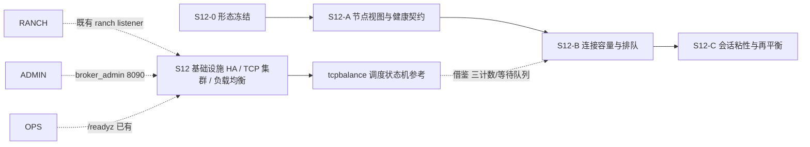

# S12 立项稿 — TCP 四层负载均衡代理（mdaguete/tcpbalance）

- **文档版本**：v0.1（底层调研立项稿，2026-11-11）
- **对应 Roadmap**：[`docs/roadmap.md`](../roadmap.md) §14（S12 基础设施高可用与 TCP 集群负载均衡）
- **调研来源**：[`mdaguete/tcpbalance`](https://github.com/mdaguete/tcpbalance)（`master`）
- **状态**：**立项规划，未开工，无「已实测」数字**。三段式：§2 实现整理（源码级事实）→ §3 需求提炼（推导）→ §4 开发计划（建议）。
- **本仓地位**：4 个仓库中**唯一真正的 TCP 四层负载均衡器**，与「TCP 集群 + 负载均衡」需求最直接相关。但它是 2003 年 OTP R9B 的独立代理进程，其「连接分发」形态与 UnifiedMQ 的有状态协议连接**不兼容**（§1.2），结论为「借鉴调度状态机，不引入代理」。

---

## 0. 来源与证据口径

| 来源 | 位置 | 取用范围 |
|---|---|---|
| [`tcpbalance` README](https://github.com/mdaguete/tcpbalance) | `master` | 7 条设计目标、编译/运行、示例配置、Web 状态页、动态改配置、故障注入演示 |
| `src/bal_proxy.erl` | `master` | 全文 609 行：`#be{}` / `#state{}`、后端选择、等待队列、故障标记、动态增删、统计与 HTTP 输出 |
| `src/tcp_proxy.erl` | `master` | 全文 142 行：listen / accept / 每连接进程 / 双向转发 |
| `src/balance.erl` / `balance.hrl` / `bal_sup.erl` / `balance.app.src` | `master` | app env 默认值、监督树、注册名 |
| `priv/be-list.config`（README 摘录） | `master` | 示例后端列表 |

**证据口径**：

1. 源码经 `curl` 取回本地逐行核对；调度算法、后端状态机、连接生命周期均以 `bal_proxy.erl` / `tcp_proxy.erl` 为准。
2. README 与源码**存在明确不一致**（feature 2「选最快的空闲后端」vs 源码 first-fit；README 自承若干 bug），§2.5 逐条列出，以源码为准。
3. README 自述的性能/部署描述（"in use at Caspian Networks for over two months. It's pretty solid"）**不作为可承诺指标**；按项目惯例所有数字必须来自 S12 起落盘的实测报告。
4. 本阶段只新增文档，不改「S0–S8 已实现」状态行与 `docs/security.md` §12 清单。

---

## 1. 定位、分层与对位

### 1.1 它解决什么

| 面 | 内容 |
|---|---|
| TCP 接入 | 单端口 `gen_tcp:listen`，`backlog 256`，每连接一个 Erlang 进程 |
| 后端选择 | 从后端列表中挑一台，建立到后端的 TCP 连接，双向透传字节 |
| 容量控制 | 每台后端 `maxconn` 上限，全部忙时客户端排队等待 |
| 故障处理 | 连接失败把后端标 `down`，管理员手工 `reset_host` 恢复 |
| 运维 | 动态 `add_be` / `del_be` / `get_state`，HTTP(8080) 状态页 |

README 逐字的 7 条设计目标（为 distcc 写 TCP 代理时要求的特性）：① 不 HTTP-centric；② **「choose the fastest back-end host that is currently idle」**；③ 感知后端多 CPU；④ 全忙时让客户端**等待**而非超配；⑤ 检测后端宕机并「do something sane」；⑥ 管理员可增删/上下线后端且不影响在用客户端；⑦ 通过 HTTP 或 Telnet 提供基本统计。README 自述 1–5 为 mandatory、6–7 为 nice-to-have。

### 1.2 与 UnifiedMQ 现有接入层的对位（关键不兼容点）

项目当前是 **ranch 2.3.0 + 每协议一个 listener**（`docs/architecture.md` §2.1 / §3.10）：MQTT 1883、WS 8080、MQTT-WS 8083、MQTT-SN 1884(UDP)、QUIC 14567、Kafka 9093、AMQP 5673、Pulsar 6650、A2A 8081(默认空)、admin 8090。每条连接在 ranch acceptor 上 `start_link` 一个协议 FSM（`mqtt_conn_fsm` 等），连接是有状态的（MQTT session、订阅、游标、epoch token）。

| 维度 | tcpbalance | UnifiedMQ |
|---|---|---|
| 连接语义 | 无状态字节隧道，任一端关闭即 `exit(byebye)` | 长连接有状态 FSM + 会话 + 归属 epoch |
| 后端选择时机 | **连接建立时**一次性选定 | 会话必须粘在同一节点（session/游标/`proto_meta.cluster_epoch`） |
| 转发边界 | 四层透传，不解析协议 | 协议 adapter 在接入节点终结协议 |
| 健康检查 | 被动（连接失败才标 down） | 已有 `/healthz` / `/readyz`（`docs/operations.md` §?），且明确「指标/管理面故障不应把 broker 摘出负载均衡」 |

**结论**：**不得**把 Broker 改造成四层 TCP 代理——那会破坏会话粘性与 ADR-021 的 `authorize_append(Partition, Epoch)` Fencing（epoch 由接入节点携带）。项目 `/readyz` 已经隐含「外部负载均衡器」假设，因此 S12 该做的是**把节点视图/健康权重供给外部 LB 的契约**，而不是自己写代理。

### 1.3 定位结论与非目标边界

**结论**：候选池标 **P1 / 重点借鉴调度状态机，不引入代理实现**。可借鉴的是 `#be{}` 三计数、等待队列与超时、被动故障标记 + 人工恢复、动态增删后端、每连接一进程的 `controlling_process` 交接——这些正好对应「接入层连接上限 / 背压 / 优雅摘流」需求。

**非目标**：四层 TCP 代理、把 ranch listener 换成透传、把有状态协议连接当无状态字节流、声称「最快空闲后端」（源码无此能力）、引入 OTP R9B 代码 / `inets`/`httpd` 老栈、自动健康恢复（源码没有）、官方 CloudEvents Binding 逐字实现（S7 已结案「不立项」）。

---

## 2. 实现整理（源码级事实）

### 2.1 仓库组成与构建

`src/` 6 个文件：`bal_proxy.erl`（21721 字节，调度器 gen_server）、`tcp_proxy.erl`（4709 字节）、`balance.erl`（application）、`balance.hrl`、`bal_sup.erl`、`balance.app.src`。根目录 `README`（纯文本）、`LICENSE`、`rebar`、`run.sh`；`priv/` 下有 `be-list.config`、`inets.conf`。仓库页面显示 **2 Commits / 30 stars / 10 forks**。

`balance.app.src` 逐字：`{vsn, "1.0"}`、`{applications, [kernel, sasl]}`、`{mod, {balance, []}}`，`modules` 列表为空。README 明确构建用 `src/Makefile`（GNU Make）、`-boot balance -config ../priv/be-list -noshell`，并警告 `src/balance.rel` 里**硬编码 OTP 版本号**（`stdlib 1.11.0` / `kernel 2.8.0`），换 OTP 版本须手改（F-8）。示例基于 **Erlang R9B-0（2003 年 1 月）**。

`bal_sup:init/1` → `{{one_for_all, 5, 60}, [BalProxy]}`；`BalProxy` 子进程 `permanent, 2000, worker`，**`httpd` WebServer 子进程在源码中被注释掉**（`%%WebServer = ...`）。

### 2.2 配置与默认值（源码逐字）

`balance.erl` 的三个 env 读取（默认值在源码，README 示例配置另给一套）：

| app env | 源码默认 | README 示例 `be-list.config` |
|---|---|---|
| `local_tcp_port` | **3632** | **2525** |
| `be_conn_timeout` | `5*1000` (5s) | 10s |
| `be_inactivity_timeout` | `180*1000` (180s) | 120s |
| `initial_be_list` | 无则 `[]` 并打 warning | 3 台 SMTP 后端 |

`balance.hrl`：`-define(BALANCER_APP, balance).` `-define(TCPPROXY, tcp_proxy).` `-define(TIMEOUT_BE, timeout_be).`（无后端可用时回给 proxy 进程的原子）。

README 示例后端：`mx1.mail.yahoo.com:25` maxconn 2、`bogus-demo:25` maxconn 1、`mx1.hotmail.com:25` maxconn 1。Web 状态页端口 **8080**（`priv/inets.conf` 的 `Port` 指令，README 逐字）。

`bal_proxy:init/1` 里 `register(balance, self())` **全局注册名单例**；`balance.erl` 注释逐字自述 OTP 不允许同一 application 跑多实例，因此「there's only one balance app running at a time」。

### 2.3 后端状态机与调度算法（`bal_proxy.erl` 逐字）

```erlang
-record(be, {name, port, status,        % up | down
             maxconn, pendconn = 0, actconn = 0,
             lasterr, lasterrtime,
             act_count = 0, act_time = 0, pidlist = []}).
-record(state, {local_port, conn_timeout, act_timeout, be_list,
                acceptor, start_time, to_timer, wait_list}).
```

**选择算法 `choose_be/3`（行 319–332）**：

```erlang
choose_be(FromPid, [B|Bs], BEList) ->
    if B#be.status == up, (B#be.pendconn + B#be.actconn < B#be.maxconn) ->
           NewB = B#be{pendconn = B#be.pendconn + 1,
                       pidlist = [{pending, FromPid}|B#be.pidlist]},
           {ok, B#be.name, B#be.port, lists:reverse([NewB|BEList], Bs)};
       true -> choose_be(FromPid, Bs, [B|BEList])
    end.
```

即**线性扫描、第一个未满载的后端（first-fit）**：条件是 `status == up` 且 `pendconn + actconn < maxconn`，选中后 `pendconn + 1`。**没有任何速度 / 权重 / 响应时间 / 最少连接指标**——README feature 2「choose the fastest back-end host that is currently idle」与 feature 3「be aware of back-end hosts with multiple CPUs」在源码中均无对应实现（F-1）。feature ③ 的等价物是管理员给每台后端**手工配 `maxconn`**（示例 2/1/1）。

**三状态计数**（`update_be/3`）：
- `remote_ok/1` → `pendconn - 1`、`actconn + 1`、`act_count + 1`、`pidlist` 里 `{pending, Pid}` 换为 `{active, Pid, now()}`；
- 进程 `exited` → `actconn - 1`、`act_time += elapsed`、`pidlist` 删除；
- `remote_error/2`（任意连接错误）→ **`status = down`**、记 `lasterr/lasterrtime`、`pendconn - 1`、删除 pid。**注意：任一后端连接失败即把整台后端永久标 down，无自动恢复**（F-3）。

**等待队列**：`choose_backend/3` 无可用后端时把 `{From, FromPid, nowtime()}` 入 `wait_list`（`queue`），返回 `?MUST_WAIT`；`handle_call({Pid,get_be}, From, State)` 在 `Reply == ?MUST_WAIT` 时 `{noreply, NewState}`，客户端阻塞在 `gen_server:call(BalancerPid, {self(), get_be}, infinity)`。`init/1` 起 1 秒周期 `timer:send_interval(1000, {check_waiter_timeouts})`，`zap_timeout_q/3` 丢弃超过 `conn_timeout` 的等待者并回 `?TIMEOUT_BE`。有连接释放（`{'EXIT', Pid, ...}`）时 `queue:out/1` 取第一个等待者重新 `choose_backend/3` 并 `gen_server:reply/2` 异步唤醒。

**`handle_info({'EXIT', Pid, _}, ...)` 的 hack**（源码注释逐字）：为判断 `wait_list` 是否为空，直接模式匹配 queue 内部表示 `{[], []}`，注释自承「We wouldn't need this hack if a function like queue:size() were available....」（F-6）。

**动态运维 API**（导出）：`get_be/1`、`remote_ok/1`、`remote_error/2`、`get_state/1`、`get_host/2`、`reset_host/2`、`reset_host/3`、`reset_all/1`、`add_be/3`、`del_be/2`、`http_get_state/2`。`add_be/3` 按 `AfterHost` 位置插入（`insert_be/3` 无尾递归，源码自承「Being lazy」），`sane_be/1` 用 `size(B) =/= size(#be{})` 之类旧式校验且注释自承「still possible to send a bogus be record」（F-7）。`reset_host(Host, up)` 会 `self() ! {'EXIT', no_such_pid, another_host_is_up_now}` 用假 EXIT 消息触发唤醒等待者（源码注释：`This is a dirty trick. :-)`）。

**统计**：`http_get_state/2` 输出 `Proxy start time / Current time / Local TCP port / Connection timeout / Activity timeout / Length of wait list` + 每台后端 `Name Port Status MaxConn PendConn ActConn LastErr LastErrTime ActiveCount ActiveTime` 表格；`act_count` / `act_time` 为累计激活次数与累计活跃时间。

### 2.4 TCP 连接生命周期（`tcp_proxy.erl` 逐字）

```erlang
accept_init(LPort, BalancerPid) ->
    {ok, LSock} = gen_tcp:listen(LPort, [binary, {backlog, 256},
                    {nodelay, true}, {reuseaddr, true}, {active, false}]),
    acceptor(LSock, BalancerPid).
```

`acceptor/2` 循环：`gen_tcp:accept/1` → `Proxy = spawn_link(?MODULE, proxy, [CSock])` → `inet:setopts(CSock, [{recbuf, 128*1024}, {sndbuf, 128*1024}])` → **`gen_tcp:controlling_process(CSock, Proxy)`** → `Proxy ! {go_for_it, CSock, BalancerPid, self()}`。

`proxy/1` 收到 `go_for_it` 后 `link(BalancerPid)`、`unlink(AcceptorPid)`（把进程生命周期从 acceptor 转挂到 balancer），再 `bal_proxy:get_be/1` 选后端；`proxy2/3` 用 `gen_tcp:connect(RHost, RPort, [binary, {nodelay,true}, {active,true}, {recbuf,...}], ConnTimeout)`，成功则 `bal_proxy:remote_ok/1`，失败则 `remote_error/2` 并**递归重试下一个后端**；收到 `?TIMEOUT_BE` 则 `exit(normal)`。

`proxy_loop/3` 双向转发 `{tcp, CSock, Data}` ↔ `{tcp, SSock, Data}`，`after ActTimeout` 空闲超时；任一方 `{tcp_closed, _}` / `{tcp_error, _}` 直接 `exit(byebye)`。源码注释逐字自承：「we're a bit stupid by exiting whenever either socket is closed or has an error. At least in the case of closure, a nice proxy would continue forwarding data in the other direction. However, that would mean we would have to carry more state in State, horror!」（**不做半关闭**，F-5）。

### 2.5 实现特征与风险（事实 → 需求输入）

| 编号 | 事实 | 对 S12 的含义 |
|---|---|---|
| F-1 | README 声称「选最快空闲后端 / 感知多 CPU」，源码是 first-fit + 手工 `maxconn` | 能力矩阵不得写「最快/加权」；需求若需要加权必须自己设计 |
| F-2 | 选择是**连接级一次性**的，无会话粘性概念 | 与 UnifiedMQ 有状态连接不兼容，禁止照搬为 Broker 前端 |
| F-3 | 后端 `down` 是被动、永久的，无主动健康检查 / 自动恢复，靠人工 `reset_host` | 项目已有 `/readyz`，应做主动健康供给而非被动标记 |
| F-4 | 全忙时 `wait_list` 无限排队 + 1s 超时清理；`get_be/1` 用 `infinity` 阻塞 | 需接入项目既有背压 / 慢消费者守卫（ADR-016），并给排队上限 |
| F-5 | 任一端关闭即整体退出，不做半关闭；代理不解析协议 | 不能承载 MQTT session / WS 升级等有状态协议 |
| F-6 | 直接模式匹配 queue 内部 `{[], []}`，依赖 OTP 内部结构 | 禁止照搬；用 `queue:is_empty/1` |
| F-7 | `add_be` 校验自承可传 bogus record；`reset_host(up)` 用假 EXIT 消息 | 管理 API 必须做严格校验与显式事件，不用消息 hack |
| F-8 | OTP R9B-0（2003）；`now()/0`、`error_logger`、`record/2` guard、`size/1` on tuple、`httpd/inets`、`balance.rel` 硬编码版本 | 与 OTP 28.3.1 不兼容，禁止引入代码，只借鉴状态机 |
| F-9 | `register(balance, self())` 单例 + `balance.erl` 自承不能跑多实例 | 与 `broker_cluster` 多节点部署冲突 |
| F-10 | `bal_sup` 的 `httpd` 子进程被注释掉，状态页实际可能不可用 | 不得声称「自带 HTTP 运维界面」 |
| F-11 | README 自承 bug：全部后端 `down` 时客户端连入、随后某后端置 `up`，会触发异常（"Work-around: Don't allow this to happen"） | 需求须覆盖「无可用节点」与「节点恢复」竞态 |
| F-12 | 2 Commits，2003 年代码，无测试套件 | 证据基线仅源码 + README，须以 S12 自建用例验证 |

---

## 3. 需求提炼

**读法**：`R-<组><序号>`；`P0` 必须 / `P1` 应做 / `P2` 后续或裁剪。约束按 RFC 2119 中文口径。**候选清单，非已批准规格**；验证见 §4.3 Gate。

### 3.1 接入层连接分发（R-L）

| 编号 | 需求 | 来源 | 优先级 |
|---|---|---|---|
| R-L1 | 必须先在 S12-0 冻结「接入层负载均衡」的形态：**复用外部 LB + Broker 供给节点视图/健康权重**，而不是把 Broker 做成四层 TCP 代理 | §1.2、F-2/F-5、ADR-021 | P0 |
| R-L2 | 必须定义并向外部 LB 暴露节点发现契约：节点列表、每节点权重/容量、`/readyz` 就绪状态、drain（优雅摘流）状态；沿用 `docs/operations.md` 已有「指标/管理面故障不应把 broker 摘出负载均衡」口径 | §1.2、F-3、`docs/operations.md` | P0 |
| R-L3 | 必须保证**会话粘性**：一条协议连接在整个生命周期内留在同一接入节点，不得按连接逐次重选节点；epoch / `proto_meta.cluster_epoch` 由接入节点携带并经 ADR-021 `authorize_append/2` 校验 | §1.2、ADR-021 D3 | P0 |
| R-L4 | 应提供可插拔的节点选择策略（最少连接 / 加权 / 一致性哈希），策略接口与策略实现分离；**不得**把 first-fit 写成「最快后端」 | §2.3、F-1 | P1 |
| R-L5 | 必须实现连接级容量控制：每节点最大连接数、pending/active 计数、超限时排队或拒绝，并接入既有背压 / 慢消费者守卫（ADR-016） | §2.3、F-4、ADR-016 | P0 |
| R-L6 | 必须给等待队列设**上限 + 超时 + 显式拒绝**，不得出现 `gen_server:call(..., infinity)` 式无限阻塞 | §2.3、F-4 | P0 |
| R-L7 | 必须覆盖「全部节点不可用」与「节点恢复」竞态（F-11 的反例），并有恢复后的重新分发用例 | F-11 | P0 |

### 3.2 健康、故障与运维（R-H）

| 编号 | 需求 | 来源 | 优先级 |
|---|---|---|---|
| R-H1 | 必须实现**主动**健康上报（节点 → 控制面 / 外部 LB），不得沿用「连接失败才标 down」的被动模式 | F-3、`docs/operations.md` | P0 |
| R-H2 | 必须支持节点上线 / 下线 / drain / 恢复的显式管理 API，操作期间不得中断在用连接 | README feature 6、§2.3 | P0 |
| R-H3 | 管理 API 入参必须严格校验（禁止 F-7 的 bogus record），状态变更用显式事件而非假 `EXIT` 消息 | F-6/F-7 | P1 |
| R-H4 | 指标应含每节点 active/pending 连接数、等待队列长度、被拒连接数、节点上下线次数；避免高基数标签 | §2.3、ADR-016 | P1 |
| R-H5 | 不得引入 `inets`/`httpd` 老栈作为运维面；复用 `broker_admin` 的 HTTP 端点（8090） | F-8/F-10、`docs/architecture.md` §2.1 | P0 |

### 3.3 明确不做（R-N）与工程约束（R-E）

| 编号 | 需求 | 来源 | 优先级 |
|---|---|---|---|
| R-N1 | **不得**把 ranch listener 换成本仓式四层透传代理，不得把有状态协议连接当无状态字节流 | F-2/F-5 | P0 |
| R-N2 | **不得**引入 OTP R9B 代码、`now()/0` / `error_logger` / `record/2` / `size/1` / `balance.rel` / `httpd` | F-8 | P0 |
| R-N3 | **不得**照搬 `register(balance, self())` 单例假设 | F-9 | P0 |
| R-N4 | 能力矩阵逐行留痕：first-fit 非「最快」、被动故障、无自动恢复、无半关闭、自承 bug | F-1/F-3/F-5/F-11 | P0 |
| R-E1 | 调度状态机（三计数 / 等待队列 / 动态增删）若借鉴，必须先在 S12-0 以 ADR 冻结与 `broker_metrics` / `broker_admin` 的落点 | §1.3、ADR-016 | P0 |
| R-E2 | 需真实多节点连接分发证据落盘（外部 LB 或等价模拟器）+ 能力矩阵与限制清单 | roadmap §10.2 / S8 惯例 | P0 |
| R-E3 | 既有 `rebar3 ct` 零回归（基线以当次 `rebar3 ct` 为准）；dialyzer / xref 干净；`rebar3 release` 装配成功 | 项目惯例 | P0 |
| R-E4 | 性能 / 容量数字全部来自落盘实测，不得预先承诺 | README §11.4 | P0 |

**收口**：§1.3 非目标与 `P2` 项逐行写入能力矩阵（S8 惯例）。

---

## 4. 开发计划

### 4.1 阶段定位与依赖



本仓无独立实现阶段；其借鉴点落在 S12-A（节点视图/健康契约）与 S12-B（连接容量与排队），由 S12-0 统一裁决。

### 4.2 Gate（并入 S12-0 / S12-A / S12-B，不另开）

- [ ] 「外部 LB + Broker 供给契约」的形态由 ADR 冻结，且明确「不做四层代理」
- [ ] 节点视图 / 权重 / drain / `/readyz` 契约有自动化测试；会话粘性有跨节点用例
- [ ] 连接上限 / 排队上限 / 超时拒绝 / 全不可用与恢复竞态专项用例通过
- [ ] 主动健康上报与管理 API 严格校验用例通过
- [ ] 能力矩阵逐行留痕 F-1~F-12
- [ ] 未引入本仓代码 / OTP R9B 依赖 / `register(balance, ...)` 单例
- [ ] 既有 `rebar3 ct` 零回归（基线以当次 `rebar3 ct` 为准）；dialyzer / xref 干净

### 4.3 未决问题（并入 S12-0）

| 编号 | 问题 | 收敛方式 |
|---|---|---|
| OQ-1 | 接入层 LB 形态：外部 LB / DNS-SD / 客户端侧路由 / Broker 内部分发，取哪个 | 需求评审 + ADR（倾向「外部 LB + Broker 供给契约」） |
| OQ-2 | 节点视图与 `broker_cluster` 的 Metadata Raft / `cluster_node` 表如何共用一份真相 | 与 ADR-021 D1 对齐 |
| OQ-3 | 会话粘性 vs 节点再平衡：迁移中的连接如何处理（drain 还是断开重连） | ADR-021 D3 两阶段 migrate 对齐 |
| OQ-4 | 连接计数 / 等待队列状态落在 `broker_metrics` 还是新 app；是否进控制面 | ADR-016 / ADR-002 对齐 |
| OQ-5 | 选择策略首期取哪几种；一致性哈希是否与分区归属（ADR-008 G=16）冲突 | 策略 spike + ADR |
| OQ-6 | 是否真的需要 Broker 内部排队，还是全部交给外部 LB 拒绝 | 背压口径评审 |

### 4.4 口径说明

1. 本文是**底层调研规划稿**：§3 是候选需求、Gate 全未勾选；任何「已完成 / 已实测」表述都不适用。
2. 事实与推导分开：§2 逐字取自 README 与两个核心源码；§1/§3 的对位与取舍是 UnifiedMQ 的推导。README/源码不一致已逐条标注。
3. 不新增 app / 端口 / 代码路径；现有状态行本阶段不同步。
4. 沿用 ADR-002/007/008/016/021、S7 统一身份表、`docs/operations.md` 健康检查口径，不重复立项、不推翻。

---

## 5. 参考资料

- [`mdaguete/tcpbalance`](https://github.com/mdaguete/tcpbalance)（README、`src/bal_proxy.erl`、`src/tcp_proxy.erl`、`src/balance.erl`、`src/balance.hrl`、`src/bal_sup.erl`、`src/balance.app.src`）
- 本仓 [ADR-016](../adr/016-observability-minimal-set.md)、[ADR-021](../adr/021-cluster-control-plane-raft-and-fencing.md)、[`docs/operations.md`](../operations.md)（`/healthz` / `/readyz`）、[`docs/architecture.md`](../architecture.md) §2.1 / §3.10
- 总览：[`docs/design/s12-infrastructure-ha-and-lb.md`](s12-infrastructure-ha-and-lb.md)
