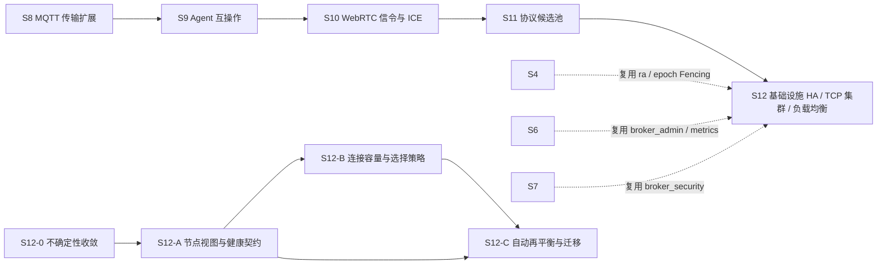

# S12 需求文档 — 增强基础设施的高可用性、TCP 集群与负载均衡

- **文档版本**：v0.1（底层调研立项稿，2026-11-11）
- **对应 Roadmap**：[`docs/roadmap.md`](../roadmap.md) §14（S12 基础设施高可用与 TCP 集群负载均衡）
- **前置**：S0–S8 已实现并验证（回归基线以当次 `rebar3 ct` 为准）；S9 / S10 / S11 的实时状态以 roadmap 对应章节为准（本文不写死其进度）
- **状态**：**立项规划，未开工，无「已实测」数字，无新增 app / 端口 / 代码路径**。
- **调研对象**：4 个 Erlang/OTP 基础设施仓库，按「底层调研」口径**全部深挖到源码级**（README + 全部核心源码逐行核对），无索引级稿：
  - [`developerworks/tcp_gen_server_cluster`](https://github.com/developerworks/tcp_gen_server_cluster) → [`s12-infra-gen-server-cluster.md`](s12-infra-gen-server-cluster.md)
  - [`mdaguete/tcpbalance`](https://github.com/mdaguete/tcpbalance) → [`s12-infra-tcpbalance.md`](s12-infra-tcpbalance.md)
  - [`boundary/gen_lb`](https://github.com/boundary/gen_lb) → [`s12-infra-gen-lb.md`](s12-infra-gen-lb.md)
  - [`erlnets/nkdist`](https://github.com/erlnets/nkdist) → [`s12-infra-nkdist.md`](s12-infra-nkdist.md)

---

## 0. 证据口径

1. **源码级核对**：4 仓核心源码经 `curl` 取回本地逐行读取，不是仅凭 README 摘要。各仓 §2 的实现机制均可定位到具体模块与行；README 与源码不一致处（tcpbalance「最快空闲后端」、nkdist master 消息名、gen_lb `.app.src` 描述、gen_server_cluster 仓库名含 `tcp`）已逐条标注，以源码为准。
2. **事实与推导分开**：各单仓稿 §2 只写仓库逐字内容；本文 §2 的「现状」取自本仓 ADR / architecture / operations / config；§3 的「对位 / 借鉴 / 取舍」与 §4 的「需求」是 UnifiedMQ 的推导，不是仓库或规范要求。
3. **不把示例当生产库**：4 仓分别是 2007 年文章示例、2003 年 OTP R9B 代码、2011 年零文档库、2015 年 riak_core 最终一致库；均**不作依赖引入**，只取设计点。
4. **数字口径**：本文不含任何吞吐 / 延迟 / 容量 / 迁移耗时数字；按项目惯例（README §11.4 / roadmap §0 第 4 条）所有数字必须来自 S12 起落盘的实测报告。
5. **状态口径**：S12 全部「⬜ 未开工」，Gate S12 全未勾选。README / `progress.md` / `architecture.md` 的「S0–S8 已实现」状态行与 `docs/security.md` §12 清单本阶段**仍不改动**——规划稿不等于立项实现，待有首个代码交付时统一同步。

---

## 1. 需求陈述

> **增强基础设施的高可用性、支持 TCP 集群以及负载均衡特性。**

拆成三项可验收的目标（三者共享同一套集群真相，不得各自建设）：

| 编号 | 目标 | 含义 | 验收方向 |
|---|---|---|---|
| **G1** | **高可用（HA）** | 节点故障 / 上线 / 下线 / 升级时，服务有明确的可用性与降级口径；健康状态可被外部依赖消费；有状态服务不因单节点故障丢状态 | 主动健康上报、drain 优雅摘流、主备切换经共识、状态持久化与崩溃恢复 |
| **G2** | **TCP 集群** | 多节点作为**同一个 Broker** 对外提供 TCP 接入；节点有统一视图；连接归属与会话在集群内可解释、可迁移 | 节点视图契约、会话粘性、跨节点归属与 epoch 校验、成员变更不中断在用连接 |
| **G3** | **负载均衡** | 连接 / 请求在多节点间按策略分摊，且容量有上限、超限有明确降级 | 节点选择策略可插拔、连接上限与排队、健康权重供给、再平衡 |

**边界声明**：本需求是**基础设施层**增强，不是新增消息协议、不是 S11 的协议候选池、不改变 S5/S8 各 `broker_proto_*` adapter 的协议语义；一切归属与成员真相仍以 S4 的 Metadata Raft 为唯一来源（ADR-021）。

---

## 2. 现状与缺口（本仓事实）

### 2.1 已有的基础设施（S4 / S6 / S7）

| 能力 | 落点 | 依据 |
|---|---|---|
| 控制面元数据 | `broker_meta`：Mnesia 11 张表（`cluster_node` / `partition_meta` / `config_version` / outbox 等），`reconcile/0` 周期对账 | [ADR-021](../adr/021-cluster-control-plane-raft-and-fencing.md) D1 |
| 分区归属与共识 | `broker_cluster`：`ra 3.2.0` Metadata Raft Group，`{broker_cluster_meta, node()}`，状态机 `#{partitions => #{Partition => #{owner, epoch, replicas, state}}}` | ADR-021 D2 |
| Fencing | epoch 单调递增；`broker_cluster:authorize_append(Partition, Epoch)`；旧 owner 写被 `{fenced, _}` 拒绝 | ADR-021 D3 |
| 复制与 ACK | `replicated_commit`：本地 fsync + `broker_cluster_rep` 复制，quorum 达成才 ACK | ADR-021 D5 |
| 两阶段迁移 | `migrate`（`migrating`，源仍可读）→ 数据追平 → `finish_migration` | ADR-021 D3 |
| 接入层 | `ranch 2.3.0`；每协议一个 listener，每连接一个协议 FSM | [`docs/architecture.md`](../architecture.md) §2.1 / §3.10 |
| 健康检查 | `broker_admin`（8090）的 `/healthz` / `/readyz`；`/readyz` 检查 6 个必需 app | [`docs/operations.md`](../operations.md) |
| 可观测最小集 | `broker_metrics:snapshot/0`、封闭 key 集合、`/metrics` | [ADR-016](../adr/016-observability-minimal-set.md) |
| 身份与 ACL | 六协议共用 `broker_security` 身份表（S7） | `docs/security.md` §2.1 |

### 2.2 明确的缺口（逐条对应需求）

| 编号 | 缺口 | 依据 | 对应目标 |
|---|---|---|---|
| **K1** | **ADR-021 逐字写着「S4 只实现组内归属，不做自动再平衡」**；`assign/migrate/finish_migration/remove` 全靠外部驱动，没有「节点加入自动重算归属」的触发者 | ADR-021「后果」段 | G2 / G3 |
| **K2** | 接入层**没有统一的节点视图 / 权重 / 健康状态供给契约**；每协议一个 listener、多端口，客户端直连单节点 | `config/sys.config.src`（1883 / 8080 / 8083 / 1884 / 14567 / 9093 / 5673 / 6650 / 8081 / 8090）、architecture §2.1 | G1 / G2 / G3 |
| **K3** | `docs/operations.md` 已写「指标/管理面故障不应把 broker **摘出负载均衡**」——**项目已隐含外部负载均衡器假设**，但 Broker 自身没有供给节点视图/健康权重的能力 | `docs/operations.md` §健康检查 | G1 / G3 |
| **K4** | 没有连接级容量上限 / pending-active 计数 / 等待队列，也没有「无可用节点」的显式降级口径 | 对比 `s12-infra-tcpbalance.md` §2.3 | G3 |
| **K5** | 没有可插拔的节点选择策略；`broker_router` 只做 destination → partition（ADR-010），不做「选哪个接入节点」 | ADR-010 | G3 |
| **K6** | 没有「有状态协调进程」的主备 / 迁移契约；`broker_cluster` 是元数据层，具体协调进程仍单点 | 对比 `s12-infra-nkdist.md` §2.3、`s12-infra-gen-server-cluster.md` §2.4 | G1 / G2 |
| **K7** | ADR-021 已自列两项未竟项：`{on_quorum_loss, reject|os_buffer_only}` 运行时开关未实现、`broker_security` 的 `mnesia` 接线未实现（S7 之后） | ADR-021「冻结后补充」 | G1 |
| **K8** | 故障检测是**被动**的 HTTP 健康检查（外部轮询），没有节点 → 控制面的主动健康上报 / drain 状态机 | `docs/operations.md` | G1 |

### 2.3 最容易踩的三个坑（跨仓结论）

1. **「服务发现 / 成员视图」≠「集群归属真相」**：4 个仓库里 `gen_lb` 用 `net_kernel:monitor_nodes`、`gen_server_cluster` 用 `global:register_name`、`nkdist` 用 riak_core ring + 最终一致——**都会形成第二套、且更弱的成员真相**。S12 必须复用 ra 提交的 `owner/epoch`，不得另起炉灶。
2. **「四层 TCP 代理」≠「有状态协议接入」**：tcpbalance 在连接建立时一次性选后端、任一端关闭即整体退出、不解析协议。UnifiedMQ 的连接是有状态的（MQTT session、订阅、游标、`proto_meta.cluster_epoch`），照搬会破坏会话粘性与 Fencing。**S12 做的是「外部 LB + Broker 供给节点视图/健康/权重」的契约，不是把 Broker 改成代理。**
3. **「无共识主备 / 最终一致」≠「强一致 HA」**：`gen_server_cluster` 选举非确定、`nkdist` 自述最终一致且节点失败即丢进程状态。任何可用性承诺必须绑定 ADR-007 三档显式可靠性，并落在 WAL / `broker_storage`（ADR-011）上，禁止「零停机 / 自动故障转移」这类含糊表述。

---

## 3. 四仓调研结论汇总

### 3.1 对比全表

| 仓库 | 年代 / OTP | 实际形态 | 核心机制 | 与需求的关系 | 结论 | 单仓稿 |
|---|---|---|---|---|---|---|
| `tcp_gen_server_cluster` | 2007 / 5.5.3 | **有状态 `gen_server` 主备框架**（仓库名含 `tcp` 但无 TCP 代码） | `{global,Name}` 主 + N 个 `{local,Name}` 备；`cast` 广播**状态更新闭包**；主死后 `global:register_name` 竞争接管；`link/2` 把外部链接复制进 state 供切换重建 | G1 主备语义参考；**非 TCP 集群、非 LB** | P2 设计参考，不引入（无共识 / 无 Fencing，与 ADR-021 冲突） | [稿](s12-infra-gen-server-cluster.md) |
| `tcpbalance` | 2003 / R9B-0 | **真正的 TCP 四层负载均衡代理** | `gen_tcp:listen` + 每连接一进程 + `controlling_process` 交接；`#be{}` 的 `maxconn/pendconn/actconn` 三计数；first-fit 选后端；全忙入 `wait_list` 队列；连接失败标 `down`、人工 `reset_host` 恢复；`add_be/del_be` 动态运维 | G3 调度状态机最直接参考 | P1 重点借鉴状态机，**不引入代理**（有状态连接不兼容） | [稿](s12-infra-tcpbalance.md) |
| `gen_lb` | 2011 / 旧 OTP | **Erlang 节点间消息分发库**（非 TCP 连接分发） | `SelectNode` 是用户函数 `(Nodes, Request, Context) -> {Node, Context2}`，内置 `round_robin/3`；seed + `{admin,Seed}` 查询 + 30s 心跳 + `net_kernel:monitor_nodes`；`call` 排队、`cast` 静默丢弃；ping/pong 成员验证退避 `2500*2^N` 无上限 | G3 策略可插拔参考 | P1 策略接口参考，不引入（`net_kernel` 成员 / 旧 OTP API） | [稿](s12-infra-gen-lb.md) |
| `nkdist` | 2015 / riak_core | **一致性哈希进程分布 + handoff 自动再平衡** | `chash:key_of/1` → `riak_core_apl:get_apl(DocIdx,1,?APP)` → vnode；`nkdist_proc` 的 `start/2`、`start_and_join/2`、`join/2`；riak_core handoff 迁移；本地 ETS 缓存；按 class 选 master | **直接命中 K1（自动再平衡缺口）** | **P0 重点架构参考**，只借鉴迁移语义，**不引入 riak_core**（最终一致，与 ra 冲突） | [稿](s12-infra-nkdist.md) |

### 3.2 分层归类

| 层 | 仓库 | 对 S12 的作用 |
|---|---|---|
| 接入 / 连接分发 | `tcpbalance` | 借鉴容量计数、等待队列、动态上下线；**不借鉴四层透传** |
| 请求 / 节点路由 | `gen_lb` | 借鉴「策略即函数 + Context」；**不借鉴 `net_kernel` 成员视图** |
| 有状态服务主备 | `tcp_gen_server_cluster` | 借鉴「只传更新函数」「link 随切换重建」；**不借鉴 `global` 竞争选举** |
| 归属 / 再平衡 | `nkdist` | 借鉴 handoff 的 `start_and_join` / `join` 契约与本地缓存；**不借鉴最终一致 / riak_core** |

### 3.3 四仓共有的工程事实（一律不引入代码）

- 全部使用**旧 / 已移除 OTP API**：`now()/0`、`random:uniform/1`、`error_logger`、`dict`、旧 `sets`、`record/2` guard、`size/1` on tuple、`inets`/`httpd`、`riak_core` 老版本。项目为 OTP 28.3.1 / rebar3 3.27，不兼容。
- 依赖不可复现：`git://` 协议、`branch master` / `"master"` 字符串、无 tag/ref（`lager`、`meck`）——与 ADR-003 的 `vendor/` + `_checkouts/` 离线构建口径冲突。
- 监督树多为空或极简；无生产级测试套件；均无认证 / ACL / 审计。
- **结论**：4 仓**全部只作设计参考**，S12 不引入任何一仓的代码或依赖；能力矩阵逐行留痕。

---

## 4. 需求提炼

**读法**：`R-<组><序号>`；优先级 `P0` = 首期闭环必须、`P1` = 首期应做、`P2` = 后续或明确裁剪；「子阶段」对应 §5.2。约束用词按 RFC 2119 中文口径（必须 / 应 / 不得 / 可）。**这是候选需求清单，不是已批准的规格**；验证统一见 §5.3 Gate S12。

### 4.1 高可用（R-HA，G1）

| 编号 | 需求 | 来源 | 优先级 | 子阶段 |
|---|---|---|---|---|
| R-HA1 | 必须实现**主动**健康上报（节点 → 控制面 / 外部 LB），状态至少含 `up / draining / down`；不得沿用「连接失败才标 down」的被动模式 | K8、`s12-infra-tcpbalance.md` F-3 | P0 | S12-A |
| R-HA2 | 必须实现 **drain（优雅摘流）**：停止接受新连接、保持在用连接直至自然结束或超时；`/readyz` 必须与 drain 状态一致 | K3、`docs/operations.md` | P0 | S12-A |
| R-HA3 | 必须定义节点故障 / 上线 / 升级时的显式可用性与降级口径，并绑定 ADR-007 三档可靠性；**不得**使用「零停机 / 自动故障转移」含糊表述 | §2.3 坑 3、ADR-007 | P0 | S12-0 |
| R-HA4 | 有状态服务的状态必须落在 WAL / `broker_storage`（ADR-011），不得只存进程内存；崩溃恢复有测试证明 | `s12-infra-nkdist.md` F-3、ADR-011 | P0 | S12-C |
| R-HA5 | 应补齐 ADR-021 已列未竟项：`{on_quorum_loss, reject\|os_buffer_only}` 运行时开关、`broker_security` 的 `mnesia` 接线；若本阶段不做，须在能力矩阵留痕 | K7、ADR-021 | P1 | S12-C |
| R-HA6 | 应把 `join_callback` / 主备切换之类的生命周期事件接入既有审计与告警口径 | `s12-infra-gen-server-cluster.md` §2.4 | P1 | S12-C |

### 4.2 TCP 集群（R-CL，G2）

| 编号 | 需求 | 来源 | 优先级 | 子阶段 |
|---|---|---|---|---|
| R-CL1 | 必须定义统一的**节点视图契约**：节点标识、角色、容量/权重、健康状态、epoch；视图唯一真相来自 `broker_cluster` 的 Raft 归属 / `cluster_node` 表（ADR-021 D1/D2），不得来自 `net_kernel` / `global` / ring | K2、§2.3 坑 1 | P0 | S12-A |
| R-CL2 | 必须保证**会话粘性**：一条协议连接整个生命周期留在同一接入节点；`proto_meta.cluster_epoch` 由接入节点携带并经 `authorize_append/2` 校验 | `s12-infra-tcpbalance.md` §1.2、ADR-021 D3 | P0 | S12-A |
| R-CL3 | 必须实现节点加入 / 退出 / 故障的视图变更广播与对账，复用 ADR-021 D1 的 `reconcile/0`，不得让本地缓存成为第二份真相 | `s12-infra-nkdist.md` F-5、ADR-021 | P0 | S12-A |
| R-CL4 | 成员变更**不得**中断在用连接；需要迁移的连接应有明确的 drain / 重连 / 重投契约并绑定 ADR-007 档位 | G2、ADR-007/015 | P0 | S12-C |
| R-CL5 | 必须明确：S12 **不**把 ranch listener 改成四层透传代理，也不把有状态协议连接当无状态字节流 | §2.3 坑 2 | P0 | S12-0 |

### 4.3 负载均衡（R-LB，G3）

| 编号 | 需求 | 来源 | 优先级 | 子阶段 |
|---|---|---|---|---|
| R-LB1 | 必须先在 S12-0 冻结 LB 形态：**外部 LB + Broker 供给节点视图/健康/权重**，而非 Broker 内建四层代理 | K3、§2.3 坑 2 | P0 | S12-0 |
| R-LB2 | 必须把「节点选择」做成**可插拔策略**，策略接口含节点视图 + 请求上下文，输出「选中节点 + 新 Context」；内置至少一种确定性策略 | K5、`s12-infra-gen-lb.md` §2.3 | P1 | S12-B |
| R-LB3 | 策略所需的节点视图必须来自 R-CL1 的唯一真相；不得由策略自己维护成员集合 | §2.3 坑 1 | P0 | S12-B |
| R-LB4 | 必须实现连接级容量控制：每节点最大连接数、pending/active 计数、超限排队或拒绝，并接入既有背压 / 慢消费者守卫（ADR-016） | K4、`s12-infra-tcpbalance.md` §2.3 | P0 | S12-B |
| R-LB5 | 等待队列必须有**上限 + 超时 + 显式拒绝**；不得出现 `gen_server:call(..., infinity)` 式无限阻塞，也不得静默丢弃请求 | `s12-infra-tcpbalance.md` F-4、`s12-infra-gen-lb.md` F-3 | P0 | S12-B |
| R-LB6 | 必须显式定义「无可用节点」与「节点恢复」竞态行为并有专项用例；节点恢复后的重放必须幂等且校验时效 | `s12-infra-tcpbalance.md` F-11、`s12-infra-gen-lb.md` §2.4 | P0 | S12-B |
| R-LB7 | 成员验证 / 健康检查的退避必须有上限与最大重试，不得照搬 `2500 * 2^N` 无上限递归 | `s12-infra-gen-lb.md` F-4 | P0 | S12-B |
| R-LB8 | 管理 API（节点上下线 / drain / 恢复 / 权重调整）入参必须严格校验，状态变更用显式事件，禁止假 `EXIT` 消息等 hack | `s12-infra-tcpbalance.md` F-6/F-7 | P1 | S12-A |
| R-LB9 | 指标应含每节点 active/pending 连接数、等待队列长度、被拒连接数、节点上下线次数、迁移次数；避免高基数标签 | ADR-016、`s12-infra-tcpbalance.md` §2.3 | P1 | S12-B |

### 4.4 自动再平衡与迁移（R-RB，K1 核心缺口）

| 编号 | 需求 | 来源 | 优先级 | 子阶段 |
|---|---|---|---|---|
| R-RB1 | 必须补齐 ADR-021「不做自动再平衡」的缺口：定义节点加入 / 退出 / 故障时的**归属重算触发者**，但归属变更仍须经 ra 多数派提交并携带递增 epoch | K1、ADR-021 D2/D3 | P0 | S12-C |
| R-RB2 | 再平衡的目标函数（分区数 / 连接数 / 容量）与「何时不迁移」的稳定条件必须先以 ADR 冻结，避免抖动 | `s12-infra-nkdist.md` §2.2 | P0 | S12-0 |
| R-RB3 | 归属映射若用一致性哈希，必须复用 ADR-008 分组模型与 `broker_router`（ADR-010），**不得**引入 `chash` / `riak_core_apl` / ring | `s12-infra-nkdist.md` F-1、ADR-008/010 | P0 | S12-0 |
| R-RB4 | 迁移期间沿用 ADR-021 D3 两阶段 `migrate → finish_migration`；源仍可读、epoch+1、旧 owner 被 `{fenced, _}` 拒绝；**不得**出现无 Fencing 双写 | ADR-021 D3、`s12-infra-nkdist.md` F-2 | P0 | S12-C |
| R-RB5 | 若引入可迁移的有状态进程，必须定义三态迁移契约（新节点起进程并从旧进程取状态 / 分裂后合并 / 旧进程冻结停止），并绑定 epoch 与幂等 | `s12-infra-nkdist.md` §2.3、F-6 | P1 | S12-C |
| R-RB6 | 迁移状态 / handoff 格式必须有版本号与兼容策略 | `s12-infra-nkdist.md` F-8 | P1 | S12-C |

### 4.5 明确不做（R-N）

| 编号 | 需求 | 来源 | 优先级 |
|---|---|---|---|
| R-N1 | **不得**引入 `global` 注册主备 / 无共识选举、`net_kernel` 成员视图、riak_core ring / vnode / `chash` / `nklib` 作为第二套成员真相 | §2.3 坑 1、四仓 §1.2 | P0 |
| R-N2 | **不得**把 Broker 做成四层 TCP 代理、不用 `gen_tcp:controlling_process` 透传有状态协议连接 | §2.3 坑 2 | P0 |
| R-N3 | **不得**引入 4 个仓库中任一仓的代码 / 依赖（`git://` 无固定 ref、OTP R9B/旧 API、`inets`/`httpd`、`lager` parse_transform 等） | §3.3、ADR-003 | P0 |
| R-N4 | **不得**把最终一致 / 事后 `join` 调和当强一致；不得声称「节点故障不丢状态」「零停机」 | §2.3 坑 3、ADR-007 | P0 |
| R-N5 | 不得把 4 仓列为「TCP 连接 LB / 集群」能力矩阵的实现项（`tcpbalance` 是代理、`gen_lb` 是消息路由、`gen_server_cluster` 是主备、`nkdist` 是进程分布） | §3.1 | P0 |
| R-N6 | 不得新增第二套消息内核 / 第二套控制面元数据；不得推翻 ADR-021 | ADR-001/002/021 | P0 |
| R-N7 | 各协议官方 CloudEvents Binding 逐字实现（S7 已结案「不立项」）；本阶段不重复立项 | `docs/roadmap.md` §9.1 | P0 |
| R-N8 | 必须把 4 仓的全部裁剪项（各单仓稿 §2.5 的 F- 条目）逐行写入能力矩阵与限制清单 | S8 惯例 | P0 |

### 4.6 工程约束（R-E）

| 编号 | 需求 | 来源 | 优先级 |
|---|---|---|---|
| R-E1 | S12 的关键不确定性必须在 S12-0 收敛并以 **ADR 落盘**（LB 形态、节点视图真相、再平衡触发者、迁移契约），冻结后再写实现 | roadmap §0 第 2 条 | P0 |
| R-E2 | 各 adapter 只依赖内核门面、彼此不引用；基础设施增强**不得**让协议层反向依赖集群细节 | ADR-001、`docs/architecture.md` §2.1 | P0 |
| R-E3 | 需多节点证据落盘：扩 `apps/broker_cluster/test/broker_cluster_dist_SUITE`（已有 3 节点 peer）；外部 LB 或等价模拟器的连接分发用例落 `test/protocol-compatibility/`；能力矩阵与限制清单齐全 | ADR-021 验证、roadmap §10.2 / S8 惯例 | P0 |
| R-E4 | 既有 `rebar3 ct` 零回归（基线以当次 `rebar3 ct` 为准）；dialyzer / xref 干净；`rebar3 release` 装配成功 | 项目惯例 | P0 |
| R-E5 | 所有性能 / 容量 / 迁移耗时数字必须来自落盘实测，不得预先承诺 | README §11.4 / roadmap §0 第 4 条 | P0 |
| R-E6 | 新增 listener / 端口 / 配置项必须有消费者，默认关闭或显式门控（参照 S8-D `quicer`、S9-A `listeners => []`） | 项目惯例 | P1 |
| R-E7 | 文档同步：roadmap / architecture / operations / security / README / progress / protocol-compatibility | roadmap §10.2 | P1 |

**收口**：§4.5「明确不做」与各单仓稿的 `P2` / F- 条目一起构成裁剪边界；**每裁剪一项都要在能力矩阵里留一行**，与 S8 对 MQTT-SN / QUIC / WS 的处理一致（`docs/protocol-compatibility.md` §4.11–§4.13）。

---

## 5. 下一阶段开发计划（S12）

### 5.1 阶段定位与依赖

S12 承接 S11（S9/S10/S11 均在交付或规划中，S12 **不阻塞**它们）。它是**基础设施增强**，不新增消息内核、不新增协议 adapter、不改协议语义；复用 S4（`broker_cluster` / ra / epoch / 两阶段 migrate）、S6（`broker_admin` 8090 / `/healthz` / `/readyz` / `broker_metrics`）、S7（`broker_security`）、ADR-001/002/007/008/010/011/013/016/021。

### 5.2 子阶段划分（Gate 驱动）

| 子阶段 | 状态 | 目标 | 证据 |
|---|---|---|---|
| **S12-0** 不确定性收敛 | ⬜ 未开工 | 回答 §5.4 全部 OQ；以 ADR 冻结 LB 形态、节点视图唯一真相、再平衡触发者与稳定条件、迁移契约、依赖边界 | 收敛报告 + 新增 ADR；**不新增 app / 端口 / 代码路径** |
| **S12-A** 节点视图与健康契约 | ⬜ 未开工 | 统一节点视图（R-CL1）+ 主动健康上报 + drain + `/readyz` 对齐 + 管理 API 严格校验 | 多节点视图一致性用例；drain 期间在用连接不中断；既有零回归（基线以当次 `rebar3 ct` 为准） |
| **S12-B** 连接容量与选择策略 | ⬜ 未开工 | 可插拔策略 + 连接上限/pending-active 计数 + 排队上限与超时 + 无可用节点/恢复竞态 + 指标 | 外部 LB 或模拟器连接分发证据；背压与拒绝专项用例；能力矩阵 |
| **S12-C** 自动再平衡与迁移 | ⬜ 未开工 | 再平衡触发者 + 两阶段迁移 + 有状态进程迁移契约 + 状态持久化 + 故障注入 + 文档同步 | 扩 `broker_cluster_dist_SUITE`：节点加入/退出/故障、旧 owner `{fenced,_}`、迁移期间无双写、崩溃恢复；全量 CT + dialyzer/xref + 容量报告 |

> 子阶段命名与粒度是**建议**；实际以 S12-0 评审后冻结的 ADR 为准（同 S8 / S9 / S10 / S11 设计稿的落地偏差处理方式）。

### 5.3 Gate S12（结案条件，与 roadmap §14.2 同一份清单）

- [ ] G1/G2/G3 三项需求各有可验收的自动化用例，且共享同一套集群真相（无第二套成员/共识）
- [ ] LB 形态、节点视图唯一真相、再平衡触发者与稳定条件、迁移契约由 ADR 冻结
- [ ] 节点加入 / 退出 / 故障的故障注入全套通过；迁移期间旧 owner 被 `{fenced, _}` 拒绝；无双写
- [ ] 会话粘性、drain、`/readyz` 一致性、主动健康上报有专项用例
- [ ] 连接上限 / 排队上限 / 超时拒绝 / 全不可用与恢复竞态有专项用例
- [ ] 有状态服务的状态持久化与崩溃恢复有测试证明，并绑定 ADR-007 显式可靠性等级
- [ ] 外部 LB 或等价模拟器的真实分发证据落盘 `test/protocol-compatibility/`；能力矩阵与限制清单齐全
- [ ] §4.5 非目标与各单仓稿的 F- 裁剪项在能力矩阵中逐行留痕
- [ ] 既有 `rebar3 ct` 零回归（基线以当次 `rebar3 ct` 为准）；dialyzer / xref 干净；`rebar3 release` 装配成功
- [ ] 压测 / 容量 / 迁移耗时报告落盘，数字全部来自实测
- [ ] S12 ADR 定稿；roadmap / architecture / operations / security / README / progress / protocol-compatibility 同步

### 5.4 未决问题（必须在 S12-0 收敛，符合 roadmap §0「不确定性前置」）

| 编号 | 问题 | 为什么阻塞 | 收敛方式 |
|---|---|---|---|
| OQ-1 | **LB 形态**：外部 LB + Broker 供给契约 / DNS-SD / 客户端侧路由 / Broker 内部分发，取哪个 | 决定 R-LB1 与全部子阶段；`docs/operations.md` 已隐含外部 LB | 需求评审 + ADR（倾向「外部 LB + Broker 供给契约」） |
| OQ-2 | 节点视图与 `cluster_node` / `partition_meta` / `broker_cluster:owner/1` 如何共用一份真相；缓存对账周期 | 决定 R-CL1/R-CL3，避免第二份元数据 | ADR-021 D1/D2 对齐 |
| OQ-3 | 再平衡触发者放在哪（新控制面进程 / `broker_cluster` 内 / 运维命令）；目标函数与稳定阈值 | 决定 R-RB1/R-RB2，是 S12 最核心架构决策 | spike + ADR（参照 ADR-021 D2 状态机论证） |
| OQ-4 | 归属映射是否引入一致性哈希；若引入，如何不引入 ring / 与 ADR-008 G=16 共存 | 决定 R-RB3 | ADR-008/010 对齐 |
| OQ-5 | 哪些进程属于「有状态可迁移」范畴；与 `broker_subscription` 游标 / `broker_queue` 的边界 | 决定 R-RB5 | ADR-013/019 对齐 |
| OQ-6 | 迁移期间的连接与在途消息如何处置（drain / 重连 / 重投），与 ADR-007 三档如何绑定 | 决定 R-CL4、R-HA3 | ADR-007/015 对齐 |
| OQ-7 | 连接计数 / 等待队列状态落在 `broker_metrics` 还是新 app；是否进控制面 | 决定 R-LB4/R-LB9 落点 | ADR-016 / ADR-002 对齐 |
| OQ-8 | 是否需要 Broker 内部排队，还是全部交给外部 LB 拒绝 | 决定 R-LB5 | 背压口径评审 |
| OQ-9 | ADR-021 遗留的 `{on_quorum_loss}` 开关与 `broker_security` mnesia 接线是否并入 S12 | 决定 R-HA5 范围 | 与 S7 之后待办对齐 |
| OQ-10 | S12 与 S9 / S10 / S11 的先后：这些阶段仍在交付时 S12 是否可先行 | 都复用身份表 / 前端 / 端口，装配顺序可能互相影响 | roadmap 层面冻结依赖顺序（本文 §5.1 暂定 S9 → S10 → S11 → S12） |

### 5.5 口径说明

1. **本文件是规划稿**：§4 是候选需求、§5.2 是建议子阶段、§5.3 全是未勾选项。任何「已完成 / 已实测」表述都不适用于 S12；Gate 通过后以 ADR 与 `progress.md` 的实测记录为准。
2. **事实与推导分开**：4 份单仓稿 §2 与本仓 §2 是逐字事实；§3 的对位/借鉴、§4 的需求、§5 的计划是 UnifiedMQ 的推导。
3. **现有状态行暂不同步**：README / `progress.md` / `architecture.md` 的「S0–S8 已实现」与 `security.md` §12 清单刻意保留；待 S12-A 有首个代码交付时统一同步。
4. **沿用既有结论**：ADR-001/002/003/007/008/010/011/013/015/016/021、S7 统一身份表、CloudEvents 逐字 Binding「不立项」、`docs/operations.md` 健康检查口径——S12 均不重复立项、不推翻。

---

## 6. 文档产出物索引

| 文档 | 仓库 / 主题 | 深度 |
|---|---|---|
| [`s12-infrastructure-ha-and-lb.md`](s12-infrastructure-ha-and-lb.md) | **本文：统一需求文档** | 总览 |
| [`s12-infra-gen-server-cluster.md`](s12-infra-gen-server-cluster.md) | `developerworks/tcp_gen_server_cluster` | 源码级深挖 |
| [`s12-infra-tcpbalance.md`](s12-infra-tcpbalance.md) | `mdaguete/tcpbalance` | 源码级深挖 |
| [`s12-infra-gen-lb.md`](s12-infra-gen-lb.md) | `boundary/gen_lb` | 源码级深挖 |
| [`s12-infra-nkdist.md`](s12-infra-nkdist.md) | `erlnets/nkdist` | 源码级深挖 |

全部登记在 [`docs/roadmap.md`](../roadmap.md) §15.2「文档产出物」。
