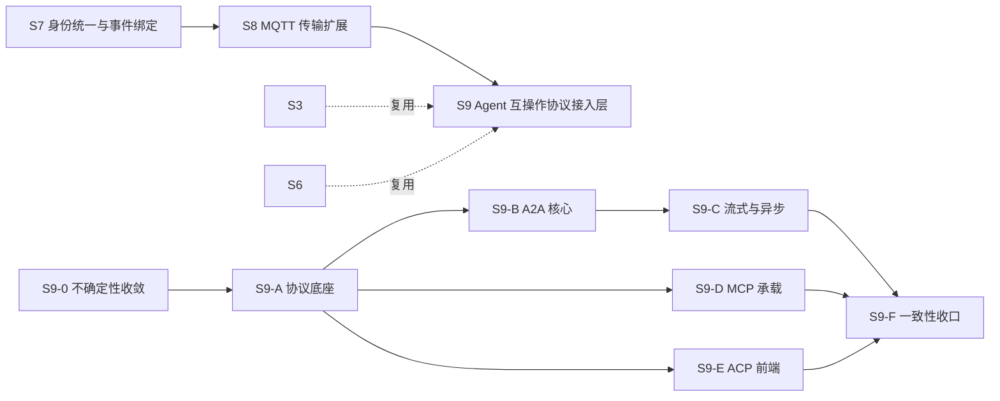

# S9 方案设计 — Agent 互操作协议接入层（A2A / MCP / ACP）

- **文档版本**：v0.1（立项评审稿，2026-11-11）
- **对应 Roadmap**：[`docs/roadmap.md`](../roadmap.md) §11（S9 章，含阶段总览与 Gate S9）
- **前置**：S0–S8 全部结案（`progress.md`，`rebar3 ct` 823/823 / 52 套件）
- **状态**：**规划稿，未开工，无「已实测」数字**。本文是「协议整理（§2）→ 需求提炼（§3）→ 开发计划（§4）」三段式立项输入；需求优先级与子阶段归属是**建议**，Gate 通过后以 ADR 冻结。
- **本文三部分的读法**：§2 是对三份外部规范的整理（事实），§3 是把这些事实映射成 UnifiedMQ 接入层需求的候选清单（推导），§4 是把需求排成阶段与 Gate（计划）。三者之间的推导链要可回溯，不要把 §3 的候选需求读成 §2 的规范条文。

## 0. 来源与证据口径

| 来源 | 版本 / 日期 | 本文取用范围 |
|---|---|---|
| [A2A Protocol Specification](https://a2a-protocol.org/latest/specification/) | `1.0.0`（latest released） | 主规范 + [Key Concepts](https://a2a-protocol.org/latest/topics/key-concepts/)、[Agent Discovery](https://a2a-protocol.org/latest/topics/agent-discovery/)、[Enterprise Features](https://a2a-protocol.org/latest/topics/enterprise-ready/)、[Streaming & Async](https://a2a-protocol.org/latest/topics/streaming-and-async/)、[Life of a Task](https://a2a-protocol.org/latest/topics/life-of-a-task/) |
| [Agent Client Protocol](https://agentclientprotocol.com/) | v1 stable（`protocolVersion 1`）/ v2 draft（2026-07-20 草案） | Introduction + [v1 overview](https://agentclientprotocol.com/protocol/v1/overview) / [v2 overview](https://agentclientprotocol.com/protocol/v2/overview) |
| [MCP Intro](https://modelcontextprotocol.io/docs/2026-07-28/getting-started/intro) | 协议版本 `2026-07-28` | Intro + 同版本 [Architecture overview](https://modelcontextprotocol.io/docs/2026-07-28/learn) |

**证据口径（重要，先声明）**：

1. A2A 的 `latest/specification/` 是单页长文，本次抓取在 §3 之后被截断；凡涉及**精确的 `TASK_STATE_*` 常量名、Agent Card 全部字段、三种绑定的方法名与端点映射**均以规范自述的**唯一权威源 `spec/a2a.proto`**（及 spec §4/§5.3/§8/§9/§10/§11）为准，本文只列已在上述页面逐字出现的内容，并在 §4.4 把「以 proto 复核」列为 S9-0 的第一项未决问题。**不把推测写成规范事实。**
2. MCP 的 Intro 页是概念介绍，§2.2 的数据层/传输层/原语细节取自同版本 Architecture overview，本文标注了出处。
3. ACP 的 v2 是**草案**，远程 HTTP/WS 传输**尚未定稿**；本文按 v1 stable 提炼需求，v2 差异只作为版本门控的提醒，不按 v2 立项。
4. 本文不含任何性能、兼容性、吞吐数字；所有这类数字按项目惯例（README §11.4 / roadmap §0 第 4 条）必须来自 S9 起落盘的实测报告。

---

## 1. 定位、分层与对位

### 1.1 「agent 之间通信协议」的准确分层

用户给的三份链接常被合称「agent 通信协议」，但**只有 A2A 是 agent↔agent**。三者是同一栈上相邻的三层，先澄清，否则需求会串层：

| 协议 | 通信双方 | 解决的问题 | 首发版本 | 传输 | 载荷格式 |
|---|---|---|---|---|---|
| **A2A** | A2A Client（代用户/其他 agent）↔ A2A Server（Remote Agent，**不透明黑盒**） | 对等 agent 之间的**能力发现、任务委派、协作、长任务跟踪** | `1.0.0` | HTTP(S)，payload 为 JSON-RPC 2.0；另有 gRPC / HTTP+JSON(REST) 绑定 | JSON-RPC 2.0；规范数据模型为 ProtoBuf（`a2a.proto`） |
| **MCP** | MCP Host/Client（AI 应用，1 client : 1 server）↔ MCP Server（提供 context） | agent 如何**接工具、数据源、提示词**（「AI 应用的 USB-C」） | `2026-07-28` | stdio（本地）/ Streamable HTTP（HTTP POST + 可选 SSE，远程） | JSON-RPC 2.0 |
| **ACP** | Client（编辑器/IDE，可信代理）↔ Agent（编码 agent，本地子进程，沙箱） | 编辑器与编码 agent 的**会话标准化**，类比 LSP 之于 language server | v1 stable（v2 draft） | JSON-RPC 2.0 over stdio（本地）；远程 HTTP/WebSocket **WIP** | JSON-RPC 2.0；文本默认 Markdown，复用 MCP 的 JSON 表示 |

三者**共同技术底座**（这是能收敛成「一个接入层」而非三套东西的原因）：

- 载荷都是 **JSON-RPC 2.0**（request/response + notification，无响应）；
- 都有**版本协商 + 能力协商**（A2A `Agent Card.capabilities`、MCP `server/discover` + `initialize`、ACP `initialize`）；
- 身份都放在**传输/HTTP 层，payload 不携带身份**（A2A 明确 "No Identity in Payload"）；
- 都强调**流式增量**（SSE / notification）与**异步长任务**；
- 都有**扩展点**（A2A `Extension`、MCP/ACP `_meta`、ACP 下划线前缀自定义方法）；
- 都用 `camelCase` 键（ACP 明确：判别字段的值用 `snake_case`）。

### 1.2 与 UnifiedMQ 现有抽象的对位（为什么是「新增协议接入层」）

按 roadmap §0「协议层横向解耦」与 [ADR-001](../adr/001-protocol-adapter-separation.md)，S9 与 S5/S8 同构：**各协议一个 `broker_proto_*` adapter，只依赖内核门面，彼此不引用，不写第二套消息内核**。三份规范里的概念几乎都能落到已有能力上：

| 协议概念 | 落点（既有能力 / 待补） | 依据 |
|---|---|---|
| A2A `Task`（有状态、长生命周期、状态机、**终态不可变**） | 统一消息模型 `broker_message`（ADR-009）+ `broker_queue` / 订阅游标 / retention；状态机是 adapter 层新逻辑 | ADR-009/013/014/015 |
| A2A `TaskStatusUpdateEvent` / `TaskArtifactUpdateEvent`、MCP `notifications/progress`、ACP `session/update` | 流式投递 + 统一 `ce-*` 事件通道（S3 的 CloudEvents Binary Mode 映射）+ W3C Trace Context 门控（S7 `broker_event_trace`） | ADR-020、`docs/cloudevents-mapping.md`、`docs/security.md` §5.1 |
| A2A **Push Notification**（出站 webhook、重试、SSRF 防护） | 出站投递；重投递 / DLQ / TTL（ADR-015）+ `broker_security` ACL；egress 策略是新增 | ADR-015、`docs/security.md` §4 |
| A2A `Agent Card` / 发现（well-known URI、注册中心、缓存） | 控制面元数据（`broker_meta`；`topic_meta`/`queue_meta`/`binding_meta` 已建表并有泛型 CRUD，**但无运行时读取方**）+ 管理 API | `docs/architecture.md` §2.1、`docs/security.md` §12 第 7 条 |
| A2A `securitySchemes` / MCP OAuth / ACP `authenticate` | **六协议共用 `broker_security` 身份表**（S7 已完成），认证在传输层，`401`/`403`、逐 skill 授权 | `docs/security.md` §2.1/§4、ADR-021 |
| ACP `session/*`、A2A `contextId` | 会话 / 订阅（ADR-013 的 cursor 归属）+ 新增 session 元数据 | ADR-013/019 |
| MCP `tools/resources/prompts`、ACP agent 侧推理 | **不在 Broker 内实现**：Broker 只承载传输，语义由外部 server / agent 提供 | README §1.2 非目标 |
| 可观测 | `broker_metrics:snapshot/0` + ADR-016 最小集；OTel 导出层仍是 `docs/security.md` §12 待办 | ADR-016 |

### 1.3 定位结论与非目标边界

**结论**：S9 = 在既有统一消息内核之上，新增 A2A / MCP / ACP 三个协议接入前端，把 Broker 扩展为 agent 间任务、事件与流式消息的可靠承载与网关；**首期以 A2A 为主线**（唯一真正的 agent↔agent 协议），MCP / ACP 作为配套承载面。

**非目标（明确不做，避免被读成「已完成」）**：

| 项 | 说明 |
|---|---|
| agent 推理 / LLM 调用 / 工具执行 / 代码修改 | MCP tools、ACP agent 侧的语义执行由外部进程提供，Broker 不做 |
| A2A **gRPC / HTTP+REST 绑定** | 规范定义了三种绑定，首期只取 JSON-RPC + SSE；另两种不立项 |
| A2A curated registry 的**标准** API | A2A 规范自述「不规定 registry 标准 API」，只做项目私有 catalog |
| ACP **远程** HTTP/WebSocket 传输 | Transports WG 草案未定稿，vendor-specific HTTP 不当规范实现 |
| MCP **sampling** | 自协议版本 `2026-07-28` 起已弃用 |
| Agent Card 签名（JWS）完整 PKI / 外部 KMS、OTel 导出层、审计日志签名 | 沿用 `docs/security.md` §12 既有待办，S9 不扩面 |
| 各协议**官方 CloudEvents Binding 逐字实现** | S7 已结案「不立项」（`docs/roadmap.md` §9.1），S9 沿用统一 `ce-*` 项目定义 |
| A2A 历史版本（0.3.0 及更早）兼容 | 只对齐 `1.0.0` |
| Part 内嵌 UI（iframe）渲染 | Modality Agnostic 的可选形态，非消息内核职责 |

---

## 2. 协议整理

### 2.1 A2A Protocol 1.0.0

**目标与原则**：让不同框架/厂商的、彼此**不透明**的 agent 系统能互相发现能力、协商交互模态（文本/文件/结构化数据）、管理协作任务、安全交换信息，**无需访问对方内部状态、内存或工具**。指导原则：`Simple`（复用 HTTP / JSON-RPC 2.0 / SSE）、`Enterprise Ready`、`Async First`、`Modality Agnostic`、`Opaque Execution`。

**三层规范结构**（对工程实现最有约束力的一条）：

| 层 | 内容 | 约束 |
|---|---|---|
| Layer 1 Canonical Data Model | 协议无关的核心数据结构，以 **ProtoBuf** 表达 | `spec/a2a.proto` 是**唯一权威**；SDK / JSON Schema / 绑定**必须**由 proto 生成，不得手改 |
| Layer 2 Abstract Operations | 与传输无关的抽象能力 | 所有实现必须支持，语义在绑定间一致 |
| Layer 3 Protocol Bindings | JSON-RPC / gRPC / HTTP+JSON(REST) 的具体映射 | 方法名、端点模式、绑定特有行为；新增绑定不改数据模型 |

变更控制：字段重命名新旧并存并标 deprecated，**不得早于下一个主版本移除**；破坏性变更必须附迁移文档；文档锚点必须保留。规范关键字按 RFC 2119。

**核心角色与对象**：

- `A2A Client`：代用户/系统向 Server 发起请求；`A2A Server (Remote Agent)`：暴露合规 endpoint，对 Client 是**黑盒**。
- `Agent Card`：Server 发布的 JSON「数字名片」，描述 identity / capabilities / skills / endpoint / 认证要求，用于发现与交互初始化。
- `Message`：一轮通信，`role`（`user`/`agent`）+ 唯一 `messageId` + 一个或多个 `Part`。
- `Task`：**有状态工作单元**，唯一 `id`，走完定义好的生命周期；`contextId` 分组相关 Task/Message。
- `Part`：`Message` / `Artifact` 的最小内容容器，`oneof` —— `text`（字符串）/ `raw`（内联字节）/ `url`（外部文件引用）/ `data`（结构化 JSON）；附加 `mediaType`、`filename`、`metadata`。**必须恰好含一个内容字段**。
- `Artifact`：任务产出的实体交付物，`artifactId` + `name` + 一个或多个 `Part`，可分块流式下发。

**抽象操作集**（Layer 2，binding-independent；以下名称来自规范页面逐字内容）：

| 操作 | 输入 → 输出 | 关键行为 |
|---|---|---|
| `SendMessage` | `SendMessageRequest` → `Task` **或** `Message` | 必须立即返回；返回 `Task` 时处理可异步继续；简单交互直接回 `Message` |
| `SendStreamingMessage` | `SendMessageRequest` → 流（`Task`/`Message` 起始 + `TaskStatusUpdateEvent`/`TaskArtifactUpdateEvent`） | 两种流形态：Message-only（恰一条后立即关闭）/ Task lifecycle（终态关闭） |
| `GetTask` | `taskId` → 当前 `Task`（status / artifacts / 可选 history） | 轮询长任务 |
| `CancelTask` | `taskId` → `Task` | 终态任务不可取消 |
| `SubscribeToTask` | `taskId` → 事件流 | SSE 断线后**重订阅** |
| `CreateTaskPushNotificationConfig` / `GetTaskPushNotificationConfig` | `TaskPushNotificationConfig` | webhook 配置 CRUD（另有 List / Delete） |
| `GetExtendedAgentCard` | → 认证后的扩展 Agent Card | 敏感信息/更详细版本 |

错误集（规范逐字出现）：`ContentTypeNotSupportedError`、`UnsupportedOperationError`（含「终态任务不可再收消息」「不支持流式」）、`TaskNotFoundError`、`InvalidParamsError`、`PushNotificationNotSupportedError`、`TaskNotCancelableError`。

**Task 生命周期**（`life-of-a-task` + spec 页面）：

- 状态（文本口径，完整 `TASK_STATE_*` 常量名以 `a2a.proto` 复核）：`submitted` / `working` / `input-required` / `auth-required` / `completed` / `failed` / `canceled` / `rejected`；其中 **`completed` / `failed` / `canceled` / `rejected` 是终态**，`input-required` / `auth-required` 是中断态。
- **Task 不可变**：终态后不可重启、不可再收消息；后续 refinement 必须在**同一个 `contextId` 下新建 Task**，并可用 `referenceTaskIds` 引用原任务。同一 `contextId` 下允许并行 follow-up Task。
- Artifact 的**版本链由 Client 维护**（协议不规定）：Server 复用一致的 `artifact-name`，Client 决定接受哪一版；`Part.metadata` 可带 `artifactId`/`taskId` 引用。
- Agent 分三类：`Message-only` / `Task-generating` / `Hybrid`（先用 Message 协商范围，再建 Task）；Hybrid 一旦建 Task，后续只回 Task。

**三种交互模式**：

| 模式 | 机制 | 适用 |
|---|---|---|
| Request/Response (Polling) | `SendMessage` + `GetTask` 轮询 | 长任务、客户端可定期查 |
| SSE Streaming | `SendStreamingMessage`，HTTP 200 + `Content-Type: text/event-stream`，每个 event 的 `data` 是一个 JSON-RPC 2.0 Response（`SendStreamingMessageResponse.result` 为 `Task`/`TaskStatusUpdateEvent`/`TaskArtifactUpdateEvent`）；`TaskArtifactUpdateEvent` 用 `append`/`lastChunk` 重组大文件；流在终态或中断态关闭；断线用 `SubscribeToTask` 重连 | 实时进度、增量 artifact、低延迟 |
| Push Notifications | Server 在显著状态变更时向 Client 提供的 **HTTPS webhook** 发 `POST`，body 是 `StreamResponse`（`task`/`message`/`statusUpdate`/`artifactUpdate`）；Client 收到并验真后用 `GetTask` 拉全量 | 分钟/小时/天级长任务、移动端 / serverless / 断开的客户端 |

Server 必须在 Agent Card 声明 `capabilities.streaming` / `capabilities.pushNotifications` 才能启用对应模式。

**Agent Card 与发现**：

- 字段（页面逐字出现的部分，完整集以 `a2a.proto` / spec §8 复核）：identity `name`/`description`/`provider`、服务 `url`、`version`、A2A 能力 `capabilities`（`streaming` / `pushNotifications` / `extendedAgentCard`）、认证 `security` / `securitySchemes`（如 `Bearer` / `OAuth2`）、`skills`（`AgentSkill`：`id`/`name`/`description`/`inputModes`/`outputModes`/`examples`/`tags`）。
- 三种发现策略：
  1. **Well-Known URI**（推荐，公开 agent）：`https://{domain}/.well-known/agent-card.json`（RFC 8615），HTTP GET 取 JSON；
  2. **Curated Registries / Catalog**：中心 registry 按 skill / tag / provider 查询、支持访问控制与选择性披露——**规范不规定标准 registry API**；
  3. **Direct Configuration / Private Discovery**：硬编码 / 配置 / 环境变量 / 私有 API。
- 保护：敏感 card 用 `authenticated extended agent card`；endpoint 加 mTLS / IP 限制 / OAuth 2.0；registry 按调用方身份**选择性披露**；**强烈建议用带外动态凭据，不在 card 内嵌静态密钥**。
- 缓存：Server 给 `Cache-Control: max-age` + `ETag`（由 `version` 或内容哈希派生）；Client 用 `If-None-Match` / `If-Modified-Since` 条件请求。

**企业级特性**：

- 生产环境**必须 HTTPS**，推荐 TLS ≥ 1.2 与强套件，Client 必须校验服务端证书。
- 认证：`Agent Card.security` 对齐 OpenAPI 的 security schemes；凭据**带外获取**（OAuth2 流程 / 安全密钥分发），通过标准 HTTP 头传（`Authorization: Bearer <TOKEN>` / `API-Key: <KEY>`）；Server **必须逐请求校验**；失败返回 `401 Unauthorized`（带 `WWW-Authenticate`）或 `403 Forbidden`。
- **In-Task Authentication**：任务中需访问第三方系统时用 `auth-required` 中断态示意，Client 带外取二次凭据后回填。
- 授权：按已认证身份做**逐 skill** 授权（OAuth scope）、数据/动作级授权、最小权限；Server 是后端资源的守门人。
- 数据隐私：GDPR / CCPA / HIPAA、数据最小化、传输（TLS）与落盘均需保护。
- 可观测：OpenTelemetry + **W3C Trace Context** 头传播 trace/span id；日志含 `taskId` / `sessionId` / correlation id / trace context；指标含请求率、错误率、任务处理延迟、资源利用率；审计任务创建、关键状态变更、敏感动作。
- API 治理：集中策略（认证/限流/配额）、负载均衡与路由、分析报表、开发者门户发布 Agent Card。

**Push Notification 安全**（出站、server-initiated，风险最高）：

- Server 侧：不得盲信 Client 提供的 URL（**SSRF** / DDoS 放大）——用域名 allowlist、归属挑战应答校验、egress 防火墙；按 `TaskPushNotificationConfig.authentication` 向 webhook 自证（Bearer / API key / HMAC / mTLS）。
- Client webhook 侧：验真（JWT 签名对 Server 公钥 / HMAC / API key）、校验 `TaskPushNotificationConfig.token`、防重放（时间戳 + 拒绝过旧、`jti`/nonce 单次）、密钥轮换（JWKS）。
- 示例流：Server 签 JWT（`iss`/`aud`/`iat`/`exp`/`jti`/`taskId`，头带 `kid`）→ Client 取 JWKS 公钥验签并校验 claims。

### 2.2 MCP（协议版本 2026-07-28）

**定位**：连接 AI 应用到外部系统（数据源 / 工具 / 工作流）的开放标准，「AI 应用的 USB-C」。只规定**上下文交换协议**，不规定应用如何用 LLM、如何管理 context。

**架构**：`MCP Host`（AI 应用，协调并管理多个 client）为每个 server 建一个 `MCP Client`（**1:1 专用连接**）；`MCP Server` 提供 context。本地 server 走 stdio（通常只服务一个 client），远程 server 走 Streamable HTTP（服务多个 client）。

**两层**：

| 层 | 内容 |
|---|---|
| Data layer | JSON-RPC 2.0 交换：`server/discover`（版本/能力/身份发现）；Server features `tools`（AI 动作）/ `resources`（上下文数据）/ `prompts`（交互模板）；Client features `elicitation`（向用户征询输入，**sampling 自 2026-07-28 弃用**）；Utility `notifications` / `progress`（实时更新、长操作进度） |
| Transport layer | 连接建立、消息成帧、授权。`stdio`（本地进程，无网络开销）/ `Streamable HTTP`（HTTP POST 客户端→服务器 + 可选 SSE 流；标准 HTTP 认证：bearer / API key / 自定义头，**推荐 OAuth**） |

**无状态**：每个请求在 `_meta` 携带该请求相关的 protocol version 与 capabilities，Server 可独立处理；Client 也在 `_meta` 标识自己。

**生命周期**：`initialize` 握手（版本 + 能力协商）→ Discovery（`tools/list` / `resources/list` / `prompts/list`）→ Operation（`tools/call` / `resources/read` …），实时 `notifications` 与 `progress` 贯穿。

**安全与控制**：有副作用的 tool 需用户显式同意；`Roots` 限定文件系统边界；本地 server 进程隔离；远程 HTTPS/TLS；社区明确关注 prompt injection 与工具链数据外泄。版本号为**日期式**（`2025-11-25`、`2026-07-28`），靠能力协商实现后向兼容，小特性不必升主版本。

### 2.3 ACP（v1 stable / v2 draft）

**定位**：标准化**编辑器/IDE 与编码 agent** 之间的通信，类比 LSP 统一 language server。解决 N 编辑器 × M agent 的集成爆炸、兼容性受限、开发者锁定：实现一次 ACP，agent 可用于任何兼容编辑器。

**角色与不变量**：`Client`（编辑器/host）拥有 UI、workspace、用户，是**可信代理**，负责执行副作用与策略；`Agent`（AI 编码程序）通常是 Client 的**本地子进程**，拥有 model loop 与规划，**不直接触碰 workspace**——所有文件读写、shell、用户提问都回调 Client，由 Client 执行并展示 UI。这是 ACP 的核心不变量。

**通信模型**：JSON-RPC 2.0，`Methods`（request/response）+ `Notifications`（单向无响应）；**双方都可发请求**、各自独立选 id、不得复用未决 id；v2 起 id 必须是 string/int **不得为 null**、**不用 batch**、`$/cancel_request` 取消在途请求。约定：键用 `camelCase`，判别字段的**值**用 `snake_case`，信封字段照 JSON-RPC 2.0；文件路径**必须是绝对路径**（宿主机原生语法，**不是 URI**），行号 1-based；扩展用 `_meta` 与下划线前缀方法名。

**典型流程**：

1. Initialization：`initialize`（协商 `protocolVersion` + `clientCapabilities` / `agentCapabilities` / `authMethods`）→（若需要）`authenticate`（v1）/ `auth/login`（v2）；
2. Session Setup：`session/new`，或 `session/load` / `session/resume`（能力门控）；
3. Prompt Turn：`session/prompt`（用户一轮，content blocks：text/image/audio/resource/resource_link）→ Agent 流 `session/update` 通知（message chunk / thought / `tool_call` + `tool_call_update` / plan / usage / available commands / config options / 用户通知）→ 按需 `session/request_permission` 让用户批准敏感 tool call、回调 `fs/*` / `terminal/*` 执行副作用 → 必要时 `session/cancel` 中断 → 以 `stopReason`（`end_turn` / `cancelled` / `max_tokens` …）结束。

**方法表**（v1 口径）：

| 方向 | Baseline（必须） | Optional | Notifications |
|---|---|---|---|
| Agent（供 Client 调） | `initialize`、`session/new`、`session/prompt` | `authenticate`、`logout`、`session/load`、`session/resume`、`session/list`、`session/close`、`session/delete`、`session/set_mode`、`session/set_config_option` | — |
| Client（供 Agent 回调） | `session/request_permission` | `fs/read_text_file`、`fs/write_text_file`、`terminal/create` / `output` / `release` / `wait_for_exit` / `kill`、`elicitation/create` | `session/update`、`session/cancel`、`elicitation/complete` |

内容块与 A2A `Part` 同构（`text`/`image`/`audio`/`resource`/`resource_link`），另有 ACP 自定义的 diff 展示类型；用户可读文本默认 **Markdown**（不要求编辑器能渲染 HTML）。`tool_call` 状态机 `pending → in_progress → completed/failed`。

**版本风险（v2 draft，非本阶段基线）**：`auth/login`+`auth/logout` 取代 `authenticate`/`logout`；`session/resume` 升为必需、`session/load` 移除；`session/list`+`session/close` 升为 baseline；`session/prompt` 只确认接收、完成移到 `state_update`；`fs/*` / `terminal/*` 从 Client 面移除；更新改为 ID-keyed upsert；`session/set_mode` 移除。远程传输目前仍是 WIP（Transports WG 草案：长连接 GET stream + POST + 同端点 WS upgrade），**在定稿前 HTTP 层是 vendor-specific**。

### 2.4 三者对照总表

| 维度 | A2A 1.0.0 | MCP 2026-07-28 | ACP v1 |
|---|---|---|---|
| 关系 | agent ↔ agent（对等、不透明） | host/client ↔ server（上下文供给） | editor ↔ 编码 agent（人机会话） |
| 状态性 | **有状态 Task**（长生命周期、终态不可变） | **无状态**（每请求带 `_meta`） | **有状态 session**（可 resume） |
| 传输 | HTTP(S) + JSON-RPC 2.0 / SSE / webhook；gRPC、REST 绑定 | stdio / Streamable HTTP(POST+SSE) | stdio 子进程；远程 HTTP/WS 未定稿 |
| 流式 | SSE `SendStreamingMessage` + `SubscribeToTask` | 可选 SSE + `notifications` / `progress` | `session/update` 通知 |
| 异步 | `GetTask` 轮询 + Push Notification | 长操作 progress | `stopReason` + `session/cancel` |
| 发现 | Agent Card（well-known / registry / 配置） | `server/discover` + `tools\|resources\|prompts/list` | `initialize` 能力协商 |
| 认证 | Agent Card `securitySchemes`，HTTP 头，带外凭据，401/403 | 标准 HTTP 认证，推荐 OAuth | `authMethods` / `authenticate` |
| 扩展 | `Extension` + Agent Card 声明 | `_meta` + capability | `_meta` + 下划线前缀方法 |
| 对 S9 的意义 | **主线**：任务总线 / 事件承载 / 出站推送 | 配套：工具面传输承载 | 配套：会话面传输承载 |

---

## 3. 需求提炼

**读法**：编号 `R-<组><序号>`；「来源」指向 §2 的规范事实；优先级 `P0` = 首期 A2A 闭环必须、`P1` = 首期应做、`P2` = 后续或明确裁剪；「子阶段」对应 §4.2。约束用词按 RFC 2119 中文口径（必须 / 应 / 不得 / 可）。**这是候选需求清单，不是已批准的规格**；验证方式统一见 §4.3 Gate S9。

### 3.1 传输与编解码（R-T）

| 编号 | 需求 | 来源 | 优先级 | 子阶段 |
|---|---|---|---|---|
| R-T1 | 必须实现 HTTP/1.1 上的 JSON-RPC 2.0 单请求 / 响应 / 通知 / 错误信封；**不得实现 batch**；请求 id 不得为 null；错误必须带 `code` + `message` | §2.1/§2.3 共同底座 | P0 | S9-A |
| R-T2 | 必须实现 SSE 服务端流（`200 OK` + `Content-Type: text/event-stream`），每个 `data` 为一个完整 JSON-RPC Response | §2.1 SSE / §2.2 | P0 | S9-A/S9-C |
| R-T3 | 应实现 Streamable HTTP：客户端→服务端用 `POST`，服务端→客户端可选 SSE | §2.2 | P1 | S9-D |
| R-T4 | 应实现 stdio 前端（本地子进程消息成帧），供 MCP / ACP 本地形态使用 | §2.2/§2.3 | P1 | S9-D/S9-E |
| R-T5 | 生产必须 HTTPS，推荐 TLS ≥ 1.2 与强套件；客户端证书校验；凭据只在 HTTP 头，**不得进 payload** | §2.1 企业级 | P0 | S9-A |
| R-T6 | 必须实现版本协商 + 能力协商（A2A `capabilities`、MCP `initialize`/`server/discover`、ACP `initialize`），不支持的能力必须显式拒绝而非静默降级 | §1.1 共同底座 / §2.1 `UnsupportedOperationError` | P0 | S9-A |
| R-T7 | 应支持扩展约定：`_meta` 透传、下划线前缀自定义方法、`camelCase` 键 | §2.2/§2.3 | P2 | S9-A |
| R-T8 | 新增协议前端必须可配置门控（默认关闭 / profile 门控可选依赖），参照 S8-D `quicer` 做法 | 项目惯例 | P1 | S9-A |

### 3.2 Agent Card 与发现（R-D）

| 编号 | 需求 | 来源 | 优先级 | 子阶段 |
|---|---|---|---|---|
| R-D1 | 必须实现 `Agent Card` 数据结构与 JSON 校验（identity / `url` / `capabilities` / `skills` / `securitySchemes` / `security` / `version`），字段集以 `a2a.proto` 复核 | §2.1 | P0 | S9-B |
| R-D2 | 必须提供 `GET /.well-known/agent-card.json`（RFC 8615） | §2.1 发现策略 1 | P0 | S9-B |
| R-D3 | 必须实现缓存语义：`Cache-Control: max-age` + `ETag`（`version`/内容哈希）+ `If-None-Match` → `304` | §2.1 缓存 | P1 | S9-B |
| R-D4 | 应提供项目私有 catalog 查询（按 skill / tag / provider / capability 过滤）；**不得声称实现 A2A 标准 registry API**（规范未定义） | §2.1 发现策略 2 | P1 | S9-B |
| R-D5 | 应支持 `GetExtendedAgentCard`：认证后返回更详细 card，并按调用方身份选择性披露 | §2.1 保护 | P1 | S9-B |
| R-D6 | card 内**不得**包含静态密钥；必须走带外动态凭据 | §2.1 保护 | P0 | S9-B |

### 3.3 Task / 会话状态（R-S，与内核对位的核心）

| 编号 | 需求 | 来源 | 优先级 | 子阶段 |
|---|---|---|---|---|
| R-S1 | 必须实现 `Task` 对象：`id` / `contextId` / `status` / `artifacts` / `history` / `metadata` | §2.1 | P0 | S9-B |
| R-S2 | 必须实现状态枚举与合法迁移；**终态（completed/failed/canceled/rejected）不可变**：不可重启、不可再收后续消息 | §2.1 Task 不可变 | P0 | S9-B |
| R-S3 | 必须支持 `contextId` 分组、`referenceTaskIds` 引用、同 `contextId` 下并行 follow-up；artifact 版本链由客户端维护（Server 不追踪） | §2.1 生命周期 | P1 | S9-B |
| R-S4 | 必须支持 `input-required` / `auth-required` 中断态与多轮续接 | §2.1/§2.1 企业级 | P0 | S9-B |
| R-S5 | 必须实现 `SendMessage` 返回 `Task` 或 `Message` 的判定（简单交互直接回 Message） | §2.1 操作集 | P0 | S9-B |
| R-S6 | 必须实现取消：`CancelTask` / `session/cancel` / `$/cancel_request`；不可取消时返回明确错误 | §2.1/§2.3 | P0 | S9-B/S9-E |
| R-S7 | 应实现 ACP session 元数据：`new` / `resume` / `close` / `list` / `delete`（能力门控） | §2.3 | P1 | S9-E |
| R-S8 | 必须给出 Task 状态的**持久化与崩溃恢复**口径并绑定显式可靠性等级，**不得**使用含糊的「可靠」表述 | §2.1 + ADR-007/013/015 | P0 | S9-B |
| R-S9 | Task 状态到 `broker_message` / 队列 / 订阅游标的映射必须先有 ADR 冻结，再写实现 | §1.2 + 项目惯例 | P0 | S9-0 |

### 3.4 消息 / Part / Artifact（R-M）

| 编号 | 需求 | 来源 | 优先级 | 子阶段 |
|---|---|---|---|---|
| R-M1 | 必须实现 `Message`：`role` / `messageId` / `parts` / `contextId` / `referenceTaskIds` / `metadata` | §2.1 | P0 | S9-B |
| R-M2 | 必须实现 `Part` 的 `oneof`（`text` / `raw` / `url` / `data`，**恰好一个**）+ `mediaType` / `filename` / `metadata`，支持多模态 | §2.1 | P0 | S9-B |
| R-M3 | 必须实现 `Artifact`：`artifactId` / `name` / `description` / `parts`，支持 `append` / `lastChunk` 分块重组 | §2.1 SSE | P1 | S9-C |
| R-M4 | 不支持的 `mediaType` 必须返回 `ContentTypeNotSupportedError` | §2.1 错误集 | P0 | S9-B |
| R-M5 | 必须定义内联字节大小上限、外链 URL 校验与背压，接入既有资源上限 / 慢消费者守卫 | §2.1 + README §10.1 | P0 | S9-C |
| R-M6 | 必须给出到统一消息模型（`broker_message`）与 CloudEvents `ce-*` 通道的映射；沿用 S7「逐字 Binding 不立项」结论 | §1.2 + ADR-009/020 | P0 | S9-B |

### 3.5 流式 / 异步 / 推送（R-A）

| 编号 | 需求 | 来源 | 优先级 | 子阶段 |
|---|---|---|---|---|
| R-A1 | 必须实现 `SendStreamingMessage` 的事件序列（起始 Task/Message → 状态/产物事件 → 终态或中断态关流） | §2.1 SSE | P0 | S9-C |
| R-A2 | 必须实现 `SubscribeToTask` 断线重订阅 | §2.1 SSE | P1 | S9-C |
| R-A3 | 必须实现 `GetTask` 轮询 | §2.1 操作集 | P0 | S9-B |
| R-A4 | 应实现 `TaskPushNotificationConfig` 的 CRUD（`url` / `token` / `authentication` / `id`） | §2.1 Push | P1 | S9-C |
| R-A5 | 应实现出站 webhook `POST`（`StreamResponse` 载荷）并接入重投递 / DLQ / TTL | §2.1 Push + ADR-015 | P1 | S9-C |
| R-A6 | 出站 webhook **必须**有 SSRF 防护：域名 allowlist、归属挑战校验、egress 控制；不得盲信客户端 URL | §2.1 安全 | P0 | S9-C |
| R-A7 | 出站必须按配置自证（Bearer / API key / HMAC / mTLS）；接收侧验真、防重放（时间戳 + `jti`）、密钥轮换 | §2.1 安全 | P1 | S9-C |
| R-A8 | 应实现 `session/update` 型通知（chunk / `tool_call` 状态机 / plan / usage） | §2.3 | P1 | S9-E |
| R-A9 | 应支持长任务进度通知（`notifications` / `progress`） | §2.2 | P2 | S9-D |

### 3.6 认证、授权与安全（R-X）

| 编号 | 需求 | 来源 | 优先级 | 子阶段 |
|---|---|---|---|---|
| R-X1 | 认证必须接**六协议共用 `broker_security` 身份表**（S7）；身份在传输层，payload 不携带身份 | §2.1 企业级 + `docs/security.md` §2.1 | P0 | S9-A |
| R-X2 | 应支持 `securitySchemes` 声明（`apiKey` / `http` / `oauth2` / `openIdConnect` / mTLS）并与 Agent Card `security` 对齐 OpenAPI | §2.1 | P1 | S9-A |
| R-X3 | 认证失败必须返回 `401`（带 `WWW-Authenticate`）/ `403`，逐请求校验 | §2.1 | P0 | S9-A |
| R-X4 | 应支持逐 skill / 逐动作授权与最小权限，ACL 不得被事件属性绕过 | §2.1 + `docs/security.md` §4/§5 | P0 | S9-B |
| R-X5 | 应支持 In-Task 二次凭据（`auth-required` 中断态） | §2.1 | P2 | S9-B |
| R-X6 | 应实现用户批准门（`session/request_permission`、MCP 有副作用 tool 的同意、`elicitation`） | §2.2/§2.3 | P1 | S9-E |
| R-X7 | 应给出 prompt injection / 数据外泄 / 敏感数据最小化的边界说明 | §2.2 安全 | P1 | S9-F |
| R-X8 | 必须审计任务创建、关键状态变更与 agent 动作 | §2.1 可观测 | P1 | S9-F |

### 3.7 可观测与治理（R-O）

| 编号 | 需求 | 来源 | 优先级 | 子阶段 |
|---|---|---|---|---|
| R-O1 | 应传播 **W3C Trace Context**（接 S7 `broker_event_trace` 门控），对齐 OpenTelemetry 语义 | §2.1 + `docs/security.md` §5.1 | P1 | S9-A |
| R-O2 | 日志应含 `taskId` / `sessionId` / `contextId` / correlation id / trace context | §2.1 | P1 | S9-A |
| R-O3 | 指标应含请求率 / 错误率 / 任务处理延迟 / 资源利用率；**避免高基数标签** | §2.1 + ADR-016 / `docs/security.md` §7 | P1 | S9-F |
| R-O4 | 应提供限流 / 配额并接入既有资源上限 | §2.1 API 治理 | P2 | S9-F |

### 3.8 MCP / ACP 承载边界（R-B）

| 编号 | 需求 | 来源 | 优先级 | 子阶段 |
|---|---|---|---|---|
| R-B1 | 应透传 MCP 原语（`server/discover`、`tools/list\|call`、`resources/list\|read`、`prompts/*`、`notifications`、`progress`）；**Broker 不解释 / 不执行工具语义** | §2.2 + §1.3 非目标 | P1 | S9-D |
| R-B2 | **不得**实现 `sampling`（`2026-07-28` 已弃用） | §2.2 | P0 | S9-D |
| R-B3 | 必须明确 Broker 在 ACP 中扮演哪一侧；`fs/*` / `terminal/*` / `session/request_permission` 回调面若不由 Broker 提供，须在能力矩阵中写明 | §2.3 | P0 | S9-E |
| R-B4 | ACP 远程 HTTP/WS **不得**按规范实现（未定稿）；版本必须可协商门控，v2 草案特性不进默认路径 | §2.3 版本风险 | P0 | S9-E |

### 3.9 工程约束（R-E）

| 编号 | 需求 | 来源 | 优先级 | 子阶段 |
|---|---|---|---|---|
| R-E1 | 各协议 adapter 只依赖内核门面、彼此不引用；**不得写第二套消息内核** | ADR-001 / roadmap §0 | P0 | 全程 |
| R-E2 | S9 的关键不确定性必须在 S9-0 收敛并以 **ADR 落盘**，冻结后再写实现 | roadmap §0 第 2 条 | P0 | S9-0 |
| R-E3 | 三协议各需一份**真实第三方客户端**兼容证据（`test/protocol-compatibility/`）+ 能力矩阵与限制清单 | roadmap §10.2 / S8 惯例 | P0 | S9-B/C/D/E/F |
| R-E4 | 既有 `rebar3 ct`（823/823 / 52 套件）零回归；dialyzer / xref 干净 | 项目惯例 | P0 | 全程 |
| R-E5 | 所有性能 / 容量数字必须来自落盘的实测基准，不得预先承诺 | README §11.4 / roadmap §0 第 4 条 | P0 | S9-F |
| R-E6 | 文档同步：roadmap、architecture、operations、security、README、progress、protocol-compatibility | roadmap §10.2 | P1 | S9-F |

### 3.10 需求到「非目标」的收口

§3.1–§3.9 中标注 `P2` 的项与 §1.3 非目标表一起构成裁剪边界；**每裁剪一项都要在能力矩阵里留一行**，与 S8 对 MQTT-SN / QUIC / WS 的处理一致（`docs/protocol-compatibility.md` §4.11–§4.13）。

---

## 4. 下一阶段开发计划（S9）

### 4.1 阶段定位与依赖

S9 承接 S8 之后；它**不引入新的内核抽象**，而是复用 S3（CloudEvents `ce-*` 通道）、S6/S7（`broker_security` 身份表、ACL、可观测最小集、trace 门控）与 ADR-007/013/014/015（可靠性、游标、retention、重投递/DLQ/TTL）。S9-D/S9-E 与 S9-C 可在 S9-A 底座完成后并行（协议层横向解耦）。

### 4.2 子阶段划分（Gate 驱动）

| 子阶段 | 目标 | 主要产出 | 证据（真实客户端 / 测试） | 依赖 |
|---|---|---|---|---|
| **S9-0** 不确定性收敛 | 回答 §4.4 全部 OQ，冻结关键抽象 | spike 报告 + 新增 ADR（任务→内核映射、Agent Card 落点、HTTP/SSE 前端选型、ACP 侧别） | spike 代码 + 评审签认 | S8 结案 |
| **S9-A** 协议底座 | JSON-RPC 2.0 + HTTP/SSE 前端 + 版本/能力协商 + 错误模型 + `broker_security` 接线 | `broker_proto_agent_rpc`（或同层命名）公共底座；配置门控 | 单方法 echo + 协商 + `401`/`403` 用例；既有 823/823 零回归 | S9-0 |
| **S9-B** A2A 核心 | Agent Card + 发现 + Task 状态机 + `SendMessage`/`GetTask`/`CancelTask` + `broker_message`/CloudEvents 映射 | `broker_proto_a2a` | 官方 A2A SDK / sample 真实客户端跑通 Task 全生命周期；终态不可变 + 崩溃恢复用例 | S9-A |
| **S9-C** A2A 流式与异步 | SSE 流 + `SubscribeToTask` + Push Notification Config + 出站 webhook + SSRF / 签名 / 防重放 + 重试/DLQ/TTL | 流式与出站子系统 | 真实客户端断线重连 + webhook 端到端；SSRF 拒绝 / 伪造签名拒绝专项用例 | S9-B |
| **S9-D** MCP 承载 | Streamable HTTP（POST+SSE）/ stdio 前端 + `initialize`/`server/discover` + 原语透传 + 无状态 `_meta` | `broker_proto_mcp` | MCP Inspector / 官方 SDK 真实客户端兼容矩阵 | S9-A |
| **S9-E** ACP 前端 | stdio 前端 + `initialize`/`session/*`/`session/update` + 权限回调 + `stopReason` | `broker_proto_acp` | 官方 ACP SDK / 兼容编辑器真实 agent 客户端证据 | S9-A |
| **S9-F** 一致性收口 | 能力矩阵与限制清单、安全审计、压测与容量、运维/告警、文档同步、ADR 定稿 | 文档与报告 | 全量 CT + dialyzer/xref + 容量报告 + 审计用例 | S9-B/C/D/E |

> 子阶段命名与粒度是**建议**（同 s8 设计稿的落地偏差处理方式）；实际以 S9-0 评审后冻结的 ADR 为准。

### 4.3 Gate S9（结案条件，与 roadmap §11.2 同一份清单；逐项验收细节在 S9-0 后补齐）

- [ ] 三个协议各一份**真实第三方客户端**兼容证据落盘 `test/protocol-compatibility/`，并各有一行能力矩阵 + 逐协议限制清单（`docs/protocol-compatibility.md`）
- [ ] Task 状态机与**终态不可变**有自动化测试，含崩溃恢复与可靠性等级逐档证明
- [ ] 认证接六协议统一身份表；`401`/`403`、ACL 越权专项用例通过
- [ ] Push Notification 的 SSRF 防护、签名验真、防重放专项用例通过
- [ ] 既有 `rebar3 ct` 零回归（基线 823/823、52 套件）；dialyzer / xref 干净；`rebar3 release` 装配成功
- [ ] 压测 / 容量报告落盘，数字全部来自实测
- [ ] S9 ADR 定稿；roadmap / architecture / operations / security / README / progress / protocol-compatibility 同步
- [ ] §1.3 非目标与 §3.10 裁剪项在能力矩阵中逐行留痕

### 4.4 未决问题（必须在 S9-0 收敛，符合 roadmap §0「不确定性前置」）

| 编号 | 问题 | 为什么阻塞 | 收敛方式 |
|---|---|---|---|
| OQ-1 | A2A 精确 `TASK_STATE_*` 常量、Agent Card 全字段、JSON-RPC 绑定方法名与 §5.3/§9/§10/§11 映射 | 本次规范页被截断；写错会破坏与官方 SDK 的互操作 | 以 `spec/a2a.proto` 为唯一权威逐项复核，落 ADR |
| OQ-2 | `Task` 状态落到哪里：独立元数据表 / 持久化队列 / 订阅游标？与 ADR-007 三档可靠性如何绑定 | 决定 R-S8/R-S9，是 S9 最核心的架构决策 | spike + ADR（参照 ADR-013 cursor 归属的论证方式） |
| OQ-3 | Agent Card / catalog 落到 `broker_meta` 还是新建表；`topic_meta`/`queue_meta`/`binding_meta` 三表当前无运行时读取方 | 控制面归属未定，容易写成第二套元数据 | spike + ADR，沿用 ADR-002（Mnesia 只做控制面） |
| OQ-4 | HTTP/SSE 服务端选型：复用 `broker_proto_ws` / 引入 cowboy / 基于 ranch 自建 | 决定 SSE 长连接、背压、慢消费者守卫的落点 | spike，给出与既有 listener 监督树的装配关系 |
| OQ-5 | SSE 长连接与既有流控 / 背压（ADR-016、慢消费者守卫）如何共存 | 长连接会放大慢消费者风险 | spike + 容量用例 |
| OQ-6 | ACP 远程传输未定稿，本阶段是否**只做 stdio**；Broker 扮演 Client 还是 Agent 侧 | 决定 R-B3/R-B4 与前端形态 | 规范跟踪 + ADR 明确侧别 |
| OQ-7 | 出站 webhook 的 egress 策略与部署边界（allowlist 配置、网络策略） | 直接关系 R-A6 SSRF 防护 | 与 `docs/security.md` §4/§9 对齐 |
| OQ-8 | OAuth 授权服务器 / JWKS 端点是否纳入 Broker | 倾向「不纳入，凭据带外」（A2A 规范建议），但需冻结 | ADR 边界声明 |
| OQ-9 | 大 `Artifact`（内联 `raw` 字节）与 Broker 消息大小上限的冲突 | 决定 R-M5 的上限口径 | 容量 spike + 限制清单 |
| OQ-10 | 三协议与六协议既有端口 / listener / `broker_security` 认证路径的装配顺序 | 避免破坏既有 823 用例与 boot 顺序 | 参照 `docs/architecture.md` §3.1 boot step 给出顺序 |

### 4.5 口径说明

1. **本文件是规划稿**：§3 是候选需求、§4.2 是建议子阶段、§4.3 全是未勾选项。任何「已完成 / 已实测」的表述都不适用于 S9；Gate 通过后以 ADR 与 `progress.md` 的实测记录为准。
2. **事实与推导分开**：§2 只写三份规范逐字出现的内容；§3 的映射、优先级、子阶段归属是 UnifiedMQ 的**推导**，不属于规范条文。A2A 的 proto 权威项、MCP 的弃用项、ACP 的草案项都已在 §0/§2 标注。
3. **现有状态行暂不同步**：README / `progress.md` / `architecture.md` 目前写「S0–S8 已实现」、`security.md` §12 写「S7 之后未实现项」。这是**刻意保留**——规划稿不等于立项实现，待 S9-A 有首个代码交付时再统一同步，避免把计划读成现状。
4. **沿用既有结论**：CloudEvents 逐字 Binding「不立项」（S7）、六协议统一身份表（S7）、OTel 导出层与审计签名等 §12 待办，S9 均不重复立项、不推翻。

---

## 5. 参考资料

**外部规范**：

- A2A：<https://a2a-protocol.org/latest/specification/>（v1.0.0）；Topics：Key Concepts / Agent Discovery / Enterprise Features / Streaming & Async / Life of a Task
- ACP：<https://agentclientprotocol.com/>（Introduction）；<https://agentclientprotocol.com/protocol/v1/overview>（v1 stable）、<https://agentclientprotocol.com/protocol/v2/overview>（v2 draft）
- MCP：<https://modelcontextprotocol.io/docs/2026-07-28/getting-started/intro>；同版本 Architecture overview

**项目内**：

- [`docs/roadmap.md`](../roadmap.md) §0/§1/§10/§11、[`docs/architecture.md`](../architecture.md) §2.1/§3.1、[`docs/security.md`](../security.md) §2.1/§4/§5.1/§12、[`docs/protocol-compatibility.md`](../protocol-compatibility.md) §4.10–§4.13、[`docs/cloudevents-mapping.md`](../cloudevents-mapping.md)
- ADR：[001](../adr/001-protocol-adapter-separation.md)（适配层分离）、[002](../adr/002-mnesia-control-plane-only.md)、[007](../adr/007-explicit-reliability.md)、[009](../adr/009-broker-message-record.md)、[013](../adr/013-subscription-kinds-and-cursor-ownership.md)、[015](../adr/015-redelivery-dlq-and-ttl.md)、[016](../adr/016-observability-minimal-set.md)、[020](../adr/020-cloudevents-codec-policy-binding.md)、[021](../adr/021-cluster-control-plane-raft-and-fencing.md)
- 阶段惯例：[`docs/design/s8-mqtt-sn-mqtt-over-quic-and-mqtt-over-ws.md`](s8-mqtt-sn-mqtt-over-quic-and-mqtt-over-ws.md)
