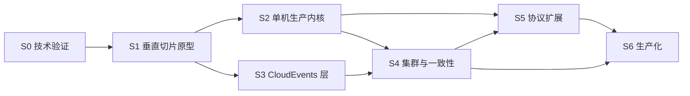

# UnifiedMQ 开发路线图

- **文档版本**：v1.0
- **对应架构文档**：[README.md](../README.md) v1.2
- **状态**：已评审（S1 首个垂直切片协议确定为 MQTT）
- **路径**：技术验证 → 垂直切片原型 → 单机内核 → 集群一致性 → 协议扩展 → 生产化

---

## 0. 规划原则

1. **Gate 驱动**：每个阶段有明确的进入条件，未达标不进入下一阶段。Gate 清单即验收测试清单。
2. **不确定性前置**：README 中标记"待验证"的假设全部在 S0 收敛，选型结论以 ADR 形式落盘。
3. **协议层横向解耦**：每种协议可独立交付、独立测试，不依赖其他协议的内部实现。
4. **性能数字不预先承诺**：所有吞吐/延迟数据必须来自 S2 起的实测基准（README 11.4）。
5. **可靠性显式化**：不使用含糊的"可靠投递"表述，ACK 返回时机与可靠性等级严格绑定（ADR-007）。
6. **领域模型先于框架**：统一消息模型与行为接口在 S1 定死，后续所有协议/存储实现都挂在这些抽象上。

### 阶段依赖关系



S2 与 S3 可并行：CloudEvents 是纯逻辑层，与内核开发的冲突面很小。S3 必须早于 S4，因为跨协议转换报告与属性映射规则需要在分布式语义稳定前定型。

---

## 1. 阶段总览与 Gate

| 阶段 | 名称 | 核心产出 | Gate（进入下一阶段的条件） |
|---|---|---|---|
| **S0** | 技术验证 | 5 份 spike 报告 + ADR-001~007 定稿 | 关键不确定性有明确结论；WAL + Raft 写入路径 PoC 跑通 |
| **S1** | 垂直切片原型 | MQTT 端到端闭环（单节点、无复制） | 真实 MQTT 客户端完成 pub/sub + 崩溃恢复 |
| **S2** | 单机生产内核 | 分区/订阅/ACK/DLQ/TTL/流控 + 可插拔存储 | 可靠性等级与 ACK 契约被测试逐档证明 |
| **S3** | CloudEvents 标准化层 | Codec + Binding Mapper + 策略开关 | 往返测试 + 转换报告测试通过 |
| **S4** | 集群与一致性 | Metadata Raft + 分区归属 + 消息复制 | 故障注入全套（崩溃/分区/失去多数派）达标 |
| **S5** | 协议扩展 | AMQP / NATS / Kafka / WebSocket / Pulsar | 每个协议通过真实客户端兼容矩阵 |
| **S6** | 生产化 | 安全 / 可观测 / 运维 / 容量 | 压测报告 + 故障演练 + 运维手册 |

---

## 2. S0 — 技术验证

**目标**：把 README 中的"待验证"假设变成结论。**此阶段只做实验，禁止设计内核 API。**

每个 spike 位于独立可丢弃的目录 `spikes/<id>/`，不得被 `apps/` 引用。

| Spike | 验证内容 | 方法 | 结论产出 |
|---|---|---|---|
| **S0.1** Raft 库评估 | `rabbitmq/ra` 的 API、快照、成员变更、快照后日志截断、慢节点与网络分区行为 | 3 节点 docker-compose（基于 `ra` 自带示例集群），注入 kill -9 / 网络分区 / 磁盘满 | ADR-003 定稿：采用 / 自研 / 换库 |
| **S0.2** Raft 分组模型 | 每分区一个 Raft Group 的资源开销 vs 批量分组 | 1/8/32/128 分组 × 1KB/100KB 消息压测，观测 CPU/内存/尾延迟 | 分组策略与故障域定义（回应 README 5.3 警告） |
| **S0.3** WAL + Group Commit | 自研分段日志的 fsync 吞吐、组提交收益、段文件恢复耗时 | 追加写 + 周期快照，crash-loop 注入，测恢复时间与重复/丢失窗口 | 方案 A（自研 WAL）可行性结论；可承诺的 `fsync` 等级 |
| **S0.4** 协议客户端基线 | 各协议真实客户端的最小可交互面（不实现协议） | 跑通官方 sample：Eclipse Paho、pulsar-client(java)、kafka-clients、nats.go、qpid proton | **客户端与版本矩阵表**（README 11.1 的前置输入） |
| **S0.5** CloudEvents 校验开销 | JSON Structured/Binary 编解码 + 核心属性校验的 CPU/内存成本 | 基准对比策略开关前后的吞吐与延迟分布 | 是否需限制 extensions 数量 / 嵌套深度（README 10.1） |

### 必须在本阶段回答的额外问题

- **ACK 契约等级表**：README 6.3 仅给出三档方向，S0.3 需给出每档实测的数据丢失边界。
- **快照与 Segment 清理的关系**：不得因使用 Raft 而省略日志段管理、保留策略与游标保留（README 5.3 明确警告）。
- **失去多数派时的行为**：明确停止写入还是限制为非持久写入，以及对存量连接的处置。

### Gate S0

- [x] S0.1 与 S0.3 产出明确结论（采用 / 拒绝均有依据）—— ADR-003（采用 `rabbitmq/ra` 3.2.0）、ADR-008（自研 WAL + 分组模型）
- [x] S0.4 的客户端与版本矩阵被采纳为 S5 全部协议测试的基线 —— `docs/protocol-compatibility.md` §0
- [x] ADR-001 ~ ADR-007 从 README 摘要升级为 `docs/adr/00N-*.md` 正式文件 —— 7 份文件均存在
- [x] S0.2 产出分区分组决策，记录故障域定义 —— ADR-008 §8.1（G=16 折中，故障域 = 组大小）

---

## 3. S1 — 垂直切片原型（MQTT）

**目标**：以 MQTT 为首个协议，完成 README 附录 A 的 7 步端到端闭环。

**范围限定**：单节点、无复制、无控制面（Mnesia 只放最小配置）、内存 + 本地 WAL 双存储实现。

### 3.1 骨架搭建

按 README 第 8 节目录结构创建，S1 阶段只建会实际用到的 app：

```text
unified-mq/
├── rebar.config
├── apps/
│   ├── broker_core/          # 统一消息模型 + 行为接口
│   ├── broker_router/        # destination → partition 解析
│   ├── broker_queue/         # 分区与队列
│   ├── broker_subscription/  # 订阅与游标
│   ├── broker_storage/       # WAL + 内存实现
│   ├── broker_event/         # S1 恒等桩（pass_through）；CloudEvents codec（S3 填充）
│   └── broker_proto_mqtt/    # 首个协议适配器
├── config/
├── docs/
│   ├── adr/
│   └── roadmap.md
├── spikes/                   # S0 实验，仅 S0 使用
└── test/
    ├── integration/
    └── protocol-compatibility/
```

### 3.2 三个必须先定死的抽象

后续所有协议与存储实现都挂在这三个抽象上，S1 评审时需单独确认：

1. **`broker_message` / `cloud_event` 记录**（README 3.1 已给草案，定稿后不改）
2. **`broker_router` behavior**：destination → `{partition, subscription}` 列表
3. **`broker_storage` behavior**：`append / read_from / ack / truncate / recover`，本阶段交付内存与 WAL 两份实现

> **S1 T0.5 冻结状态（2026-10-21）**：三项已定稿为 [ADR-009](adr/009-broker-message-record.md)（消息记录）、[ADR-010](adr/010-broker-router-behavior.md)（Router behavior）、[ADR-011](adr/011-broker-storage-behavior.md)（Storage behavior），状态**已采纳**。本 roadmap 条目是评审前的动词基线，保留原文不改；与冻结 API 的对应关系为：
> - 抽象 2 的 `destination → {partition, subscription}` 列表 → 冻结为 `route/3` 返回 `{ok, [{partition_id(), [sub_ref()]}]}`，其中 SubRef 由 `broker_subscription` 铸造、Router 仅作索引 key（ADR-010 §10.1/§10.2）。
> - 抽象 3 的 `ack` → 冻结为 `advance_committed/2`（storage 只持有全局连续前缀水位，per-sub cursor 归 `broker_subscription`）；`recover` → 冻结为与 `create/2` **分离**的 `recover/2`，额外返回 `HighOffset`（ADR-011 §11.2/§11.3）。
>
> 后续若需修改这三份 ADR 的 API，须走 ADR 修订流程并在 Gate 显式处置，不得在实现中静默偏离。

### 3.3 MQTT 首批范围

| 能力 | 范围 | 说明 |
|---|---|---|
| 连接 | MQTT 3.1.1 CONNECT/CONNACK、Keepalive、PINGREQ/PINGRESP | 5.0 在 S5 补齐 |
| 认证 | Username/Password，委托给 `broker_security` 桩接口 | S6 实现 TLS 与密钥轮换 |
| 发布订阅 | SUBSCRIBE/SUBACK/PUBLISH QoS 0 + QoS 1 | QoS 2 在 S2 补齐 |
| 持久化 | QoS 1 与 `clean_session=false` 的会话状态 | 验证协议会话与 Broker 游标的映射 |

### 3.4 崩溃恢复验证

使用 docker compose 编排单节点 + 外部客户端，脚本化注入：

1. publish → WAL 落盘 → 收到 PUBACK → `docker compose kill -9`
2. 重启后验证：已 ACK 消息不丢、订阅位置不丢、未 ACK 消息重投
3. 对每条断言编写测试，明确可容忍的重复窗口

### Gate S1

- [x] 真实 MQTT 客户端（Eclipse Paho / mosquitto_pub）完成 publish → subscribe → ack 全链路 —— **T15（2026-11-06）：8/8 用例、46/46 帧字节一致**
- [x] `kill -9` 后重启，消息丢失/重复行为有测试断言且符合契约 —— **T14：R1a~R7 × 默认/零回退双档 16/16 PASS**
- [x] 三个核心抽象完成评审并冻结 —— **T0.5 冻结；T17 复核无偏离**
- [x] `apps/broker_storage` 的 WAL 与内存实现可互换（同一 behaviour 两种后端） —— **T4/T5 契约 13 例 × 2；T13 端到端双组 12/12**
- [x] **在此 Gate 之前不允许实现第二个协议** —— 通过时 `apps/` 仍只有 `broker_proto_mqtt`

> **Gate S1 于 2026-11-06 通过。** 签认记录：ADR-011 §11.7（E1 措辞）、`docs/protocol-compatibility.md` §5（冻结契约一致性）、`progress.md`「Gate S1 验收结论」。

---

## 4. S2 — 单机生产内核

**目标**：把原型变成能承载真实流量的单机系统，仍无分布式。

**详细规划**：[`docs/design/s2-single-node-kernel.md`](design/s2-single-node-kernel.md)（v0.3：O1~O4 已拍板、D1~D9 已结案、ADR-012~017 已签认，S2-A~S2-I 子项目与 Gate 映射）。**S2-A 可观测性最小集（2026-11-07）、S2-B 替身档（2026-11-07）、S2-C QoS2/Retain/Will（2026-11-07）、S2-D 订阅语义与 cursor 重构（2026-11-08）、S2-E 重投递 / DLQ / TTL（2026-11-08）、S2-F retention / 段 GC / 慢消费者守卫（2026-11-08）、S2-G 背压 / 限流（2026-11-08）、S2-I 基准与 Gate 报告（2026-11-08）已完成**；执行计划见 [`s2-a-metrics-execution-plan.md`](design/s2-a-metrics-execution-plan.md)、[`s2-b-reliability-execution-plan.md`](design/s2-b-reliability-execution-plan.md)、[`s2-c-protocol-completion-execution-plan.md`](design/s2-c-protocol-completion-execution-plan.md)、[`s2-d-subscription-kinds-execution-plan.md`](design/s2-d-subscription-kinds-execution-plan.md)（决策 [ADR-019](adr/019-shared-assignment-ack-ownership-and-session-layout.md) 修订 ADR-013 的 §13.2/§13.3/§13.5，含实现期 §19.5）、[`s2-e-redelivery-dlq-ttl-execution-plan.md`](design/s2-e-redelivery-dlq-ttl-execution-plan.md)（ADR-015 §15.6 实现注记）、[`s2-f-retention-execution-plan.md`](design/s2-f-retention-execution-plan.md)（ADR-014 §14.7 实现注记）、[`s2-g-backpressure-execution-plan.md`](design/s2-g-backpressure-execution-plan.md)（ADR-016 §16.2 实施注记）；其余子项目逐项开执行计划。

### 4.1 功能范围

- **分区与顺序**：partition 归属、消息有序性边界
- **订阅抽象**：Exclusive / Shared / Failover 统一到 `broker_subscription` + `broker_cursor`（README 5.2）
- **消息生命周期**：ACK / 重投递（指数退避）/ 重试上限 / DLQ / TTL / retention
- **MQTT 补齐**：QoS 2、Retain、Will ✅（S2-C）；MQTT 5.0 Session 与 User Properties ✅（S2.5，2026-11-08，ADR-017）
- **可靠性等级**：`os_buffer` → `fsync` → `replicated_commit` 三档，Producer ACK 返回时机与等级严格对应（README 6.3）
- **背压**：bounded batch、mailbox 水位观测、生产者限速、consumer flow permit ✅（S2-G，`0` = 关闭阈值）
- **可观测性最小集**：连接数、认证失败、吞吐、端到端延迟、ACK 延迟、队列深度、订阅积压、cursor lag、DLQ 规模、WAL 写/刷盘延迟

### 4.2 监督树

落地 README 7.3 结构。**重启策略按进程性质区分，不统一处理**：

| 进程类型 | 重启策略 | 原因 |
|---|---|---|
| Listener / Connection | transient | 持连接，重启会破坏客户端会话 |
| 分区 Worker / Storage Worker | permanent + fencing 检查 | 持有分区所有权，需 Raft epoch 校验 |
| Config / Observability | permanent | 状态可重建但重启应可观测 |

### 4.2.1 S2.5（MQTT 5 子集，Gate 外）

**状态：✅ 完成（2026-11-08）**。CONNECT/PUBLISH/SUBSCRIBE properties、v5 reason codes（含 `0x84`）、session expiry 落盘与 boot 清理、`$share` 建组、`receive_maximum` 出站窗口、`maximum_packet_size` 入站/出站边界。执行计划与交付记录见 [`design/s2.5-mqtt5-execution-plan.md`](design/s2.5-mqtt5-execution-plan.md)；兼容性口径见 [`protocol-compatibility.md`](protocol-compatibility.md) §4.2。全量 `rebar3 ct` **397/397**、`dialyzer` 干净。topic alias / request-response / AUTH **仍未实现**（ADR-017 §17.1 冻结子集，S5 未纳入）。

### 4.3 Gate S2

- [ ] 三档可靠性等级逐档有自动化测试证明（尤其 `os_buffer` 档的丢失边界）——**自动化证明已完成**（`os_buffer` 替身三场景 CI 常驻 + `replicated_commit` 显式拒绝 + `fsync` 对照，见 `docs/benchmarks/reliability/s2-b-osbuffer-loss.md`）；**待补** dm-flakey 实机报告（特权/操作者）后勾选
- [x] 慢消费者 / 热点分区场景不导致 OOM——**S2-G 结构 + S2-I 数字**：慢消费者 20 000 条 RSS +37.1 MiB、热点分区冷路径 14 ms / RSS +41.3 MiB、300 连接 +0.4 MiB，均通过且 broker 存活（`docs/benchmarks/2026-11-08-s2-baseline.md` §4）
- [x] 基准报告已出：单机吞吐、消息大小 / 批量大小 / 分区数 / 订阅数的影响、延迟分位——[`docs/benchmarks/2026-11-08-s2-baseline.md`](benchmarks/2026-11-08-s2-baseline.md)（1 KiB / 8 连接 935 msg/s；`kill -9` 恢复 4.14 s；复跑命令在文首）
- [x] 无单一 GenServer 成为全局瓶颈（依据 README 7.2 的四项约束逐条检查）——报告 §5 逐条给代码事实与数字：1 → 8 连接 4.4x、1 → 16 分区 875 → 1056 msg/s、100 订阅 25 740 投递/s、热点积压时冷分区 14 ms

> **Gate S2 状态（2026-11-08）**：第 2/3/4 项已通过，第 1 项待 `dm-flakey` 实机报告（需 root，`sudo python3 tools/docker/s2_powerloss.py --scenario powerloss`）。**Gate 整体暂不宣布通过**；证据与口径见 [`docs/benchmarks/2026-11-08-s2-baseline.md`](benchmarks/2026-11-08-s2-baseline.md) 与 `progress.md`「Gate S2 验收结论」。

---

## 5. S3 — CloudEvents 标准化层

**目标**：实现 README 3 ~ 4 定义的标准化能力，可与 S2 并行。

### 5.1 功能范围

- **Codec**：JSON 编解码、核心属性类型校验、`data` / `data_base64` 互斥规则、扩展属性命名与类型校验
- **编码模式**：Structured 与 Binary Mode 双向实现；Structured 输出 `application/cloudevents+json`
- **策略开关**：`disabled` / `pass_through` / `validate_if_present` / `required` / `normalize`（README 3.4），按租户 + 目的地生效
- **Binding Mapper**：先做 MQTT binding（MQTT 3.1.1 元数据能力受限，需明确兼容策略），其余随 S5 协议补齐
- **转换报告**：目标协议无法表达的元数据必须显式标记损失，不得静默丢弃（README 4.1）
- **跨协议规则**：保留 `specversion / id / source / type` 与全部合法扩展；payload 字节不被无意的 JSON 反序列化改变；协议侧标识（offset / Pulsar Message ID / MQTT Packet Identifier）不得覆盖 CloudEvents `id`（ADR-005）
- **去重窗口**：按租户/目的地配置，键为 `source + id`，不默认永久去重
- **拒绝策略**：转换失败时提供明确拒绝 / 隔离 / 死信路径

### 5.2 Gate S3

- [x] README 11.2 全部测试项通过：缺失必需属性、错误类型、无效格式、扩展属性保留、未知扩展、时间格式、`data` 与 `data_base64` 互斥（`broker_event_SUITE` 31 例，2026-11-08）
- [x] Structured / Binary 正反向映射测试通过，跨协议往返测试通过并明确列出允许的非无损字段（`docs/protocol-compatibility.md` §4.3 损失清单；`cross_protocol_roundtrip_keeps_identity`）
- [x] 重复事件与重投递行为有测试覆盖（`duplicate_window_deduplicates` / `duplicate_is_off_by_default` / `duplicate_window_expires`；默认关闭时行为不变）
- [x] ACL 决策仅使用认证主体，未信任的事件属性无法影响授权（README 10.1）（`acl_does_not_trust_event_attributes`）
- [x] 转换失败路径不丢数据（有 DLQ 或隔离证据）（拒绝不 ACK + v5 `0x83` / 3.1.1 关闭；`quarantine_writes_a_durable_copy`；`mqtt_conn_SUITE` 2 例）

**结论：Gate S3 五项于 2026-11-08 全部通过**（全量 `rebar3 ct` 422/422、`dialyzer` 0 warnings、`xref` 76 条均为预期 unused-export）。

---

## 6. S4 — 集群与一致性

**目标**：实现分布式能力，本项目成本最高的阶段。

### 6.1 控制面

- **Mnesia 表**：`tenant` / `broker_user` / `acl_rule` / `topic_meta` / `queue_meta` / `binding_meta` / `subscription_meta` / `cluster_node` / `partition_meta` / `config_version` / `config_outbox`
- **配置更新**：版本号 + 事件通知 + 周期性对账
- **Outbox 模式**：配置提交后需向外部发布变更事件时使用，避免双写不一致（README 6.1）
- **Mnesia 边界**：不承担消息正文、每次 ACK、高频 Cursor 更新（ADR-002）

### 6.2 共识层

- **Metadata Raft Group**：分区 Owner、Epoch、复制成员、分区迁移状态
- **消息复制层**：按 S0.2 结论决定分组模型；本地数据面走批量追加，不将每个业务操作变为全局共识命令
- **失去多数派**：按配置停止或限制可靠写入
- **Fencing**：Epoch 变化后旧 Owner 必须被拒绝写入

### 6.3 Gate S4（README 11.3 全项作为验收清单）

- [x] 节点崩溃、网络分区、失去多数派、Leader 切换、分区迁移 —— `broker_cluster_dist_SUITE`（3 节点 `peer`）4/4：组形成/复制、Leader 故障切换、失去多数派、迁移后 Fencing；节点崩溃与 WAL/段清理由 S1 T14 与 S2-F 证据覆盖
- [x] 旧 Owner 的 Fencing 验证 —— `broker_cluster:authorize_append/2` 返回 `{error, {fenced, #{partition, expected_epoch, actual_epoch}}}`；`old_owner_is_fenced_after_migration` 用例
- [x] WAL 部分写入、刷盘失败、磁盘满、恢复中断、日志段清理 —— 沿用 S1 T14 崩溃矩阵（默认/零回退各 8/8）与 S2-F `wal_gc` 证据
- [x] **Producer ACK 与实际持久化/复制等级一致性**由测试证明 —— `replicated_commit` 仅在 `quorum = (N div 2) + 1` 个副本 fsync 后返回 `{ok, Offset}`；`broker_cluster_SUITE` 覆盖副本不足不 ACK
- [x] 慢消费者、热点分区、积压暴涨、背压恢复 —— 沿用 S2-G 背压/限流证据（整轮 permit、生产者过载断开、有界 batch）

**Gate S4 结论：✅ 通过（2026-11-08）。** 实现与证据见 [ADR-021](adr/021-cluster-control-plane-raft-and-fencing.md) 与 [`docs/design/s4-cluster-execution-plan.md`](design/s4-cluster-execution-plan.md) §5。

---

## 7. S5 — 协议扩展

每个协议交付物 = **一份独立测试套件 + 能力矩阵的一行**（README 11.1）。顺序按"验证成本 / 客户端易得性"排列：

| 顺序 | 协议 | 首批范围 | 真实客户端（来自 S0.4 矩阵） |
|---|---|---|---|
| 1 | MQTT（已由 S1 建立） | S2 已补齐 QoS 0/1/2、Retain、Will、5.0 | Eclipse Paho、mosquitto |
| 2 | WebSocket | Broker 自有 JSON/二进制帧 API | 浏览器 + 自定义客户端 |
| 3 | NATS | Publish、Subscribe、Queue Group、Request/Reply | nats.go、nats.js |
| 4 | AMQP | Exchange/Queue/Binding、Publish/Consume/ACK | qpid proton、amqp091 |
| 5 | Kafka | Produce、Fetch、Metadata、Consumer Group | kafka-clients、librdkafka |
| 6 | Pulsar | P1 基础连通 → P2 消费语义 → P3 可靠性 → P4 扩展 | **官方 Pulsar Java Client（硬性要求，README 5.1）** |

每个协议同时交付：

- CloudEvents Binding Mapper 与正反向映射测试
- 协议级流控与异常帧处理
- 认证失败、断连恢复、连接中多命令交错测试
- 能力矩阵标记（已支持 / 部分支持 / 计划支持）

### Gate S5

- [x] 每个协议通过真实第三方客户端集成测试，无自编客户端互测 —— mqtt 10/10（paho+mosquitto）、ws 10/10（websocket-client）、nats 11/11（nats.go）、amqp 13/13（amqp091-go）、kafka 12/12（kafka-clients）、pulsar 8/8（官方 Java Client）；见 `docs/protocol-compatibility.md` §0 与 §4.5~§4.9
- [x] 各协议 Binding 的往返测试通过，转换损失项有明确清单 —— **MQTT**：ADR-020 冻结的正反向映射 + 显式损失报告（`broker_event_SUITE`，含 `cross_protocol_roundtrip_keeps_identity`）；**WS/NATS/AMQP/Kafka/Pulsar**：S6 补齐的协议中立 Binary Mode（`ce-*` 头 + `content-type` → `#broker_message.headers`），`to_headers/3` / `from_headers/3` 对五个目标各做正反向往返（`header_binding_roundtrip_for_all_targets`），损失清单见 `docs/protocol-compatibility.md` §4.10
- [x] 能力矩阵文档更新，覆盖 README 11.1 全部验证维度 —— `docs/protocol-compatibility.md` §2 能力矩阵 + §4.5~§4.9 每协议限制清单

> **口径说明**：第 2 项覆盖六个协议的 Binding 往返。MQTT 走 ADR-020 的 `mqtt_user_properties` 通道；其余五个协议走统一 `ce-*` 头通道（不是各协议标准 CloudEvents Binding 的逐字实现，非无损点已在 §4.10 列明）。

---

## 8. S6 — 生产化

### 8.1 安全

- 租户隔离、认证、ACL、TLS 与密钥轮换
- 限制消息体大小、事件属性数量、扩展属性长度、嵌套 JSON 深度（README 10.1）
- 指标防高基数：**不得**将任意 `source` / `subject` / `id` 作为 Prometheus 标签
- 定义非法事件、未知扩展属性、Schema 不匹配、编码失败的错误策略

### 8.2 运维

- 管理 API、配置审计
- 监控告警、备份恢复
- 滚动升级（协议与配置版本兼容窗口）、数据迁移
- 容量规划、完整压测报告、故障演练（GameDay）、运维手册

### 8.3 Gate S6

- [x] 安全审计通过（租户越权、ACL 绕过、事件属性越权三项专项检查）——`broker_security_audit_SUITE` 9 例；见 `docs/security.md`
- [x] 压测报告覆盖 README 11.4 全部维度——`docs/benchmarks/2026-11-09-s6-capacity.md`（含连接数、内存 vs 持久化、CloudEvents 开销、3 节点复制与恢复）
- [x] 故障演练记录：崩溃、分区、磁盘故障、慢消费者场景的实测恢复时间——`docs/benchmarks/2026-11-09-s6-gameday.md`（crash 3.956 s / disk 3.559 s / slow_consumer +42.8 MiB / partition 4/4）
- [x] 运维手册与告警规则交付——`docs/operations.md` + `config/alerts.yml`
- [x] CI 分层流水线：common test → 协议兼容 → chaos → performance——`.github/workflows/ci.yml`

---

## 9. 附录

### 9.1 关键 ADR 索引

| ADR | 主题 | 定稿阶段 |
|---|---|---|
| ADR-001 | 协议 Adapter 与消息内核分离 | S0 |
| ADR-002 | Mnesia 只承担控制面元数据 | S0 |
| ADR-003 | Raft 实现选型（`rabbitmq/ra` 评估结论） | S0 |
| ADR-004 | CloudEvents 是可选事件标准化层 | S0 |
| ADR-005 | 事件 ID 与 Broker Message ID 分离 | S0 |
| ADR-006 | Pulsar 协议兼容与原生存储解耦 | S0 |
| ADR-007 | 可靠性承诺必须显式化 | S0 |
| ADR-008+ | 分区 Raft 分组模型、ACK 等级表、存储方案 A/B 取舍 | S0 |
| ADR-009 | 统一消息模型 `broker_message` 记录定稿 | S1 |
| ADR-010 | `broker_router` behavior 与路由/订阅索引边界 | S1 |
| ADR-011 | `broker_storage` behavior、能力模型与磁盘协议 | S1 |
| ADR-012 | QoS 2 承诺边界与 release 状态持久化 | S2（已采纳） |
| ADR-013 | 订阅类型、cursor 归属与会话文件 v2 迁移 | S2（已采纳） |
| ADR-014 | retention、物理段删除与慢消费者守卫 | S2（已采纳） |
| ADR-015 | 重投递、DLQ 与消息 TTL 的归属与形状 | S2（已采纳） |
| ADR-016 | 可观测性最小集与「无外部依赖」取舍 | S2（已采纳） |
| ADR-017 | MQTT 5 properties 落位与 3.1.1 兼容边界 | S2.5（已采纳） |
| ADR-018 | Retain/Will 语义与持久化边界；QoS 2 握手幂等 | S2（已采纳） |
| ADR-019 | Shared 分配、`ack/4` 归属与会话文件按 SubRef 布局 | S2（已采纳） |
| ADR-020 | CloudEvents codec 策略与 Binding 边界 | S3（已采纳） |
| ADR-021 | 集群控制面、Metadata Raft 与 Fencing | S4（已采纳） |

### 9.2 文档产出物

| 文档 | 阶段 | 对应 README 章节 |
|---|---|---|
| `docs/adr/00N-*.md` | S0 | 13 |
| `docs/architecture.md` | S1 | 2 |
| `docs/storage-and-recovery.md` | S1（v0.1，T16）；S2-C 扩至 v0.2（`retain.v1` + `.inflight` v2）；S2-D 扩至 v0.3（会话文件按 SubRef + v1→v2 迁移 + R9）；S4 继续扩写 | 5.3、6 |
| `docs/design/s2-single-node-kernel.md` | S2（v0.3 决策冻结） | 4、5.2、6.3、7.2、10 |
| `docs/design/s2-a-metrics-execution-plan.md` | S2-A（已完成 2026-11-07） | 10.2 |
| `docs/design/s2-b-reliability-execution-plan.md` | S2-B（替身档已完成 2026-11-07） | 6.3、10 |
| `docs/design/s2-c-protocol-completion-execution-plan.md` | S2-C（已完成 2026-11-07） | 4.1、11.1 |
| `docs/design/s2-d-subscription-kinds-execution-plan.md` | S2-D（已完成 2026-11-08） | 5.2 |
| `docs/design/s2-e-redelivery-dlq-ttl-execution-plan.md` | S2-E（已完成 2026-11-08） | 4.1、5.2 |
| `docs/design/s2.5-mqtt5-execution-plan.md` | S2.5（已完成 2026-11-08） | 4.1、11.1 |
| `docs/design/s3-cloudevents-execution-plan.md` | S3（已完成 2026-11-08） | 3、4 |
| `docs/design/s4-cluster-execution-plan.md` | S4（已完成 2026-11-08） | 6、11.3 |
| `docs/cloudevents-mapping.md` | S3 | 3、4 |
| `docs/protocol-compatibility.md` | S1 起持续更新 | 11.1 |
| `docs/benchmarks/` | S2 起 | 11.4 |