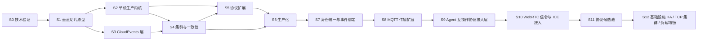

# UnifiedMQ 开发路线图

- **文档版本**：v1.0
- **对应架构文档**：[README.md](../README.md) v1.2
- **状态**：已评审（S1 首个垂直切片协议确定为 MQTT）
- **路径**：技术验证 → 垂直切片原型 → 单机内核 → 集群一致性 → 协议扩展 → 生产化

---

## 0. 规划原则

1. **Gate 驱动**：每个阶段有明确的进入条件，未达标不进入下一阶段。Gate 清单即验收测试清单。
2. **不确定性前置**：README 中标记"待验证"的假设全部在 S0 收敛，选型结论以 ADR 形式落盘。
3. **协议层横向解耦**：每种协议可独立交付、独立测试，不依赖其他协议的内部实现。
4. **性能数字不预先承诺**：所有吞吐/延迟数据必须来自 S2 起的实测基准（README 11.4）。
5. **可靠性显式化**：不使用含糊的"可靠投递"表述，ACK 返回时机与可靠性等级严格绑定（ADR-007）。
6. **领域模型先于框架**：统一消息模型与行为接口在 S1 定死，后续所有协议/存储实现都挂在这些抽象上。

### 阶段依赖关系



S2 与 S3 可并行：CloudEvents 是纯逻辑层，与内核开发的冲突面很小。S3 必须早于 S4，因为跨协议转换报告与属性映射规则需要在分布式语义稳定前定型。S7 承接 S6 之后遗留的两件事：六协议的身份表统一（2026-11-09 已完成，见 §9），以及各协议标准 CloudEvents Binding 的逐字结论（2026-11-10 已结案，见 §9.1）。S8 在 MQTT 引擎之上补三种 MQTT 系传输（MQTT-SN / QUIC / WebSocket），2026-11-11 全部结案，见 §10。S9 承接 S8 之后新增 A2A / MCP / ACP 三个协议接入前端，把 Broker 扩展为 agent 间任务、事件与流式消息的承载与网关；**S9-0 已结项、S9-A（协议底座 + A2A JSON-RPC echo 前端）已交付（2026-11-11）、S9-B（A2A Task 状态机 + 事件溯源 + Agent Card）已交付（2026-11-12）、S9-C（SSE 流式 + 出站 Push webhook）已交付（2026-11-12）、S9-D（MCP 承载前端）已交付（2026-11-12）、S9-E（ACP 前端）已交付（2026-11-12）、S9-F（一致性收口：三协议官方 SDK 真实客户端证据 + 能力矩阵/限制清单 + 安全审计 + 容量报告 + 文档同步）已交付（2026-11-12）——S9 全部子阶段收口**，需求与计划见 §11 与 [`docs/design/s9-agent-protocols.md`](design/s9-agent-protocols.md)。S10 是更后一阶段的立项建议：调研 [`lambdaclass/webrtc-server`](https://github.com/lambdaclass/webrtc-server) 后，把 WebRTC 的**信令面（WSS 房间中继）与 ICE 面（STUN/TURN）**作为新的接入前端纳入规划，媒体面明确不做；**同为立项规划、未开工**，需求与计划见 §12 与 [`docs/design/s10-webrtc-signaling.md`](design/s10-webrtc-signaling.md)。S10 排在 S9 之后但不阻塞 S9，两者都复用 S6/S7 的身份表与前端经验。S11 是**协议候选池 / 筛选阶段**而非「14 个协议一起实现」：调研 14 个 Erlang 网络协议仓库（CoAP / LoRaWAN / STUN / DNS / mDNS / DNS-SD / DHT / beacon / SIP ×3 / MTProto Proxy / APNs），9 个 IoT/UDP 类深挖、5 个索引级，各写一份三段式立项稿；**同为立项规划、未开工**，总览与筛选结论见 §13 与 [`docs/design/s11-protocol-candidates.md`](design/s11-protocol-candidates.md)。S11 排在 S10 之后但不阻塞 S10；当前建议仅 CoAP 进入实现评审，其余按「归并 S9/S10 / 参考 / 明确不做」收口。S12 是**基础设施层**需求而非新协议：底层调研 4 个 Erlang 仓库（`tcp_gen_server_cluster` / `tcpbalance` / `gen_lb` / `nkdist`）后，收敛为「增强基础设施的高可用性、支持 TCP 集群以及负载均衡特性」三项统一目标，4 仓各一份源码级三段式立项稿 + 一份总览需求文档；**同为立项规划、未开工**，需求与计划见 §14 与 [`docs/design/s12-infrastructure-ha-and-lb.md`](design/s12-infrastructure-ha-and-lb.md)。S12 承接 S11 但不阻塞 S11，核心是补齐 ADR-021 明确留下的「S4 不做自动再平衡」缺口，并把 `docs/operations.md` 已隐含的外部负载均衡器假设落成节点视图 / 健康 / 权重契约；**不引入第二套共识、不把 Broker 改成四层 TCP 代理**。

---

## 1. 阶段总览与 Gate

| 阶段 | 名称 | 核心产出 | Gate（进入下一阶段的条件） |
|---|---|---|---|
| **S0** | 技术验证 | 5 份 spike 报告 + ADR-001~007 定稿 | 关键不确定性有明确结论；WAL + Raft 写入路径 PoC 跑通 |
| **S1** | 垂直切片原型 | MQTT 端到端闭环（单节点、无复制） | 真实 MQTT 客户端完成 pub/sub + 崩溃恢复 |
| **S2** | 单机生产内核 | 分区/订阅/ACK/DLQ/TTL/流控 + 可插拔存储 | 可靠性等级与 ACK 契约被测试逐档证明 |
| **S3** | CloudEvents 标准化层 | Codec + Binding Mapper + 策略开关 | 往返测试 + 转换报告测试通过 |
| **S4** | 集群与一致性 | Metadata Raft + 分区归属 + 消息复制 | 故障注入全套（崩溃/分区/失去多数派）达标 |
| **S5** | 协议扩展 | AMQP / NATS / Kafka / WebSocket / Pulsar | 每个协议通过真实客户端兼容矩阵 |
| **S6** | 生产化 | 安全 / 可观测 / 运维 / 容量 | 压测报告 + 故障演练 + 运维手册 |
| **S7** | 身份统一与事件绑定 | 六协议共用身份表（已完成）+ 标准 CloudEvents Binding 逐字结论（已完成） | 租户来自用户记录 + 每个协议的 Binding 有明确结论 |
| **S8** | MQTT 传输扩展 | MQTT-SN 1.2 / MQTT over QUIC / MQTT over WebSocket（三条复用同一 MQTT 引擎的传输） | 三种传输各有一份真实第三方客户端证据 + 能力矩阵与限制清单 |
| **S9** | Agent 互操作协议接入层 | A2A 1.0.0 / MCP 2026-07-28 / ACP v1 三个 `broker_proto_*` adapter，以 A2A 为主线；复用统一消息内核、CloudEvents `ce-*` 通道、`broker_security` 身份表与 ACL | 三协议各一份真实第三方客户端证据 + 能力矩阵与限制清单；Task 状态机与终态不可变、认证与 SSRF 防护专项用例；既有 1062/1062 零回归（**S9-A~S9-F 全部已交付（2026-11-11~12），S9 收口，见 §11**） |
| **S10** | WebRTC 信令与 ICE 接入 | `broker_proto_webrtc` 信令前端 + STUN/TURN ICE 组件；调研 [`lambdaclass/webrtc-server`](https://github.com/lambdaclass/webrtc-server)，复用 `broker_ws` / `broker_security` / 统一消息内核；**媒体面（SFU/MCU/转码）不做** | 浏览器 `RTCPeerConnection` + STUN/TURN 真实客户端证据 + 能力矩阵与限制清单；信令「瞬时转发、不落盘」由 ADR 冻结并有测试证明；跨房间/未知 peer 拒绝不崩溃、认证接身份表专项用例；既有 823/823 零回归（**立项规划，未开工，见 §12**） |
| **S11** | 协议候选池（14 个 Erlang 协议仓库） | 9 深挖 + 5 索引级三段式立项稿 + 总览；筛选结论「立项 / 归并 / 参考 / 不做」由 ADR 冻结；**不写第二套消息内核、不替代 S4 Membership** | 14 个候选各有一份立项稿与明确结论；发现面 / DHT / SIP 三组完成统一裁决；经 Gate 通过的候选有真实第三方客户端证据 + 能力矩阵与限制清单；既有 823/823 零回归（**立项规划，未开工，见 §13**） |
| **S12** | 基础设施高可用 / TCP 集群 / 负载均衡 | 底层调研 4 仓（`tcp_gen_server_cluster` / `tcpbalance` / `gen_lb` / `nkdist`）各一份源码级三段式立项稿 + 总览需求文档；收敛 G1 高可用 / G2 TCP 集群 / G3 负载均衡；**不引入第二套共识、不做四层 TCP 代理、4 仓代码与依赖一律不引入** | 节点视图唯一真相与 LB 形态由 ADR 冻结；自动再平衡触发者 + 两阶段迁移 + 旧 owner Fencing 的故障注入全套；会话粘性 / drain / `/readyz` 一致性 / 主动健康上报 / 连接容量与排队上限专项用例；外部 LB 或等价模拟器分发证据 + 能力矩阵；既有零回归（**立项规划，未开工，见 §14**） |

---

## 2. S0 — 技术验证

**目标**：把 README 中的"待验证"假设变成结论。**此阶段只做实验，禁止设计内核 API。**

每个 spike 位于独立可丢弃的目录 `spikes/<id>/`，不得被 `apps/` 引用。

| Spike | 验证内容 | 方法 | 结论产出 |
|---|---|---|---|
| **S0.1** Raft 库评估 | `rabbitmq/ra` 的 API、快照、成员变更、快照后日志截断、慢节点与网络分区行为 | 3 节点 docker-compose（基于 `ra` 自带示例集群），注入 kill -9 / 网络分区 / 磁盘满 | ADR-003 定稿：采用 / 自研 / 换库 |
| **S0.2** Raft 分组模型 | 每分区一个 Raft Group 的资源开销 vs 批量分组 | 1/8/32/128 分组 × 1KB/100KB 消息压测，观测 CPU/内存/尾延迟 | 分组策略与故障域定义（回应 README 5.3 警告） |
| **S0.3** WAL + Group Commit | 自研分段日志的 fsync 吞吐、组提交收益、段文件恢复耗时 | 追加写 + 周期快照，crash-loop 注入，测恢复时间与重复/丢失窗口 | 方案 A（自研 WAL）可行性结论；可承诺的 `fsync` 等级 |
| **S0.4** 协议客户端基线 | 各协议真实客户端的最小可交互面（不实现协议） | 跑通官方 sample：Eclipse Paho、pulsar-client(java)、kafka-clients、nats.go、qpid proton | **客户端与版本矩阵表**（README 11.1 的前置输入） |
| **S0.5** CloudEvents 校验开销 | JSON Structured/Binary 编解码 + 核心属性校验的 CPU/内存成本 | 基准对比策略开关前后的吞吐与延迟分布 | 是否需限制 extensions 数量 / 嵌套深度（README 10.1） |

### 必须在本阶段回答的额外问题

- **ACK 契约等级表**：README 6.3 仅给出三档方向，S0.3 需给出每档实测的数据丢失边界。
- **快照与 Segment 清理的关系**：不得因使用 Raft 而省略日志段管理、保留策略与游标保留（README 5.3 明确警告）。
- **失去多数派时的行为**：明确停止写入还是限制为非持久写入，以及对存量连接的处置。

### Gate S0

- [x] S0.1 与 S0.3 产出明确结论（采用 / 拒绝均有依据）—— ADR-003（采用 `rabbitmq/ra` 3.2.0）、ADR-008（自研 WAL + 分组模型）
- [x] S0.4 的客户端与版本矩阵被采纳为 S5 全部协议测试的基线 —— `docs/protocol-compatibility.md` §0
- [x] ADR-001 ~ ADR-007 从 README 摘要升级为 `docs/adr/00N-*.md` 正式文件 —— 7 份文件均存在
- [x] S0.2 产出分区分组决策，记录故障域定义 —— ADR-008 §8.1（G=16 折中，故障域 = 组大小）

---

## 3. S1 — 垂直切片原型（MQTT）

**目标**：以 MQTT 为首个协议，完成 README 附录 A 的 7 步端到端闭环。

**范围限定**：单节点、无复制、无控制面（Mnesia 只放最小配置）、内存 + 本地 WAL 双存储实现。

### 3.1 骨架搭建

按 README 第 8 节目录结构创建，S1 阶段只建会实际用到的 app：

```text
unified-mq/
├── rebar.config
├── apps/
│   ├── broker_core/          # 统一消息模型 + 行为接口
│   ├── broker_router/        # destination → partition 解析
│   ├── broker_queue/         # 分区与队列
│   ├── broker_subscription/  # 订阅与游标
│   ├── broker_storage/       # WAL + 内存实现
│   ├── broker_event/         # S1 恒等桩（pass_through）；CloudEvents codec（S3 填充）
│   └── broker_proto_mqtt/    # 首个协议适配器
├── config/
├── docs/
│   ├── adr/
│   └── roadmap.md
├── spikes/                   # S0 实验，仅 S0 使用
└── test/
    ├── integration/
    └── protocol-compatibility/
```

### 3.2 三个必须先定死的抽象

后续所有协议与存储实现都挂在这三个抽象上，S1 评审时需单独确认：

1. **`broker_message` / `cloud_event` 记录**（README 3.1 已给草案，定稿后不改）
2. **`broker_router` behavior**：destination → `{partition, subscription}` 列表
3. **`broker_storage` behavior**：`append / read_from / ack / truncate / recover`，本阶段交付内存与 WAL 两份实现

> **S1 T0.5 冻结状态（2026-10-21）**：三项已定稿为 [ADR-009](adr/009-broker-message-record.md)（消息记录）、[ADR-010](adr/010-broker-router-behavior.md)（Router behavior）、[ADR-011](adr/011-broker-storage-behavior.md)（Storage behavior），状态**已采纳**。本 roadmap 条目是评审前的动词基线，保留原文不改；与冻结 API 的对应关系为：
> - 抽象 2 的 `destination → {partition, subscription}` 列表 → 冻结为 `route/3` 返回 `{ok, [{partition_id(), [sub_ref()]}]}`，其中 SubRef 由 `broker_subscription` 铸造、Router 仅作索引 key（ADR-010 §10.1/§10.2）。
> - 抽象 3 的 `ack` → 冻结为 `advance_committed/2`（storage 只持有全局连续前缀水位，per-sub cursor 归 `broker_subscription`）；`recover` → 冻结为与 `create/2` **分离**的 `recover/2`，额外返回 `HighOffset`（ADR-011 §11.2/§11.3）。
>
> 后续若需修改这三份 ADR 的 API，须走 ADR 修订流程并在 Gate 显式处置，不得在实现中静默偏离。

### 3.3 MQTT 首批范围

| 能力 | 范围 | 说明 |
|---|---|---|
| 连接 | MQTT 3.1.1 CONNECT/CONNACK、Keepalive、PINGREQ/PINGRESP | 5.0 在 S5 补齐 |
| 认证 | Username/Password，委托给 `broker_security` 桩接口 | S6 实现 TLS 与密钥轮换 |
| 发布订阅 | SUBSCRIBE/SUBACK/PUBLISH QoS 0 + QoS 1 | QoS 2 在 S2 补齐 |
| 持久化 | QoS 1 与 `clean_session=false` 的会话状态 | 验证协议会话与 Broker 游标的映射 |

### 3.4 崩溃恢复验证

使用 docker compose 编排单节点 + 外部客户端，脚本化注入：

1. publish → WAL 落盘 → 收到 PUBACK → `docker compose kill -9`
2. 重启后验证：已 ACK 消息不丢、订阅位置不丢、未 ACK 消息重投
3. 对每条断言编写测试，明确可容忍的重复窗口

### Gate S1

- [x] 真实 MQTT 客户端（Eclipse Paho / mosquitto_pub）完成 publish → subscribe → ack 全链路 —— **T15（2026-11-06）：8/8 用例、46/46 帧字节一致**
- [x] `kill -9` 后重启，消息丢失/重复行为有测试断言且符合契约 —— **T14：R1a~R7 × 默认/零回退双档 16/16 PASS**
- [x] 三个核心抽象完成评审并冻结 —— **T0.5 冻结；T17 复核无偏离**
- [x] `apps/broker_storage` 的 WAL 与内存实现可互换（同一 behaviour 两种后端） —— **T4/T5 契约 13 例 × 2；T13 端到端双组 12/12**
- [x] **在此 Gate 之前不允许实现第二个协议** —— 通过时 `apps/` 仍只有 `broker_proto_mqtt`

> **Gate S1 于 2026-11-06 通过。** 签认记录：ADR-011 §11.7（E1 措辞）、`docs/protocol-compatibility.md` §5（冻结契约一致性）、`progress.md`「Gate S1 验收结论」。

---

## 4. S2 — 单机生产内核

**目标**：把原型变成能承载真实流量的单机系统，仍无分布式。

**详细规划**：[`docs/design/s2-single-node-kernel.md`](design/s2-single-node-kernel.md)（v0.3：O1~O4 已拍板、D1~D9 已结案、ADR-012~017 已签认，S2-A~S2-I 子项目与 Gate 映射）。**S2-A 可观测性最小集（2026-11-07）、S2-B 替身档（2026-11-07）、S2-C QoS2/Retain/Will（2026-11-07）、S2-D 订阅语义与 cursor 重构（2026-11-08）、S2-E 重投递 / DLQ / TTL（2026-11-08）、S2-F retention / 段 GC / 慢消费者守卫（2026-11-08）、S2-G 背压 / 限流（2026-11-08）、S2-I 基准与 Gate 报告（2026-11-08）已完成**；执行计划见 [`s2-a-metrics-execution-plan.md`](design/s2-a-metrics-execution-plan.md)、[`s2-b-reliability-execution-plan.md`](design/s2-b-reliability-execution-plan.md)、[`s2-c-protocol-completion-execution-plan.md`](design/s2-c-protocol-completion-execution-plan.md)、[`s2-d-subscription-kinds-execution-plan.md`](design/s2-d-subscription-kinds-execution-plan.md)（决策 [ADR-019](adr/019-shared-assignment-ack-ownership-and-session-layout.md) 修订 ADR-013 的 §13.2/§13.3/§13.5，含实现期 §19.5）、[`s2-e-redelivery-dlq-ttl-execution-plan.md`](design/s2-e-redelivery-dlq-ttl-execution-plan.md)（ADR-015 §15.6 实现注记）、[`s2-f-retention-execution-plan.md`](design/s2-f-retention-execution-plan.md)（ADR-014 §14.7 实现注记）、[`s2-g-backpressure-execution-plan.md`](design/s2-g-backpressure-execution-plan.md)（ADR-016 §16.2 实施注记）；其余子项目逐项开执行计划。

### 4.1 功能范围

- **分区与顺序**：partition 归属、消息有序性边界
- **订阅抽象**：Exclusive / Shared / Failover 统一到 `broker_subscription` + `broker_cursor`（README 5.2）
- **消息生命周期**：ACK / 重投递（指数退避）/ 重试上限 / DLQ / TTL / retention
- **MQTT 补齐**：QoS 2、Retain、Will ✅（S2-C）；MQTT 5.0 Session 与 User Properties ✅（S2.5，2026-11-08，ADR-017）
- **可靠性等级**：`os_buffer` → `fsync` → `replicated_commit` 三档，Producer ACK 返回时机与等级严格对应（README 6.3）
- **背压**：bounded batch、mailbox 水位观测、生产者限速、consumer flow permit ✅（S2-G，`0` = 关闭阈值）
- **可观测性最小集**：连接数、认证失败、吞吐、端到端延迟、ACK 延迟、队列深度、订阅积压、cursor lag、DLQ 规模、WAL 写/刷盘延迟

### 4.2 监督树

落地 README 7.3 结构。**重启策略按进程性质区分，不统一处理**：

| 进程类型 | 重启策略 | 原因 |
|---|---|---|
| Listener / Connection | transient | 持连接，重启会破坏客户端会话 |
| 分区 Worker / Storage Worker | permanent + fencing 检查 | 持有分区所有权，需 Raft epoch 校验 |
| Config / Observability | permanent | 状态可重建但重启应可观测 |

### 4.2.1 S2.5（MQTT 5 子集，Gate 外）

**状态：✅ 完成（2026-11-08）**。CONNECT/PUBLISH/SUBSCRIBE properties、v5 reason codes（含 `0x84`）、session expiry 落盘与 boot 清理、`$share` 建组、`receive_maximum` 出站窗口、`maximum_packet_size` 入站/出站边界。执行计划与交付记录见 [`design/s2.5-mqtt5-execution-plan.md`](design/s2.5-mqtt5-execution-plan.md)；兼容性口径见 [`protocol-compatibility.md`](protocol-compatibility.md) §4.2。全量 `rebar3 ct` **397/397**、`dialyzer` 干净。topic alias / request-response / AUTH **仍未实现**（ADR-017 §17.1 冻结子集，S5 未纳入）。

### 4.3 Gate S2

- [x] 三档可靠性等级逐档有自动化测试证明（尤其 `os_buffer` 档的丢失边界）——**两档证据齐备**：`os_buffer` 替身三场景 CI 常驻（`docs/benchmarks/reliability/s2-b-osbuffer-loss.md` §3）+ `replicated_commit` 显式拒绝 + `fsync` 对照，**外加 dm-flakey 实机掉电报告**（2026-11-09，§5.1：64 条未 fsync 尾部全丢、`high` 回到 K+1、`committed == K`、真 broker 在恢复后的 fs 上启动成功）
- [x] 慢消费者 / 热点分区场景不导致 OOM——**S2-G 结构 + S2-I 数字**：慢消费者 20 000 条 RSS +37.1 MiB、热点分区冷路径 14 ms / RSS +41.3 MiB、300 连接 +0.4 MiB，均通过且 broker 存活（`docs/benchmarks/2026-11-08-s2-baseline.md` §4）
- [x] 基准报告已出：单机吞吐、消息大小 / 批量大小 / 分区数 / 订阅数的影响、延迟分位——[`docs/benchmarks/2026-11-08-s2-baseline.md`](benchmarks/2026-11-08-s2-baseline.md)（1 KiB / 8 连接 935 msg/s；`kill -9` 恢复 4.14 s；复跑命令在文首）
- [x] 无单一 GenServer 成为全局瓶颈（依据 README 7.2 的四项约束逐条检查）——报告 §5 逐条给代码事实与数字：1 → 8 连接 4.4x、1 → 16 分区 875 → 1056 msg/s、100 订阅 25 740 投递/s、热点积压时冷分区 14 ms

> **Gate S2 状态（2026-11-09）**：**四项全部通过，Gate S2 通过。** 第 1 项的 dm-flakey 实机掉电报告已产出（`docs/benchmarks/reliability/s2-powerloss-20261109-215930.json`，口径与复跑见 `s2-b-osbuffer-loss.md` §5）；无 sudo 密码但有 Docker 的机器可用 `sh tools/docker/s2_powerloss_priv.sh --scenario powerloss` 复跑。证据与口径另见 [`docs/benchmarks/2026-11-08-s2-baseline.md`](benchmarks/2026-11-08-s2-baseline.md) 与 `progress.md`「Gate S2 验收结论」。

---

## 5. S3 — CloudEvents 标准化层

**目标**：实现 README 3 ~ 4 定义的标准化能力，可与 S2 并行。

### 5.1 功能范围

- **Codec**：JSON 编解码、核心属性类型校验、`data` / `data_base64` 互斥规则、扩展属性命名与类型校验
- **编码模式**：Structured 与 Binary Mode 双向实现；Structured 输出 `application/cloudevents+json`
- **策略开关**：`disabled` / `pass_through` / `validate_if_present` / `required` / `normalize`（README 3.4），按租户 + 目的地生效
- **Binding Mapper**：先做 MQTT binding（MQTT 3.1.1 元数据能力受限，需明确兼容策略），其余随 S5 协议补齐
- **转换报告**：目标协议无法表达的元数据必须显式标记损失，不得静默丢弃（README 4.1）
- **跨协议规则**：保留 `specversion / id / source / type` 与全部合法扩展；payload 字节不被无意的 JSON 反序列化改变；协议侧标识（offset / Pulsar Message ID / MQTT Packet Identifier）不得覆盖 CloudEvents `id`（ADR-005）
- **去重窗口**：按租户/目的地配置，键为 `source + id`，不默认永久去重
- **拒绝策略**：转换失败时提供明确拒绝 / 隔离 / 死信路径

### 5.2 Gate S3

- [x] README 11.2 全部测试项通过：缺失必需属性、错误类型、无效格式、扩展属性保留、未知扩展、时间格式、`data` 与 `data_base64` 互斥（`broker_event_SUITE` 31 例，2026-11-08；S5/S6 追加头通道往返后共 35 例）
- [x] Structured / Binary 正反向映射测试通过，跨协议往返测试通过并明确列出允许的非无损字段（`docs/protocol-compatibility.md` §4.3 损失清单；`cross_protocol_roundtrip_keeps_identity`）
- [x] 重复事件与重投递行为有测试覆盖（`duplicate_window_deduplicates` / `duplicate_is_off_by_default` / `duplicate_window_expires`；默认关闭时行为不变）
- [x] ACL 决策仅使用认证主体，未信任的事件属性无法影响授权（README 10.1）（`acl_does_not_trust_event_attributes`）
- [x] 转换失败路径不丢数据（有 DLQ 或隔离证据）（拒绝不 ACK + v5 `0x83` / 3.1.1 关闭；`quarantine_writes_a_durable_copy`；`mqtt_conn_SUITE` 2 例）

**结论：Gate S3 五项于 2026-11-08 全部通过**（全量 `rebar3 ct` 422/422、`dialyzer` 0 warnings、`xref` 76 条均为预期 unused-export）。

---

## 6. S4 — 集群与一致性

**目标**：实现分布式能力，本项目成本最高的阶段。

### 6.1 控制面

- **Mnesia 表**：`tenant` / `broker_user` / `acl_rule` / `topic_meta` / `queue_meta` / `binding_meta` / `subscription_meta` / `cluster_node` / `partition_meta` / `config_version` / `config_outbox`
- **配置更新**：版本号 + 事件通知 + 周期性对账
- **Outbox 模式**：配置提交后需向外部发布变更事件时使用，避免双写不一致（README 6.1）
- **Mnesia 边界**：不承担消息正文、每次 ACK、高频 Cursor 更新（ADR-002）

### 6.2 共识层

- **Metadata Raft Group**：分区 Owner、Epoch、复制成员、分区迁移状态
- **消息复制层**：按 S0.2 结论决定分组模型；本地数据面走批量追加，不将每个业务操作变为全局共识命令
- **失去多数派**：按配置停止或限制可靠写入
- **Fencing**：Epoch 变化后旧 Owner 必须被拒绝写入

### 6.3 Gate S4（README 11.3 全项作为验收清单）

- [x] 节点崩溃、网络分区、失去多数派、Leader 切换、分区迁移 —— `broker_cluster_dist_SUITE`（3 节点 `peer`）4/4：组形成/复制、Leader 故障切换、失去多数派、迁移后 Fencing；节点崩溃与 WAL/段清理由 S1 T14 与 S2-F 证据覆盖
- [x] 旧 Owner 的 Fencing 验证 —— `broker_cluster:authorize_append/2` 返回 `{error, {fenced, #{partition, expected_epoch, actual_epoch}}}`；`old_owner_is_fenced_after_migration` 用例
- [x] WAL 部分写入、刷盘失败、磁盘满、恢复中断、日志段清理 —— 沿用 S1 T14 崩溃矩阵（默认/零回退各 8/8）与 S2-F `wal_gc` 证据
- [x] **Producer ACK 与实际持久化/复制等级一致性**由测试证明 —— `replicated_commit` 仅在 `quorum = (N div 2) + 1` 个副本 fsync 后返回 `{ok, Offset}`；`broker_cluster_SUITE` 覆盖副本不足不 ACK
- [x] 慢消费者、热点分区、积压暴涨、背压恢复 —— 沿用 S2-G 背压/限流证据（整轮 permit、生产者过载断开、有界 batch）

**Gate S4 结论：✅ 通过（2026-11-08）。** 实现与证据见 [ADR-021](adr/021-cluster-control-plane-raft-and-fencing.md) 与 [`docs/design/s4-cluster-execution-plan.md`](design/s4-cluster-execution-plan.md) §5。

> **口径说明（Router 分区归属）**：ADR-010 §10.5 与验证段原本设想 S4 通过 `on_partition_change/2` 通知 Router，并在启动时拒绝未实现该 callback 的旧后端。S4 实际以 `broker_cluster`（ra 元数据 + `broker_cluster_cache`）承担归属，以 `broker_queue` 的 `append_guard` / `replicator` 钩子接入数据面与 fencing；`Destination → Partition` 是迁移前后不变的纯函数，Router 不需要感知归属变化。ADR-010 以「冻结后补充 S4」记录该取代关系，冻结文本未改；Gate S4 的各项验收不受影响。

---

## 7. S5 — 协议扩展

每个协议交付物 = **一份独立测试套件 + 能力矩阵的一行**（README 11.1）。顺序按"验证成本 / 客户端易得性"排列：

| 顺序 | 协议 | 首批范围 | 真实客户端（来自 S0.4 矩阵） |
|---|---|---|---|
| 1 | MQTT（已由 S1 建立） | S2 已补齐 QoS 0/1/2、Retain、Will、5.0 | Eclipse Paho、mosquitto |
| 2 | WebSocket | Broker 自有 JSON/二进制帧 API | 浏览器 + 自定义客户端 |
| 3 | NATS | Publish、Subscribe、Queue Group、Request/Reply | nats.go、nats.js |
| 4 | AMQP | Exchange/Queue/Binding、Publish/Consume/ACK | qpid proton、amqp091 |
| 5 | Kafka | Produce、Fetch、Metadata、Consumer Group | kafka-clients、librdkafka |
| 6 | Pulsar | P1 基础连通 → P2 消费语义 → P3 可靠性 → P4 扩展 | **官方 Pulsar Java Client（硬性要求，README 5.1）** |

每个协议同时交付：

- CloudEvents Binding Mapper 与正反向映射测试
- 协议级流控与异常帧处理
- 认证失败、断连恢复、连接中多命令交错测试
- 能力矩阵标记（已支持 / 部分支持 / 计划支持）

### Gate S5

- [x] 每个协议通过真实第三方客户端集成测试，无自编客户端互测 —— mqtt 10/10（paho+mosquitto）、ws 10/10（websocket-client）、nats 11/11（nats.go）、amqp 13/13（amqp091-go）、kafka 12/12（kafka-clients）、pulsar 8/8（官方 Java Client）；见 `docs/protocol-compatibility.md` §0 与 §4.5~§4.9
- [x] 各协议 Binding 的往返测试通过，转换损失项有明确清单 —— **MQTT**：ADR-020 冻结的正反向映射 + 显式损失报告（`broker_event_SUITE`，含 `cross_protocol_roundtrip_keeps_identity`）；**WS/NATS/AMQP/Kafka/Pulsar**：S6 补齐的协议中立 Binary Mode（`ce-*` 头 + `content-type` → `#broker_message.headers`），`to_headers/3` / `from_headers/3` 对五个目标各做正反向往返（`header_binding_roundtrip_for_all_targets`），损失清单见 `docs/protocol-compatibility.md` §4.10
- [x] 能力矩阵文档更新，覆盖 README 11.1 全部验证维度 —— `docs/protocol-compatibility.md` §2 能力矩阵 + §4.5~§4.9 每协议限制清单

> **口径说明**：第 2 项覆盖六个协议的 Binding 往返。MQTT 走 ADR-020 的 `mqtt_user_properties` 通道；其余五个协议走统一 `ce-*` 头通道（不是各协议标准 CloudEvents Binding 的逐字实现，非无损点已在 §4.10 列明）。

---

## 8. S6 — 生产化

### 8.1 安全

- 租户隔离、认证、ACL、TLS 与密钥轮换
- 限制消息体大小、事件属性数量、扩展属性长度、嵌套 JSON 深度（README 10.1）
- 指标防高基数：**不得**将任意 `source` / `subject` / `id` 作为 Prometheus 标签
- 定义非法事件、未知扩展属性、Schema 不匹配、编码失败的错误策略

### 8.2 运维

- 管理 API、配置审计
- 监控告警、备份恢复
- 滚动升级（协议与配置版本兼容窗口）、数据迁移
- 容量规划、完整压测报告、故障演练（GameDay）、运维手册

### 8.3 Gate S6

- [x] 安全审计通过（租户越权、ACL 绕过、事件属性越权三项专项检查）——`broker_security_audit_SUITE` 9 例；见 `docs/security.md`
- [x] 压测报告覆盖 README 11.4 全部维度——`docs/benchmarks/2026-11-09-s6-capacity.md`（含连接数、内存 vs 持久化、CloudEvents 开销、3 节点复制与恢复）
- [x] 故障演练记录：崩溃、分区、磁盘故障、慢消费者场景的实测恢复时间——`docs/benchmarks/2026-11-09-s6-gameday.md`（crash 3.956 s / disk 3.559 s / slow_consumer +42.8 MiB / partition 4/4）
- [x] 运维手册与告警规则交付——`docs/operations.md` + `config/alerts.yml`
- [x] CI 分层流水线：common test → 协议兼容 → chaos → performance——`.github/workflows/ci.yml`

---

## 9. S7 — 身份统一与事件绑定

**目标**：把 S6 之后遗留的两件事从「散落在文档角落的待办」变成有验收清单的正式阶段。两项交付均已于 2026-11-09 / 2026-11-10 落地。

S7 有两项交付：

1. **六个协议共用一张身份表**（2026-11-09 已完成，见 `docs/security.md` §2.1）。修复前只有 MQTT 走 `broker_security`，其余五种协议的租户来自协议字段或硬编码的 `t0`，客户端可以自称任何租户；现在六种协议都经 `broker_security` 的用户表解析凭据，租户一律来自匹配到的用户记录。
2. **各协议标准 CloudEvents Binding 的逐字结论**（2026-11-10 结案，见 §9.1）。结论不是「六个协议都已逐字实现」——**没有任何一个协议是本仓库按官方条文逐字实现的**；结论是逐协议说清「官方规范要求什么、本仓库做了什么、差在哪里」，避免文档继续暗示「还没做」或反过来暗示「已经一致」。

### 9.1 标准 CloudEvents Binding：逐协议结论（2026-11-10 结案）

判定依据是 CloudEvents 官方仓库的 binding 原文（`github.com/cloudevents/spec/tree/main/cloudevents/bindings`，逐份 grep 条文），**不以本表此前的旧表述为准**。官方目录只有六份文件——`amqp-protocol-binding.md`、`http-protocol-binding.md`、`kafka-protocol-binding.md`、`mqtt-protocol-binding.md`、`nats-protocol-binding.md`、`websockets-protocol-binding.md`（版本标记为 1.0.3-wip），**没有 Pulsar**，也没有除这六份之外的协议约定。下文引用均为该目录下的文件与节号，可逐条复核。

| 协议 | 官方条文要求 | 本仓库实现 | 结论 |
|---|---|---|---|
| **MQTT 5.0** | `mqtt-protocol-binding.md` §3.1：`Content Type` ← `datacontenttype`；其余属性逐个进 User Property，且 §3.1.3.1「CloudEvents attribute names **MUST be used unchanged**」——即 `specversion`/`id`/`source`/`type`，**不加任何前缀**；值取属性类型的规范字符串形式（§3.1.3.2） | User Property 用 `ce-specversion`/`ce-id`/…（`broker_event_codec:encode_binary/1` 生成 `<<"ce-", Name>>`），入站按 `ce-specversion` 判二进制模式（`broker_event_binding` 的私有函数 `has_ce_props/1`） | **非逐字**：键名多了 `ce-` 前缀，与规范的 MUST 相反；模式判定也不按 `Content Type` 前缀 |
| **MQTT 3.1.1** | 同一文件 §1.3：「With MQTT 3.1.1, the content mode is **always structured**」且 payload **MUST** 用 JSON 事件格式；3.1.1 无元数据通道，因此**不存在** binary mode | Structured Mode 逐字节支持（`to_mqtt/3` 的 structured 分支对 3.1.1 不写 `Content Type`，与规范一致）；另额外提供 Binary Mode，把无法承载的属性全列进 `report/5` 的 `losses` | **结构化方向合规**；Binary Mode 是规范之外的扩展（有显式损失报告，非静默丢弃） |
| **WebSocket** | `websockets-protocol-binding.md` §1.3「content mode is always structured」；§1.4/§1.5 用 `Sec-WebSocket-Protocol` 协商事件格式子协议，JSON 必须支持 `cloudevents.json`，消息用 Text 帧 | WS 端点与该子协议无关：是与 `cloudevents.json` 并列的 **Broker 自有应用层协议**（JSON/二进制帧，见 §4.5），上下文走 Binary Mode 的 `ce-*` 顶层键 | **未实现官方 Binding**，显式声明「自有协议」；官方只定义 structured + 子协议协商 |
| **NATS** | `nats-protocol-binding.md` §3.1.3.1：属性进 NATS header，名字加 **`ce-`（连字符）**前缀（`ce-specversion`、`ce-datacontenttype`…）；§3.1.3.2：值 **MUST** 按 RFC3986 percent-encode | 键名与规范**完全一致**（同一 `ce-` 前缀，含 `ce-datacontenttype`）；未做 percent-encoding | **键名一致、编码不合规**：header 值未按 §3.1.3.2 编码，含 `,`/`"`/空格的属性值在严格对端会失真 |
| **Kafka** | `kafka-protocol-binding.md` §3.2.3.1：属性逐个进 Record Header，前缀是 **`ce_`（下划线）**（`ce_specversion`、`ce_id`…），键与值均为字符串 | 前缀用 `ce-`（连字符） | **非逐字**：分隔符不同（`ce-` vs `ce_`） |
| **AMQP** | `amqp-protocol-binding.md` 只定义 **AMQP 1.0**（§1.2）：binary mode 把属性放进 **application-properties**，前缀 `cloudEvents_` 或 `cloudEvents:`（§3.1.3.1） | 实现的是 **AMQP 0-9-1**：属性在 basic properties 的 `headers` table，前缀 `ce-` | **规范不覆盖本实现**：0-9-1 没有官方 Binding，需先引入 AMQP 1.0 才有逐字实现对象 |
| **Pulsar** | 官方 bindings 目录**无此文件** | `ce-*` 进 Message properties | **无官方 Binding**：统一 `ce-*` 通道是本 Broker 的定义 |

**结论落地方式**（不是「都已逐字实现」）：

1. 六个协议共用的 `ce-*` 头通道是**本 Broker 的项目方言**，继续作为默认行为，`docs/protocol-compatibility.md` §4.10 如实标注每处与官方的差异，不再出现「与官方 Binding 一致」的表述。
2. 需要与官方互操作时，只能在对应协议上做逐字映射，且必须先解决上表的硬冲突：MQTT 5 的**去前缀**（与现有 `ce-` 通道互斥，需要按协议分流）、Kafka 的 `ce_` 分隔符、NATS 的 percent-encoding、WebSocket 的子协议协商、AMQP 的 1.0 迁移。
3. 这些逐字实现在本阶段**不立项**（会破坏六协议统一头通道与既有真实客户端套件），因此记为「已给出结论、不改实现」，而不是留成隐性待办。清单同步在 `docs/security.md` §12 与 `docs/architecture.md` §9。

### 9.2 Gate S7

- [x] 六个协议共用一张身份表，租户来自用户记录而非客户端——`broker_security_identity_SUITE` 10 例 + 五个协议套件的认证用例（WS 4、NATS 3、AMQP 3、Kafka 3、Pulsar 3）；见 `docs/security.md` §2.1
- [x] 匿名连接是部署决策（`require_auth`），且「握手里带不了凭据的协议」永不被要求
- [x] 每个协议的标准 CloudEvents Binding 有明确结论：逐字实现，或显式声明「无官方 Binding」——2026-11-10 逐份核对官方 binding 原文后结案，见 §9.1：**没有一个协议是逐字实现**；MQTT 5 前缀相反（规范 MUST 不加前缀）、Kafka 分隔符不同（`ce_` vs `ce-`）、NATS 键名一致但缺 percent-encoding、WebSocket 未实现子协议化 structured 绑定、AMQP 仅有 1.0 规范（本仓库是 0-9-1）、Pulsar 无官方 Binding。结论为「统一 `ce-*` 是本 Broker 定义，逐字实现不立项」
- [x] `docs/security.md` §12 与 `docs/architecture.md` §9 的遗留清单与实际一致（2026-11-09 核对：认证统一已从清单移除，标准 Binding 归入 S7 Gate）

---

## 10. S8 — MQTT 传输扩展（MQTT-SN / MQTT over QUIC / MQTT over WebSocket）

**目标**：在既有 MQTT 引擎之上补齐三种 MQTT 系传输，同时**不写第二个 MQTT 实现**。设计见 [`docs/design/s8-mqtt-sn-mqtt-over-quic-and-mqtt-over-ws.md`](design/s8-mqtt-sn-mqtt-over-quic-and-mqtt-over-ws.md)。

**做法**：S8-A 先把「传输」抽成 `mqtt_transport` 行为（`send`/`arm_once`/`close`/`decode_msg`）并抽 `broker_ws` 纯 RFC 6455 库；S8-B/C/D 各自实现一种前端。三种传输对 `mqtt_conn_fsm` 的关系不同，这正是设计要回答的部分：

- **S8-B MQTT over WebSocket**：同一 `mqtt_conn_fsm`（handle = WS 进程 pid），每连接两进程；
- **S8-C MQTT-SN**：**不复用** `mqtt_conn_fsm`（UDP 没有「一条会丢的连接」这个前提），单 socket 服务全部会话，只复用下层路由/队列/订阅；
- **S8-D MQTT over QUIC**：同一 `mqtt_conn_fsm`（handle = QUIC stream），比 TCP 多一层「连接在流之间存活」。

### 10.1 阶段表

| 子阶段 | 状态 | 产出 | 证据 |
|---|---|---|---|
| S8-A 传输底座 | ✅ 完成（2026-11-10，HEAD `28aa4c4`） | `mqtt_transport` 行为 + `mqtt_transport_tcp`；`broker_ws` 纯 RFC 6455 库；**顺带修好 MQTT over TLS**（此前从未真正工作） | `ws_frame_SUITE` 9、`ws_handshake_SUITE` 15、`ws_conn_SUITE` 22、`mqtt_conn_SUITE` 70、`mqtt_transport_tcp_SUITE` 10、`mqtt_tls_SUITE` 4；全量 702/702（46 套件） |
| S8-B MQTT over WebSocket | ✅ 完成（2026-11-10） | `broker_proto_mqtt_ws`，TCP 8083；两进程分层；子协议必须命中 `mqtt`/`mqttv3.1`/`mqttv3.1.1` 否则 400；仅 binary 帧（text → close 1003） | `mqtt_ws_conn_SUITE` 19；paho-mqtt 2.1.0 websocket **8/8**；顺带修好既有 `broker_proto_ws` 的 wss 握手（`ws_conn_SUITE` 23）；全量 722/722（47 套件） |
| S8-C MQTT-SN 1.2 | ✅ 完成（2026-11-10） | `broker_proto_mqtt_sn`，UDP 1884；单 socket 单 reader、会话按 `{IP,Port}` + `client_id` 双索引；27 种报文 / QoS −1~2 / Will / Retain / 三种 topic id / 休眠唤醒 / SEARCHGW+ADVERTISE；**不复用 `mqtt_conn_fsm`** | `mqtt_sn_codec_SUITE` 40 + `mqtt_sn_topics_SUITE` 21 + `mqtt_sn_conn_SUITE` 23 = 84；`mqtt-sn-tools` 0.0.7 **10/10**；抓到 codec 把 CONNECT 的 Will/CleanSession 读错位（bit 7/6 应为 3/2）的真实缺陷；全量 806/806（50 套件） |
| S8-D MQTT over QUIC | ✅ 完成（2026-11-11，HEAD `0fc9049`） | `broker_proto_mqtt_quic`，UDP 14567（默认关闭）；CN Draft 3 单流模式；ALPN 固定 `mqtt`；强制 TLS 1.3；流关闭 ≠ 连接关闭；quicer 走 `quic` profile 门控 | `mqtt_quic_transport_SUITE` 13 + `mqtt_quic_listener_SUITE` 4（默认）/ 10（`quic`）；EMQX `emqtt` 1.16.1 **8/8**；修 `active, 1` → `once` 与 cluster dist 的 `_build/test` 硬编码；全量 823/823（52 套件），`as quic ct` 827 passed + 2 skipped |

### 10.2 Gate S8

- [x] MQTT-SN：`mqtt-sn-tools` 真实客户端用例全绿，日志与 `report.json` 落盘——`test/protocol-compatibility/mqtt_sn/`，**10/10**
- [x] MQTT-SN：QoS2 与休眠/唤醒由仓内套件覆盖并有明确说明——`mqtt_sn_conn_SUITE`（QoS −1/0/1/2、休眠 + 新端点唤醒 + 积压、keepalive 判死）；第三方工具无 QoS2/无 Will/`PINGREQ` 不带 client id，能力边界已在 `docs/protocol-compatibility.md` §4.11 单列
- [x] MQTT over QUIC：`emqtt` 单流客户端用例全绿，ALPN `mqtt` 有握手证据——`test/protocol-compatibility/mqtt_quic/`，**8/8**；ALPN 由 `mqtt_quic_listener_SUITE:a_client_with_alpn_mqtt_can_handshake` 与非 `mqtt` 被拒两例钉死
- [x] MQTT over WebSocket：`paho-mqtt` websocket 传输用例全绿，子协议与 binary 帧有证据——`test/protocol-compatibility/mqtt_ws/`，**8/8**（另 1 例 raw framing 探针单列）
- [x] 三协议各一行能力矩阵 + 逐协议限制清单——`docs/protocol-compatibility.md` §2 与 §4.11（SN）/ §4.12（QUIC）/ §4.13（WS）
- [x] `rebar3 ct` 既有 673 例零回归；`as quic ct` 全绿；dialyzer/xref 干净——当前 **823/823（52 套件，零 FAILED / 零 Skipped）**；`rebar3 as quic ct` **827 passed + 2 skipped**（`mqtt_quic_transport_SUITE` 的两个「quicer 缺失」用例按设计 skip），零 FAILED
- [x] `rebar3 release` 与 `as quic release` 均装配成功
- [x] 文档同步：roadmap、architecture、operations、security、README、progress

**明确的非目标**：MQTT-SN over DTLS、QUIC 0-RTT、QUIC 多流（EMQX 私有扩展）、`permessage-deflate`。四项都写进 `docs/security.md` §12 与各自的 §4.x 限制表。

---

## 11. S9 — Agent 互操作协议接入层（A2A / MCP / ACP）

**目标**：在既有统一消息内核之上新增三个协议接入前端，把 Broker 扩展为 agent 间任务、事件与流式消息的可靠承载与网关；**首期以 A2A 为主线**（唯一真正的 agent↔agent 协议），MCP / ACP 作为配套承载面。协议整理、需求提炼与完整开发计划见 [`docs/design/s9-agent-protocols.md`](design/s9-agent-protocols.md)（§2 / §3 / §4）。

**定位**：与 S5 / S8 同构，按 ADR-001「协议适配与消息内核解耦」——各协议一个 `broker_proto_*` adapter，只依赖内核门面、彼此不引用，**不写第二套消息内核**；复用 S3 的 CloudEvents `ce-*` 通道、S6/S7 的 `broker_security` 身份表与 ACL、可观测最小集与 W3C Trace Context 门控，以及 ADR-007/013/014/015 的可靠性 / 游标 / retention / 重投递-DLQ-TTL。

**来源与边界**：A2A `1.0.0`、MCP `2026-07-28`、ACP v1 stable（v2 为草案）。严格说三者不都是「agent 之间」——A2A 是 agent↔agent，MCP 是 agent↔工具/数据，ACP 是编辑器↔编码 agent；共同底座是 JSON-RPC 2.0、版本/能力协商、传输层认证（payload 不带身份）、流式与异步长任务。agent 推理 / 工具执行、A2A gRPC/REST 绑定、ACP 远程传输（未定稿）、MCP `sampling`（已弃用）、各协议官方 CloudEvents Binding 逐字实现（S7 已结案「不立项」）均为非目标。

### 11.1 阶段表

| 子阶段 | 状态 | 产出 | 证据 |
|---|---|---|---|
| S9-0 不确定性收敛 | ✅ 已收敛（2026-11-11，文档结项，无代码） | 《S9-0 收敛报告》+ [ADR-025](adr/025-a2a-task-log-mapping.md)（Task → 内核映射）+ [ADR-026](adr/026-agent-adapter-front-end.md)（前端/控制面/边界）；OQ-1~OQ-10 全部收敛 | 收敛报告 §0 结论速览、§2 协议事实、§14 S9-A 入口条件 |
| S9-A 协议底座 | ✅ 已交付（2026-11-11） | 新建 `broker_proto_agent_rpc`（纯库：JSON-RPC 2.0 信封 / 错误码表 / `A2A-Version` 协商 / HTTP/1.1 帧 / SSE 帧 / 凭据 helper）与 `broker_proto_a2a`（app + 监督树，**默认 `listeners => []` 零端口**）；`SendMessage` echo、认证/ACL/版本/限额/错误模型全跑通；`require_auth` 默认 `true`、`false` 只允许回环绑定 | **CT 85 例 / 7 套件**（`agent_rpc_*` 6 套件 + `a2a_listener_SUITE` 16，全部 `port => 0`）；全量 **908/908、59 套件**（基线 823/52 零回归）；`dialyzer` 0 warning、`xref` 仅既有 unused-export；两种 release 均含新 app；`curl` **11 条**真实请求/响应见 [`docs/protocol-compatibility.md`](protocol-compatibility.md) §4.14 |
| S9-B A2A 核心 | ✅ 已交付（2026-11-12） | Agent Card（`broker_meta` 第 12 表 `agent_card`）+ 发现（`/.well-known/agent-card.json` ETag/304 / catalog `/agents`）+ `a2a_task` 状态机 + 事件溯源（`$a2a/task/<id>` 普通 `#broker_message{}`）+ `a2a_task_projection`/`a2a_task_shard`/`a2a_task_registry`/`a2a_task_recovery` + `SendMessage`/`GetTask`/`ListTasks`/`CancelTask`/`GetExtendedAgentCard` + boot 全量重放恢复 | **CT 952/952、62 套件**（基线 908/59 零回归；`a2a_task_SUITE` 11 / `a2a_event_SUITE` 6 / `a2a_task_projection_SUITE` 8，`a2a_listener_SUITE` 16→33、`broker_meta_SUITE` 10→12）；`dialyzer` 0 warning；`curl` **25 条**真实请求/响应（含重启后 boot replay 恢复同一 Task、异步模式 `SUBMITTED→CANCELED`）见 [`docs/protocol-compatibility.md`](protocol-compatibility.md) §4.15；官方 A2A SDK 客户端证据已在 S9-F 交付（`a2a-sdk 1.3.0`，见 §4.19） |
| S9-C 流式与异步 | ✅ 已交付（2026-11-12） | SSE 流（`a2a_stream`：`SendStreamingMessage`/`SubscribeToTask`，帧是完整 JSON-RPC Response，终态/中断态关流，`: ping` 心跳，`sse_max_duration_ms` 上限，不建 SubRef 不 pin retention）+ Push Notification Config 四方法（`broker_meta` 第 13 表 `push_config`，服务端生成 config id，行内不存密钥）+ 出站 webhook（`a2a_push`/`a2a_push_auth`/`a2a_push_worker`：两层 allowlist ∩ + pin IP + 禁 3xx + 只读状态行 + 64 KiB 上限；`X-A2A-Timestamp`/`Nonce`/`Task-Id`/`Config-Id` + 可选 HMAC `X-A2A-Signature`；`push_max_attempts` 次指数退避 + TTL；耗尽写 `$a2a/push/dlq/<tenant>`；cast 不阻塞终态） | **CT 973/973、63 套件**（基线 952/62 零回归；新套件 `a2a_stream_push_SUITE` 20 例 = stream 7 + push 5 + guard 8，`broker_meta_SUITE` 12→13）；`dialyzer` 0 warning；两种 release 均含新代码；`curl` **15 条** + 本地 webhook receiver 实收 POST（签名头齐全、失败重试 2 次后 DLQ 可读）见 [`docs/protocol-compatibility.md`](protocol-compatibility.md) §4.16 |
| S9-D MCP 承载 | ✅ 已交付（2026-11-12） | 新建 `broker_proto_mcp`（app + 监督树，`mcp_listener`（ranch）/ `mcp_conn`（HTTP per-conn loop）/ `mcp_route`（method → capability 门控）/ `mcp_discover`（能力发现）/ `mcp_dispatch`（传输无关协议层）/ `mcp_rpc`（HTTP 门禁 + 分派）/ `mcp_stream`（SSE/stdio 双 sink）/ `mcp_stdio`（newline 成帧 + 订阅子进程））；MCP 作为网关：原语透传到 `$mcp/<method>`，`server/discover`/`subscriptions/listen` 本地实现，不解释工具语义；SSE 流 + stdio 前端（日志强制 `standard_error`） | **CT 1015/1015、65 套件**（基线 973/63 零回归；新套件 `mcp_listener_SUITE` 32 + `mcp_stdio_SUITE` 10 = 42 例）；`dialyzer` 0 warning、`xref` 仅既有 unused-export；两种 release 均含新 app；`curl` **24 条** + stdio 6 帧驱动真实证据（HTTP 门禁矩阵、SSE progress/result、listen 通知、stdio stdout-only）见 [`docs/protocol-compatibility.md`](protocol-compatibility.md) §4.17；官方 MCP SDK 客户端证据已在 S9-F 交付（`mcp 2.3.0`，见 §4.17.9） |
| S9-E ACP 前端 | ✅ 已交付（2026-11-12） | 新建 `broker_proto_acp`（app + 监督树，`acp_transport` 行为 + `acp_port` 生产子进程传输 + `acp_fake_transport` 测试态 + `acp_frame` 分帧/信封 + `acp_policy` 权限裁决 + `acp_turn` turn 折叠 + `acp_session` 纯状态机 + `acp_event` 三目的地 + `acp_agent` 每连接主循环）；**Broker 作 ACP Client、agent 是本地子进程**：主动发 `initialize`/`session/new`/`session/prompt`，实装 `session/request_permission`（默认拒绝 + allowlist + 超时 + 每次审计）、`session/cancel` 转发、`session/update` 折叠为 turn 投影（含 `stopReason`）；`fs/*`/`terminal/*`/`elicitation/*` 回 `-32601` 但保持会话；prompt 经 `$acp/in/<agent>` 异步回读、读者按 destination 过滤；仅 stdio、无 listener | **CT 1062/1062、68 套件**（基线 1015/65 零回归；新套件 `acp_frame_SUITE` 14 + `acp_policy_SUITE` 16 + `acp_agent_SUITE` 17 = 47 例）；`dialyzer` 0 warning、`xref` 仅既有 unused-export；两种 release 均含新 app；假 agent 走**生产 `acp_port` 传输**六场景（handshake/plain/permission-allow/fs-reject/cancel/permission-deny）+ **11 帧** client→agent 原文见 [`docs/protocol-compatibility.md`](protocol-compatibility.md) §4.18.5；官方 ACP SDK Agent 侧证据已在 S9-F 交付（`agent-client-protocol 1.0.0` + wire 修复，见 §4.18.8） |
| S9-F 一致性收口 | ✅ 已交付（2026-11-12） | 能力矩阵与限制清单收口（§2 补 A2A 行、S9-F 官方 SDK 证据分节 §4.17.9 / §4.18.8 / §4.19）；安全审计（`docs/security.md` §12.1 三协议 18 条明确未实现项）；压测与容量报告（`docs/benchmarks/2026-11-12-s9f-capacity.md` + 三份 JSON）；运维（`test/protocol-compatibility/s9f/` harness + README）；文档同步（protocol-compatibility / security / roadmap / README / progress）；ADR-025/026 定稿说明；**修复官方 SDK 暴露的 ACP wire 缺陷**（`acp_policy:wire/1` 嵌套 `outcome`） | **CT 1063/1063、68 套件**（基线 1062 零回归 + `acp_policy_SUITE` 新增 `wire_result_is_nested` 1 例）；`dialyzer` 0 warning；**三协议官方 SDK 真实客户端证据**落盘（MCP `mcp 2.3.0` 三阶段 / ACP `agent-client-protocol 1.0.0` 五场景 + 7 帧 / A2A `a2a-sdk 1.3.0` 六步）见 [`docs/protocol-compatibility.md`](protocol-compatibility.md) §4.17.9/§4.18.8/§4.19 与 [`test/protocol-compatibility/s9f/`](../test/protocol-compatibility/s9f/)；容量见 [`docs/benchmarks/2026-11-12-s9f-capacity.md`](benchmarks/2026-11-12-s9f-capacity.md) |

### 11.2 Gate S9（与设计文档 §4.3 同一份清单；逐项验收细节随 S9-A 落地补齐，S9-0 已冻结 Entry 条件见[收敛报告](design/s9-0-convergence-report.md) §14）

- [x] 三协议各一份真实第三方客户端证据落盘 `test/protocol-compatibility/s9f/`（MCP `mcp 2.3.0` 三阶段、ACP `agent-client-protocol 1.0.0` 五场景、A2A `a2a-sdk 1.3.0` 六步），并各有一行能力矩阵 + 逐协议限制清单（§2 三行 + §4.17.9/§4.18.8/§4.19 + `docs/security.md` §12.1）
- [x] Task 状态机与终态不可变有自动化测试，含崩溃恢复与可靠性等级逐档证明（**S9-B/S9-E，2026-11-12**：`a2a_task_SUITE` 11 例 + `a2a_task_projection_SUITE` 8 例 + `a2a_event_SUITE` 6 例；`a2a_task_recovery` 走 boot 全量重放恢复同一 Task（§4.15.6 `curl` 重启后取回）；ACP 侧 `acp_session` 纯状态机 17 例 + `acp_agent` 17 例，终态 `gone`/`refusal` 由拒绝路径置位（§4.18.1）
- [x] 认证接六协议统一身份表；`401`/`403` 与 ACL 越权专项用例通过（**S9-A/S9-C/S9-D，2026-11-11~12**：`require_auth` 默认 `true`，`false` 只允许回环绑定；MCP 门禁矩阵含 `401`/`403` 与 ACL 越权（§4.17.2 第 8 步 + §4.17.6 #12/#18）；A2A push 的 SSRF/签名/防重放专项见 §4.16.6 #11/#12）
- [x] Push Notification 的 SSRF 防护、签名验真、防重放专项用例通过（**S9-C，2026-11-12**：`a2a_stream_push_SUITE` 的 `guard` 组 8 例覆盖私网/空白名单/越权 host/非 https/重定向拒绝、`allow_private` 放行、HMAC 头校验、未配置 scheme 拒绝；`curl` §4.16.6 #11/#12 实测投递期 `guard_refused`，真实 webhook receiver 验得 `X-A2A-Signature`）
- [x] 既有 `rebar3 ct` 零回归（**S9-F 后基线 1063/1063、68 套件** = S9-E 后 1062/1062 零回归 + `acp_policy_SUITE` 新增 1 例 `wire_result_is_nested`；中间档：S9-D 后 1015/1015、65，S9-C 后 973/973、63，S9-A 后 908/908、59，S9-B 后 952/952）；dialyzer / xref 干净；`rebar3 release` 装配成功
- [x] 压测 / 容量报告落盘，数字全部来自实测（**S9-F，2026-11-12**：[`docs/benchmarks/2026-11-12-s9f-capacity.md`](benchmarks/2026-11-12-s9f-capacity.md) + 三份 JSON；MCP `mcp 2.3.0` 顺序 30.1 ops/s·p50 30.7ms / 并发 16 79.8 ops/s·p50 183.6ms；A2A `a2a-sdk 1.3.0` 顺序 62.3 / 并发 16 150.3 ops/s；ACP 官方 SDK agent 顺序 113.2 / 并发 4 105.9 ops/s；**tmpfs + `require_durable_fs => false` 的证据节点前提已如实标注，不声称 ext4 持久化性能**）
- [x] S9 ADR 定稿；roadmap / architecture / operations / security / README / progress / protocol-compatibility 同步（**S9-F，2026-11-12**：ADR-025/026 定稿说明见 [`docs/design/s9-f-execution-plan.md`](design/s9-f-execution-plan.md) §落地偏差；roadmap §11 状态口径 + Gate S9 全勾；`docs/protocol-compatibility.md` §2 补 A2A 行 + §4.17.9/§4.18.8/§4.19；`docs/security.md` §12.1；README 状态行；`progress.md`；architecture/operations 引用 S9-F harness）
- [x] 非目标与裁剪项在能力矩阵中逐行留痕（**S9-F，2026-11-12**：§2 三协议行的「已知限制 / 转换损失」列 + `docs/security.md` §12.1 三协议 18 条明确未实现项 + §4.17.9 B 段「`does-not-exist` 透传成功是 R-B1 的设计而非缺陷」）

**状态口径**：**S9-0 已以文档形式结项（2026-11-11），S9-A 已交付（2026-11-11），S9-B 已交付（2026-11-12），S9-C 已交付（2026-11-12），S9-D 已交付（2026-11-12），S9-E 已交付（2026-11-12），S9-F 已交付（2026-11-12）**——`docs/design/s9-agent-protocols.md` §4.4 的 OQ-1~OQ-10 已收敛，结论落在[《S9-0 收敛报告》](design/s9-0-convergence-report.md) 与 ADR-025/026；S9-A 的代码与证据记录在 [`docs/design/s9-a-execution-plan.md`](design/s9-a-execution-plan.md)（DoD 全勾选 + 5 条落地偏差 + 证据快照），S9-B 的在 [`docs/design/s9-b-execution-plan.md`](design/s9-b-execution-plan.md)（DoD 全勾选 + 7 条落地偏差 + 证据快照），S9-C 的在 [`docs/design/s9-c-execution-plan.md`](design/s9-c-execution-plan.md)（DoD 全勾选 + 5 条落地偏差 + 门禁实测表），S9-D 的在 [`docs/design/s9-d-execution-plan.md`](design/s9-d-execution-plan.md)（DoD 全勾选 + 13 条落地偏差 + 门禁实测表），S9-E 的在 [`docs/design/s9-e-execution-plan.md`](design/s9-e-execution-plan.md)（DoD 全勾选 + 8 条落地偏差 + 真实端口证据 + 门禁实测表），**S9-F 的在 [`docs/design/s9-f-execution-plan.md`](design/s9-f-execution-plan.md)**（DoD 全勾选 + 落地偏差记录 + 证据快照）；当前全量 `rebar3 ct` **1063/1063、68 套件**。**S9 全部子阶段已收口**：Gate S9 的「三协议真实第三方客户端证据」由 S9-F 用官方 SDK 补齐（§4.17.9/§4.18.8/§4.19），「压测/容量报告」落 `docs/benchmarks/2026-11-12-s9f-capacity.md`，「非目标逐行留痕」在 `docs/security.md` §12.1 与能力矩阵；`docs/security.md` §12.1、`docs/protocol-compatibility.md` §2 与 README 状态行已由 S9-F 统一更新。

---

## 12. S10 — WebRTC 信令与 ICE 接入（下一阶段，立项规划）

**目标**：在既有统一消息内核之上，新增 WebRTC **信令接入前端**与 **STUN/TURN ICE 辅助服务**，把 Broker 扩展为实时媒体会话的可信信令中继与 NAT 穿越辅助；**媒体面不做**。协议整理（调研事实）、需求提炼与完整开发计划见 [`docs/design/s10-webrtc-signaling.md`](design/s10-webrtc-signaling.md)（§2 / §3 / §4）。

**S10-0 文档**：[`docs/design/s10-0-convergence-report.md`](design/s10-0-convergence-report.md)（OQ-1~OQ-10 收敛结论 + 反证点）与 [`docs/design/s10-execution-plan.md`](design/s10-execution-plan.md)（任务拆分 / 测试矩阵 / 证据计划 / 端口·配置·依赖表 / DoD）。**ADR-028/029 已于 2026-11-13 签认落盘**（[`docs/adr/028-...`](adr/028-webrtc-signaling-kernel-boundary.md) / [`029-...`](adr/029-ice-component-and-port-matrix.md)），S10-A 入口条件已满足。

**调研来源**：[`lambdaclass/webrtc-server`](https://github.com/lambdaclass/webrtc-server)（`master`，Erlang/OTP；Cowboy WSS 信令 + `processone/stun` STUN/TURN）。该仓库只覆盖**信令面**（房间 + JSON 事件转发）与 **ICE 面**（UDP 3478 / TURN），媒体（RTP/RTCP/DataChannel）为浏览器 P2P，不经服务端。设计文档 §2 逐字整理了其报文、配置、源码缺陷（README 与源码不一致、跨房间 `to` 会令 handler 崩溃等 14 条），§3 把它们映射为候选需求。

**定位**：与 S5 / S8 / S9 同构，按 ADR-001「协议适配与消息内核解耦」——一个 `broker_proto_*` adapter + 一个与内核解耦的 ICE 组件，只依赖内核门面与既有门面能力，**不写第二套消息内核**；复用 S8-B 的 `broker_ws`（RFC 6455）/ ranch 装配、S6/S7 的 `broker_security` 身份表与 ACL、S3 的 CloudEvents `ce-*` 通道、ADR-016 可观测最小集与 W3C Trace Context 门控。

**来源与边界**：首期对齐仓库的 **1:1 房间**假设；信令为**瞬时转发、默认不落盘**（持久化边界由 S10-0 以 ADR 冻结），不建 SubRef cursor。非目标：SFU/MCU/转码/录制、DataChannel Broker 内终结、TURN over TLS 5349 全套 / TURN over TCP / ICE-lite / Trickle ICE 全套优化、多人房间规模化选路、引入 Cowboy 替换 ranch、各协议官方 CloudEvents Binding 逐字实现（S7 已结案「不立项」）。

### 12.1 阶段表

| 子阶段 | 状态 | 产出 | 证据 |
|---|---|---|---|
| S10-0 不确定性收敛 | ✅ **已交付（2026-11-13）** | [`s10-0-convergence-report.md`](design/s10-0-convergence-report.md)（OQ-1~OQ-10 全收敛 + 风险反证点 + S10-A 入口条件）、[`s10-execution-plan.md`](design/s10-execution-plan.md)（S10-0~D 任务拆分 / 测试矩阵 / 证据计划 / 端口·配置·依赖表 / 风险回退 / 待填门禁表）与 **ADR-028/029 签认落盘**（[`adr/028`](adr/028-webrtc-signaling-kernel-boundary.md) 信令面边界：进程直投、无 `#broker_message{}`、无 cursor/retention、ACL 的 destination 仅模式主体；[`adr/029`](adr/029-ice-component-and-port-matrix.md) ICE 组件：独立 app、3478/UDP + relay 段、5349/TCP/TLS 不做） | 文档 + ADR + **[`spikes/s10_0_ws_signal/`](../../spikes/s10_0_ws_signal/REPORT.md) spike** 交付（10 条 eunit 全绿）。**spike 结论**：`ranch_tcp` 与 `ranch_ssl` 共用一份连接模块（101 响应都 164 字节、wss 走到 TLSv1.3）；子协议缺失 → 400；文本 `ping` 与 opcode 9/10 并存；binary → close 1003；`to` 进程直投且 SDP 字节不变；`peer_id` 服务端铸造。**入口条件已齐，可进 S10-A** |
| S10-A 信令前端底座 | ⬜ 未开工 | WSS 前端 + `broker_ws` 复用 + `ping`/`pong` + 认证窗口 + `broker_security` 接线 + 配置门控（默认关闭） | 单连接认证 / 拒绝 / 保活用例；既有 1063/1063 零回归 |
| S10-B 房间与信令内核 | ⬜ 未开工 | `authenticated`/`unauthorized`/`invalid_message`/`joined`/`left` 事件集 + `peer_id` + `to`/`from` 转发 + 房间隔离与 ACL + 服务端 API | 两浏览器客户端 1:1 信令贯通；跨房间 / 未知 peer 拒绝不崩溃专项用例 |
| S10-C ICE / STUN / TURN | ⬜ 未开工 | UDP 3478 + TURN 长期凭据接身份表 + `turn_ip` / 端口矩阵 + 监督树 + 限流与上限 | STUN/TURN 客户端 + 浏览器 `RTCPeerConnection` 连通性证据 |
| S10-D 安全与一致性收口 | ⬜ 未开工 | 凭据脱敏 / 审计 / 可观测 / 能力矩阵与限制清单 / 压测与容量 / 文档同步 / ADR 定稿 | 全量 CT + dialyzer/xref + 容量报告 + 安全专项用例 |

### 12.2 Gate S10（与设计文档 §4.3 同一份清单）

- [ ] 一份**真实第三方客户端**证据落盘 `test/protocol-compatibility/`：浏览器 `RTCPeerConnection` 完成 offer/answer/candidate 全时序 + STUN/TURN 连通性；一行能力矩阵 + 逐项限制清单
- [ ] 信令「瞬时转发、不落盘」口径由 ADR 冻结并有测试证明（无 SubRef cursor、不写 `.cursors`）
- [ ] 五类服务器事件的广播集合与线格式有自动化测试钉死
- [ ] 认证接六协议统一身份表；`unauthorized` / ACL 越权 / 跨房间 `to` / 未知 `peer_id` 专项用例通过且 handler 不崩溃
- [ ] STUN/TURN 认证接身份表、凭据轮换、日志脱敏专项用例通过；端口矩阵与防火墙要求写入运维文档
- [ ] 既有 `rebar3 ct` 零回归（**开工基线 1063/1063、68 套件**，2026-11-12 S9-F 收尾；设计稿 §4.3 冻结原文写的 823/823、52 套件是 2026-11-11 写稿时的快照）；dialyzer / xref 干净；`rebar3 release` 装配成功
- [ ] 压测 / 容量报告落盘，数字全部来自实测
- [ ] S10 ADR 定稿；roadmap / architecture / operations / security / README / progress / protocol-compatibility 同步
- [ ] 非目标与裁剪项在能力矩阵中逐行留痕

**状态口径**：**S10-0 已交付（2026-11-13：两份规划文档 + ADR-028/029 签认落盘），S10-A~S10-D 全部「⬜ 未开工」，Gate S10 全未勾选，无任何「已实测」数字**；S10 排在 S9 之后（S9 已于 2026-11-12 收口）。README / `progress.md` / `architecture.md` 的「S0–S9 已实现」状态行与 `docs/security.md` §12 清单**本阶段仍不改动**——S10-0 只新增文档，没有新增 app、端口或代码路径，待 S10-A 有首个代码交付时统一同步，避免把计划读成现状。`docs/operations.md` 端口表同理：8084/3478 的「计划（未实现）」标注按收敛报告 §5 入口条件第 4 条在**进入 S10-A 时**才加，现在不写。

---

## 13. S11 — 协议候选池（下一阶段，立项规划）

**目标**：对 14 个 Erlang/OTP 网络协议仓库做筛选，**不是把 14 个协议一起实现**。按「协议整理（调研事实）→ 需求提炼（推导）→ 开发计划（建议）」三段式，每个仓库一份立项稿（9 份深挖 + 5 份索引级），加一份总览；S11-0 收敛出「立项 / 归并 / 参考 / 不做」四类结论并以 ADR 冻结。总览与全表见 [`docs/design/s11-protocol-candidates.md`](design/s11-protocol-candidates.md)（§1 候选池全表、§3 优先级结论、§4.4 OQ-1~OQ-9）。

**调研范围**：CoAP、LoRaWAN、STUN/TURN、DNS 权威、mDNS、DNS-SD/Bonjour、DHT ×2、LAN beacon、SIP ×3、MTProto Proxy、APNs。**深挖 9 个 IoT/UDP 类**（源码级：依赖版本、behaviour、配置、线格式、缺陷清单）；**索引级 5 个**（SIP 三仓与代理 / 出站类，§2 明确标「仅索引级、待深挖」）。

**定位**：与 S5 / S8 / S9 / S10 同构，按 ADR-001「协议适配与消息内核解耦」——**14 个候选没有一个需要新的消息内核抽象**。统一复用 S3（`ce-*` 通道）、S4（Metadata Raft / Membership / Fencing，**不得被 DHT / mDNS / DNS 发现替代**）、S6/S7（`broker_security` 身份表 / ACL / TLS）、S8（UDP 前端与 `broker_ws` 装配）、ADR-007/013/014/015（可靠性 / 游标 / retention / 重投递）。

**边界与非目标**：不写第二套消息内核；不替代 S4 成员管理；不把完整服务器（`lorawan-server` / `nksip` / `yxa` / `erldns` / `dhtcrawler`）照搬成 `broker_proto_*`；不把 CoAP CON/ACK、LoRaWAN FCnt、MQTT-SN QoS 混为同一可靠性等级；不引入 `avahi-daemon` 等外部守护进程（ADR-016 取舍）；不引入 `gproc` 作 Broker pub/sub；不开 `MDNS_CAN_MESH` 自动组网；不把 beacon 载荷当业务消息；各协议官方 CloudEvents Binding 逐字实现（S7 已结案「不立项」）；不预先承诺任何性能 / 容量数字。

### 13.1 阶段表

| 子阶段 | 状态 | 产出 | 证据 |
|---|---|---|---|
| S11-0 候选池筛选 | ⬜ 未开工 | 14 仓「立项 / 归并 / 参考 / 不做」结论 + ADR；发现面 / DHT / SIP 三组统一裁决；5 份索引级稿的深挖去向 | 本总览 + 14 份立项稿 + 评审签认；**不新增 app / 端口 / 代码路径** |
| S11-A CoAP 前端与编解码 | ⬜ 未开工 | 仅当 S11-0 通过：UDP/DTLS 前端 + 报文编解码 + 资源路由 + `.well-known/core` | libcoap 真实客户端 GET/PUT 用例；既有 823/823 零回归 |
| S11-B CoAP Observe 与内核映射 | ⬜ 未开工 | Observe 订阅 / 通知 / 取消 + `broker_message` 映射 + 可靠性分档 | Observe 全流程 + 崩溃恢复用例；映射 ADR |
| S11-C CoAP 安全与一致性收口 | ⬜ 未开工 | 身份表 / ACL / 限流 / 能力矩阵 / 压测 / 文档同步 / ADR 定稿 | 全量 CT + dialyzer/xref + 容量报告 + 安全专项用例 |

> 子阶段命名与粒度是**建议**；实际以 S11-0 评审后冻结的 ADR 为准。归并到 S9 / S10 的候选不产生 S11 子阶段：`processone/stun` 归并 S10 ICE 组件，`apns4erl` 出站推送归并 S9 webhook，`lorawan-server` 收窄为桥接。

### 13.2 Gate S11（与总览文档 §4.3 同一份清单）

- [ ] 14 个候选全部有「立项 / 归并 / 参考 / 不做」四选一的明确结论，并由 ADR 冻结
- [ ] 「发现面一组」「DHT 一组」「SIP 一组」完成统一裁决；总览 §3.2「明确不做清单」逐行留痕
- [ ] 5 份索引级稿的「待深挖」项有明确去向（升级 / 移除 / 保留）
- [ ] 经 Gate 通过的候选有真实第三方客户端证据落盘 `test/protocol-compatibility/` + 能力矩阵与限制清单
- [ ] 无第二套消息内核、无替代 S4 Membership、无外部守护进程依赖（除非 ADR 显式推翻）
- [ ] 既有 `rebar3 ct` 零回归（基线 823/823、52 套件）；dialyzer / xref 干净；`rebar3 release` 装配成功
- [ ] 压测 / 容量报告落盘，数字全部来自实测
- [ ] S11 ADR 定稿；roadmap / architecture / operations / security / README / progress / protocol-compatibility 同步
- [ ] 非目标与裁剪项在能力矩阵中逐行留痕

**状态口径**：**S11 全部「⬜ 未开工」，Gate S11 全未勾选，无任何「已实测」数字**；S11 排在 S10 之后但不阻塞 S10。README / `progress.md` / `architecture.md` 的「S0–S8 已实现」状态行与 `docs/security.md` §12 清单**本阶段仍不改动**——本阶段只新增文档，没有新增 app、端口或代码路径，待 S11-0 通过且有首个代码交付时统一同步，避免把计划读成现状。**当前建议仅 CoAP 进入实现评审**（总览 §3.1 A 档），其余按「归并 / 参考 / 明确不做」收口。

---

## 14. S12 — 基础设施高可用 / TCP 集群 / 负载均衡（立项规划）

**目标**：增强基础设施的**高可用性（G1）**、支持 **TCP 集群（G2）**、具备**负载均衡（G3）**特性。三者共享同一套集群真相，不得各自建设。完整需求文档见 [`docs/design/s12-infrastructure-ha-and-lb.md`](design/s12-infrastructure-ha-and-lb.md)（§1 需求陈述、§2 现状与缺口、§4 需求提炼、§5 计划与 Gate）。

**调研范围**：4 个 Erlang/OTP 基础设施仓库，按「底层调研」口径**全部深挖到源码级**（README + 全部核心源码逐行核对，无索引级稿）：`developerworks/tcp_gen_server_cluster`（有状态 `gen_server` 主备框架）、`mdaguete/tcpbalance`（TCP 四层负载均衡代理）、`boundary/gen_lb`（Erlang 节点间消息分发 + 可插拔策略）、`erlnets/nkdist`（riak_core 一致性哈希进程分布 + handoff 自动再平衡）。

**定位与边界**：与 S5 / S8 / S9 / S10 / S11 不同，S12 是**基础设施层增强**，不新增消息协议、不新增 `broker_proto_*` adapter、不改协议语义。复用 S4（`broker_cluster` / `ra 3.2.0` / epoch Fencing / 两阶段 migrate，ADR-021）、S6（`broker_admin` 8090 / `/healthz` / `/readyz` / `broker_metrics`，ADR-016）、S7（`broker_security` 统一身份表）、ADR-001/002/007/008/010/011/013。

**三条硬边界**：① **不引入第二套共识 / 成员真相**——4 仓的 `global` 注册主备、`net_kernel` 成员视图、riak_core ring / 最终一致全部排除，归属唯一真相仍是 ra 提交的 `owner/epoch`；② **不把 Broker 做成四层 TCP 代理**——连接是有状态的（MQTT session / 游标 / `proto_meta.cluster_epoch`），S12 做「外部 LB + Broker 供给节点视图 / 健康 / 权重」契约；③ **不把最终一致 / 无共识主备当强一致 HA**——可用性承诺必须绑定 ADR-007 三档并落在 WAL / `broker_storage`（ADR-011），禁止「零停机 / 自动故障转移」含糊表述。

**核心缺口**：ADR-021「后果」逐字写着「**S4 只实现组内归属，不做自动再平衡**」；`docs/operations.md` 已写「指标/管理面故障不应把 broker 摘出负载均衡」，即**项目已隐含外部 LB 假设**但 Broker 没有节点视图 / 健康 / 权重供给能力。

### 14.1 子阶段表

| 子阶段 | 状态 | 产出 | 证据 |
|---|---|---|---|
| S12-0 不确定性收敛 | ⬜ 未开工 | 收敛报告 + ADR（LB 形态、节点视图唯一真相、再平衡触发者与稳定条件、迁移契约、依赖边界）；OQ-1~OQ-10 收敛 | spike + 评审签认；**不新增 app / 端口 / 代码路径** |
| S12-A 节点视图与健康契约 | ⬜ 未开工 | 统一节点视图 + 主动健康上报（`up/draining/down`）+ drain 优雅摘流 + `/readyz` 对齐 + 管理 API 严格校验 | 多节点视图一致性用例；drain 期间在用连接不中断；既有零回归 |
| S12-B 连接容量与选择策略 | ⬜ 未开工 | 可插拔节点选择策略 + 连接上限 / pending-active 计数 + 排队上限与超时 + 无可用节点 / 恢复竞态 + 指标 | 外部 LB 或等价模拟器分发证据；背压与拒绝专项用例；能力矩阵 |
| S12-C 自动再平衡与迁移 | ⬜ 未开工 | 再平衡触发者 + ADR-021 两阶段迁移 + 有状态进程迁移契约 + 状态持久化 + 故障注入 + 文档同步 + ADR 定稿 | 扩 `broker_cluster_dist_SUITE`（3 节点 peer）：节点加入/退出/故障、旧 owner `{fenced,_}`、无双写、崩溃恢复；全量 CT + dialyzer/xref + 容量报告 |

> 子阶段命名与粒度是**建议**；实际以 S12-0 评审后冻结的 ADR 为准（同 S8 / S9 / S10 / S11 设计稿的落地偏差处理方式）。

### 14.2 Gate S12（与需求文档 §5.3 同一份清单）

- [ ] G1/G2/G3 三项需求各有可验收的自动化用例，且共享同一套集群真相（无第二套成员 / 共识）
- [ ] LB 形态、节点视图唯一真相、再平衡触发者与稳定条件、迁移契约由 ADR 冻结
- [ ] 节点加入 / 退出 / 故障的故障注入全套通过；迁移期间旧 owner 被 `{fenced, _}` 拒绝；无双写
- [ ] 会话粘性、drain、`/readyz` 一致性、主动健康上报专项用例通过
- [ ] 连接上限 / 排队上限 / 超时拒绝 / 全不可用与恢复竞态专项用例通过
- [ ] 有状态服务的状态持久化与崩溃恢复有测试证明，并绑定 ADR-007 显式可靠性等级
- [ ] 外部 LB 或等价模拟器的真实分发证据落盘 `test/protocol-compatibility/`；能力矩阵与限制清单齐全
- [ ] 4 仓全部裁剪项（各单仓稿 §2.5 的 F- 条目）在能力矩阵中逐行留痕
- [ ] 既有 `rebar3 ct` 零回归（基线以当次 `rebar3 ct` 为准）；dialyzer / xref 干净；`rebar3 release` 装配成功
- [ ] 压测 / 容量 / 迁移耗时报告落盘，数字全部来自实测
- [ ] S12 ADR 定稿；roadmap / architecture / operations / security / README / progress / protocol-compatibility 同步

**状态口径**：**S12 全部「⬜ 未开工」，Gate S12 全未勾选，无任何「已实测」数字**；S12 排在 S11 之后但不阻塞 S11。README / `progress.md` / `architecture.md` 的「S0–S8 已实现」状态行与 `docs/security.md` §12 清单**本阶段仍不改动**——本阶段只新增文档，没有新增 app、端口或代码路径，待 S12-A 有首个代码交付时统一同步，避免把计划读成现状。**4 个仓库全部只作设计参考，不引入任何一仓的代码或依赖。**

---

## 15. 附录

### 15.1 关键 ADR 索引

| ADR | 主题 | 定稿阶段 |
|---|---|---|
| ADR-001 | 协议 Adapter 与消息内核分离 | S0 |
| ADR-002 | Mnesia 只承担控制面元数据 | S0 |
| ADR-003 | Raft 实现选型（`rabbitmq/ra` 评估结论） | S0 |
| ADR-004 | CloudEvents 是可选事件标准化层 | S0 |
| ADR-005 | 事件 ID 与 Broker Message ID 分离 | S0 |
| ADR-006 | Pulsar 协议兼容与原生存储解耦 | S0 |
| ADR-007 | 可靠性承诺必须显式化 | S0 |
| ADR-008+ | 分区 Raft 分组模型、ACK 等级表、存储方案 A/B 取舍 | S0 |
| ADR-009 | 统一消息模型 `broker_message` 记录定稿 | S1 |
| ADR-010 | `broker_router` behavior 与路由/订阅索引边界 | S1 |
| ADR-011 | `broker_storage` behavior、能力模型与磁盘协议 | S1 |
| ADR-012 | QoS 2 承诺边界与 release 状态持久化 | S2（已采纳） |
| ADR-013 | 订阅类型、cursor 归属与会话文件 v2 迁移 | S2（已采纳） |
| ADR-014 | retention、物理段删除与慢消费者守卫 | S2（已采纳） |
| ADR-015 | 重投递、DLQ 与消息 TTL 的归属与形状 | S2（已采纳） |
| ADR-016 | 可观测性最小集与「无外部依赖」取舍 | S2（已采纳） |
| ADR-017 | MQTT 5 properties 落位与 3.1.1 兼容边界 | S2.5（已采纳） |
| ADR-018 | Retain/Will 语义与持久化边界；QoS 2 握手幂等 | S2（已采纳） |
| ADR-019 | Shared 分配、`ack/4` 归属与会话文件按 SubRef 布局 | S2（已采纳） |
| ADR-020 | CloudEvents codec 策略与 Binding 边界 | S3（已采纳） |
| ADR-021 | 集群控制面、Metadata Raft 与 Fencing | S4（已采纳） |
| ADR-022 | MQTT-SN 网关：单 socket / 多会话、topic id 三表与休眠语义 | S8-C（已采纳） |
| ADR-023 | MQTT over WebSocket 的两进程分层 | S8-B（已采纳） |
| ADR-024 | MQTT over QUIC：连接/流两层、profile 门控依赖与流信用 | S8-D（已采纳） |
| ADR-025 | A2A Task 状态机到统一消息内核的映射（事件溯源、可靠性档、retention 契约） | S9-0（已采纳） |
| ADR-026 | Agent 接入前端：应用拆分、HTTP/SSE 选型、Agent Card 落点与边界 | S9-0（已采纳） |

### 15.2 文档产出物

| 文档 | 阶段 | 对应 README 章节 |
|---|---|---|
| `docs/adr/00N-*.md` | S0 | 13 |
| `docs/architecture.md` | S1 | 2 |
| `docs/storage-and-recovery.md` | S1（v0.1，T16）；S2-C 扩至 v0.2（`retain.v1` + `.inflight` v2）；S2-D 扩至 v0.3（会话文件按 SubRef + v1→v2 迁移 + R9）；S4 继续扩写 | 5.3、6 |
| `docs/design/s2-single-node-kernel.md` | S2（v0.3 决策冻结） | 4、5.2、6.3、7.2、10 |
| `docs/design/s2-a-metrics-execution-plan.md` | S2-A（已完成 2026-11-07） | 10.2 |
| `docs/design/s2-b-reliability-execution-plan.md` | S2-B（替身档已完成 2026-11-07） | 6.3、10 |
| `docs/design/s2-c-protocol-completion-execution-plan.md` | S2-C（已完成 2026-11-07） | 4.1、11.1 |
| `docs/design/s2-d-subscription-kinds-execution-plan.md` | S2-D（已完成 2026-11-08） | 5.2 |
| `docs/design/s2-e-redelivery-dlq-ttl-execution-plan.md` | S2-E（已完成 2026-11-08） | 4.1、5.2 |
| `docs/design/s2.5-mqtt5-execution-plan.md` | S2.5（已完成 2026-11-08） | 4.1、11.1 |
| `docs/design/s3-cloudevents-execution-plan.md` | S3（已完成 2026-11-08） | 3、4 |
| `docs/design/s4-cluster-execution-plan.md` | S4（已完成 2026-11-08） | 6、11.3 |
| `docs/design/s8-mqtt-sn-mqtt-over-quic-and-mqtt-over-ws.md` | S8（设计，2026-11-10） | 4.1、11.1 |
| `docs/design/s8-a-foundation-execution-plan.md` | S8-A（已完成 2026-11-10） | 4.1、11.1 |
| `docs/design/s8-b-mqtt-over-ws-execution-plan.md` | S8-B（已完成 2026-11-10） | 4.1、11.1 |
| `docs/design/s8-c-mqtt-sn-execution-plan.md` | S8-C（已完成 2026-11-10） | 4.1、11.1 |
| `docs/design/s8-d-mqtt-over-quic-execution-plan.md` | S8-D（已完成 2026-11-11） | 4.1、11.1 |
| `docs/design/s9-agent-protocols.md` | S9（立项规划稿，2026-11-11；协议整理 + 需求 + 计划） | 4.1、11.1 |
| `docs/design/s9-0-convergence-report.md` | S9-0（已完成 2026-11-11，文档；OQ-1~OQ-10 收敛） | 11.1 |
| `docs/design/s9-a-execution-plan.md` | S9-A（已完成 2026-11-11；代码 + 证据 + 落地偏差） | 11.1 |
| `docs/design/s9-d-execution-plan.md` | S9-D（已完成 2026-11-12；Task + DoD + 门禁实测 + 落地偏差） | 11.1 |
| `docs/design/s9-e-execution-plan.md` | S9-E（已完成 2026-11-12；Task + DoD + 真实端口证据 + 门禁实测 + 落地偏差） | 11.1 |
| `docs/design/s10-webrtc-signaling.md` | S10（下一阶段需求 / 立项规划稿，2026-11-11；调研 `lambdaclass/webrtc-server` + 协议整理 + 需求 + 计划） | 4.1、11.1、12.1 |
| `docs/design/s10-0-convergence-report.md` | S10-0（**草案 2026-11-12，待签认**；OQ-1~OQ-10 收敛 + ADR-028/029 底稿 + 反证点） | 4.1、12.1 |
| `docs/design/s10-execution-plan.md` | S10（**计划稿 2026-11-12，未开工**；任务拆分 / 测试矩阵 / 证据计划 / 端口·配置·依赖表 / 风险回退 / 待填门禁表） | 4.1、12.1 |
| `docs/design/s11-protocol-candidates.md` | S11（总览 / 立项规划稿，2026-11-11；14 仓候选池全表 + 优先级结论 + Gate + OQ-1~OQ-9） | 4.1、11.1 |
| `docs/design/s11-coap.md` | S11（深挖立项稿，2026-11-11；CoAP / `gen_coap`；**A 档建议立项**） | 4.1、11.1 |
| `docs/design/s11-lorawan.md` | S11（深挖立项稿；LoRaWAN / `lorawan-server`，收窄为桥接） | 4.1、11.1 |
| `docs/design/s11-stun.md` | S11（深挖 / 依赖级复核；`processone/stun` 归并 S10 ICE 组件，不重复立项） | 4.1、11.1 |
| `docs/design/s11-erldns.md` | S11（深挖立项稿；DNS 权威 / `erldns`，P2 参考） | 4.1、11.1 |
| `docs/design/s11-dht.md` | S11（深挖立项稿；Kademlia DHT / `jlouis/dht`，P2 参考、明确不做为接入协议） | 4.1、11.1 |
| `docs/design/s11-dhtcrawler.md` | S11（深挖 / 裁剪结论；`dhtcrawler` 应用非协议栈，明确不做） | 4.1、11.1 |
| `docs/design/s11-mdns.md` | S11（深挖立项稿；mDNS / `shortishly/mdns`，发现面一组） | 4.1、11.1 |
| `docs/design/s11-dnssd.md` | S11（深挖立项稿；DNS-SD / `dnssd_erlang`，发现面一组） | 4.1、11.1 |
| `docs/design/s11-rbeacon.md` | S11（深挖立项稿；LAN beacon / `rbeacon`，发现面一组） | 4.1、11.1 |
| `docs/design/s11-ersip.md` | S11（索引级立项稿；SIP/SDP 纯函数库 / `ersip`，若做 SIP 选它） | 4.1、11.1 |
| `docs/design/s11-nksip.md` | S11（索引级立项稿；SIP 应用服务器 / `nksip`） | 4.1、11.1 |
| `docs/design/s11-yxa.md` | S11（索引级立项稿；历史 SIP 套件 / `yxa`） | 4.1、11.1 |
| `docs/design/s11-mtproto-proxy.md` | S11（索引级立项稿；MTProto Proxy，明确不做） | 4.1、11.1 |
| `docs/design/s11-apns4erl.md` | S11（索引级立项稿；APNs 出站客户端 / `apns4erl`，归并 S9 webhook） | 4.1、11.1 |
| `docs/design/s12-infrastructure-ha-and-lb.md` | S12（**统一需求文档**，2026-11-11；G1 高可用 / G2 TCP 集群 / G3 负载均衡，4 仓调研汇总 + 需求 + Gate + OQ-1~OQ-10） | 2、5.3、6、11.3 |
| `docs/design/s12-infra-gen-server-cluster.md` | S12（源码级立项稿；`tcp_gen_server_cluster` 主备框架，P2 设计参考） | 5.3、6 |
| `docs/design/s12-infra-tcpbalance.md` | S12（源码级立项稿；`tcpbalance` TCP 四层代理调度状态机，P1 借鉴） | 5.3、6 |
| `docs/design/s12-infra-gen-lb.md` | S12（源码级立项稿；`gen_lb` 可插拔策略接口，P1 借鉴） | 5.3、6 |
| `docs/design/s12-infra-nkdist.md` | S12（源码级立项稿；`nkdist` handoff 自动再平衡，**P0 重点架构参考**，命中 ADR-021 缺口） | 5.3、6、11.3 |
| `docs/cloudevents-mapping.md` | S3 | 3、4 |
| `docs/protocol-compatibility.md` | S1 起持续更新 | 11.1 |
| `docs/protocol-conformance-validation.md` | S6 之后（2026-11-10 起草；外部 conformance 资源接入规划，S8 三协议不在范围） | 11.1、11.2 |
| `docs/benchmarks/` | S2 起 | 11.4 |